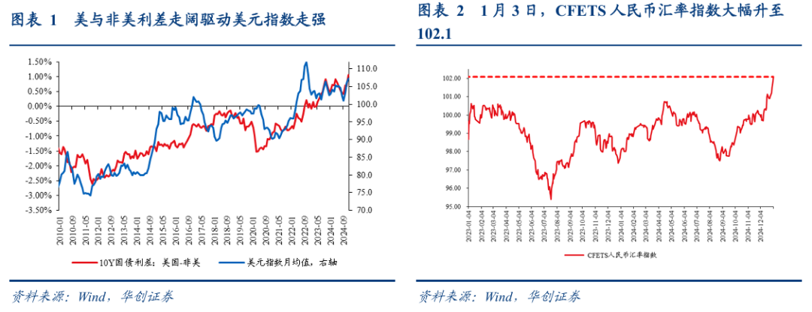
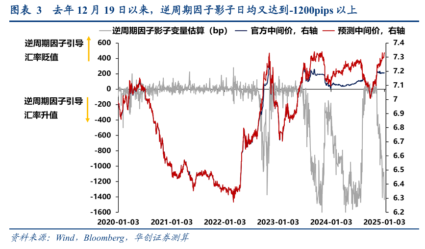
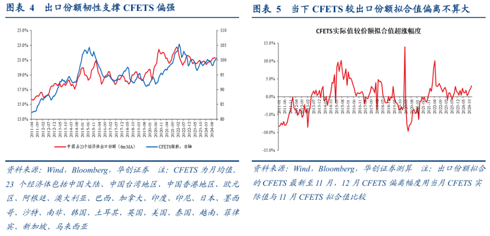
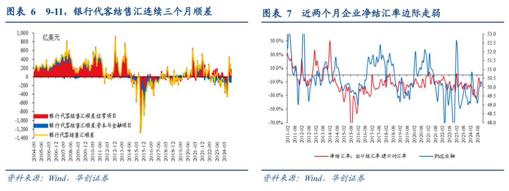
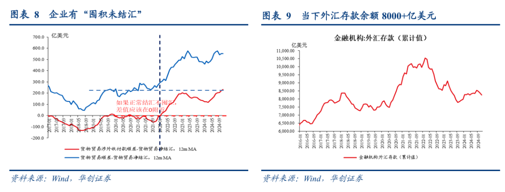
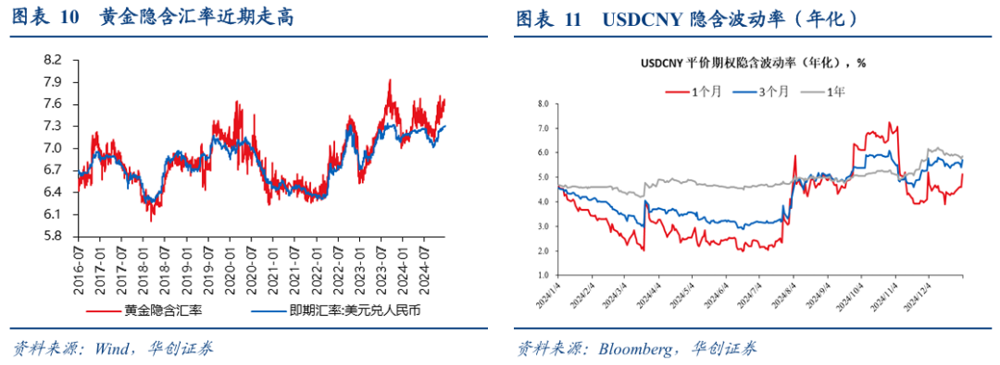
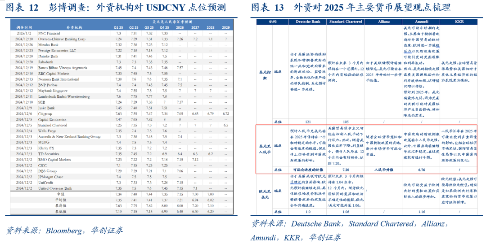

# 华创张瑜：人民币汇率弹性释放不是坏事

- 页面显示时间：2025-01-04T17:14:40+08:00
- 页面署名：潘凌飞
- 标注来源：华创证券张瑜
- 原文：[华尔街见闻](https://wallstreetcn.com/articles/3738385)
- 取得时间：2026-11-04T16:03:24+08:00
- [HTML阅读版](article.html) · [来源记录](metadata.json)

## 导语

1月3日，在岸人民币盘中一度跌破7.3。张瑜认为，这或是央行顺势而为，当前人民币弹性释放不是坏事，其对于后续稳增长政策空间至关重要，而且或可一定程度削弱我们应对外部贸易限制政策的被动性

---

## 事项

1月3日，在岸即期汇率在连续10个交易日收于7.299后盘中突破7.3，收于7.309。对此，我们理解如下：

## 核心观点

去年12月19日以来，即期汇率波动明显收窄，基本横盘稳定在7.299，1月3日上方波动弹性有所放大，本文主要是回答为何呈现此种汇率走势，为什么是现在这个时点弹性放大，以及如何理解汇率弹性放大的影响。

1、为什么汇率波动加大？美元指数冲破109，非美普遍走弱，人民币随市波动。

2、汇率弹性释放后波动空间？综合汇率定价偏离度、汇率供需基本面、市场贬值预期多维度来看，波动空间或可控。短期来看主要观察市场预期，7.5-7.6附近或是关键点位。

3、为什么是当下时点释放弹性？主要或是顺势而为，美元指数在美国偏强的基本面以及交易情绪助推下进一步冲高，主要非美货币均对美元贬值。

4、如何理解汇率弹性放大的影响？弹性释放不是坏事，其对于后续稳增长政策空间至关重要，而且或可一定程度削弱我们应对外部贸易限制政策的被动性。后续来看，短期而言，重点仍需关注政策态度和调控力度，如中间价7.20关键位置是否放开；中期而言，汇率走势仍然取决于关税对汇率的压制与内部稳增长对汇率支撑的相对节奏和强弱，波动或进一步放大。以2018年经验来看，中美进入实际贸易博弈中，我方通常不会主动将汇率工具化。

报告正文

1月3日，在岸即期汇率在连续10个交易日收于7.299后盘中突破7.3，收于7.309。对此，我们理解如下：

**一、汇率是自主贬值还是引导贬值？**

自主波动，非引导式贬值。

首先，从本轮汇率贬值背景来看：去年12月19日，美联储鹰派降息以来，利率优势驱动美元指数始终偏强震荡，人民币继而承压走弱。至于1月3日即期汇率的上行突破，从宏观基本面来看，主要触发因素或是前一夜欧元区PMI不及预期而美国PMI超预期，欧美基本面分化推动美元指数进一步走强，上行突破109，进一步加剧了人民币汇率的外部压力。

其次，从一篮子汇率来看，人民币对非美货币偏强，佐证其对美元贬值属于随行就市。1月3日，CFETS人民币汇率指数（按25个篮子货币对人民币中间价加权计算）大幅走升至102.08，较12月19日已累计上涨1.1%。人民币对一篮子货币偏强，意味着，美元指数走强背景下，人民币相对非美货币贬值幅度其实仍偏小。

最后，从逆周期因子影子来看，央行或仍着意维稳汇率、防范过度超调。华创宏观汇率模型测算，去年11月13日以来，伴随特朗普交易盛行，汇率波动加大，逆周期因子影子开始显著；去年12月19日以来，逆周期因子影子又达到平均-1200pips以上；1月3日高达-1431pips， **央行防范汇率过度超调的态度或仍明确。**

**二、汇率目前定价偏离大吗？**

市场自发驱动的汇率波动空间有多大，取决于汇率定价偏离程度、供需基本面、以及市场的贬值预期程度。

关于定价偏离程度，对于资本金融账户有限开放的人民币而言，决定其中长期定价中枢更关键的因素是经常账户，背后是出口竞争力，即中国出口份额，与CFETS关系密切。目前来看，由于出口仍偏强，CFETS指数实际值较我国出口份额拟合的CFETS指数偏差不大，仅略高约3.1%，2015年最高时曾至10%以上。

**三、汇率基本面如何？**

汇率供需基本面并未持续趋势性走弱。外汇市场供求关系主要关注一个指标——银行代客结售汇顺差，其等于贸易顺差×企业净结汇率。最近三个月（9-11月），银行代客结售汇持续保持顺差，其中经常账户顺差分别为446.5亿美元、278.4亿美元、169.3亿美元。背后主要受出口韧性支撑货物贸易顺差的影响。另一方面，客观而言，在PMI尚未确立趋势性上行走势的情况下，企业结汇意愿（净结汇率）有所波折，近两个月边际下滑。10-11月，净结汇率由-13.1%降至-17.0%，仍略好于2015-16年时期的-30%以上。

此外，出口企业层面或仍有“囤积未结汇盘”护体。2022年以来，企业通过出口赚取的顺差转化成结售汇顺差的比例有所降低（对应净结汇率的走低），即形成了所谓的“囤汇盘”，其规模或近5000亿美元（2022年1月-2024年11月，货物贸易项下，银行代客涉外收付款顺差与银行代客结售汇顺差之间的差额累计达5078亿美元）。此外，截至2024年11月，金融机构外汇存款余额约8259亿美元。

**四、市场贬值预期如何？**

市场的贬值预期是影响短期汇率波动空间的关键因素之一。目前来看，预期指标指向的汇率波动空间与幅度或相对可控。

指标一是衡量居民部门汇率预期的黄金隐含汇率，近期大体维持在7.6附近波动，比当前7.31的即期汇率高约4%。

指标二是利用期权隐含波动率计算未来即期汇率波动区间，区间上沿可能在7.6附近。隐含波动率反映市场对未来汇率波动率的预期，最新数据显示USDCNY未来3个月波动率（年化）预期约为6%，含义是期权市场定价未来3个月USDCNY波动的一倍标准差范围（概率约为68%）约为7.1-7.5，两倍标准差范围（概率约为95%）约为6.9-7.7，区间上沿是7.5-7.7。如果观察未来1年隐含波动率，当下为5.85%，意味着期权市场定价未来1年内USDCNY即期波动的一倍标准差范围为±5.85%（6.9-7.7）。

指标三是外资机构对USDCNY的预期（图12-13）。根据彭博调查，去年12月以来做出预测的28家外资机构对今年USDCNY汇率预期中值在7.35附近，年中二三季度可能达到7.4以上，仅1家机构认为汇率可能突破至8。结合我们此前[《追踪2025年外资的一致预期》](https://mp.weixin.qq.com/s?__biz=MzI3NTUyMDkzMw==&mid=2247591513&idx=1&sn=db9ee01b5ede358b7cecd29c4ec4e153&scene=21#wechat_redirect)中整理的5家外资机构展望报告中对USDCNY的观点（图13），有机构认为人民币可能会适度升值，意味着外资视角下人民币汇率波动空间或也相对可控。

**五、为什么汇率释放弹性是现在？**

主要或是顺势而为。其一，美元指数在美国偏强的基本面以及交易情绪助推下进一步冲高，主要非美货币均对美元贬值，人民币随势而为不显突兀。其二，近期出口或受“抢出口”支撑表现仍偏强，有望为汇率提供一定内部支撑，控制波幅过大的风险。其三，特朗普毕竟还未上台，关税战尚未实质落地，此时释放汇率弹性，一方面有助于控制波动过大风险，另一方面或也有利于规避美方所谓汇率操控的指责。

**六、如何理解当下的汇率弹性放大？**

汇率弹性的释放对后续稳增长政策空间至关重要，货币政策可以更加注重“以我为主”。同时，考虑到特朗普上台后国际贸易环境的不确定性，充分“发挥市场在汇率形成中的决定性作用”，或可一定程度削弱我们应对外部贸易限制政策被动性。

后续来看，短期而言，重点仍需关注政策态度和调控力度，从央行货币政策委员会四季度例会内容来看，“增强外汇市场韧性，稳定市场预期，加强市场管理，坚决对扰乱市场秩序行为进行处置，坚决防止形成单边一致性预期并自我实现，坚决防范汇率超调风险，保持人民币汇率在合理均衡水平上的基本稳定”\[1\]，波动弹性的放大或是渐近有序的，关注中间价7.20关键位置是否放开。中期而言，汇率走势仍然取决于关税对汇率的压制与内部稳增长对汇率支撑的相对节奏和强弱，波动或进一步放大。以2018年经验来看，中美进入实际贸易博弈中，我方通常不会主动将汇率工具化。

\[1\] <https://mp.weixin.qq.com/s/od5n7lFZ9MYmEODNBxEkvg>

本文作者：张瑜（S0360518090001），来源：[一瑜中的](http://mp.weixin.qq.com/s?__biz=MzI3NTUyMDkzMw==&mid=2247591713&idx=1&sn=a17f8de1272919b01582bf12e9729da2&chksm=ea185a78315f53c020dc019676af93e1c9a73c84ef9024631f58afe5ef06b417a93a1f02704b&scene=0&xtrack=1) (ID:gh_e9aae5acb49f)，华尔街见闻专栏作者，原文标题：《汇率弹性释放不是坏事——1月3日汇率波动速评》

风险提示及免责条款

市场有风险，投资需谨慎。本文不构成个人投资建议，也未考虑到个别用户特殊的投资目标、财务状况或需要。用户应考虑本文中的任何意见、观点或结论是否符合其特定状况。据此投资，责任自负。
