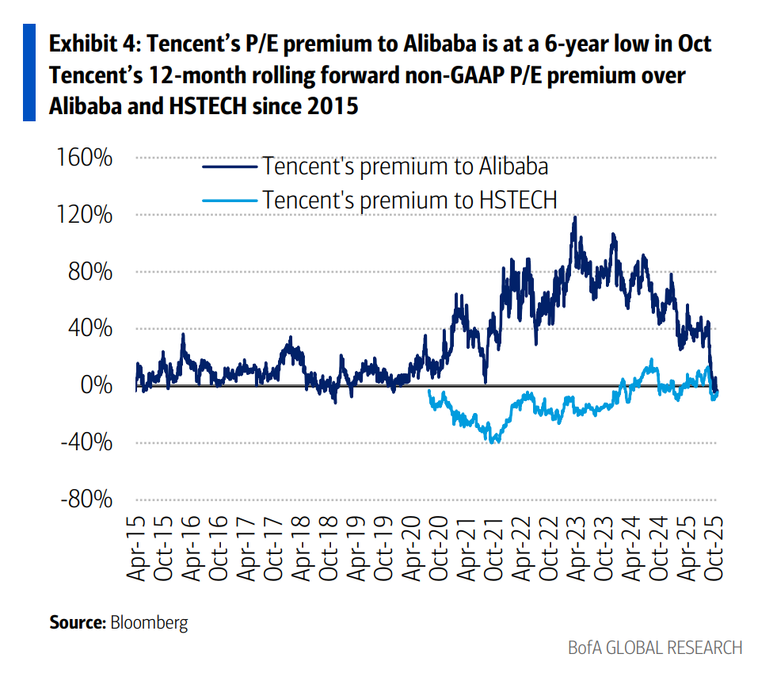
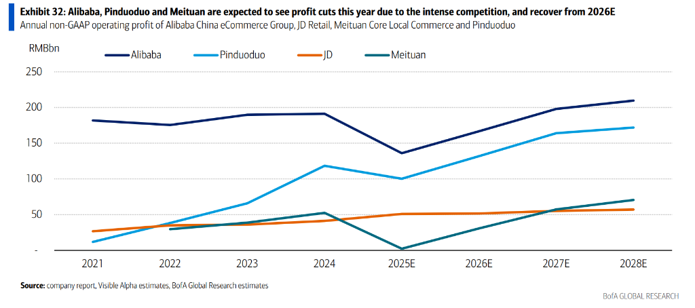
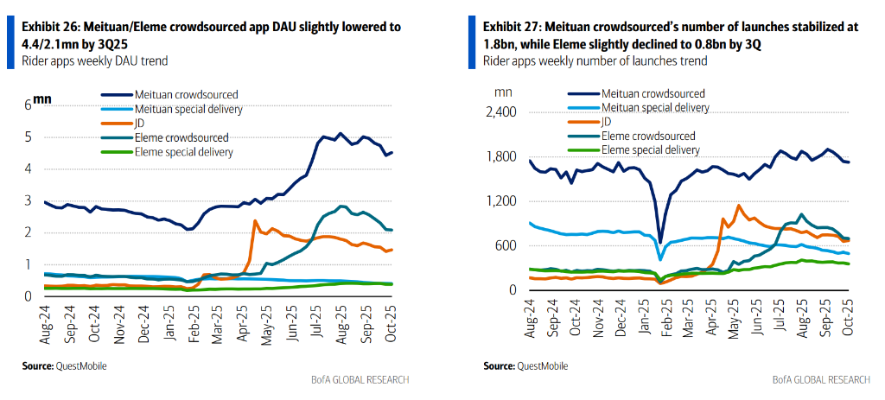
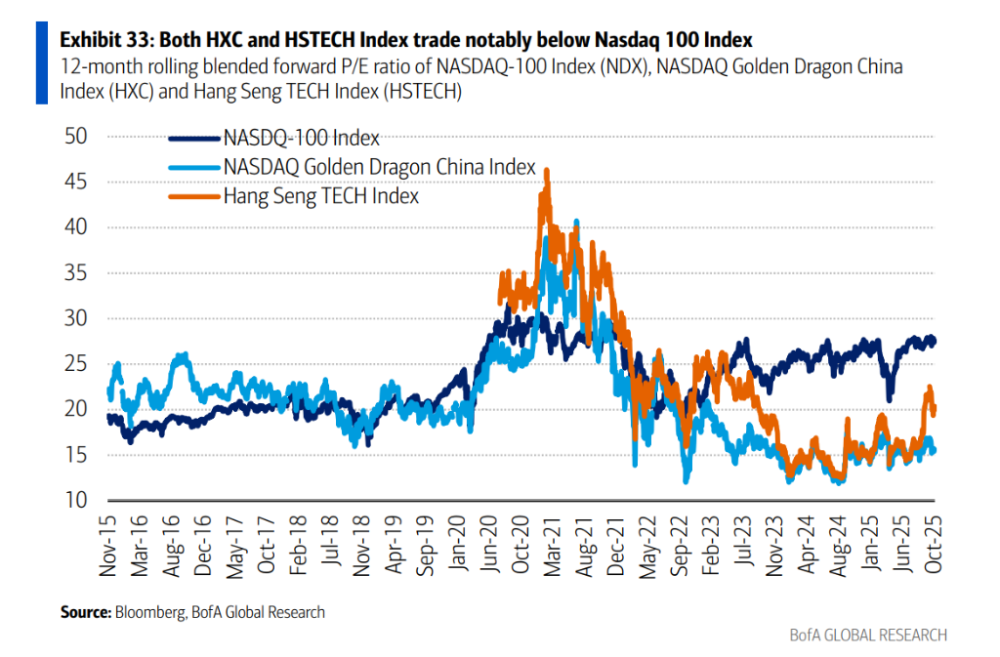
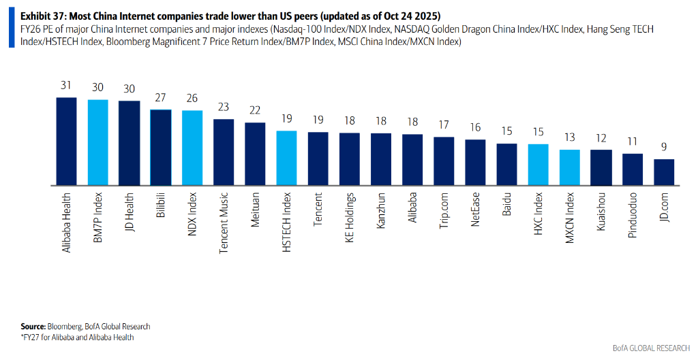

# 华尔街看中国互联网：存在"独特的投资机会"，拥抱AI和游戏，回避电商

- 页面显示时间：2025-10-29T15:09:35+08:00
- 页面署名：许超
- 标注来源：未单列，见正文
- 原文：[华尔街见闻](https://wallstreetcn.com/articles/3758157)
- 取得时间：2026-11-04T16:04:07+08:00
- [HTML阅读版](article.html) · [来源记录](metadata.json)

## 导语

美银美林认为，中国互联网巨头在AI应用和商业化方面处在“最佳位置”。尽管年初至今已上涨超50%，板块的估值仍处在“不苛刻的水平”。分析师强烈建议拥抱AI应用、在线游戏领域，同时对电商平台保持谨慎，特别是受即时零售（快商务）竞争冲击的公司，腾讯目前是板块首选。

---

美银美林认为，尽管年初至今已上涨超50%，但中国互联网板块依然是“必持”资产，在AI和游戏领域呈现出独特的投资机会。

据追风交易台消息，美银美林在10月28日的报告中表示，中国互联网公司在AI领域的路径与众不同，更侧重于效率、实际用例和生态系统实力。当前中国互联网板块的估值仍处在“不苛刻的水平”，其远期市盈率仅为17倍。随着监管尾部风险的降低，选择正确的赛道将成为获取回报的关键。

细分赛道方面，分析师强烈建议拥抱AI应用、在线游戏领域，同时对电商平台保持谨慎，特别是受即时零售（快商务）竞争冲击的公司。

## 新赛道：AI应用与游戏价值凸显

美银美林认为，中国互联网巨头在AI应用和商业化方面处在“最佳位置”。 **这主要得益于：能够实现直接转化的闭环生态系统、在移动互联网时代得到验证的商业化专长、海量用户数据以及更低的token成本四大优势。**

在美银分析师看来，腾讯目前是板块首选：公司完美结合了AI驱动的增长、稳定的竞争格局、顶级的股东回报以及富有吸引力的估值。

美银赞赏腾讯"选择性战斗"的策略——不过度在云基础设施规模上消耗现金流，而是强调AI应用开发和产品用户契合度，同时在基础AI模型研发上保持紧密跟随者地位。

估值方面， **腾讯相对于阿里巴巴的市盈率估值溢价已接近六年来的低点，接近于2018-2019年游戏行业严管时期。**

在AI与云业务领域，报告更看好阿里巴巴。

分析师认为，凭借其在云市场的最高份额和全栈式AI/云产品，阿里巴巴是“投资中国AI”主题的最佳代表，云收入的加速增长有望支撑市场情绪。

**数字娱乐方面，报告明确表示偏爱在线游戏，行业经典游戏生命力持久、竞争格局稳定且估值合理。在** 这一领域，腾讯因新游戏模式带来的短期收入增长前景而优于网易；哔哩哔哩则因其在娱乐板块中最快的2026年每股收益（EPS）增长预期而受到青睐。

## 旧战场：电商“持久战”侵蚀盈利

与对AI和游戏领域的乐观态度形成鲜明对比，美银美林对交易平台（即电商和本地服务）普遍持谨慎立场。 **报告将“即时零售”领域的竞争形容为一场“持久战，而非闪电战”，并预计这场战争将持续至2026年，从而拉低整个行业的利润率。**

数据显示，由于竞争加剧，电商板块的总运营利润增速已从2025年第一季度的同比增长2%急剧减速至第二季度的同比下降23%。自2025年6月以来，多数交易平台的12个月滚动EPS预测均被下调，其中美团的下调幅度最为显著。

基于对竞争格局的判断，报告将美团的评级从“买入”下调至“中性”。 **分析师指出，美团2026年的盈利能见度很低，存在高不确定性。他们对2026年该行业盈利的看法比市场普遍预期更为悲观。**

尽管如此，在交易平台中，分析师相对更看好阿里巴巴。核心理由包括：（1）云收入有望持续加速；（2）在即时零售领域已成为主要的份额增长者；（3）传统电商业务势头改善。

## 估值折让仍然显著

报告强调，尽管面临挑战，中国互联网板块的整体估值折扣依然显著。

纳斯达克金龙中国指数目前交易于16倍远期12个月市盈率，恒生科技指数为20倍，而纳斯达克100指数为28倍，"科技七巨头"指数为33倍。

历史对比来看，纳斯达克金龙中国指数曾在2023年初之前与纳斯达克100指数以相似估值交易，甚至在2021年交易于溢价水平。中国互联网股票相对MSCI中国指数的估值溢价目前仅为20%，而过去10年为40-80%，尽管该板块是AI驱动生产力提升的主要受益者。

这一深度折让为长期投资者提供了独特的进入机会，特别是在AI应用和游戏等高确定性增长领域。

 

 

 

 

\~\~\~\~\~\~\~\~\~\~\~\~\~\~\~\~\~\~\~\~\~\~\~~

以上精彩内容来自[追风交易台](https://mp.weixin.qq.com/s/uua05g5qk-N2J7h91pyqxQ)。

更详细的解读，包括实时解读、一线研究等内容，请加入【 [**追风交易台▪年度会员**](https://wallstreetcn.com/shop/item/1000309) 】

风险提示及免责条款

市场有风险，投资需谨慎。本文不构成个人投资建议，也未考虑到个别用户特殊的投资目标、财务状况或需要。用户应考虑本文中的任何意见、观点或结论是否符合其特定状况。据此投资，责任自负。
