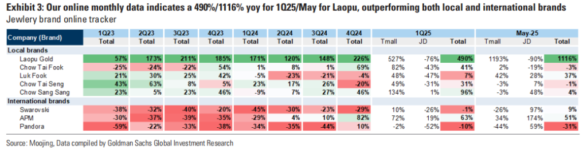
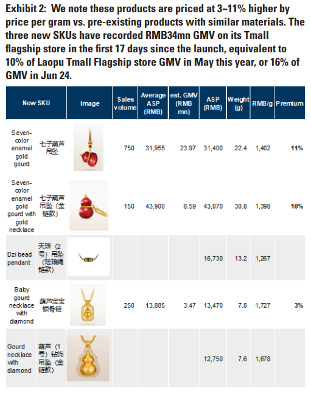
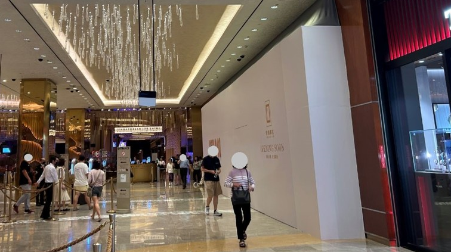

# 华尔街紧盯“老铺黄金”：高盛关注“6.27解禁”，大摩聚焦“海外首家门店”

- 页面显示时间：2025-06-19T10:11:03+08:00
- 页面署名：鲍奕龙
- 标注来源：未单列，见正文
- 原文：[华尔街见闻](https://wallstreetcn.com/articles/3749419)
- 取得时间：2026-11-04T16:04:05+08:00
- [HTML阅读版](article.html) · [来源记录](metadata.json)

## 导语

高盛激进看多老铺黄金，将老铺黄金12个月目标价从976港元大幅上调至1090港元，维持买入评级。摩根士丹利则谨慎给予中性评级，目标价865港元，其认为6月20日至30日期间开业的新加坡门店，将直接影响市场对老铺黄金海外扩张能力的信心。

---

华尔街两大投行紧盯老铺黄金—— **高盛重点关注6月27日老铺黄金股份解禁后的建仓良机，摩根士丹利则聚焦新加坡首家海外门店的战略意义** 。

6月17日，据追风交易台消息，高盛和摩根士丹利两大投行相继发布关于老铺黄金的研报。其中， **高盛激进看多，将老铺黄金12个月目标价从976港元大幅上调至1,090港元，维持买入评级。** 高盛特别强调三个即将到来的催化剂：

> - 首先是6月27日约40%股份解禁后的潜在回调将提供建仓良机；
> - 其次是同期公司将在新加坡开设首家海外门店；
> - 第三是7月底有望发布的上半年盈利预警，预计净利润同比增长约260%。

**摩根士丹利则谨慎给予中性评级，目标价865港元，其认为老铺黄金位于新加坡滨海湾金沙购物中心的门店，将直接影响市场对老铺黄金海外扩张能力的信心** 。新加坡门店将于6月20日至30日期间开业，摩根士丹利建议投资者重点关注新加坡门店的三个方面：

> - 产品组合应与大中华区保持相似；
> - 定价策略相对于香港和中国大陆市场的差异；
> - 当地居民和非中国游客的需求表现。

## 高盛：基本面强劲超预期，解禁回调或成“黄金坑”

高盛对老铺黄金的信心源于其持续超预期的经营数据。

该行将2025-27年的净利润预期上调了15-26%，并将12个月目标价从976港元上调至1,090港元，维持“买入”评级。这背后是三大核心驱动力：

> - **业绩增长势头惊人** ：根据高盛的渠道调研，即便在金价波动和高基数背景下，老铺黄金4-5月的同店销售增长率（SSSG）依然保持了三位数的强劲增长。线上渠道更是爆发式增长，今年1-5月的总GMV（商品交易总额）已达16亿元人民币，同比激增511%。门店扩张速度也已超越了公司此前给出的6-8家年度指引。
>
> 
>
> - **品牌溢价能力凸显** ：5月30日推出的新品“七子葫芦”系列取得了显著成功。该系列在设计上弱化了黄金的传统外观，但其每克定价却比同类工艺产品高出3-11%。新品推出仅17天，就在天猫旗舰店创造了3,400万元人民币的GMV。更关键的是，其二手市场价值保持在原价的90%以上，远高于行业平均的85%，有力证明了品牌强大的溢价能力。
>
> 
>
> - **多重催化剂蓄势待发** ：高盛为投资者列出了一系列即将到来的积极催化剂。除了6月底新加坡门店开业，公司预计在7月底发布上半年盈利预警，净利润同比增长预计高达约260%。此外，上海国金中心（IFC）等顶级购物中心的新店也将陆续开业。因此，高盛认为，6月27日约40%股份解禁可能带来的短期股价波动，恰恰为看好公司长期价值的投资者创造了逢低买入的战略性机遇。

## 摩根士丹利：谨慎观察海外扩张效果

与高盛聚焦于现有业务的强劲增长不同，摩根士丹利将目光投向了海外扩张。该行给予中性评级， **核心逻辑是，老铺黄金的海外故事能否讲通，关键就在于首家新加坡门店的表现** 。

> - **战略选址与市场潜力** ：根据大摩的实地调研，这家新店位于新加坡滨海湾金沙购物中心的赌场入口处，是顶级客流的必经之地。该购物中心的租户销售额数据（每平方英尺2900美元）比澳门威尼斯人高出约15%，为新店取得优异表现提供了数据支撑。管理层也预期该店将成为网络中坪效最高的门店之一。
>
> 
>
> - **海外扩张的关键测试** ：这家门店的战略意义远超其单店的财务贡献。它被视为捕捉高端中国游客需求的桥头堡。如果能成功打开市场，将极大提振投资者对公司在整个东南亚市场扩张潜力的信心。反之，若表现不及预期，则可能引发市场对其海外增长故事的质疑。

摩根士丹利建议投资者密切关注该店开业后的三个方面。 **产品组合是否与大中华区保持一致。定价策略与中国内地及香港市场相比是否存在差异。客户构成中本地居民和非中国游客的需求占比，这将反映品牌在非华人文化圈的吸引力。**

总结而言，高盛的乐观建立在扎实且超预期的现有业务数据之上，而摩根士丹利的审慎则源于对未来新增长曲线（海外市场）不确定性的关注。

风险提示及免责条款

市场有风险，投资需谨慎。本文不构成个人投资建议，也未考虑到个别用户特殊的投资目标、财务状况或需要。用户应考虑本文中的任何意见、观点或结论是否符合其特定状况。据此投资，责任自负。
