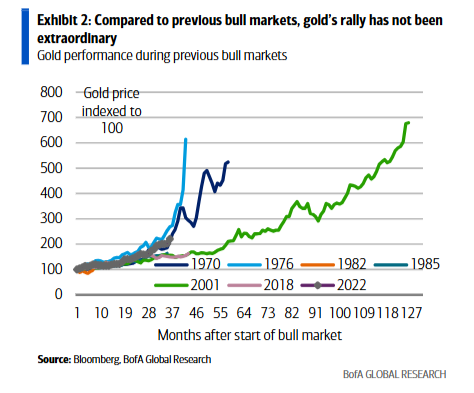
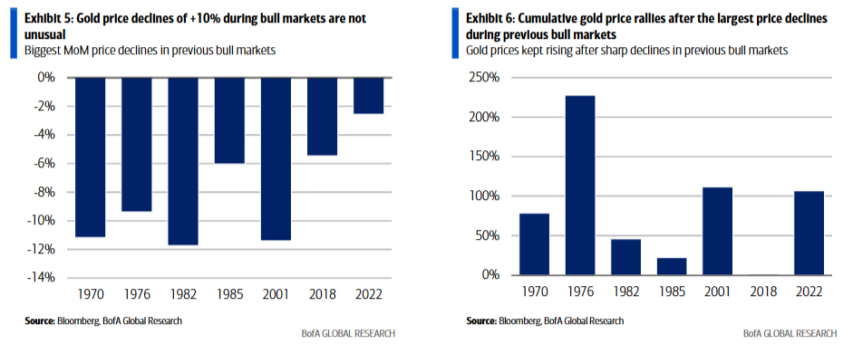

# 历史上的黄金牛市：10%的回调并不稀奇，但牛市是如何终结的？

- 页面显示时间：2025-10-29T12:17:59+08:00
- 页面署名：鲍奕龙
- 标注来源：未单列，见正文
- 原文：[华尔街见闻](https://wallstreetcn.com/articles/3758143)
- 取得时间：2026-11-04T16:03:31+08:00
- [HTML阅读版](article.html) · [来源记录](metadata.json)

## 导语

美银指出，自1970年以来的历次黄金大牛市中，超过10%的月度回调并不少见。在这些回调之后，金价往往会重拾升势，继续走高。而历次黄金牛市的终结，并非因为技术性超买或短期震荡，而是其背后的核心驱动因素发生了根本性改变。

---

本周黄金一度累跌超5%，美银认为黄金在大幅上涨后出现修正很正常，月度超过10%的回调在以往牛市中同样常见。

追风交易台消息，10月28日，美银证券发表研报指出，自1970年以来的历次黄金大牛市中，超过10%的月度回调并不少见。在这些回调之后，金价往往会重拾升势，继续走高。

（黄金历次牛市的走势）

**黄金牛市的真正终结，并非因为技术性超买或短期震荡，而是其背后的核心驱动因素发生了根本性改变。例如，从滞胀转向激进加息，或从非常规经济政策回归传统。**

研报强调，当前的回调可能为尚未充分配置黄金的投资者提供了机会。只要驱动本轮牛市的宏观因素没有改变，黄金的长期上涨趋势就依然稳固。

## 回调超10%？黄金牛市的“家常便饭”

美银表示牛市的道路从来都不是一帆风顺的。

近期金价在创下一系列历史新高后出现了回调，市场情绪也随之紧张。然而，将本轮行情置于历史长河中审视，会发现这远非异常现象。

报告中的数据显示，回顾自1970年以来的六次主要黄金牛市（分别始于1970年、1976年、1982年、1985年、2001年和2018年），期间发生超过10%的月度价格下跌并不罕见。

（左图：牛市期间金价下跌10%的情况并不少见；右图：金价牛市中的调整后迎来连续上涨行情）

**例如，在1976年开启的牛市中，曾出现过接近12%的单月最大跌幅。**

然而，对于投资者而言，更关键的信息是： **这些剧烈的回调，没有一次真正终结牛市的步伐** 。

这表明，在宏观驱动力未变的情况下， **技术性的回调往往是牛市中健康的一部分，是市场清洗过度杠杆、巩固上涨基础的正常过程** 。

**而数据显示，在这些大幅回调之后，金价都继续推高，累计涨幅在50%至200%不等。**

因此，对于长期投资者来说，此类波动不应成为恐慌性抛售的理由。

美银表示此前在其黄金价格预测中，研究团队已预见到修正的可能，并 **预计金价将在明年推高至5000美元/盎司。**

## 历史牛市如何终结，驱动因素改变才是关键

如果说回调不足为惧，那么投资者真正需要警惕的信号是什么？报告认为是宏观基本面的根本性转变。

黄金价格的上涨并非无源之水，每一次牛市都有其独特的宏观驱动力，而 **牛市的终结，无一例外地发生在这些核心驱动力消退或逆转之时。**

报告详细梳理了历次黄金牛市的“终结者”：

> - **1970年牛市（石油危机驱动）** ：随着地缘政治趋于稳定，通胀担忧缓解，牛市动力减弱。
> - **1976年牛市（滞胀驱动）** ：时任美联储主席沃尔克采取了激进的加息政策以对抗通胀，高利率环境终结了黄金的吸引力。
> - **1982年牛市（反弹交易）** ：始于沃尔克加息后金价暴跌后的“反弹交易”，叠加当时美国经济衰退（1981-1982年）的背景。但这轮牛市的结束相对简单，因为价格反弹行情本身已经走到了尽头。
> - **2001年牛市（量化宽松QE驱动）** ：当美联储宣布第三轮量化宽松时，市场认为利率已无进一步下降空间，宽松预期的边际效应递减，牛市随之停滞。
> - **2018年牛市（新冠疫情驱动）** ：随着后疫情时代全球经济重新开放，大规模货币宽松政策逐渐退出，避险需求下降。

因此报告指出， **本轮自2022年开启的牛市，其核心驱动力源于“非常规的经济政策”，具体包括美国拜登及特朗普政府期间高企的财政赤字、不断增长的债务路径，以及市场对政府偿债能力的担忧** 。

美银强调 **只要美国未能“回归更正统的经济政策和传统的保守财政政策”，或者美联储未能“重新转向鹰派立场”，那么支撑黄金价格的宏观基石就依然稳固。**

分析指出在此背景下，任何短期的价格回调，都更有可能是一个战略性的买入机会，而非趋势反转的信号。

\~\~\~\~\~\~\~\~\~\~\~\~\~\~\~\~\~\~\~\~\~\~\~~

以上精彩内容来自[追风交易台](https://mp.weixin.qq.com/s/uua05g5qk-N2J7h91pyqxQ)。

更详细的解读，包括实时解读、一线研究等内容，请加入【 [**追风交易台▪年度会员**](https://wallstreetcn.com/shop/item/1000309) 】

风险提示及免责条款

市场有风险，投资需谨慎。本文不构成个人投资建议，也未考虑到个别用户特殊的投资目标、财务状况或需要。用户应考虑本文中的任何意见、观点或结论是否符合其特定状况。据此投资，责任自负。
