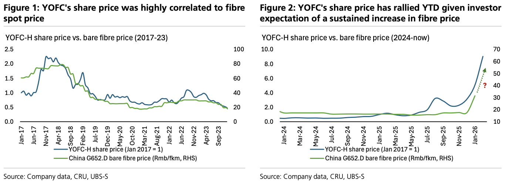

# 历史总是惊人相似：光纤大周期能否延续，产能扩张是最大隐忧

- 页面显示时间：2026-03-10T21:14:47+08:00
- 页面署名：杨宸
- 标注来源：未单列，见正文
- 原文：[华尔街见闻](https://wallstreetcn.com/articles/3767163)
- 取得时间：2026-11-04T16:04:01+08:00
- [HTML阅读版](article.html) · [来源记录](metadata.json)

## 导语

目前光纤需求回暖驱动价格上涨。瑞银认为，2017年行业曾经历相似情景，行业在需求提升驱动价格上涨后大幅扩产，但最终需求落地节奏不及预期，产能却如期投放，导致光纤和相关公司股价大跌。本轮周期能否走出不同的结局，很大程度上取决于供给端的自律程度。

---

光纤行业正站在一个似曾相识的十字路口。需求回暖驱动价格上涨，股价随之大幅反弹，与2017至2018年那轮上行周期的开局如出一辙。

然而，历史也清晰地记录了彼时繁荣如何在产能过剩的重压下戛然而止。 **本轮周期能否走出不同的结局，很大程度上取决于供给端的自律程度。**

据追风交易台，瑞银（UBS）最新研究报告显示，长飞光纤股价今年以来持续攀升，与光纤现货价格的上涨趋势高度吻合。

本轮价格回升始于2025年下半年， **核心驱动力来自数据通信需求激增带来的供给收紧、海外电信需求复苏，以及光纤无人机带来的增量需求。**

瑞银分析师Jasmine Huang在3月9日发布的报告中维持对长飞光纤的"中性"评级，12个月目标价为人民币140元。

这一审慎立场背后，是对产能扩张风险的持续警惕——尽管目前尚未看到重大扩产公告，但这一风险仍是悬在行业头顶的达摩克利斯之剑。

## **历史镜鉴：上一轮周期的兴衰**

回顾2017至2018年的上行周期，彼时推动光纤价格持续走高的核心动力是大规模4G网络建设与光纤到户（FTTH）部署，供给端相对偏紧，价格与长飞光纤股价同步攀升。

转折点出现在2017年中前后。 **彼时行业集中发布了大量扩产计划，但由于需求增长强劲，投资者对潜在供给过剩的担忧有限。**

然而， **5G需求随后的落地节奏远低于预期，而大规模产能在2018年底前基本如期投放，供需格局急剧逆转，光纤价格随之大幅下跌，长飞光纤股价亦同步重挫。**

这段历史清晰揭示了一个规律： **长飞光纤股价与光纤现货价格存在高度相关性，而价格走势的核心驱动变量，始终是供需动态的相对变化。**

## **本轮回升：需求驱动与供给约束并存**

与上一轮周期相比，本轮价格修复具有 **不同的结构性特征** 。

在需求侧， **增量来源更为多元** ——数据通信需求激增是主要引擎，海外电信需求温和复苏提供支撑，光纤无人机则构成新兴增量。

在供给侧，经历多年下行周期后，行业整体产能保持基本平稳， **部分情况下甚至有所收缩** 。瑞银预测：

> 长飞光纤营收将从2024年的约121.97亿元大幅增长至2025年的约140.87亿元，并在2026年进一步跃升至约178亿元。
>
> EBIT利润率预计从2024年的7.6%提升至2025年的10.1%，并在2026年达到12.7%。
>
> 净利润方面，预计从2024年的6.76亿元恢复至2025年的9.36亿元，2026年进一步增至约15.8亿元。

## **最大变量：产能扩张的节奏与时机**

瑞银报告明确指出，本轮价格上涨能否持续， **关键取决于产能扩张的速度与规模。** 若供给端维持自律，光纤价格有望在健康区间运行；反之， **激进的扩产行为则可能触发新一轮供给过剩周期** ，复制2018至2019年的历史。

目前，瑞银渠道调研尚未发现重大扩产公告，认为当前风险尚在可控范围之内。同时， **上一轮周期的惨烈教训使光纤厂商普遍趋于谨慎，倾向于在需求可持续性获得更充分验证之前，推迟大规模资本投入的决策。**

然而，瑞银亦强调， **激进产能扩张仍是需要持续动态跟踪的关键下行风险之一。**

## **投资者分歧：基本面共识已形成，但弹性预期仍存争议**

自2025年第四季度以来，市场对光纤板块的关注度明显升温。据瑞银观察，投资者对供需格局改善及行业触底转折的整体判断分歧不大，但争论焦点集中在两个层面：

**其一，光纤价格上涨能带来多大幅度的盈利弹性；其二，激进产能扩张是否会引发新一轮过剩周期。**

买方的盈利预期目前尚未形成清晰共识——瑞银预测2026年每股收益为1.91元人民币，市场一致预期为2.10元；2027年瑞银预测为3.04元，市场一致预期为2.92元。

伴随近期价格上涨，各机构盈利预测普遍上调，对估值形成一定支撑，但股价在当前阶段仍面临较高波动性，市场情绪的影响不容低估。

风险提示及免责条款

市场有风险，投资需谨慎。本文不构成个人投资建议，也未考虑到个别用户特殊的投资目标、财务状况或需要。用户应考虑本文中的任何意见、观点或结论是否符合其特定状况。据此投资，责任自负。
