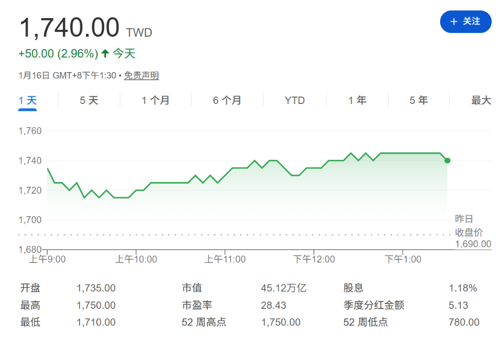

# 台积电新“黄金周期”来了？高盛：先进封装成第二增长引擎，60%毛利率或是“新常态”

- 页面显示时间：2026-01-16T15:25:43+08:00
- 页面署名：张雅琦
- 标注来源：未单列，见正文
- 原文：[华尔街见闻](https://wallstreetcn.com/articles/3763455)
- 取得时间：2026-11-04T16:04:00+08:00
- [HTML阅读版](article.html) · [来源记录](metadata.json)

## 导语

高盛认为，台积电已开启AI驱动的多年增长周期，并将目标价调升至2600元新台币。台积电上修AI与整体营收复合增长率，先进封装成为第二增长引擎，预计2026年占比突破10%。毛利率稳定在60%以上，资本开支加速上行至560亿美元。高盛维持买入评级，强调供需紧张将延续至2027年。

---

据追风交易台消息，高盛Bruce Lu团队15日发布台积电最新研报，大幅上调未来增长预期与盈利能力目标，认为该公司正在进入AI驱动的新一轮多年增长周期。高盛将12个月目标价从新台币2330元上调至2600元，维持买入评级及亚太信心名单地位。

台积电在1月15日召开的[4季度分析师会议](https://wallstreetcn.com/articles/3763360?keyword=%E5%8F%B0%E7%A7%AF%E7%94%B5)上提供了超预期的业务展望。公司将AI加速器相关营收的五年复合增长率（2024-2029年）从此前的mid-40%上调至mid-to-high 50%，同时将整体营收五年复合增长率目标从20%提升至接近25%。管理层表示，AI驱动的供需失衡仍未解决，先进制程产能持续紧张，高盛预计这一供需缺口将持续至2027年。

盈利能力方面，台积电将长期毛利率目标从"53%及以上"上调至"56%及以上"，4季度实际毛利率达62.3%，超出市场预期。尽管海外产能爬坡预计在2026年带来2-3个百分点的毛利率稀释，但生产效率提升将直接贡献利润。高盛预计2026/27年毛利率将分别达到63.2%/64.0%，远高于2025年的59.9%。

此外，先进封装正在成为台积电的第二增长引擎。管理层指引该业务2025年营收占比达8%，2026年将升至略高于10%，未来五年增速有望超越公司整体增长率。受此推动，高盛将2026-27年每股收益预测上调11-12%。

## AI需求驱动新增长周期

台积电大幅提升了AI业务的长期增长预期。 **管理层目前预计AI加速器相关营收在2024-2029年间将以mid-to-high 50%的复合增长率增长，较此前的mid-40%显著提升。** 这一调整带动公司整体营收五年复合增长率目标从20%上调至接近25%（以美元计）。

管理层强调了这一增长趋势的可持续性。云服务提供商正从AI投资中获得实际的财务回报，且财务状况保持稳健。 **高盛继续将AI视为台积电的多年增长引擎，预计供需失衡将持续至2027年，因为token消费的指数级增长将使芯片需求持续超过供应，而当前资本周期带来的新产能要到2028/2029年才会投产。**

高盛预计N3/N5制程的产能利用率将在强劲AI需求和持续生产效率提升的推动下保持紧张。该机构目前预测台积电营收（以美元计）在2026/2027年将分别增长34.5%/27.4%，较此前预期的30.4%/28.0%进一步上调。

## 资本开支进入新上行周期

台积电公布的2026年资本开支指引超出市场预期，成为另一关键看点。公司指引2026年资本开支为520-560亿美元，显著高于2025年的400亿美元，也超过高盛此前预期的460亿美元和市场普遍预期的约500亿美元。

**高盛将这一超预期指引归因于部分设备投资从2027年提前至2026年，以及基础设施建设支出的增加。** 管理层还表示，未来三年的资本开支将显著高于过去三年的1010亿美元，反映N2制程更高的资本密集度和持续强劲的客户需求。

基于上调的长期AI增长轨迹，高盛将2026/2027年资本开支预测上调至560亿/650亿美元（此前为460亿/540亿美元），分别同比增长37%/16%。

## 毛利率突破60%成为新常态

台积电的盈利能力达到历史新高。4季度毛利率达62.3%，环比上升280个基点，同比上升330个基点，超过高盛和彭博一致预期的60.7%/60.6%。1季度毛利率指引进一步升至63-65%，远高于高盛和市场预期的59.6%。

这一强劲表现得益于超预期的制造改善和生产效率提升。管理层将长期毛利率目标从"53%及以上"上调至"56%及以上"。 **高盛预计，即使在高成本环境下，60%以上的毛利率水平也将成为新常态。**

尽管N2制程计划在2026年下半年开始快速爬坡，管理层预计将对全年毛利率带来2-3个百分点的稀释，但海外工厂的毛利率稀释程度低于预期，制造生产效率的持续改善将直接贡献利润。高盛目前预测2026/2027年毛利率将达到63.2%/64.0%，较此前预期的60.4%/60.6%大幅上调，其中下半年毛利率将因N2稀释而略低。

## 先进封装成第二增长引擎

先进封装正在演变为台积电的另一增长引擎。管理层指引先进封装业务2025年营收占比预计达到8%，2026年将升至略高于10%，同时预计该业务未来五年的增长率将超过公司整体平均水平。

**高盛微调了CoWoS出货量预测，预计2026/2027年分别达到119.7万/217.1万片晶圆（此前为118.5万/219.5万片），分别同比增长90%/81%，产能预测维持在127.5万/231万片晶圆不变。** 该机构预计CoWoS营收在2026/2027年将分别同比增长102.5%/81.2%，营收占比升至11.7%/16.7%。

台积电维持2026年资本开支的10-20%用于先进封装、测试、光罩制作等领域的配置，而总资本开支预计2026年同比增长37%。高盛认为，半导体设备供应商将充分受益于CoWoS及更广泛先进封装技术的加速扩产。

## 业绩强劲推动估值上调

台积电4季度业绩全面超预期。营收10460.9亿新台币（337.3亿美元），环比增长5.7%，同比增长20.5%，超过公司指引和市场预期。每股收益19.50新台币，环比增长11.8%，同比增长35.0%，超出高盛和市场预期。毛利率62.3%和营业利润率54.0%均好于预期。

对于1季度，管理层指引营收346-358亿美元（基于新台币兑美元汇率31.6），环比增长4%，毛利率63-65%，营业利润率54-56%。营收指引强于高盛预期的1.8%环比增长，毛利率指引显著高于预期的59.6%，主要受益于更高的产能利用率和持续的成本效率提升。

基于业绩上调，高盛将2025/2026/2027年每股收益预测分别上调2.4%/10.8%/11.6%，12个月目标价从2330新台币上调至2600新台币，基于22倍2027年预期市盈率（维持不变）。对于ADR，目标价从466美元上调至520美元。高盛维持买入评级，目标价较当前股价有54%的上行空间。

高盛强调，台积电稳固的技术领先地位和执行能力使其相比同业更有能力把握行业长期结构性增长机遇，特别是在AI领域。该机构认为，公司实现未来数年25%营收复合增长率目标的前景明确，主要由芯片内容增长和AI/HPC需求驱动，长期毛利率将保持在56%以上水平。

截至发稿，台积电股价上涨2.96%至1740新台币。

 

\~\~\~\~\~\~\~\~\~\~\~\~\~\~\~\~\~\~\~\~\~\~\~~

以上精彩内容来自[追风交易台](https://mp.weixin.qq.com/s/uua05g5qk-N2J7h91pyqxQ)。

更详细的解读，包括实时解读、一线研究等内容，请加入【 [**追风交易台▪年度会员**](https://wallstreetcn.com/shop/item/1000309) 】

风险提示及免责条款

市场有风险，投资需谨慎。本文不构成个人投资建议，也未考虑到个别用户特殊的投资目标、财务状况或需要。用户应考虑本文中的任何意见、观点或结论是否符合其特定状况。据此投资，责任自负。
