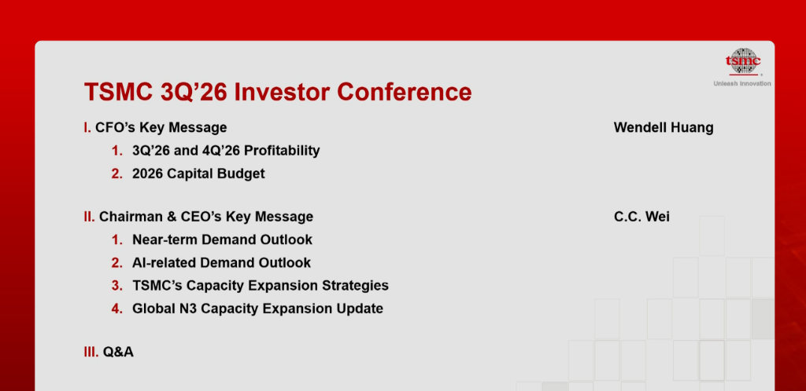

# 台积电法说会：Q4营收指引超预期6%，全年增速上调至44%，考虑在美进一步扩产

- 页面显示时间：2026-10-15T16:16:50+08:00
- 页面署名：张雅琦
- 标注来源：未单列，见正文
- 原文：[华尔街见闻](https://wallstreetcn.com/articles/3783691)
- 取得时间：2026-11-04T16:04:03+08:00
- [HTML阅读版](article.html) · [来源记录](metadata.json)

## 导语

台积电预计第四季度销售额区间为523亿至543亿美元，将2026年全年营收增速预期从此前的“略高于40%”上调至约44%。CEO透露，公司已就产能合作事宜与马斯克旗下Terafab展开洽谈。公司正考虑在亚利桑那州以外进一步扩大美国产能，得克萨斯州已在选址评估之列。

---

台积电发布强劲的第四季度业绩展望，营收指引大幅超出市场预期，再度提振市场对全球AI基础设施投资热潮可持续性的信心。

在2026 Q3业绩电话会上， **台积电预计第四季度销售额区间为523亿至543亿美元，以中间值533亿美元计算，较市场此前预估的503.5亿美元高出约6%** ，显示需求势头依然强劲。公司同步将2026年全年营收增速预期从此前的"略高于40%"上调至约44%，此前第三季度净利润同比增幅已达69%。

在盈利能力方面， **台积电预计第四季度毛利率为65%至67%，营业利益率为56.5%至58.5%。** 公司维持2026年资本支出600亿至640亿美元的原有规划不变。

台积电CEO透露，公司已就产能合作事宜与马斯克旗下Terafab展开洽谈，董事长亦表示正探讨能否利用Terafab的闲置产能，但强调任何工厂合作均须由台积电主导。与此同时，台积电表示正考虑在亚利桑那州以外进一步扩大美国产能，得克萨斯州已在选址评估之列。

台积电美股夜盘盘中一度跌近3%，随后随着业绩细节披露跌幅大幅收窄至0.6%。

## Q4指引全面超预期，全年资本支出维持高位

台积电预计第四季度毛利率为65%至67%，市场预估为66.1%；营业利益率为56.5%至58.5%，市场预估为58%。上述预测基于1美元兑31.8新台币的汇率假设。

资本支出方面，台积电确认2026年资本支出区间为600亿至640亿美元，维持此前指引不变，创历史新高。公司表示，现阶段披露2026年之后的资本支出数额为时尚早。

据彭博报道， **市场对台积电2027年资本支出的一致预期持续上调，已成为半导体行业景气度的重要前瞻指标。高盛目前预测该数字为850亿美元，瑞银预测为900亿美元，彭博调查机构的平均预估为750亿美元。**

## 扩产“前所未有”：全球近25项在建项目，确认评估得克萨斯州

台积电的产能扩张是本场电话会的另一大焦点。CEO魏哲家表示：

> 台积电正以前所未有的速度扩张，全球目前有近25项在建项目。

具体而言，未来几年台积电将在中国台湾建设13座先进制程及先进封装工厂，并在海外建设另外5至6座工厂。

在N3产能方面，除台南原有计划外，受客户强劲需求推动， **台积电宣布在台南再增建一座3纳米晶圆厂** ，计划于2028年上半年量产；亚利桑那州第二座晶圆厂已完成建设、正在进行设备安装，量产时间较原计划提前至2027年第三季度。

在美国扩张方向上，魏哲家首次公开确认正在评估亚利桑那州以外的选址：

> 近期， **我们确实开始评估亚利桑那州以外的扩张机会，得克萨斯州就是其中之一。** 我们已派团队前往当地进行全面评估。

与此同时，他还透露，台积电正与一家计划建厂的客户讨论合作——即外界广泛关注的Terafab项目：

> 我们也在与一家计划建厂的客户讨论，具体来说，就是Terafab项目，探讨是否能够利用相关产能。目前仍处于讨论阶段。

当分析师追问这些工厂是否由台积电持有和运营时，魏哲家表示：

> 目前仍在讨论，不同的合作方式都有可能，但工厂必须由台积电运营。

在产能规划逻辑上，魏哲家表态明确：

> **我们无意将业务机会留给别人，希望争取每一个能够把握的机会。**

## High-NA EUV与A14：技术节点路线图明确

魏哲家明确了台积电采用High-NA EUV光刻机的时间表：计划2030年开始采用，2031年推进12英寸光罩。当分析师质疑台积电落后于部分竞争对手时，魏哲家回应：

> 比竞争对手晚采用，是否意味着台积电处于劣势？答案是否定的。我们有信心，仍然能够为客户提供最先进的技术。

他解释，2030年导入是因为届时该技术将"趋于成熟"，成本也将达到适合量产的水平。

**在A14节点上，魏哲家表示参与开发的客户数量已超过N2同期，预计A14将成为“比当前N2更大的制程节点”，风险试产按计划推进，预计2027年开始、2028年量产。**

## 先进封装：率先实现5倍光罩尺寸量产，14倍方案在研发中

在先进封装领域，魏哲家给出了一组颇具份量的数据：

> 目前，我们已经实际量产5倍光罩尺寸的先进封装。我认为，除了台积电，目前还没有其他公司能够做到这一点。我们的良率非常好，客户对结果也非常满意。

台积电正在开发9倍光罩尺寸和14倍光罩尺寸方案，并推进CoPoS技术以控制未来成本。当分析师追问若竞争对手无法交付方案，台积电是否愿意承接，魏哲家未直接作答，但表示：

> 确保台积电客户的产品顺利进入市场，是我们的首要任务。

以下为电话会文字实录：

> **Jeff Su，投资者关系主管：**
>
> 各位下午好，欢迎参加台积电2026年第三季度业绩电话会。我是台积电投资者关系主管Jeff Su，也是今天的主持人。
>
> 本次电话会通过台积电官网进行实时音频直播，各位也可以在官网下载业绩发布资料。通过电话接入的参会者目前处于只听模式。
>
> 今天的议程如下：首先，由台积电资深副总经理暨财务长黄仁昭先生介绍2026年第三季度经营情况，以及第四季度业绩指引。随后，黄先生与台积电董事长暨首席执行官魏哲家博士将共同说明公司的重点信息，之后进入问答环节。
>
> 按照惯例，提醒各位，今天的讨论可能包含前瞻性陈述。这些陈述面临重大风险及不确定性，可能导致实际结果与前瞻性陈述中的内容存在重大差异。请参阅新闻稿中的安全港声明。
>
> 现在请黄仁昭先生介绍经营情况和本季度业绩指引。
>
> **黄仁昭，财务长：**
>
> 谢谢Jeff。各位下午好，感谢参加今天的会议。我将先介绍2026年第三季度财务重点，再说明第四季度业绩指引。
>
> 受先进制程技术强劲需求的支持，第三季度以新台币计价的营收环比增长17.6%；以美元计价的营收环比增长16.2%，达到467亿美元，高于第三季度业绩指引的上限。
>
> 毛利率环比下降1.3个百分点至66.4%，主要受到2纳米制程量产爬坡的稀释影响。营业费用占净营收的7.8%，营业利润率为58.7%。第三季度每股收益为新台币29.43元，股东权益回报率为45.5%。
>
> 接下来介绍各制程技术的营收贡献。第三季度，2纳米制程占晶圆营收的8%；3纳米、5纳米和7纳米制程分别占33%、28%和10%。7纳米及以下先进制程合计占晶圆营收的79%。
>
> 按应用平台划分，高性能计算（HPC）营收环比增长22%，占第三季度营收的68%；智能手机营收增长10%，占比21%；物联网营收增长5%，占比4%；汽车业务营收增长23%，占比4%；数字消费电子（DCE）营收下降12%，占比1%。
>
> 资产负债表方面，第三季度末，现金及有价证券合计为新台币4万亿元，约合1,260亿美元。
>
> 负债方面，流动负债环比增加新台币1,100亿元，主要由于一年内到期的应付公司债及银行借款增加460亿元，以及应付股利增加260亿元。
>
> 财务比率方面，应收账款周转天数减少1天至28天；存货周转天数减少5天至82天，主要由于晶圆出货量增加。
>
> 现金流和资本支出方面，第三季度经营活动产生的现金流约为新台币9,200亿元，资本支出为4,430亿元，并支付了1,560亿元的2025年第四季度现金股利。季度末现金余额增加4,880亿元，达到新台币3.6万亿元。以美元计价，第三季度资本支出为138亿美元。
>
> 以上是财务情况。接下来介绍本季度业绩指引。
>
> 根据目前的业务展望，我们预计第四季度营收为523亿至543亿美元，中值对应环比增长14%、同比增长58%。按1美元兑新台币31.8元的汇率假设，预计毛利率为65%至67%，营业利润率为56.5%至58.5%。
>
> 以上是财务报告，接下来说明几项重点。
>
> 首先是2026年第三季度和第四季度的盈利能力。
>
> 第三季度毛利率较第二季度下降130个基点至66.4%，主要受到2纳米技术初期量产爬坡的稀释影响。
>
> 刚才给出的第四季度毛利率指引中值为66%，环比下降40个基点，主要受到2纳米技术快速量产爬坡的持续稀释，以及海外晶圆厂的稀释影响。成本改善措施，包括生产效率提升和跨制程节点的产能优化，预计将部分抵消这些影响。
>
> 虽然海外晶圆厂的成本仍然较高，但受益于公司整体规模扩大及成本改善措施，我们目前预计，2026年全年海外晶圆厂量产爬坡对毛利率的稀释幅度将接近2个百分点。
>
> 随着我们加大力度支持客户强劲的结构性需求，美国将有更多晶圆厂进入量产爬坡阶段。因此，预计未来几年海外晶圆厂对毛利率的稀释幅度将扩大至3至4个百分点。
>
> 我们将利用亚利桑那州不断扩大的生产规模，并通过运营改善优化成本结构。同时，我们将继续与客户及供应商密切合作，管理相关影响。
>
> 总体而言，凭借制造技术领先地位和大规模生产基地等核心竞争优势，我们有信心，台积电在所有运营地区都能持续保持最具成本效益的制造能力。
>
> 接下来谈谈2026年的资本支出预算。
>
> 对台积电而言，较高的资本支出始终对应着未来几年更大的增长机会。鉴于客户未来多年的需求持续强劲，包括正在兴起的智能体人工智能（Agentic AI）市场，我们重申，2026年全年资本支出预算为600亿至640亿美元。
>
> 我们将继续大力投资，支持客户增长，预计2026年至2028年的资本支出总额将显著高于过去三年。
>
> 此外，尽管设备供应紧张，我们一直提前与设备供应商密切合作，做好产能准备，就像客户提前与我们合作规划产能一样。
>
> 未来几年，我们将以这一规模的资本支出投资未来增长，同时继续致力于为股东实现有盈利支撑的增长。我们也将持续推动每股现金股利在年度和季度层面保持可持续、稳步增长。
>
> 现在请魏哲家先生继续说明。
>
> **魏哲家，首席执行官：**
>
> 谢谢仁昭。各位下午好，首先介绍近期需求展望。
>
> 第三季度营收为467亿美元，高于我们此前以美元计价的指引，主要受到先进制程技术强劲需求的推动。
>
> 进入2026年第四季度，我们预计，先进制程技术的持续强劲需求，包括2纳米技术快速量产爬坡，将继续支持业务增长。
>
> 展望未来，我们观察到，消费类及价格敏感型终端市场仍受到零部件价格上涨和宏观经济不确定性的影响。因此，在制定2027年业务规划时，我们保持审慎，同时专注于业务基本面，进一步巩固竞争地位。
>
> 尽管如此，凭借明显的技术差异化优势和更广泛的客户基础，我们先进制程技术的需求仍然极其强劲。因此，我们目前预计，2026年全年以美元计价的营收将同比增长约44%。
>
> 接下来谈谈AI相关需求展望。
>
> AI市场持续强劲，近期的发展对AI长期需求前景十分有利。随着应用从聊天机器人转向AI助手，智能体AI的采用率不断提高，推动AI需求持续增长。
>
> 此外，我们看到开源AI模型得到更广泛的应用。这将提升效率，降低未来使用AI的门槛，并带动更多先进芯片需求。
>
> AI加速器强劲的基础需求持续支持AI相关业务。同时，面向智能体AI的CPU需求兴起，以及网络芯片需求持续增长，也在进一步推动芯片需求。
>
> 因此，半导体将继续在AI这一长期趋势中发挥关键作用。我们认为，半导体在全球供应链中的价值将持续提升，为客户和台积电创造更多获取价值的机会。
>
> 无论采用哪一种技术路径，都需要最先进的半导体制程技术。凭借技术领先地位、卓越的制造能力、全球产能扩张和客户信任，我们有能力充分把握未来多年AI相关的结构性需求。因此，所有AI领域的参与者都在与台积电合作。
>
> 接下来介绍台积电的产能扩张策略。
>
> 作为晶圆代工企业，我们的首要责任是为客户提供最好的技术和有效的产能支持，帮助客户实现创新。
>
> 为了应对半导体市场长期需求的结构性增长，台积电与客户，以及客户的客户密切合作，规划产能。此外，我们进一步派出自己的团队，核查美国数据中心的建设进度和电力供应情况。目前反馈良好，云服务提供商（CSP）也已做好充分准备。
>
> 在公司内部，台积电采用严谨的产能规划体系，从自上而下和自下而上两个角度评估市场需求。这是一个持续进行的过程。考虑到先进制程技术本身的复杂性，以及设计导入和相关前置周期，我们已经能够较清楚地掌握客户未来多年的产品路线图和生产计划。
>
> 因此，我们对AI这一长期趋势仍抱有坚定信心。我们正全力扩充产能，满足自身评估的需求，并提高资本支出，支持客户未来增长。
>
> 台积电正以前所未有的速度扩张，全球目前有近20座工厂正在建设。未来几年，我们将在中国台湾建设13座先进制程及先进封装工厂，并在海外建设另外5至6座工厂。
>
> 新制程节点N2已于2025年第四季度进入大规模量产，良率表现良好。目前，新竹和高雄厂区的多个厂期均在顺利推进N2量产爬坡。
>
> 受智能手机和HPC、AI应用强劲需求的支持，我们预计，N2系列技术的年度产能将在2027年增加一倍以上。同时，我们也在发挥制造优势，提高N2晶圆产出，进一步增强对客户的产能支持。
>
> 此外，我们已开始为A14技术准备产能。风险试产正按计划推进，预计于2027年启动，2028年进入量产。
>
> 台积电的半导体技术和制造能力，将继续在支持全球半导体产业、推动客户创新方面发挥关键作用。
>
> 接下来介绍全球N3产能扩张的最新进展。
>
> 正如我们之前所说，过去一个制程节点达到目标产能后，我们通常不会再增加该节点的产能。但根据我们的评估，为满足未来多年强劲的3纳米需求，我们正顺利推进全球新增三座晶圆厂的计划。
>
> 在中国台湾，台南科学园区新建3纳米晶圆厂预计于2027年上半年开始量产，进度符合计划。此外，受客户强劲需求的推动，我们决定在台南再增建一座3纳米晶圆厂，计划于2028年上半年量产。
>
> 在亚利桑那州，第二座晶圆厂已完成建设，目前正在进行设备搬入和安装，预计于2027年第三季度开始量产，略早于此前计划。
>
> 在日本，第二座晶圆厂采用3纳米技术的计划正在顺利推进，预计于2028年量产。
>
> 除建设新工厂外，我们还在中国台湾持续将5纳米设备转换用于支持3纳米产能。同时，我们也在利用制造优势，提高各地晶圆厂的生产效率，增加晶圆产出。
>
> 我们还在推进跨制程节点的产能优化，包括N7、N5和N3之间的灵活产能调配。
>
> 因此，我们正在采取多种措施，抓住一切可行机会，尽快行动，最大限度地支持客户。我们无意将业务机会留给别人，希望争取每一个能够把握的机会。
>
> 以上是我们的重点说明，感谢各位聆听。
>
> **Jeff Su：**
>
> 谢谢魏先生。以上是今天的预备发言。
>
> 开始问答前，提醒各位每轮最多提出两个问题，以便让更多参与者有机会提问。如果您希望用中文提问，我会先将问题翻译成英文，再请管理层回答。
>
> 现在开始问答。请接入第一位提问者。
>
> **接线员：**
>
> 第一位是Laura Chen，请提问。
>
> **Laura Chen，分析师：**
>
> 各位下午好。感谢魏先生介绍台积电的产能扩张策略，我想进一步追问。
>
> 随着AI半导体需求不断增强，台积电目前如何看待AI业务营收的复合年增长率？
>
> 此外，台积电如何综合评估客户的产能需求与潜在制约因素？这些因素包括数据中心电力供应、近期的资金问题，以及HBM、ABF、先进封装等关键环节。我们也看到，网络领域的激光器供应较为紧张。
>
> 如果这些限制导致半导体供应与AI实际发展进度不匹配，台积电会如何调整产能分配和相关策略，以降低供应链过度建设的风险？
>
> **黄仁昭：**
>
> Laura的第一个问题涉及多个方面，核心是我们如何看待AI需求前景。
>
> 魏先生提到，AI需求非常强劲，但她关注的是，我们如何综合考虑AI芯片的强劲需求，以及电力供应和供应链各环节瓶颈等风险，从而判断应当准备多少资本支出和产能。
>
> Laura，这样理解是否正确？
>
> **Laura Chen：**
>
> 是的，谢谢。
>
> **魏哲家：**
>
> 我们拥有完善的产能规划流程，评估时也非常审慎。我们会尽可能考虑各种因素，包括云服务提供商的资本支出、数据中心建设、资金、电力供应，以及其他零部件的供应情况。
>
> 我们会将这些因素纳入判断。根据自身评估的需求，目前需求仍高于供给，我们正努力缩小这一差距。
>
> 这是否回答了你的问题？
>
> **Laura Chen：**
>
> 是的，谢谢。也就是说，经过对供应链的全面研究，我们对长期需求仍然相当乐观。
>
> 那么，能否进一步更新AI业务复合年增长率的展望？我记得此前给出的预期是百分之五十几的高段。
>
> **黄仁昭：**
>
> 我们此前给出的指引是，按较窄口径定义的AI加速器业务，2024年至2029年的复合年增长率为百分之五十几的中高段。Laura想知道，今天是否会更新这个数字。
>
> **魏哲家：**
>
> 目前我能说的是，需求极其强劲，我们没有看到任何放缓迹象。复合年增长率是否处于百分之五十几的高段，并不是重点，实际增长可能会更高。
>
> **Laura Chen：**
>
> 谢谢。第二个问题是，需求非常强劲，意味着本轮资本支出周期的规模将明显高于以往。台积电此前也宣布，将在2030年前后采用高数值孔径极紫外光刻技术（High-NA EUV）。
>
> 这是否会进一步提高生产效率，对长期营收增长形成更明显的推动？同时，随着资本密集度提高，我们应如何看待台积电的定价能力、长期毛利率、资本使用效率和投资回报？
>
> **黄仁昭：**
>
> 这里实际上包含两个问题。第一，在需求强劲、资本支出增加的情况下，我们如何看待2030年采用High-NA EUV；第二，如何看待长期盈利能力。
>
> **魏哲家：**
>
> 我们会持续提高长期生产效率。High-NA EUV确实是很好的工具，目前计划在2030年采用。届时，我们的资本支出也将明显高于现在。
>
> 至于毛利率和盈利能力能否继续提高，我想说，台积电的盈利能力没有上限，但大幅提升也不会一蹴而就。
>
> 我们的理念和策略始终是与客户合作，帮助客户取得成功，然后获得与自身创造的价值相匹配的回报。
>
> **Laura Chen：**
>
> 非常有帮助，谢谢，也祝贺公司取得出色业绩。
>
> **魏哲家：**
>
> 谢谢。
>
> **Jeff Su：**
>
> 请接入下一位提问者。
>
> **接线员：**
>
> 下一位是摩根大通的Gokul Hariharan，请提问。
>
> **Gokul Hariharan，分析师：**
>
> 魏先生、黄先生、Jeff，下午好。
>
> 第一个问题仍然有关产能扩张。看起来，明年的供应短缺可能比2026年更加严重，希望听听魏先生的看法。
>
> 台积电的年度产能增幅已经很久没有超过10%。从年报来看，距离上一次产能增幅超过10%，可能已有大约十年。
>
> 随着建设提速，未来几年产能增速是否有机会接近甚至超过10%？能否介绍未来几年的产能增长规划？
>
> **Jeff Su：**
>
> Gokul的第一个问题涉及产能扩张和需求。他首先想问，2027年的晶圆供应是否会比2026年更加紧张；其次，我们如何看待整体产能增长。
>
> 关于10%这一数字，我们每年在年报中披露的产能增幅通常是中高个位数，有时还会更低。
>
> 那么，先从需求和供给展望来看，明年是否会比今年更加紧张？
>
> **魏哲家：**
>
> 正如我刚才所说，需求极其强劲，而且还在不断提高。
>
> 我们会从各个角度作出判断，包括与客户及客户的客户沟通，并进一步核查数据中心的建设情况。所有这些信息都会纳入评估。
>
> 目前的结论是，需求非常高，供需差距仍然很大，因此我们正全力增加产能。
>
> 至于差距会扩大还是缩小，我们正在努力，但现在还无法给出答案，因为客户的需求仍在不断上调。
>
> **黄仁昭：**
>
> Gokul，现在讨论未来产能增长的具体百分比还为时过早。不过，需要提醒的是，即使每年的整体产能增幅看起来不大，先进制程节点仍然是产能增长的主要驱动力。
>
> **Gokul Hariharan：**
>
> 明白，谢谢。
>
> 第二个问题是，你们提到将更积极地推进海外扩张，尤其是在美国。近期有很多关于得克萨斯州潜在新晶圆厂集群的讨论，也有一家客户提到正在与台积电洽谈。
>
> 能否介绍海外产能建设提速的计划，以及与SpaceX或特斯拉的接洽情况？客户上周提到了双方的接触，这类合作的大致框架可能是什么？是否类似于台积电在日本与部分客户开展的合作，或ESMC的合作模式？
>
> **Jeff Su：**
>
> Gokul注意到，魏先生提到，我们正在以前所未有的速度扩张，尽一切可能加快增加产能。
>
> 他的问题主要针对美国。有报道称，我们正考虑在得克萨斯州扩张，也正在与一家客户讨论合作。他希望了解这两方面的进展，以及潜在合作的框架或原则。
>
> **魏哲家：**
>
> 我们正努力扩大美国的产能。这是必要的，因为我们大多数主要客户位于美国，他们也要求台积电增加当地的产能。美国政府给予了很多帮助，因此美国是我们希望扩张的地区。
>
> 近期，我们确实开始评估亚利桑那州以外的扩张机会，得克萨斯州就是其中之一。我们已派团队前往当地进行全面评估。
>
> 同时，我们也在与一家计划建厂的客户讨论，具体来说，就是Terafab项目，探讨是否能够利用相关产能。
>
> 目前仍处于讨论阶段。如果有明确结论，我们会与各位分享。现阶段能披露的就是这些，也就是从亚利桑那州向得克萨斯州拓展。
>
> **Gokul Hariharan：**
>
> 明白。不过，这些工厂都会由台积电运营，对吗？我的理解是，台积电并不是以其他方式参与Terafab项目。能否说明相关原则？是否与JASM或ESMC的原则类似？
>
> **Jeff Su：**
>
> 关于与这家客户可能开展的合作，Gokul想进一步了解，工厂是否会由台积电持有，以及我们采取什么原则。
>
> **魏哲家：**
>
> 目前仍在讨论，不同的合作方式都有可能，但工厂必须由台积电运营。
>
> **Gokul Hariharan：**
>
> 明白，谢谢。
>
> **Jeff Su：**
>
> 请接入下一位提问者。
>
> **接线员：**
>
> 下一位是TD Cowen的Krish Sankar，请提问。
>
> **Krish Sankar，分析师：**
>
> 谢谢接受我的提问。我有两个问题。
>
> 首先，一些客户提到晶圆配额的二级市场，即一家客户将自己的晶圆产能配额转给另一家客户。这是否只占很小的业务比例，或仅涉及个别客户？
>
> 还是说，这正在成为一种趋势，即需求较弱的客户将部分配额转给需求较强的客户？之后我还有一个简短的追问。
>
> **Jeff Su：**
>
> Krish的第一个问题是，一些客户谈到可以转让晶圆配额的二级市场。这只是很小规模的个别情况，还是正在形成一种趋势？我们是否允许客户这样做？
>
> **黄仁昭：**
>
> 下面回答这个问题。
>
> **魏哲家：**
>
> 这不是新的策略，也不是新的做法。
>
> 台积电的原则是不允许客户转租或拍卖产能。但在某些情况下，客户可以通过光罩授权协议开展合作。这并不是常规做法，涉及的规模也很小。
>
> Krish，这是否回答了你的问题？
>
> **Krish Sankar：**
>
> 是的，谢谢。
>
> 接下来是一个简短的追问。你们刚才提到了与ASML就2030年起采用High-NA EUV达成的相关安排。
>
> 过去，台积电在采用EUV方面较为领先。现在看来，台积电将在2030年至2031年前后采用High-NA EUV，而部分竞争对手届时可能已经使用了一段时间。
>
> 你们是否认为这会带来竞争劣势？是否担心竞争对手凭借更早采用High-NA EUV而取得领先？
>
> **Jeff Su：**
>
> Krish注意到，一些竞争对手已经采用，或计划比台积电更早采用High-NA EUV。他想知道，这是否会使我们在技术领先地位上面临竞争劣势或风险。
>
> **魏哲家：**
>
> 我们始终在评估新设备。如果要将其用于量产，它必须具备最好的技术、合理的成本，以及最重要的成熟度。
>
> 我们计划2030年开始采用High-NA EUV，是因为我们认为届时这项技术将趋于成熟。同时，我们正与ASML密切合作，推进在2031年前建立12英寸光罩相关能力。我们认为，到那时，High-NA EUV的成本将达到合理水平，适合台积电导入量产。
>
> 我要强调，这是一项很好的工具，在更小的制程尺寸下确实具有优势。
>
> 但比竞争对手晚采用，是否意味着台积电处于劣势？答案是否定的。我们有信心，仍然是能够为客户提供最先进技术的最佳企业。
>
> **Jeff Su：**
>
> Krish，这是否回答了你的问题？
>
> **Krish Sankar：**
>
> 谢谢魏先生，也谢谢Jeff。
>
> **Jeff Su：**
>
> 请接入下一位提问者。
>
> **接线员：**
>
> 下一位是摩根士丹利的Charlie Chan，请提问。
>
> **Charlie Chan，分析师：**
>
> 谢谢接受我的提问。在近期股市回调的背景下，很高兴听到AI半导体需求仍然强劲。
>
> 第一个问题有关你们的先进制程产能扩张策略。据我了解，一家IDM客户正在非常积极地增加资本支出，因此市场担心，这家客户可能增加内部生产，减少交给台积电的外包业务。
>
> 首先，台积电会如何应对这类业务机会的变化？其次，魏先生上次提到，A14的规模可能超过N2。这一判断是否假设，这家大型IDM客户会在A14节点上外包更多CPU，尤其是服务器CPU？
>
> **Jeff Su：**
>
> Charlie的问题涉及一家IDM竞争对手。如果这家公司增加内部生产，我们此前关于A14规模将超过N2的判断，是否包含该公司的服务器CPU业务？
>
> **魏哲家：**
>
> 我们公平对待每一位客户，无论是IDM企业，还是纯粹的无晶圆厂设计公司。
>
> 当然，我们也会考虑客户的内部产能，并根据自己的判断，规划对客户的支持和产能建设。
>
> 目前，参与A14的客户越来越多，相关开发活动已经超过N2的水平。因此，我们预计，A14将成为比当前N2更大的制程节点。
>
> **Charlie Chan：**
>
> 也就是说，即使不假设这家IDM客户增加外包，A14仍然可以超过N2。这样理解是否正确？
>
> **Jeff Su：**
>
> Charlie希望具体了解这家客户的外包计划，这可能需要向该客户询问。
>
> **魏哲家：**
>
> Charlie，我不评论特定客户，但可以向你保证，我们已将各种因素纳入考虑。
>
> **Charlie Chan：**
>
> 明白。
>
> **Jeff Su：**
>
> 请提出第二个问题。
>
> **Charlie Chan：**
>
> 第二个问题有关先进封装。
>
> 我看到，封装尺寸正在不断增大。魏先生在上次或两个季度前的会议中，提到过SoW 3.5D等应对方案，目前有许多相关工作正在推进。
>
> 这些方案能否跟上客户快速发展的需求，例如达到14倍光罩曝光面积的更大规模芯片？
>
> 此外，如果部分客户最终选择英特尔的EMIB-T方案，却由于某些原因无法获得足够供应，台积电是否愿意协助客户，提供CoWoS方案所需的产能？
>
> **Jeff Su：**
>
> Charlie的第二个问题主要涉及先进封装。客户正在向更大的尺寸发展，例如14倍光罩曝光面积。
>
> 他想了解台积电的技术路线图及解决方案，以及相较于竞争对手EMIB-T方案的竞争力。这是问题的第一部分。
>
> **魏哲家：**
>
> 我认为，台积电的先进封装技术非常有竞争力。但最重要的是，利用这些技术帮助客户的产品顺利进入市场。这是我们的首要任务，因此我们必须提供最好的技术和足够的产能。
>
> 目前，我们已经实际量产5倍光罩曝光面积的先进封装。我认为，除了台积电，目前还没有其他公司能够做到这一点。我们的良率非常好，客户对结果也非常满意。
>
> 我们正在开发9倍光罩曝光面积的方案，并进一步推进14倍的方案。同时，我们也在持续改进CoWoS，以确保未来能够合理降低成本。
>
> 目前，CoWoS仍然是客户的首选。随着时间推移，竞争对手也会提供有竞争力的解决方案。但我要再次强调，就目前而言，我们是唯一能够实现5倍光罩曝光面积先进封装量产的企业，仍然非常有竞争力。
>
> **Jeff Su：**
>
> Charlie还想问，如果竞争对手无法交付其方案，台积电是否愿意作为客户的备用方案？
>
> **魏哲家：**
>
> 我不直接回答这个问题，但可以说，正如我刚才强调的，确保台积电客户的产品顺利进入市场，是我们的首要任务。
>
> 这样的回答应该已经提供了足够的信息。
>
> **Charlie Chan：**
>
> 是的，谢谢解答。希望台积电在先进封装领域也不要将业务机会留给别人。
>
> **Jeff Su：**
>
> 谢谢。请接入下一位提问者。
>
> **接线员：**
>
> 下一位是瑞银的Sunny Lin，请提问。
>
> **Sunny Lin，分析师：**
>
> 下午好，谢谢接受我的提问。
>
> 第一个问题是，我们应该如何看待2026年之后的资本支出？
>
> 几个季度前，你们提到，如果执行得当，资本支出的增速可能略低于营收增速。但现在整体需求进一步增强，你们也愿意以更大规模的扩张支持客户。
>
> 展望未来两年，资本支出的增长是否会加快，达到与营收相当的增速，甚至像2026年一样高于营收增速？
>
> 此外，设备供应非常紧张，设备价格也在上涨。进入2027年，设备涨价是否也会成为资本支出增加的推动因素？
>
> **Jeff Su：**
>
> Sunny，能否再说明一下问题的最后一部分？你指的是设备价格上涨……
>
> **Sunny Lin：**
>
> 是的。我想问，在评估2027年资本支出时，是否应该把设备价格上涨视为一个重要变量，可能导致资本支出显著高于今年？
>
> **Jeff Su：**
>
> 明白。Sunny的第一个问题涉及2026年之后，主要是2027年和2028年的资本支出。
>
> 在魏先生所说的需求极其强劲的背景下，未来两年的资本密集度会如何变化，即营收增速与资本支出增速之间的关系如何？另一个部分是，设备涨价会对资本支出展望产生什么影响。
>
> **黄仁昭：**
>
> Sunny，现在披露今年之后的具体资本支出数字还为时过早。
>
> 正如预备发言所述，我们对AI这一长期趋势抱有坚定信心，因此预计2026年至2028年的资本支出将显著高于过去三年。这是为了支持客户增长而加大投资，我们无意将业务机会留给别人。
>
> 设备价格上涨确实存在，材料和人工等成本也在增加。但资本支出的主要部分始终与长期需求相关，未来也是如此。
>
> 资本密集度方面，我们一直强调，如果执行得当，营收增长将超过资本支出增长。根据目前的判断，这一点没有改变。
>
> **Sunny Lin：**
>
> 谢谢。我想就资本支出快速追问一下。
>
> 你们刚才提到，随着海外扩张加快，海外工厂对毛利率的稀释将提高到3至4个百分点。我理解是从2027年开始。
>
> 美国扩张目前仍主要集中在亚利桑那州，这是否意味着第二阶段会很快推进？还是第三阶段及其他阶段也在加速，因此明年的毛利率稀释会加大？
>
> **Jeff Su：**
>
> Sunny想了解影响明年毛利率的各项因素。
>
> 黄先生在预备发言中提到，未来几年海外晶圆厂对毛利率的稀释幅度会扩大至3至4个百分点。魏先生也提到，第二座采用3纳米技术的工厂正在提前推进。
>
> 她想知道，第三座工厂是否也在提速，以及稀释幅度扩大的具体原因。
>
> 正如我们所说，我们正在所有可行的地方尽最大努力增加产能，满足客户的强劲需求，包括加快美国的扩张。
>
> 我们此前提到，在这五年期间的后半段，海外晶圆厂对毛利率的稀释幅度将达到3至4个百分点。这一判断没有改变。
>
> 因此，指的是这五年期间的后半段，稀释幅度为3至4个百分点。
>
> **Sunny Lin：**
>
> 明白，谢谢澄清。我的第二个问题想进一步追问……
>
> **主持人：**
>
> 抱歉，Sunny，刚才已经是两个问题。为了让更多参与者有机会提问，我们需要接入下一位。
>
> **Sunny Lin：**
>
> 好的。
>
> **主持人：**
>
> 感谢理解。请接入下一位提问者。
>
> **接线员：**
>
> 下一位是美国银行的Haas Liu，请提问。
>
> **Haas Liu，分析师：**
>
> 魏先生、黄先生、Jeff，下午好。谢谢接受我的提问，也祝贺公司取得出色业绩。
>
> 第一个问题是，你们如何看待AI需求结构可能发生的变化？
>
> 你们在预备发言中提到，AI需求正在从加速器芯片扩展到智能体AI相关应用，包括CPU和网络交换芯片。我们理解，整体AI投资依然强劲，而且各个领域都在进一步增强。
>
> 但随着商业变现越来越重要，你们是否看到客户的需求正在转向效率更高的计算方案？这会给台积电的制造和封装业务带来哪些增量机会？
>
> **Jeff Su：**
>
> Haas的第一个问题涉及AI相关需求。我们是否看到需求越来越多地转向CPU或网络交换芯片，并从AI加速器转移出去？对此有什么看法？
>
> **魏哲家：**
>
> 目前我能说的是，AI需求极其强劲。
>
> 需求究竟更多来自加速器，还是CPU，我不便评论。但我们确实看到，面向智能体AI的CPU需求正在持续增加，这是当前的趋势。
>
> 除此之外，各方面需求都非常强劲。我要再次强调，我们在判断中已考虑各种因素，而需求仍远高于目前的供应能力。我们正在努力缩小这一差距。
>
> **Haas Liu：**
>
> 谢谢，很清楚。
>
> 第二个问题有关双技术路线策略下，未来的良率学习曲线。
>
> 过去，台积电通常通过生产尺寸较小、设计相对简单的芯片积累经验，逐步提高新制程节点的良率。
>
> 未来的制程家族则需要同时支持两类技术：一类是面向移动设备和消费类应用的传统供电技术；另一类是面向HPC和AI芯片的超级电轨（Super Power Rail）技术。
>
> 同时运行两种制程架构，是否会使学习曲线更具挑战，或增加制造复杂度？从良率和成本控制的角度看，这将如何影响毛利率？
>
> **Jeff Su：**
>
> Haas的第二个问题主要涉及新制程量产爬坡时的良率学习曲线、成本，以及对毛利率的影响。
>
> 过去，新节点通常先从尺寸较小、设计较简单的芯片开始量产。现在，智能手机、AI及HPC应用同时导入，是否会增加制程架构的复杂度，使学习过程更加困难，并影响毛利率？
>
> **魏哲家：**
>
> 目前的情况确实与过去有所不同。智能手机和AI、HPC应用的需求都很强劲，因此较小尺寸的芯片与较大尺寸的加速器芯片，会在同一时期导入。
>
> 这对台积电是一个优势。我们具备相关能力，也已经为这种情况做好准备。目前的成果非常好，客户也很愿意与我们合作。
>
> 学习曲线当然存在，但我们在这方面做得不错，客户也很满意。
>
> **Haas Liu：**
>
> 谢谢。
>
> **Jeff Su：**
>
> 请接入下一位提问者。
>
> **接线员：**
>
> 下一位是麦格理的Arthur Lai，请提问。
>
> **Arthur Lai，分析师：**
>
> 谢谢接受我的提问。
>
> 第一个问题有关电力供应是否构成制约。过去，电网供应限制是否曾导致客户需求预测被下调？
>
> 另一方面，电力供应越来越紧张，是否会促使客户加快采用Super Power Rail技术，以获得更好的每瓦性能？
>
> **Jeff Su：**
>
> Arthur想问，电力供应是否构成制约因素，我们是否看到这种情况导致客户下调预测。
>
> 另一方面，随着电力供应趋紧，我们是否看到更多客户采用Super Power Rail技术？
>
> **魏哲家：**
>
> 电力供应情况确实是我们评估的因素之一。因此，我们进一步核查了美国的电力供应情况。相关研究已经完成，目前情况良好。
>
> 至于这种情况是否改变客户行为，使他们更多地采用背面供电技术，答案是否定的。
>
> 是否采用背面供电，以及相应的金属互连方案，取决于产品本身的需求。部分加速器可能采用这项技术，而手机等部分产品则不会采用，具体取决于客户的产品。
>
> 这是否回答了你的问题？
>
> **Arthur Lai：**
>
> 是的，谢谢魏先生。
>
> **Jeff Su：**
>
> 请提出第二个问题。
>
> **Arthur Lai：**
>
> 第二个问题接着刚才关于智能体AI带动CPU需求的讨论。
>
> 此前AI需求预测框架中，百分之五十几的中高段增长率是否包含CPU？如果客户大幅提高CPU需求预测，我们下一次会在什么时候更新AI需求增长数字？
>
> **Jeff Su：**
>
> Arthur的问题主要涉及我们对AI加速器的定义。他想知道，随着智能体AI和相关CPU需求兴起，这一定义是否包含CPU，以及何时会将其纳入。
>
> **魏哲家：**
>
> 不包含。CPU没有纳入我们这项AI需求计算。
>
> 原因很简单，我们无法明确区分哪些CPU用于传统服务器，哪些用于AI服务器，这也取决于客户的具体应用和分配方式。
>
> 因此，目前我们仍然沿用最初较窄的AI需求定义。
>
> **Arthur Lai：**
>
> 明白。如果CPU带来的需求非常强劲，什么时候会相应上调……
>
> **Jeff Su：**
>
> Arthur，我们已经说明，CPU不在AI加速器的狭义定义之内，但它当然属于我们的业务。
>
> **Arthur Lai：**
>
> 明白。
>
> **Jeff Su：**
>
> 时间关系，请接入最后一位提问者。
>
> **接线员：**
>
> 下一位是Stifel Financial的Sahej Singh，请提问。
>
> **Sahej Singh，分析师：**
>
> 谢谢。
>
> 进入2027年，N3已经跨过转折点，开始对毛利率产生正面贡献；N2仍处于稀释毛利率的量产爬坡阶段，而海外工厂的稀释影响也在扩大。
>
> 在抵消这些影响的因素方面，有报道称，台积电正在对成熟制程和先进制程进行较大幅度的涨价。能否介绍相关情况？
>
> 如果调整价格，通常会适用于现有已签约订单，还是主要适用于客户原有承诺之外的新增产能？
>
> **Jeff Su：**
>
> 您主要想了解明年的毛利率影响因素，还是具体询问定价？
>
> **Sahej Singh：**
>
> 具体询问定价。
>
> **Jeff Su：**
>
> 那么，问题是：对于外界报道的涨价，调整是否适用于客户现有的合同承诺，还是主要针对新增产能？
>
> **魏哲家：**
>
> 我们以前讨论过，定价是我们战略的一部分，会根据市场领域、生产地点和技术等因素而有所不同。
>
> 当我们为客户提供生产地点的灵活选择时，例如在美国生产，定价就会与在中国台湾生产有所差异。
>
> 无论如何，我们都会努力使自身创造的价值获得认可，并为股东实现技术所能带来的最大价值。
>
> **Sahej Singh：**
>
> 明白，谢谢。
>
> 第二个问题是，你们在预备发言中提到，不会将业务机会留给别人，这一点令我印象深刻。
>
> 大约一两周前，格芯宣布将向台积电供应硅中介层。能否介绍，在向专业晶圆代工企业采购与自行生产之间，台积电如何作出战略选择？
>
> **Jeff Su：**
>
> 第二个问题涉及近期与格芯在硅中介层方面的合作。我们如何看待这类合作伙伴关系，以及相关战略？
>
> **魏哲家：**
>
> 我们确实与格芯签署了协议，这是整体后段供应战略的一部分。
>
> 我们的首要任务是帮助客户在各自市场取得成功。我们希望客户能够获得完整的供应支持，包括前段制造和后段封装。
>
> 目前，后段供应确实存在一定缺口，因此我们希望与格芯这样的合作伙伴共同支持台积电的客户，确保客户产品推出时能够获得足够的产能支持。
>
> **Sahej Singh：**
>
> 明白，谢谢解答。
>
> **Jeff Su：**
>
> 谢谢各位提问，也感谢所有参与者。今天的问答环节到此结束。
>
> 会议结束前提醒各位，本次会议的回放将在30分钟内上线，文字稿将在24小时后提供，两者均可在台积电官网查阅。
>
> 再次感谢各位参加今天的会议。祝大家身体健康、秋日愉快，希望下个季度再次与各位相聚。谢谢，祝各位度过愉快的一天。

风险提示及免责条款

市场有风险，投资需谨慎。本文不构成个人投资建议，也未考虑到个别用户特殊的投资目标、财务状况或需要。用户应考虑本文中的任何意见、观点或结论是否符合其特定状况。据此投资，责任自负。
