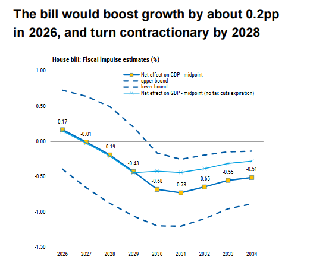
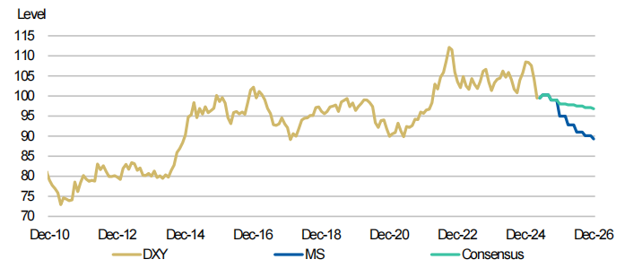
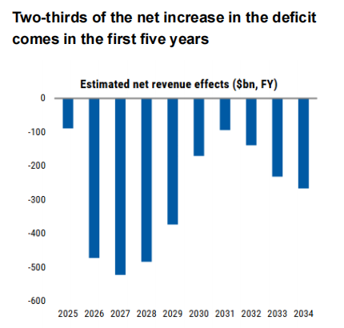
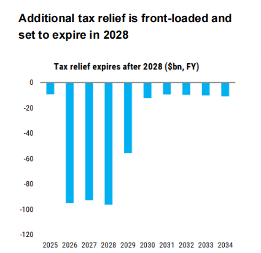
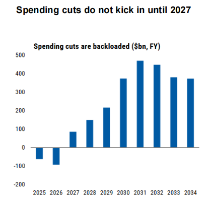
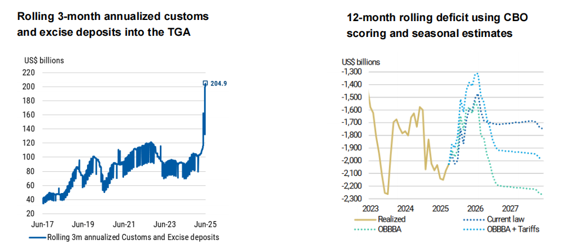
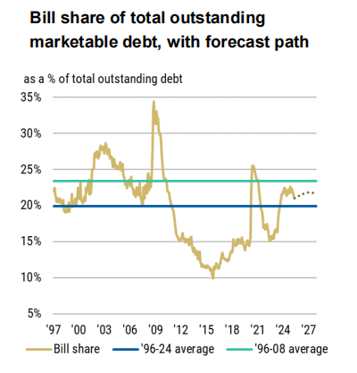
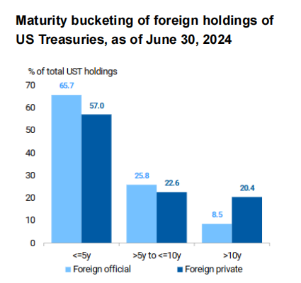
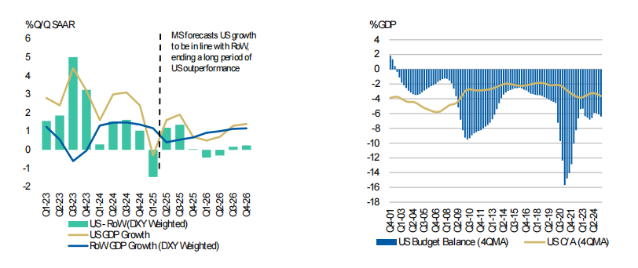
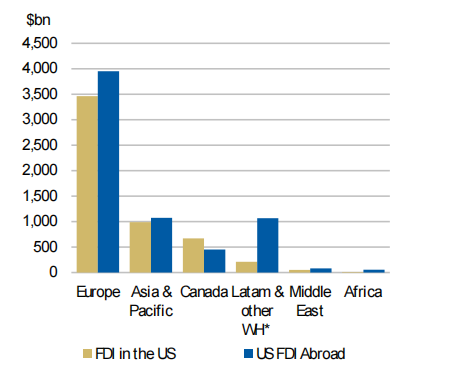

# 图解特朗普“大漂亮”法案：财政刺激力度、899条款“资本税”、对美债、美元影响有多大？

- 页面显示时间：2025-06-10T12:41:50+08:00
- 页面署名：鲍奕龙
- 标注来源：未单列，见正文
- 原文：[华尔街见闻](https://wallstreetcn.com/articles/3748815)
- 取得时间：2026-11-04T16:02:16+08:00
- [HTML阅读版](article.html) · [来源记录](metadata.json)

## 导语

摩根士丹利指出“大漂亮”法案对经济的短期刺激效果微乎其微，并将在2028年转为负面拖累。其次，899条款“资本税”将给持有美国资产的外国投资者带来巨大的不确定性。最后，在美国增长“例外论”终结、资本流入面临风险的背景下，预计美元指数到2025年底将下跌4-5%。

---

大摩解读“大漂亮”法案"，2.8万亿美元财政冲击来袭，美元熊市与“歧视性税收”风险升温。

据追风交易台消息，6月9日摩根士丹利研报深度分析了美国“大漂亮”法案的影响。报告指出：

> - 首先，尽管该法案将在未来十年新增高达2.8万亿美元的赤字，但 **其对经济的短期刺激效果微乎其微（预计2026年仅提振增长0.2个百分点），并将在2028年转为负面拖累** 。
>
> 
>
> - 其次，报告警示了一项名为“第899条款”（Section 899）的“歧视性税收”条款，它将 **给持有美国资产的外国投资者带来巨大的不确定性，可能增加其投资成本。**
> - 最后，也是最关键的投资启示：在美国增长“例外论”终结、资本流入面临风险的背景下， **摩根士丹利明确看空美元，预计美元指数到2025年底将下跌4-5%，美元的储备货币地位也可能受到影响。**
>
> 

## 前置性赤字，但财政刺激作用温和 

报告指出，该法案的赤字增长呈现明显的前置化特征。

> - **在2.8万亿美元的总赤字中，三分之二将在2025-2029年的前五年内产生。**
>
> 
>
> - **额外的税收减免措施集中在前期并将于2028年到期。**
>
> 
>
> - **支出削减要到2027年才开始实施，对医疗补助(Medicaid)的削减更是要到2032年才达到峰值。**
>
> 

**然而，由于许多条款的乘数效应不佳，实际的财政刺激作用相当有限。**

摩根士丹利预计该法案将在2026年将增长率提升约0.2个百分点，但到2028年就会转为紧缩性影响。 **这一微弱的刺激效果不太可能抵消贸易和移民政策对经济增长的负面影响。**

## 第899条款——一项具有广泛潜在影响的“歧视性税收” 

报告特别强调了法案中包含的“第899条款”，并将其定性为一种具有“歧视性”的税收。该条款规定，在特定条件下，将增加对外国实体的税收。

最大的问题在于其“不确定性”。

目前，该条款所涵盖的“金融资产”定义尚不明确，这可能给持有美国固定收益资产的外国投资者带来额外的潜在成本，从而对固收市场造成意想不到的广泛影响。

尽管参议院可能会对相关定义进行澄清，但该条款很可能被保留，并将对外国直接投资（FDI）产生深远影响。

## 对美国国债市场的影响 

对于美国国债市场，报告的观点则更为细致。

一方面， **关税收入和支出削减的综合影响，实际上降低了摩根士丹利的赤字预期** 。这意味着， **未来一段时间的赤字规模将比想象中更为温和，这应该会缓解投资者对美国国债供给过剩的焦虑** 。

另一方面， **报告指出，美国财政部在融资方面拥有相当大的灵活性** 。由于今年的短期国库券（bills）发行水平较低，加上市场对短债的需求不断增长， **财政部完全有能力在明年依赖发行短期国库券来为增加的赤字融资。**

然而大摩指出， **风险依然存在于外国投资者的行为** 。

数据显示，外国官方投资者（如央行）的持仓偏向于短期国债，而外国私人投资者则更偏好长期国债。因此， **第899条款的实施可能会对不同期限的国债产生差异化影响，尤其需要关注持有长期美债的外国私人投资者的动态。**

## 美国投资环境面临恶化风险，美元或将走弱

基于以上分析，摩根士丹利坚定地看空美元。

报告预测， **到2025年底，美元指数将下跌4-5%，其中欧元兑美元将升至1.20，美元兑日元将跌至140，并且预计在2026年美元将进一步走弱** ：

> - **美国增长“例外论”的终结** ：报告认为，美国经济增长优于世界其他地区（RoW）的“例外”时期可能即将结束。摩根士丹利预测，未来美国增长将与世界其他地区基本持平。 **增长优势的丧失将使得为巨额赤字融资变得更具挑战性** 。
>
> 
>
> - **资本流入的脆弱性** ：美国严重依赖外国资本来弥补其经常账户赤字。数据显示，2024年，投资组合资金流入规模是经常账户赤字的125%，其中长期债券投资占大头。而第899条款恰恰威胁到了这些资本流入，特别是来自欧洲的资金——欧洲是美国证券的最大持有者。
>
> 
>
> - **投资环境恶化** ：第899条款不仅影响外国直接投资（FDI），也影响投资组合流动。这种增加外国投资者成本的政策，可能会损害美元作为储备资产的吸引力，尤其是在外国政府持有的美国国债可能失去预扣税豁免的情况下。

\~\~\~\~\~\~\~\~\~\~\~\~\~\~\~\~\~\~\~\~\~\~\~~

以上精彩内容来自[追风交易台](https://mp.weixin.qq.com/s/uua05g5qk-N2J7h91pyqxQ)。

更详细的解读，包括实时解读、一线研究等内容，请加入【 [**追风交易台▪年度会员**](https://wallstreetcn.com/shop/item/1000309) 】

追风交易台由华尔街见闻和智堡联合打造；

风险提示及免责条款

市场有风险，投资需谨慎。本文不构成个人投资建议，也未考虑到个别用户特殊的投资目标、财务状况或需要。用户应考虑本文中的任何意见、观点或结论是否符合其特定状况。据此投资，责任自负。
