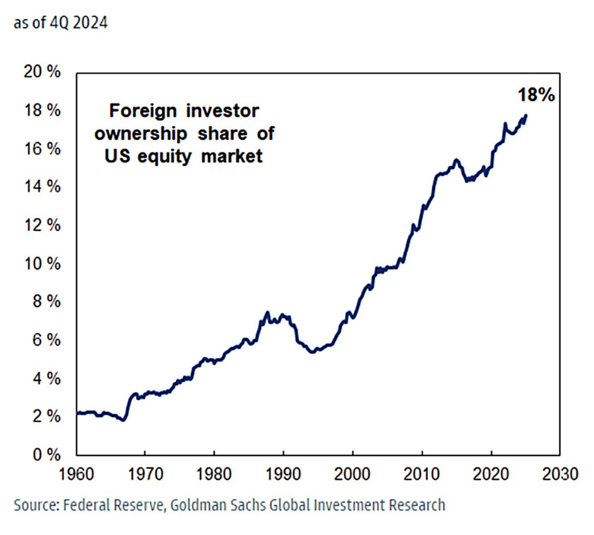

# 大摩交易员一线解读美股：快钱已经跑了，散户还未投降，外资是最大疑问

- 页面显示时间：2025-04-09T15:44:36+08:00
- 页面署名：李笑寅
- 标注来源：未单列，见正文
- 原文：[华尔街见闻](https://wallstreetcn.com/articles/3744882)
- 取得时间：2026-11-04T16:03:35+08:00
- [HTML阅读版](article.html) · [来源记录](metadata.json)

## 导语

大摩认为，在所有资金流动动态中，美国以外的实际资金有可能产生最大的下行影响——如果外资开始质疑“美国例外论”并撤出美国市场，那么股市将承受更多下行风险，预计未来几个月市场可能将面临新一轮探底。

---

外国投资者对美股的立场正在动摇，摩根士丹利称市场或面临更深调整。

摩根士丹利的量化和衍生品策略(QDS)团队正在审视近期的市场动荡，认为在经历了这一波市场混乱后，现在是转向思考下一步的关键时刻。虽然“快钱”已经撤离，但散户尚未完全投降，关键在于外国投资者接下来的行动。

大摩进一步指出， **如果外资开始质疑“美国例外论”并撤出美国市场，那么股市将承受更多下行风险，预计未来几个月市场可能将面临新一轮探底。**

## 市场正处于脆弱转折点：关键看外资

根据摩根士丹利量化和衍生品策略(QDS)交易柜台的最新分析，“快钱”已经抛售——对冲基金的净敞口在周五跌至37%（目前已升至 39%，为2010年以来第2个百分位），宏观系统性杠杆已降至第14个百分位，此前他们抛售了价值3750亿美元的股票。

同时，散户投资者尚未屈服，QDS的长期投资客户也未出现恐慌性抛售。

从资金流动角度看，大摩认为，最大的问题之一是外国投资者将如何行动——因为真正的熊市情景可能是美国以外的实际资金逆转20年来对美国的资金流入。

高盛也表示，过去30年来，外国投资者持有的美股一直在稳步上升， **目前持有18%的美国股票。** **如果这一群体开始质疑“美国例外论”——并且已经减少了对美股的投资——那么未来可能会有更多下行风险。**

大摩补充称，虽然结构性资金从美国流出的情况尚待观察，并非QDS的基本情景，但可能推动极端左尾风险。

从战术角度看， **QDS预计股票在下周可能更容易上涨而非下跌，但随着关税冲击的基本面影响显现以及缓慢资金投资者抛售股票，市场将在未来几个月重新探底，或创出新低。**

QDS表示，尽管最近出现了一些投降迹象（对冲基金净敞口 \< 40%，VIX 指数盘中 \> 50），但尚未出现完全高相关性的抛售，除非关税政策出现逆转，否则底部可能看起来像是全面的高相关性下跌（包括美元、债券、美股）。

QDS进一步指出， **当美国股市之间的相关性飙升至80%以上时（上周五仅达到60%），几乎所有美元资产将无处可逃。**

大摩认为，这可能迫使美联储重启量化宽松或降息。在此之前，投资者应该在反弹时重新调整对冲，抛售那些更容易受到经济增长放缓影响的股票，并抛售那些更容易受到美国资金外流影响的股票。

## 四大关键问题决定市场走向

展望未来，QDS专注于四个重大问题，可以称之为4个“F”:

**基本面 (Fundamentals)：** 关税的影响需要几个月的时间才能完全显现，目前市场反应如何？但历史数据显示，标普500指数下跌20%通常意味着经济衰退（13次中有9次），每股收益(EPS)下降超过10%。

**美联储 (Fed)：** 美联储将对经济增长放缓做出反应，还是会落后于形势？鲍威尔的言论表明，他们“并不着急”，因此，假设经济增长放缓，他们将反应迟缓。在美联储转变政策或关税政策逆转之前，逢标普500指数反弹时卖出。

**外国资金流动 (Foreign flows)：** 在所有资金流动动态中，实际资金——尤其是美国以外的实际资金——有可能产生最大的下行影响。

**金融杠杆 (Financial Leverage)：** 很多杠杆已经从系统中抽离，但并非全部，而且市场做空了Gamma值。隐含波动率目前过高，但在任何下跌时都值得持有Gamma。记住，在冲击之后，上涨幅度可能大于下跌幅度——这意味着做多看涨期权 /做空delta。

风险提示及免责条款

市场有风险，投资需谨慎。本文不构成个人投资建议，也未考虑到个别用户特殊的投资目标、财务状况或需要。用户应考虑本文中的任何意见、观点或结论是否符合其特定状况。据此投资，责任自负。
