# 如何理解央行上调外汇存款准备金率？

- 页面显示时间：2026-11-04T09:34:53+08:00
- 页面署名：赵颖
- 标注来源：华创证券张瑜
- 原文：[华尔街见闻](https://wallstreetcn.com/articles/3785129)
- 取得时间：2026-11-04T16:03:26+08:00
- [HTML阅读版](article.html) · [来源记录](metadata.json)

## 导语

央行宣布上调外汇存款准备金率2个百分点至6%，释放明确维稳信号。华创证券认为，上调释放的信号意义或重于实质影响，历史复盘显示2021年两次类似操作后USDCNY剩余下行空间仅约0.8%和0.6%。短期结汇需求或支撑人民币温和走强，但进一步上行空间料已有限，明年双向波动弹性或显著加大。

---

2026年11月3日，中国人民银行决定自2026年11月15日起，上调金融机构外汇存款准备金率2个百分点，即外汇存款准备金率由现行的4%上调至6%。

**核心观点**

1、本次外汇存款准备金率上调背景是人民币已持续升值约18个月，即期汇率升破6.65。

2、从外汇存款准备金率作用机制来看，上调释放的信号意义或重于实质影响，有助于防范市场单边预期自我强化，防范“羊群效应”，保持汇率在合理均衡水平上的基本稳定。

3、从历史复盘来看，“811”汇改以来、本轮调整以前，央行有两次在升值阶段上调外汇存准率，均发生在2020-2022年的升值周期。从结果来看，两次上调后，人民币均短期回调，虽未立即结束当时的人民币升值行情，但两次公告后的USDCNY剩余下行空间仅约0.8%和0.6%。这一有限历史样本提示，本次上调后人民币仍可能升值，但空间或较为有限。

4、展望后续，短期出口韧性、结汇惯性与季节性结汇需求，或支撑人民币延续温和升值，但估值因子（基于历史数据与相关变量拟合，仅提供中长期汇率中枢的经验参考，并非严格意义上的估值或定价模型）、政策取向及历史经验提示进一步升值空间或有限。展望明年，出口与结汇的增量支撑或减弱，若美元维持偏强震荡，人民币阶段性调整压力可能上升，双向波动弹性或加大。

**报告摘要**

一、基础知识铺垫：何为外汇存款准备金

官方定义为：外汇存款准备金是指金融机构按照规定将其吸收外汇存款的一定比例交存中国人民银行的存款。简单来说，我国外汇有外汇的存款准备金率，人民币有人民币的存款准备金率，外汇存款准备金只可用外汇缴纳，本币存款准备金用本币缴纳，一般而言不可交叉（不能用人民币缴纳美元存款准备金）。

二、本次上调的背景：人民币持续升值18个月，即期汇率升破6.65

本轮人民币升值已延续约18个月，累计升幅接近前两轮平均水平。自2025年4月以来，人民币对美元即期汇率累计升值约9.6%。对比过去两轮升值周期（2017-2018、2020-2022，见图1），其平均升幅为10.4%、平均持续时间为15.5个月，本轮升值幅度已接近前两轮平均水平。在汇率持续走强的背景下，最新交易日人民币升幅有所扩大。11月2日，人民币兑美元即期升值约0.15%，升幅约为上周日均水平（0.05%）的3.2倍。

在此背景下，政策层面，近期官方表态持续强调市场定价与防范汇率短期大幅波动。10月8日发布的《中国人民银行关于人民币汇率的政策立场》系统阐明汇率制度，强调市场在汇率形成中的决定性作用，同时政策重点防范汇率短期大幅波动影响金融稳定。此外，华创宏观汇率模型持续捕捉到逆周期因子影子变量抑制人民币过快升值波动，且近期有“加量”迹象。10月21日以来，我们模型测算的逆周期因子影子变量由前期300bp附近升至近期500bp以上。

综上，我们认为，本次上调外汇存款准备金率，体现了央行防范“羊群效应”、防范汇率短期急剧波动的一贯政策思路，有助于防范市场单边预期自我强化，保持汇率在合理均衡水平上的基本稳定。

三、上调外汇存款准备金率的传导路径？

第一步，上调外汇准备金率，由现行的4%上调至6%。第二步，银行需要缴纳的外汇准备金增加，减少了银行可用于贷款的外汇资金供给。第三步，外汇流动性收紧，人民币升值压力缓解。从上述影响路径可以看到，上调外汇存款准备金率可起到抑制人民币升值压力的作用。

四、影响机制：预期引导作用或强于实质影响

截至2026年9月，我国金融机构外汇存款余额约1.2万亿美元，上调准备金率2个百分点大概对应240亿美元外汇流动性的冻结。考虑到银行间即期外汇市场日均交易额约为400-500亿美元，240亿美元流动性规模的影响或相对有限。央行通过上调外汇存准率释放清晰政策信号、引导市场预期稳定的意义可能更大。

五、历史复盘：两次上调后CNY短期回调，后续升值空间有限

2015年“811”汇改以来、本次调整之前，央行曾两次在人民币升值期间上调外汇存准率，两次上调均发生于2020—2022年的人民币升值周期。综合来看，2021年的两次上调外汇存准率均对应了短期升值节奏的放缓，但并未立即结束2020—2022年的人民币升值行情。不过，与2022年3月该轮周期的USDCNY低点6.3107相比，两次公告后的剩余下行空间分别仅约0.8%和0.6%，说明公告时人民币在该轮周期中的主要升幅已基本兑现（图7-8）。从这一有限历史样本看，本次外汇存准率上调虽不意味着人民币升值行情立即结束，但可能提示即期汇率已接近本轮低位，后续升值空间较为有限。

六、央行汇率工具箱中还有什么工具未动用？

本轮人民币升值过程中，央行已先后宣布下调远期售汇业务的外汇风险准备金率（2026年2月27日，详见《汇率出招了，怎么看？——远期售汇风险准备金率下调分析》）和上调外汇存款准备金率（2026年11月3日）。此外，华创宏观汇率模型也持续捕捉到抑制人民币过快升值的逆周期因子影子变量调节信号。后续仍可关注下调企业和金融机构跨境融资宏观审慎调节参数等政策选项，外汇存款准备金率也存在再次上调的可能。2021年央行曾两次上调外汇存准率，将其由5%提高至9%；本次上调后为6%，仍低于当时水平。

七、人民币汇率未来走势判断

结合内盘供需、外盘响应、政策调控及估值因子（基于历史数据与相关变量拟合，仅提供中长期汇率中枢的经验参考，并非严格意义上的估值或定价模型），我们认为，短期出口韧性、结汇惯性与季节性结汇需求，或支撑人民币短期延续温和升值。不过，当前人民币相对模型拟合值或已处于偏贵位置，叠加央行防范短期过快升值的态度较为明确，再结合此前两次上调外汇存准率的历史经验，进一步升值空间或较为有限。展望明年，随着出口和结汇意愿的增量支撑减弱，叠加美元或具偏强震荡的基础，人民币面临的阶段性调整压力可能上升，双向波动弹性或加大。（具体五方面的论述详见正文）

正文

## 一、基础知识铺垫：何为外汇存款准备金

官方定义为：外汇存款准备金是指金融机构按照规定将其吸收外汇存款的一定比例交存中国人民银行的存款。

简单来说，我国外汇有外汇的存款准备金率，人民币有人民币的存款准备金率，外汇存款准备金只可用外汇缴纳，本币存款准备金用本币缴纳，一般而言不可交叉（不能用人民币缴纳美元存款准备金）。也可以简单理解为：本币有一套信用扩张体系，外币有一套信用扩张体系。本币信用扩张是先有贷款，外币信用扩张则是先有存款。

对于央行将金融机构外汇存款准备金率由4%上调2个百分点至6%，我们举个简化的例子来说明其含义：张三从海外赚了一笔100美元的外汇，拿回国内交给银行A形成外汇存款（没有结汇），那么银行A以前需要冻结4美元的准备金给央行，现在则需要冻结6美元，银行可以释放美元流动性的部分少了2美元，短期降低了美元周转效率，相当于收紧境内美元流动性。

## 二、本次上调的背景：人民币持续升值18个月，即期汇率升破6.65

本轮人民币升值已延续约18个月，累计升幅接近前两轮平均水平。自2025年4月以来，美元兑人民币即期汇率由7.3498降至6.65下方，对应人民币累计升值约9.6%，其中今年以来升值约4.9%。对比过去两轮升值周期（图1），其平均升幅为10.4%、平均持续时间为15.5个月，本轮升值幅度已接近前两轮平均水平。

从汇率位置和升值范围看，人民币对美元及一篮子货币均持续走强。目前，美元兑人民币即期汇率已降至6.65下方，超越2015年“811”汇改以来历史波动区间中值6.83，属于偏强位置。CFETS人民币汇率指数也由2025年7月的低点95.09回升至近期的103.83左右，累计升幅约9.2%。

在汇率持续走强的背景下，最新交易日人民币升幅有所扩大。11月2日，人民币兑美元即期升值约0.15%，升幅约为上周日均水平（0.05%）的3.2倍。

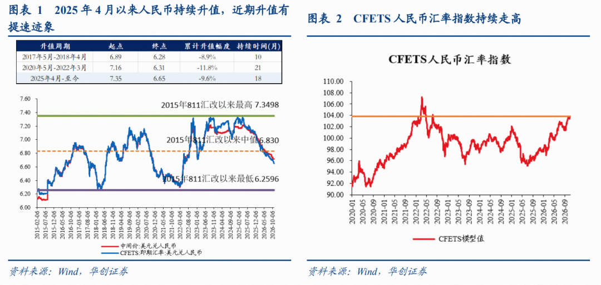

在此背景下，政策层面，近期官方表态持续强调市场定价与防范汇率短期大幅波动。10月8日发布的《中国人民银行关于人民币汇率的政策立场》系统阐明汇率制度，强调市场在汇率形成中的决定性作用，同时政策重点防范汇率短期大幅波动影响金融稳定。10月19日，潘功胜行长在金融街论坛年会上再次指出，在特定情景下，人民银行运用宏观审慎管理工具进行调节，校正市场的羊群效应和非理性预期的自我强化。此外，华创宏观汇率模型持续捕捉到逆周期因子影子变量抑制人民币过快升值波动，且近期有“加量”迹象。10月21日以来，我们模型测算的逆周期因子影子变量由前期300bp附近升至近期500bp以上。

结合上述背景，我们认为，本次上调外汇存款准备金率，体现了央行防范“羊群效应”、防范汇率短期急剧波动的一贯政策思路，有助于防范市场单边预期自我强化和人民币短期过快升值，保持汇率在合理均衡水平上的基本稳定。

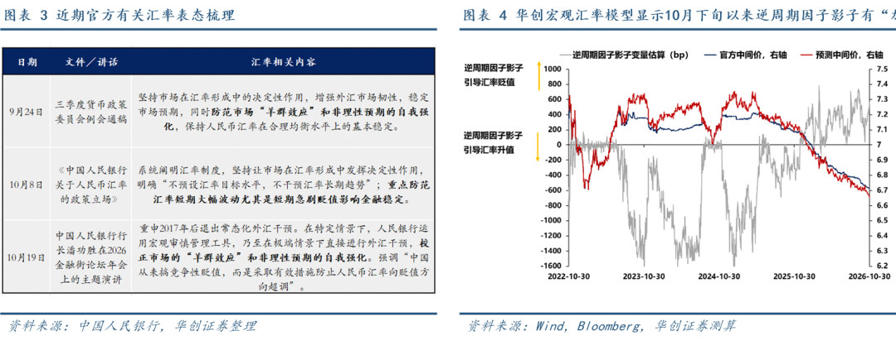

## 三、上调外汇存款准备金率的传导路径？

第一步，上调外汇准备金率，由现行的4%上调至6%。

第二步，银行需要缴纳的外汇准备金增加，降低了银行可用于贷款的外汇资金供给。

第三步，外汇流动性收紧，人民币升值压力缓解。

从上述影响路径可以看到，上调外汇存款准备金率可起到抑制人民币升值压力的作用。

## 四、影响机制：预期引导作用或强于实质影响

截至2026年9月，我国金融机构外汇存款余额约1.2万亿美元，上调准备金率2个百分点大概对应240亿美元外汇流动性的冻结。考虑到银行间即期外汇市场日均交易额约为400-500亿美元，240亿美元流动性规模的影响或相对有限。央行通过上调外汇存准率释放清晰政策信号、引导市场预期稳定的意义可能更大。

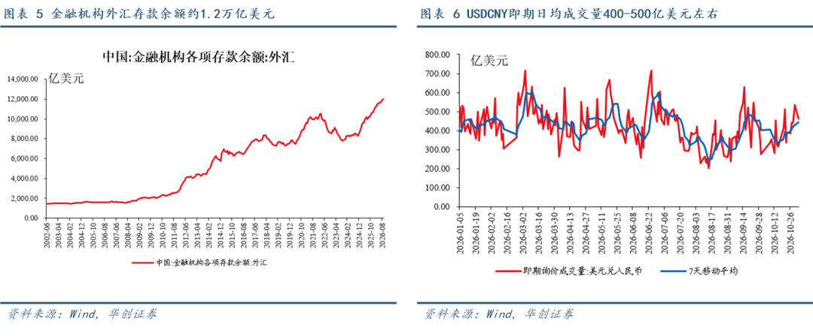

## 五、历史复盘：两次上调后CNY短期回调，后续升值空间有限

复盘来看，此前两次上调外汇存准率后，人民币均出现阶段性回调，但随后仍有升值，政策调整并未就此终结原有升值行情（图7—9）。2015年“811”汇改以来、本次调整之前，央行曾两次在人民币升值期间上调外汇存准率，两次上调均发生于2020—2022年的人民币升值周期，且从后续升值空间看，公告时USDCNY已接近彼时升值周期的低点。

第一次是2021年5月31日，当日美元兑人民币即期汇率为6.3607。公告后，人民币连续四个交易日回调，累计贬值约0.8%，随后数月走势有所反复。期间，USDCNY最高于7月27日达到6.504，较公告日上行约2.3%；至8月下旬，人民币再度转入震荡升值。总体来看，此次外汇存准率上调后，人民币经历了一段时间的回调与震荡，但原有升值行情此后仍有延续。

第二次是2021年12月9日，当日美元兑人民币即期汇率为6.3457。公告后七个交易日，人民币累计贬值约0.5%，随后USDCNY主要围绕6.37震荡，人民币仍处于偏强区间。进入2022年后，人民币再度走强，USDCNY于2022年3月达到本轮低点6.3107。

综合来看，2021年的两次上调均对应了短期升值节奏的放缓，但并未立即结束2020—2022年的人民币升值行情。不过，与2022年3月该轮周期的USDCNY低点6.3107相比，两次公告后的剩余下行空间分别仅约0.8%和0.6%，说明公告时人民币在该轮周期中的主要升幅已基本兑现。从这一有限历史样本看，本次外汇存准率上调虽不意味着人民币升值行情立即结束，但可能提示即期汇率已接近本轮低位，后续升值空间较为有限。

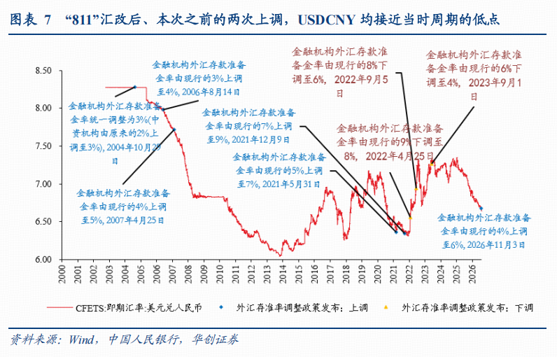

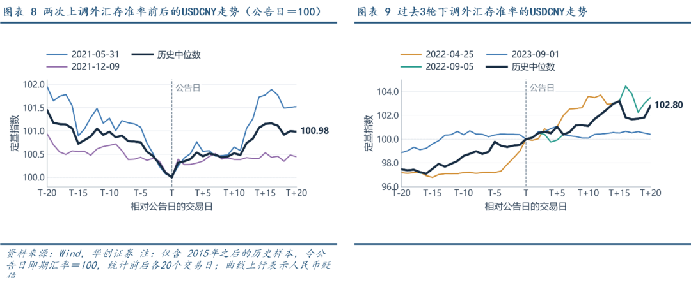

## 六、央行汇率工具箱中还有什么工具未动用？

本轮人民币升值过程中，央行已先后宣布下调远期售汇业务的外汇风险准备金率和上调外汇存款准备金率（2026年11月3日）。此外，华创宏观汇率模型也持续捕捉到抑制人民币过快升值的逆周期因子影子变量调节信号。

后续仍可关注下调企业和金融机构跨境融资宏观审慎调节参数等政策选项，外汇存款准备金率也存在再次上调的可能。2021年央行曾两次上调外汇存准率，将其由5%提高至9%；本次上调后为6%，仍低于当时水平。

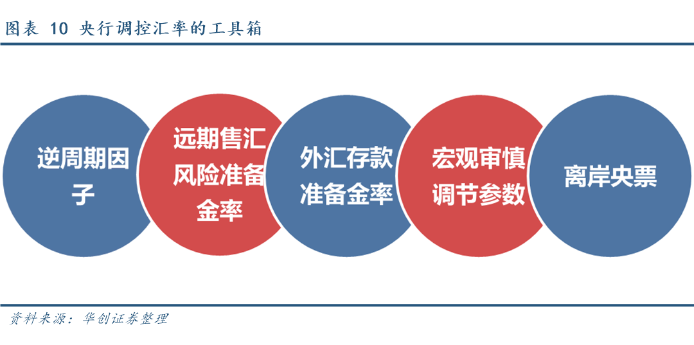

七、人民币汇率后势怎么看？

从中间价定价公式出发，拆解驱动汇率变化的三因素：内盘供需、外盘响应、政策调控。其中，内盘供需反映境内外汇供求状况，重点观察企业结售汇行为，背后是出口和企业结汇意愿；外盘响应反映国际汇率变化对人民币的影响，重点观察美元指数走势；政策调控反映政策对汇率预期和波动节奏的引导，重点关注汇率政策取向及工具运用。

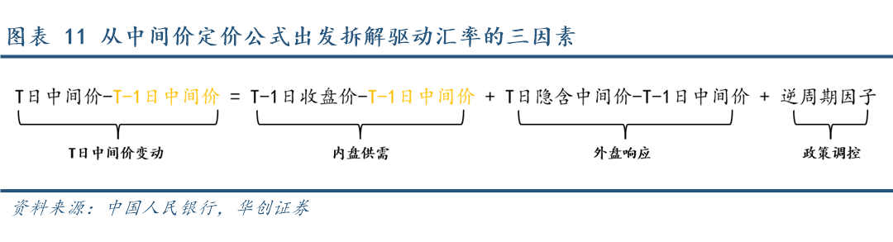

结合内盘供需、外盘响应、政策调控及估值因子（基于历史数据与相关变量拟合，仅提供中长期汇率中枢的经验参考，并非严格意义上的估值或定价模型），我们认为，短期出口韧性、结汇惯性与季节性结汇需求，或支撑人民币短期延续温和升值。不过，当前人民币相对模型拟合值或已处于偏贵位置，叠加央行防范短期过快升值的态度较为明确，再结合此前两次上调外汇存准率的历史经验，进一步升值空间或较为有限。展望2027年，随着出口和结汇意愿的增量支撑减弱，叠加美元或具偏强震荡的基础，人民币面临的阶段性调整压力可能上升，双向波动或更为明显，汇率弹性可能加大。具体从以下五个方面展开：

一是从估值因子（基于历史数据与相关变量拟合，仅提供中长期汇率中枢的经验参考，并非严格意义上的估值或定价模型）看，当前无论是USDCNY还是CFETS一篮子汇率指数，或均较估值中枢偏贵，意味着人民币对利空因素可能更敏感。

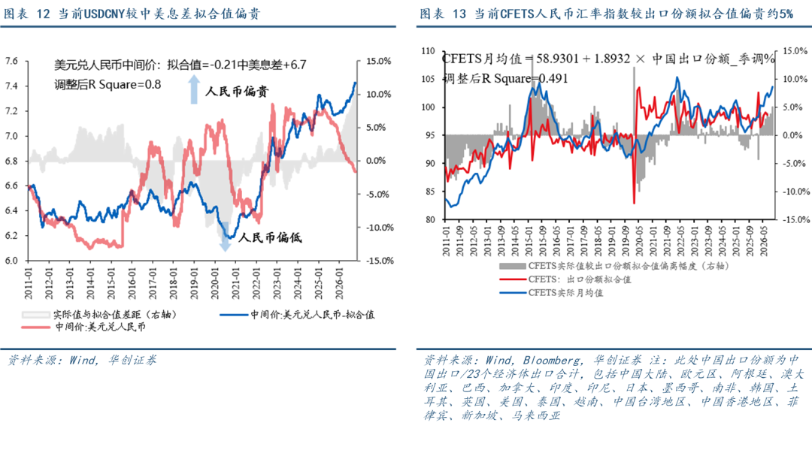

二是出口，韧性仍在，但增量支撑或减弱。工业周期与AI需求仍有支撑，明年出口增速有望保持历史偏高水平，但随着全球工业扩张趋缓、AI链增速回落，出口对人民币升值的增量支撑或有所减弱。

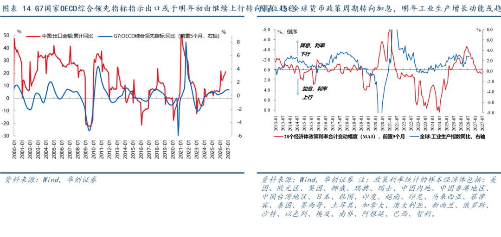

三是企业结汇意愿，短期惯性或仍在，后续动能或边际趋弱。此前，人民币升值与企业结汇可能形成相互强化：升值预期促使企业提前结汇，结汇增加外汇供给，又进一步推动人民币升值。这一惯性短期或仍有延续，但从国内景气、存量释放和持汇收益看，后续结汇动能可能边际减弱。

从国内景气看，制造业PMI近期有所反复，10月回落至49.3%，显示景气修复仍不稳固。我们跟踪的PMI领先指标——企业与居民存款增速剪刀差，目前处于近六年高位，后续若出现回落，国内景气对企业结汇意愿的支撑存在趋弱风险。

从存量结汇释放的角度看，按历史积压资金估算，其持汇成本（用当时的即期汇率水平作为代理变量）或主要集中在USDCNY为6.9—7.5的区间，目前即期汇率已降至该区间下方。后续人民币即使进一步升值，触发的集中结汇规模也可能减小，存量结汇对人民币升值的额外推动或有所减弱。

从持汇收益看，此前人民币升值幅度超过了中美息差，削弱了美元利率优势对持汇的吸引力。当下伴随美联储步入加息周期，中美息差倒挂程度或进一步加深，而人民币升值速度有所放缓，持汇利息收益对预期汇兑损失的补偿作用有望增强，持汇的相对吸引力或有所上升，企业结汇节奏也可能随之放缓。

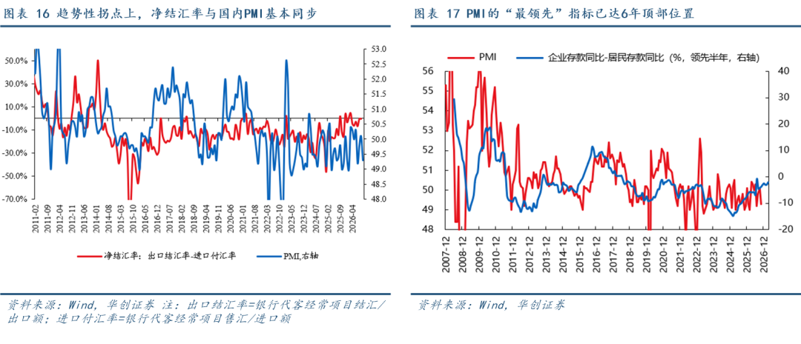

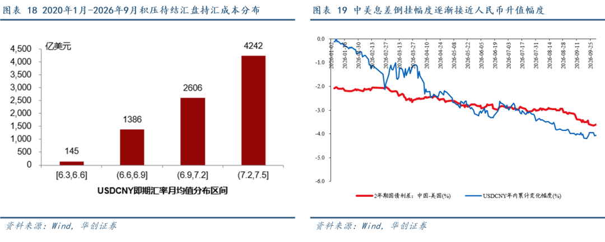

四是政策，防范人民币短期过快升值的取向较为明确。央行重视防范“羊群效应”和非理性预期的自我强化，本次上调外汇存准率体现了这一政策思路。历史上，2021年的两次上调均伴随人民币短期回调，且公告时该轮升值的主要幅度已基本兑现。从这一有限历史样本看，本次上调虽不意味着人民币升值行情立即结束，但可能提示即期汇率已接近本轮低位，后续升值空间较为有限。

五是美元，从美欧利差与相对增长优势来看，其或仍具备偏强震荡的基础。

从利差看，一年后的美欧短端利差预期与当期SOFR－ESTR利差大体相当，表明市场预期美国的相对利率优势仍将维持，有助于支撑美元韧性。

从相对经济表现看，考虑到能源冲击与AI需求扩张是影响全球增长的两股重要力量，美国的增长条件相对有利。美国为能源净出口国，而2024年法、德能源净进口额分别占GDP的1.6%、2.4%；2025年美国AI硬件净贸易额绝对值占GDP约0.6%，德法均约0.1%，美国AI相关贸易暴露度更高。此外，彭博一致预期显示，明年美国名义GDP增速仍高于欧日，相对增长优势可能为美元提供支撑。

若明年内盘供需对人民币的支撑如我们预期减弱，美元维持偏强震荡，其对人民币的影响可能更加明显，带来阶段性调整压力。

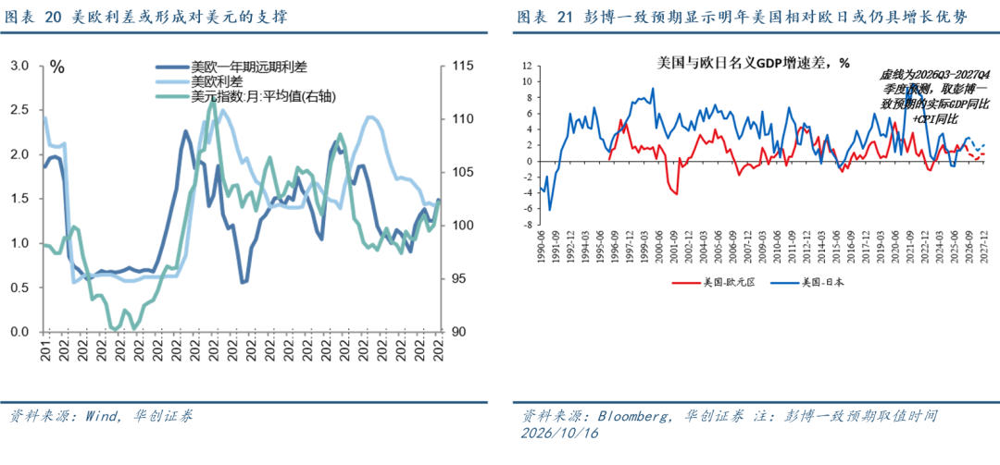

本文来源：[一瑜中的](http://mp.weixin.qq.com/s?__biz=MzI3NTUyMDkzMw==&mid=2247610719&idx=1&sn=7a99f016117a2a0fc0dadded149709c3&chksm=ea1271cbd617fd2230962e956e62f223bc38b1bdf8a3089123ac292e703ac1f5837befb63027&scene=0&xtrack=1)

风险提示及免责条款

市场有风险，投资需谨慎。本文不构成个人投资建议，也未考虑到个别用户特殊的投资目标、财务状况或需要。用户应考虑本文中的任何意见、观点或结论是否符合其特定状况。据此投资，责任自负。
