# 如何看待开年回调，后续如何应对？

- 页面显示时间：2025-01-05T17:28:32+08:00
- 页面署名：李笑寅
- 标注来源：广发证券刘晨明、郑恺
- 原文：[华尔街见闻](https://wallstreetcn.com/articles/3738403)
- 取得时间：2026-11-04T16:03:34+08:00
- [HTML阅读版](article.html) · [来源记录](metadata.json)

## 导语

广发证券认为，考虑到一季度对于未来政策预期、PPI和ROE的预期，都很难被证伪，因此理论上来说，指数的系统性风险应当相对可控；后续，中小盘股票或在年报预告和春节之后开启一波不错的春季躁动；红利仍然是最具有配置意义的指数。

---

**报告摘要**

> 开年以来，各类指数和风格无差别下跌。分别如何看待中小盘、大盘白马、高股息等不同资产类别的调整？今年还能否春季躁动？如何思考未来的选股策略？

**报告正文**

## **本期话题：如何看待开年下跌和后续的选股思路？**

**（一）中小盘的下跌在可预见的范畴之内**

在上周的报告《岁末年初“风格切换”的两个时点与规律》中，我们曾经分析，12月和1月，中小盘股票的调整概率是比较大的，核心是每年1月底是全部上市公司年报预告的有条件强制披露的截止日，尤其是在业绩压力比较大的年份，投资者都可能提前规避这一风险。

目前，交易所发布的年报预告最新规则如下（第4条稍有变化）：

**上市公司预计年度经营业绩和财务状况将出现下列情形之一的，应当在会计年度结束后1个月内进行预告：**

（1）净利润为负值；

（2）净利润实现扭亏为盈；

（3）实现盈利，且净利润与上年同期相比上升或者下降50%以上；

（4）利润总额、净利润或者扣除非经常性损益后的净利润孰低者为负值，且扣除与主营业务无关的业务收入和不具备商业实质的收入后的营业收入低于3亿元；

（5）期末净资产为负值；

（6）本所认定的其他情形。

**因此，中小盘股票每次会在年报预告（业绩暴雷和ST风险落地）和春节之后（春节期间海外不确定因素落地）开启一波不错的春季躁动。**

数据统计规律如下：

规律①：12月市场表现一般，小盘风格有较大下跌风险（申万小盘指数、中证1000、国证2000上涨概率不足33%）；

规律②：跨年是分水岭，之后市场胜率提升，春节至两会市场风格倒向小盘，尤其是区间申万小盘指数的上涨概率是100%（中证1000/国证2000上涨概率93%）；

规律③：两会是第二个分水岭，市场胜率下降，政治局会至4月下旬市场上涨概率不足25%，小盘风险更大。

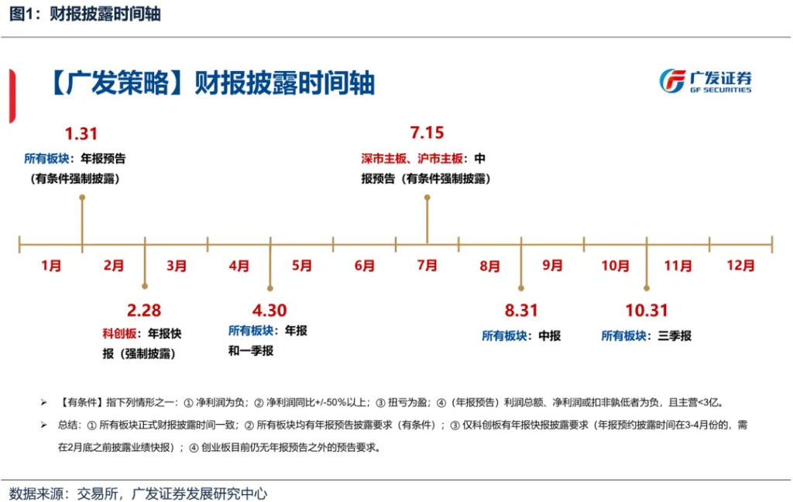

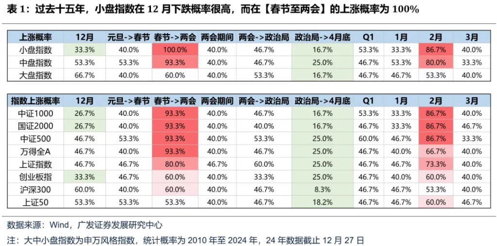

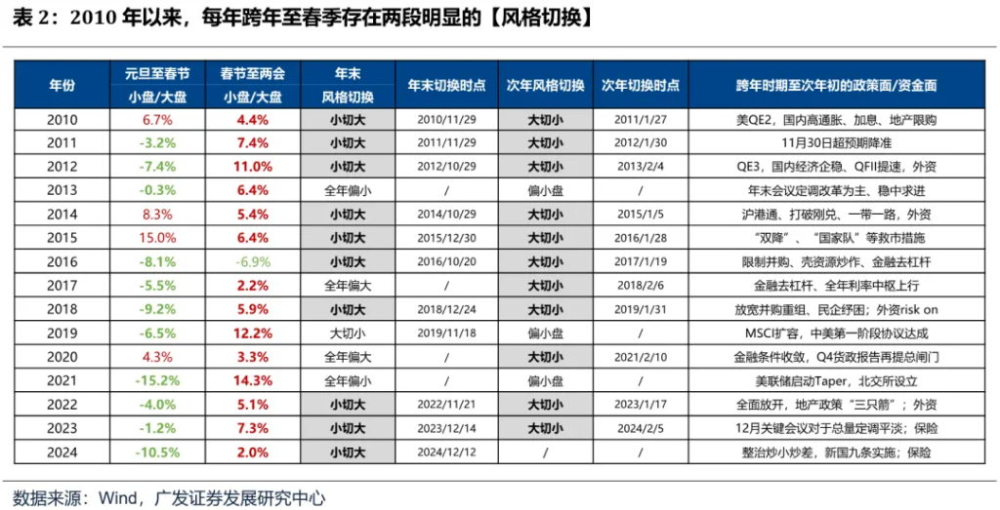

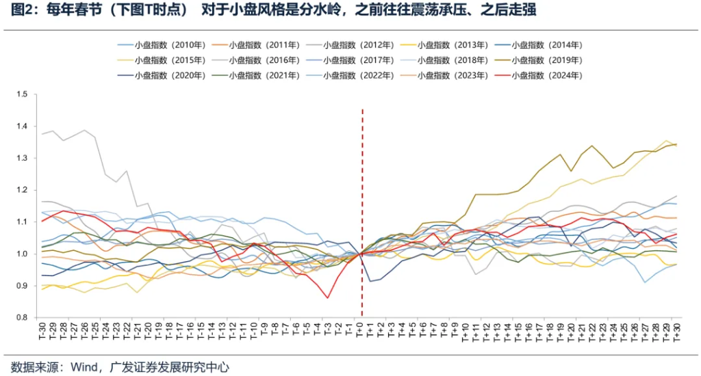

**（二）大盘股的下跌超出预期**

如果说中小盘股票的下跌基本符合市场的历史规律和节奏，那么大盘股在元旦前后的下跌，则超出了很多投资人的预期。而事后的解释，也大多停留在资金面的维度。

后续的关键在于，由大盘股主导的指数，是否还有更大的下跌空间，以至于需要明显降低仓位？

回归到Q1市场运行的本质来说，核心还是对未来基本面的预期，因为当期基本面处于淡季、同时有春节错位和数据空窗期等问题。

对未来基本面的预期，也就是下图中对未来ROE趋势的判断：能否形成拐点、形成哪种类型的拐点？

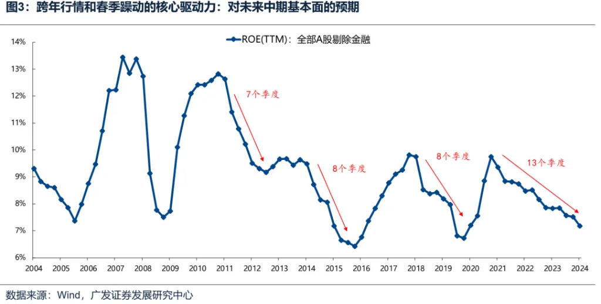

而对于未来ROE趋势的判断，此前我们框架中的一个简单传导链条是：狭义目标赤字 → 广义财政 → PPI → ROE。

因此，每年跨年行情和春季躁动的主要推动因素，就在于通过政策基调（狭义目标赤字）来预期未来广义财政扩张的空间。到4月决断的时候，再根据实际广义财政的情况，判断PPI能否全面回升、带动ROE形成拐点。

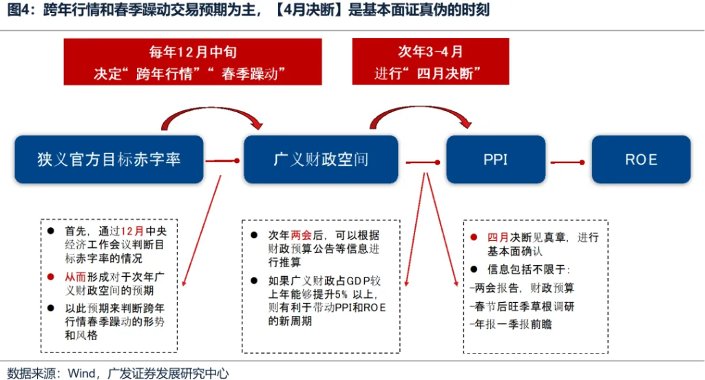

23年底、24年初，市场逐步意识到目标赤字率可能比较低于预期，于是市场放弃了对24年广义财政的乐观预期，进而认为PPI和ROE很难全面回升，因此24年初市场的跌幅非常大。

但是，当前来看，由于25年的目标赤字率大概率在3.5-4%，甚至接近于4%。如下图，赤字率目标不是一个简单的数字，而是代表了广义财政的基调，也就是说在目标赤字率显著提升的情况下，广义财政的空间至少很难被证伪。

**从这个角度出发，一季度对于未来政策预期、PPI和ROE的预期，都很难被证伪。因此，理论上来说，指数的系统性风险应当相对可控。**

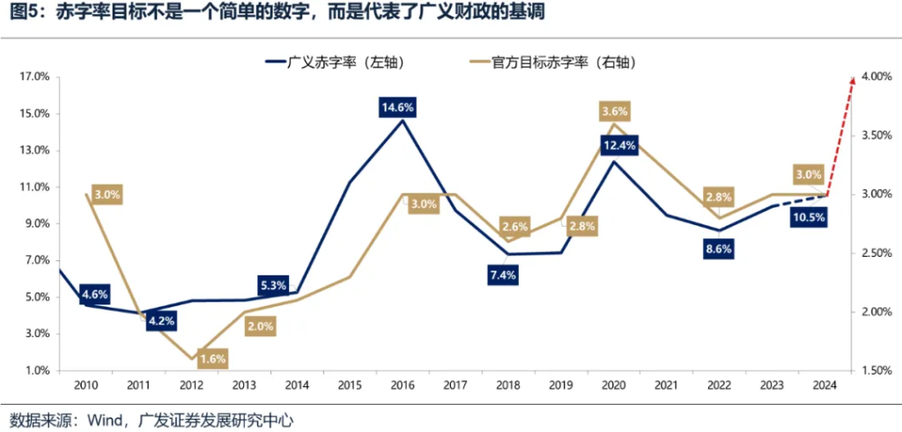

**（三）红利也出现调整，但仍然是最具有配置意义的指数**

12月，在利率快速下行和保险公司有增量配置资金的预期推动下，红利类指数一度表现相对不错，但是开年也出现了较大幅度的下跌。

从利率下行或者维持低位的角度，如果我们把十年国债当做股票贴现模型中的无风险利率看待，那么从我们划分的三类资产（经济周期、景气成长、稳定价值）来看，影响最直接、最显著的，应当还是稳定价值类。

核心在于，经济周期类和景气成长类的贴现模型中，现金流或者分红，受到经济运行和产业周期的影响都非常大，也就是他们基本面的波动性、还有受基本面预期波动影响的风险溢价，都使得无风险利率（十年国债）从来不是一个最主要的影响因素。

而对于稳定价值类的资产，比如红利类，他们的现金流或者分红的稳定性和可预见性都相对比较强，从而风险溢价水平也相对比较稳定，因此利率下行或者维持低位，对于这类资产应当最为有利。

**（四）红利类ETF所引发的对于选股策略的思考**

**在前期报告中，我们曾经提到，从未来一个长期角度来看，在众多ETF中，红利类ETF可能是为数不多，不需要择时，可以长期配置的资产。**

下图中可以看到，红利类指数的调仓，更类似于低买高卖，而其他宽基窄基指数多以高买低卖的形式进行样本调整。这就构成了指数走势的长期差别：

红利类指数：长期净值曲线斜率几乎不变，长期配置角度，不需要择时。

其他宽基窄基指数：净值曲线波动巨大，16-17年大涨，18年磨平涨幅，20-21年大涨，22-24年磨平涨幅，因此如果不做择时，就没有配置的意义。

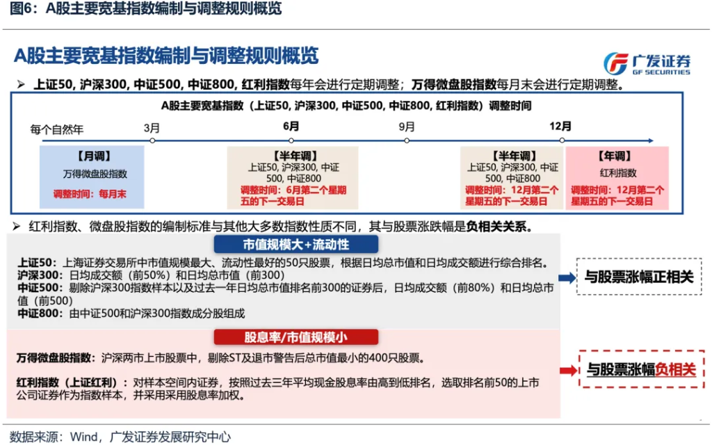

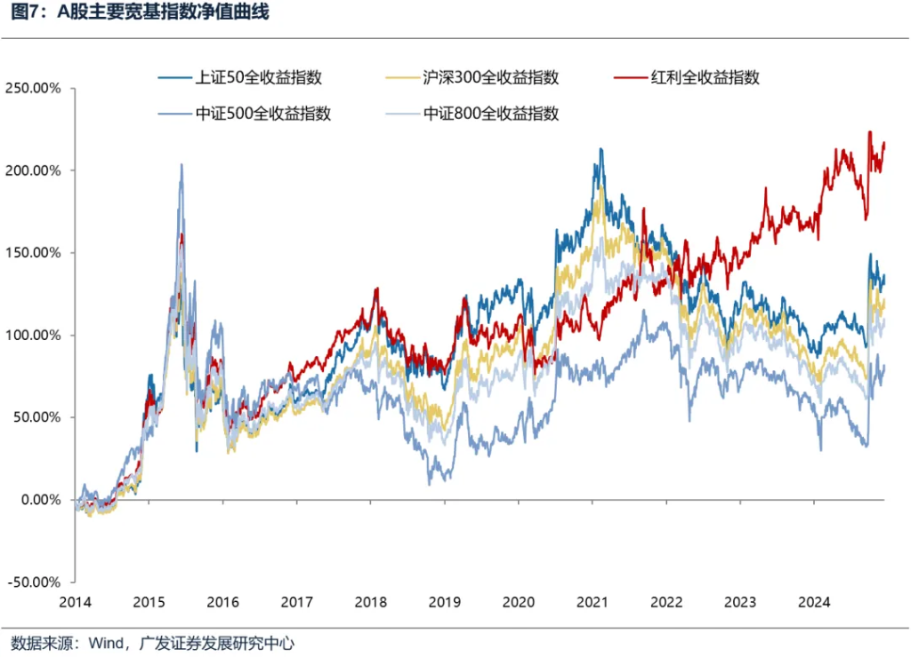

除了ETF所对应的各类指数，在A股中，还有一个典型的指数，也是采用了低买高卖的指数调仓策略，那就是微盘股指数。红利类指数和微盘指数不是胜在公司质量有多好，核心是持续低买高卖的调仓策略，让他们的净值曲线走势几乎保持了不变的斜率：

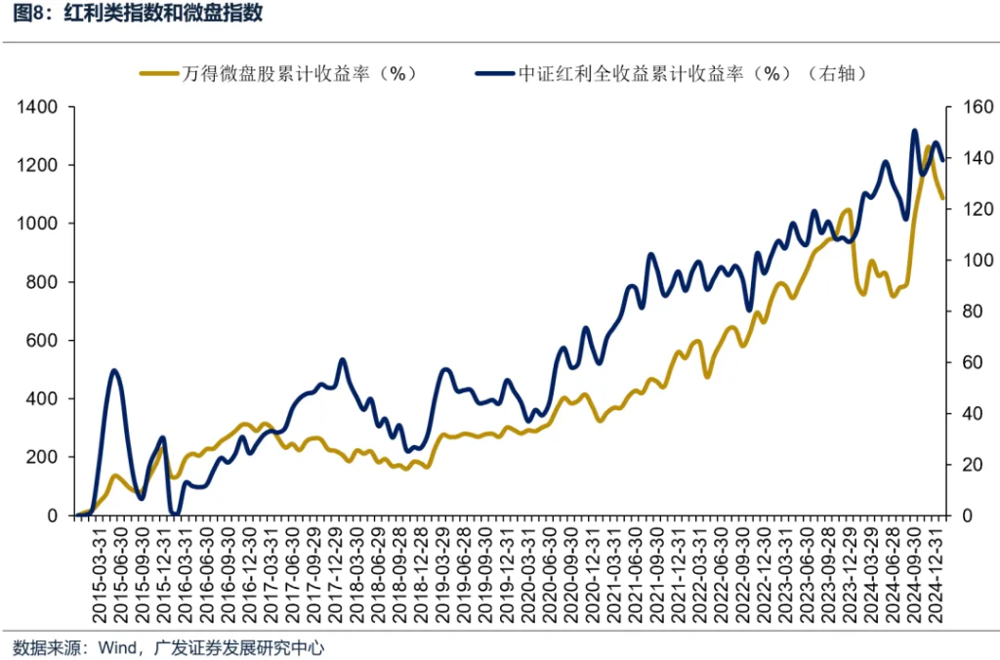

**这里就不得不引出另外一个话题，在A股市场中，大多数情况下，在一个较低位置买入一个股票，拉一个中长期维度来看，这个股票出现一个比较明显上涨，或者跑赢其它股票的概率，都相对比较大。**

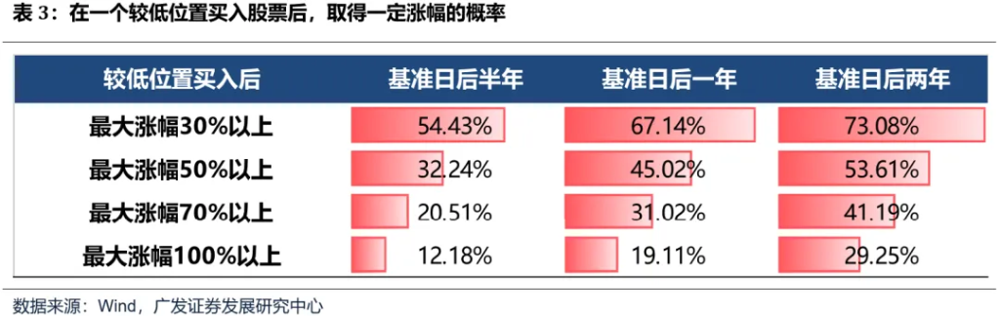

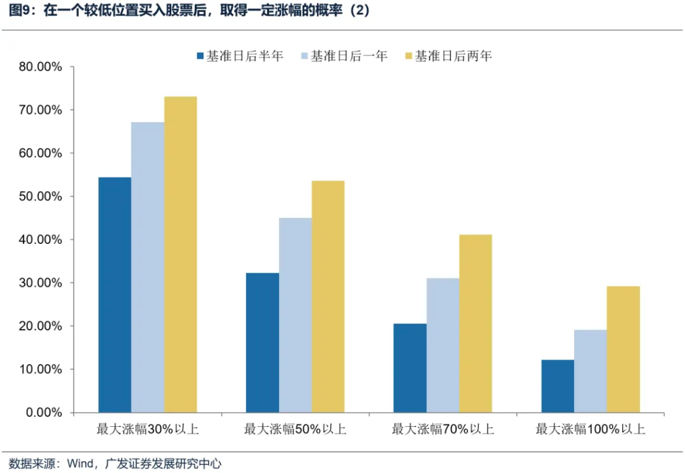

本文作者：广发证券刘晨明（SAC执证编号：S0260524020001）、郑恺（SAC执证编号：S0260515090004），来源：[晨明的策略深度思考](https://mp.weixin.qq.com/s?__biz=MzAxNjAwNTMwNQ==&mid=2652379864&idx=1&sn=dbf391186a92c8623a14da12be6df728&chksm=81d51c30607abe81ef14dec6a57281149e595b38398b44127592364627ed9bdfefbfd9b8b93c&mpshare=1&scene=23&srcid=0105UvSJvc1tnW0FiSf1KHfm&sharer_shareinfo=cbd5a1d0a35bcfaef3f6ee0b2e7edbfc&sharer_shareinfo_first=cbd5a1d0a35bcfaef3f6ee0b2e7edbfc#rd)，原文标题：《【广发策略】如何看待开年下跌和后续的选股思路？》，华尔街见闻有所删减

风险提示及免责条款

市场有风险，投资需谨慎。本文不构成个人投资建议，也未考虑到个别用户特殊的投资目标、财务状况或需要。用户应考虑本文中的任何意见、观点或结论是否符合其特定状况。据此投资，责任自负。
