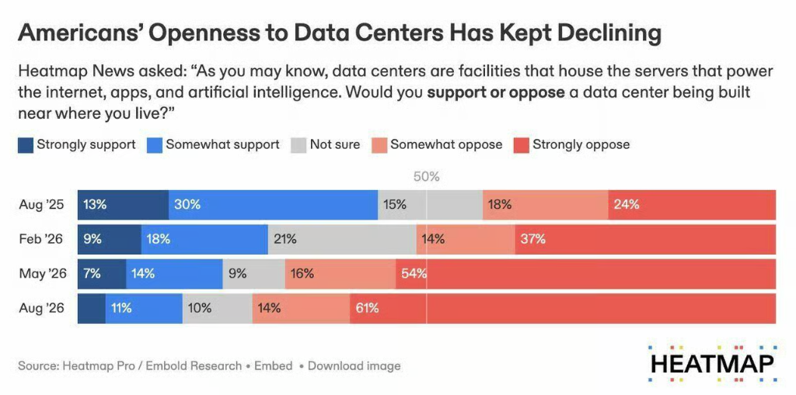
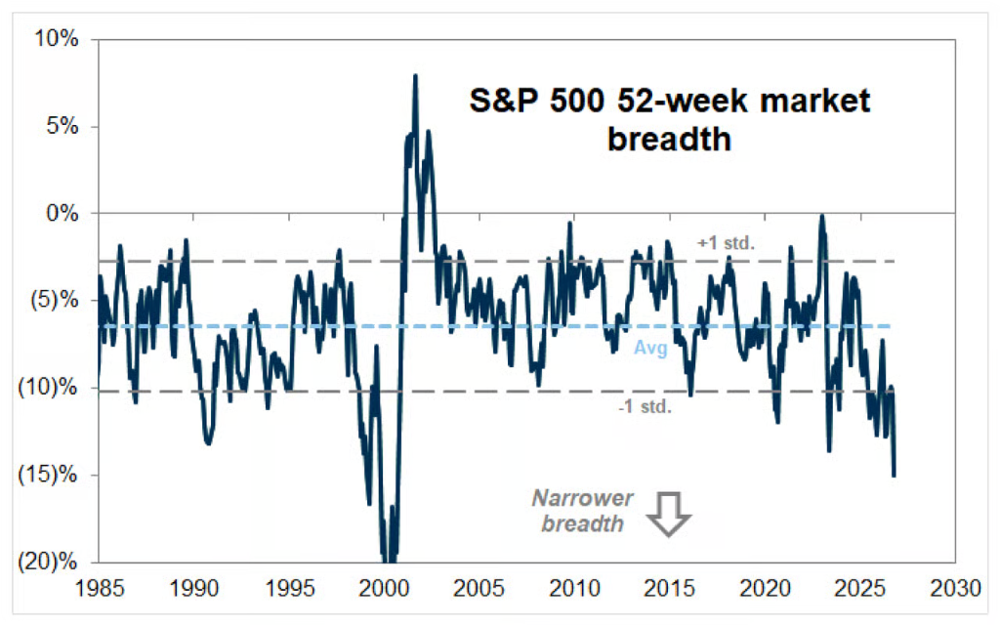
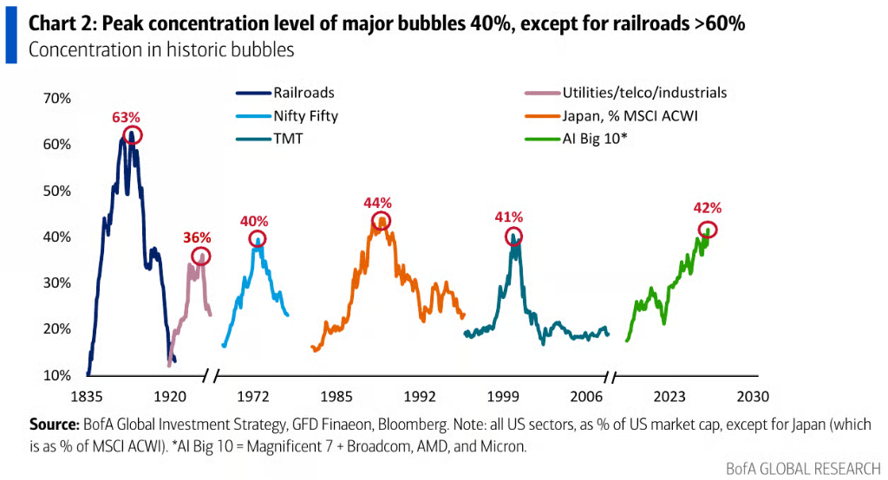
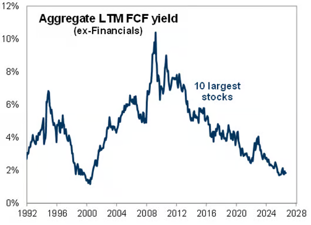
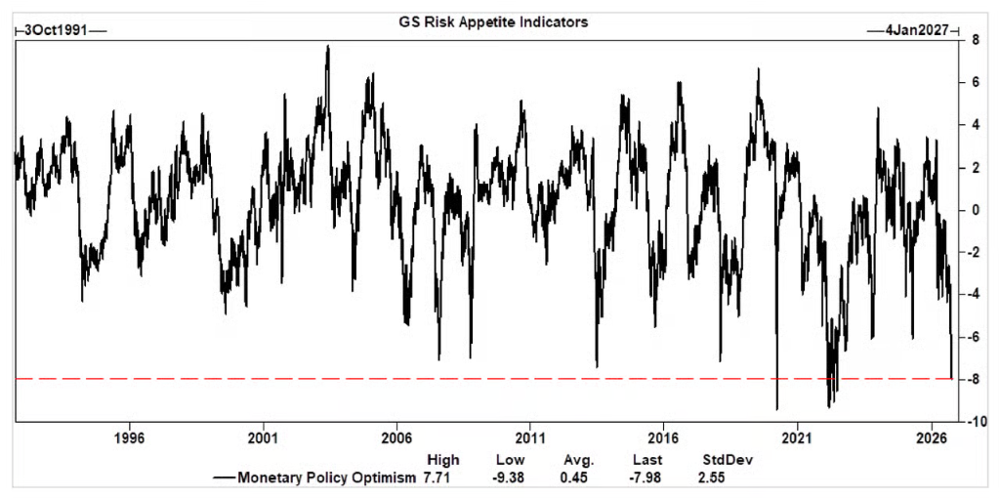

# 如何看待当前的AI泡沫？大佬们吵翻了

- 页面显示时间：2026-10-08T13:55:18+08:00
- 页面署名：董静
- 标注来源：未单列，见正文
- 原文：[华尔街见闻](https://wallstreetcn.com/articles/3783165)
- 取得时间：2026-11-04T16:03:53+08:00
- [HTML阅读版](article.html) · [来源记录](metadata.json)

## 导语

Novogratz称"泡沫还不够壮观"；达利欧警告"已非常接近破裂"；Taleb指真正风险在债券市场。高盛数据显示，AI股市值已占标普500的42%，超越1999年科技泡沫顶峰。争论焦点现已演变为“破裂前如何搞钱”。

---

AI泡沫之争已从“是否存在泡沫”演变为“如何在泡沫破裂前赚钱”。围绕这一问题，全球顶级投资人本周公开交锋，观点针锋相对，却在一个结论上罕见达成共识： **这是我们有生之年最大的泡沫。**

10月8日，据彭博报道， **Galaxy Digital创始人Mike Novogratz在格林威治经济论坛上表示，AI正处于“我们有生之年最大的泡沫”之中，但他同时建议投资者立刻入场。** 他的逻辑是：“泡沫不会像现在这样结束。我知道泡沫如何终结——它们以壮观的方式终结，而现在还不够壮观。”换言之，泡沫是真实的，只是还没膨胀到极致。

与此同时，桥水基金创始人达利欧（Ray Dalio）在新加坡发出截然相反的警告，称 **AI是一个“经典泡沫”且已接近破裂** 。《黑天鹅》作者Nassim Taleb则将目光转向债券市场，认为 **真正的风险断层在那里。**

这场争论的市场意义不容忽视。高盛数据显示，AI相关股票市值已占标普500总市值的42%，超过1999年科技股泡沫顶峰时的41%，市场集中度创历史次高；与此同时，标普500成分股的市场宽度已跌至互联网泡沫顶峰以来最窄水平。

高盛策略师Bobby Molavi梳理过去两个世纪所有重大资本支出繁荣周期后发现， **触发崩溃的机制几乎从未“壮观”——而是始于一次央行政策转向，且往往在股票见顶后资本支出仍继续攀升长达两年。**

## Novogratz：泡沫不够大，现在入场

Novogratz的多头逻辑建立在估值之上。他认为，AI相关股票以市盈率衡量仍属便宜，并以近乎激进的措辞敦促观望者行动：“如果你还没有投资AI，不如回家把头埋进冰桶里。”

在政策层面，他认为AI不存在政治刹车。他指出，华盛顿“很难放慢AI的步伐，哪怕是放慢到那些正在构建AI的人自己希望的程度”。

**值得注意的是，这并非Novogratz第一次发出“有生之年最大泡沫”的判断。** 2017年11月，他曾以同样的措辞描述加密货币，同样保持看多立场。彼时比特币在次月见顶，随后跌去逾80%，其旗下公司Galaxy Digital在2018年亏损高达2.73亿美元。

不过，如果要公平而言，他最终被证明对比特币的长期判断是正确的——只是中间经历了一次惨烈的崩盘。

## 达利欧：经典泡沫，已近破裂

达利欧本周三在新加坡表示，AI是一个“经典泡沫”，正在逼近破裂节点，驱动力来自两股力量： **利率上升** 与 **将纸面财富转化为现金的需求** 。

> “我们正处于那个节点之前，但正在接近。我认为我们已经很近了。”

自今年6月以来，达利欧已多次就此发出警告。他告诉彭博电视，“刺破泡沫的过程就是将财富转化为货币的过程”。此后形势进一步恶化：长期美债收益率已升至2002年以来最高水平。达利欧还补充警告称，日本可能减持美国国债，因为一段既是债权人与债务人、又是对立方的关系“会制造非常困难的动态”。

Dalio还指出，AI企业过去依赖股权融资， **如今正被迫转向债务融资** ，而这一转变恰逢资金成本大幅攀升之际，进一步加剧了财务脆弱性。

## Taleb：真正的风险在债券市场

Taleb在格林威治论坛上认同达利欧对泡沫的诊断，但对风险来源的判断有所不同。据彭博报道，他表示：“债券市场非常脆弱。”

他的担忧并不主要指向东京的减持行为，而是聚焦于美国国内退休基金和机构投资者可能撤离长久期债券。他认为，这一群体的退出将造成远比外国央行抛售更大的冲击——而AI企业的债务融资需求，正在与美国国债争夺同一批久期买家。

**Taleb对“因为AI改变世界就买AI股”的逻辑提出了明确警告，称这将是“一个陷阱”。**

他援引历史指出，技术变革的最大受益者往往不是最初的开拓者。他还提醒，标普500并不等同于美国经济，其最大成分股均为全球性企业，中等收入家庭的状况才是衡量美国经济健康的更真实指标。

一贯风格下，Taleb拒绝预测市场崩盘时点——“认为市场会下跌是一种错误的思维方式……你应该思考的是风险在上升”——并给出了他标志性的建议：“永远持有尾部对冲，哪怕你没有任何对冲的理由。”

## 高盛内部：估值派与历史派的分歧

高盛内部对这场争论并未形成统一立场，两种截然不同的声音并存。

策略师Bobby Molavi梳理了过去两个世纪的重大资本支出繁荣周期——1845年铁路、1929年公用事业、1989年日本、2000年互联网、2014年页岩油——得出一个规律性结论：

> **“触发因素几乎每次都相同——央行政策转向。每次顺序一致：股票见顶，资本支出继续攀升（持续6至24个月），然后资本支出回落，随后股票回落。”**

这意味着，当泡沫看起来“足够壮观”时，顶部往往已经过去。而资本支出在股票见顶后仍持续上升的阶段，恰恰是所有人指着不断增长的支出说“你看，根本没有泡沫”的时刻。

**Molavi的数据同样触目惊心：** AI相关股票市值占标普500的42%，已超过1999年科技股泡沫顶峰的41%，仅次于1830年代铁路狂热（63%）和1985年日本（44%）。与此同时，标普500的市场宽度已跌至互联网泡沫顶峰以来最窄水平。

美银策略师Michael Hartnett亦持相近立场，称AI是 **“自铁路以来最大的泡沫”。**

然而，高盛的Tony Pasquariello提供了另一面数据：AI基础设施股票的远期市盈率中位数已从4月的32倍降至22倍，“这些公司正在兑现业绩，而市场对待它们的态度比1999年、2007年或2021年要冷静得多”。他还指出，AI基础设施股票预计将贡献标普500三季度盈利增长的一半，其中英伟达和美光两家公司合计贡献三分之一。

**“市盈率便宜”论的软肋在于：盈利越来越多地需要用于支撑资本支出，留给股东的自由现金流所剩无几。** 目前，标普500前十大成分股的自由现金流收益率已降至互联网泡沫以来最低水平。

## 共识与分歧：所有人都说买，但理由各异

综合各方立场，一个吊诡的共识浮出水面： **无论是认为泡沫尚未到顶的Novogratz，还是认为泡沫即将破裂的达利欧，抑或是美国银行和星展银行（DBS）首席投资官Hou Wey Fook，几乎所有人都在建议投资者继续持有或买入AI相关资产——只是对冲方式和风险意识有所不同。**

美国银行建议客户通过股票衍生品对冲下行风险的同时继续持仓；星展银行的Hou Wey Fook则以英伟达十几倍的远期市盈率反问"这怎么可能是泡沫"。

**真正的分歧在于触发机制与时间窗口。** 达利欧的利率与流动性收紧机制和Taleb的债券市场脆弱性，本质上是同一枚硬币的两面，而AI企业的债务融资狂潮正处于这枚硬币的正中央。高盛自身的“货币政策乐观度”指标已跌至-7.98，逼近历史最低值-9.38，而标普500同期仍处于历史高位——这一背离本身，或许就是最值得警惕的信号。

正如Molavi的历史研究所揭示的： **泡沫破裂的方式，往往远比人们预期的更为平淡，“壮观”只在事后的回望中才变得清晰。**

风险提示及免责条款

市场有风险，投资需谨慎。本文不构成个人投资建议，也未考虑到个别用户特殊的投资目标、财务状况或需要。用户应考虑本文中的任何意见、观点或结论是否符合其特定状况。据此投资，责任自负。
