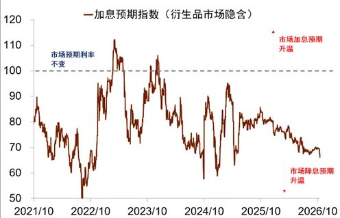
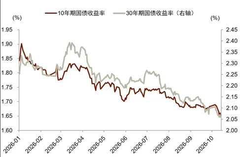
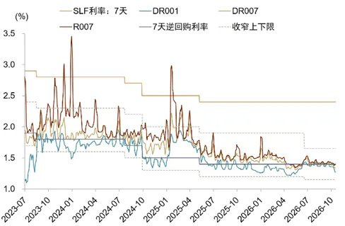
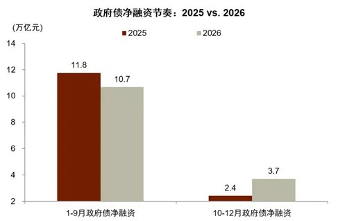
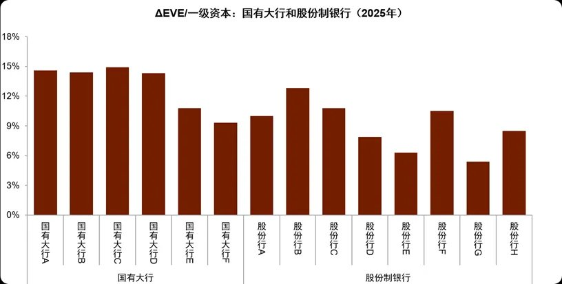
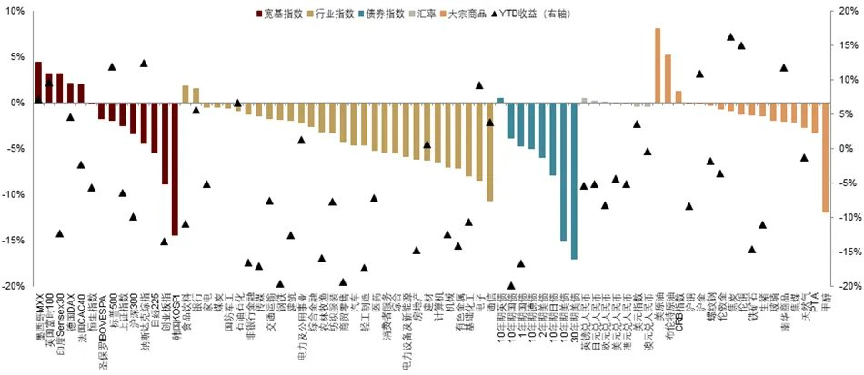
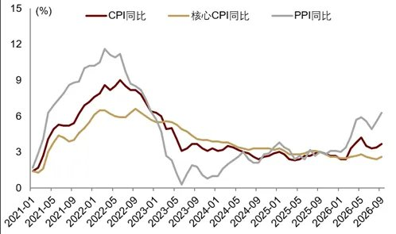
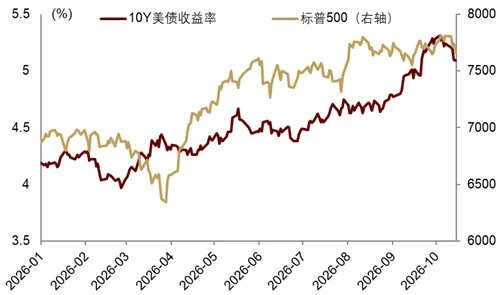

# 如何看待降息预期走强？

- 页面显示时间：2026-10-19T09:13:52+08:00
- 页面署名：董静
- 标注来源：中金周彭、周奕江等
- 原文：[华尔街见闻](https://wallstreetcn.com/articles/3783881)
- 取得时间：2026-11-04T16:03:30+08:00
- [HTML阅读版](article.html) · [来源记录](metadata.json)

## 导语

中金认为，关键信号在于：央行未因收益率下行而收紧流动性，反以加量续作、净买国债释放宽松信号。但央行更可能通过"政策利率换锚"而非直接降7天逆回购利率实现降息——此举对存量贷款利率影响有限，银行净息差压力较小，但国债收益率进一步下行空间或受限，明年财政力度才是债市走向的核心变量。

---

**中金研究**

> 10月国庆假期后，利率衍生品市场隐含的降息预期迅速走强，已经来到了央行前几轮降息前的水平。降息预期走强的一个原因是，9月下旬以来国债收益率较快下行并未触发央行流动性收紧。我们认为，相对于普降7天逆回购利率和LPR，央行通过政策利率“换锚”、保持资金利率中枢在较低位置实现降息的可能性大一些。如果是后一种降息方式，国债收益率进一步下行的空间可能受限，而且这种降息大概率不影响存量贷款利率、新发贷款利率或会有所下行。明年财政政策力度预期仍是国债收益率方向的重要影响因素。

10月国庆假期后，利率衍生品市场隐含的降息预期快速走强，已经来到了央行前几轮降息前的水平（图表1）。我们计算的利率互换隐含的未来1年的降息概率从10月8日起快速走强，截至10月16日，该概率已经来到了央行2025年5月、2024年9月和7月、2023年8月降息前的水平。同时，10年期、30年期国债收益率快速走低（图表2），截至10月16日，两者分别位于1.65%、2.06%，均为年内新低。

近期降息预期快速走强的一个原因是，国债收益率较快下行并未触发央行流动性收紧，资金面仍然保持宽松。今年二、三季度，央行曾多次在国债利率较快下行时收紧流动性投放，如4月中下旬连续“地量”逆回购，6月3-4日逆回购零操作，4月、8月MLF缩量续作，4-6月买断式逆回购连续净回笼等。

9月下旬，在基本面数据相对较弱、股市情绪偏谨慎等多重因素影响下，10年期、30年期国债收益率分别跌至1.67%、2.07%的年内低位，但央行对资金面仍然展现出偏支持态度：9月央行加量2000亿元续作MLF（8月为缩量续作），并在公开市场净买入国债1000亿元（年内最高）；9月28日-10月8日，央行每日隔夜逆回购操作量在6000-8500亿元之间、是央行6月设立该项工具以来最高。10月假期后，10年期、30年期国债收益率继续下行，央行仍两次加量续作买断式逆回购（9月为等量续作），每日7D逆回购净投放也维持在400-600亿元的常规区间。受此影响，10月假期后DR001、DR007中枢已分别降至1.30%、1.35%以下（9月分别为1.38%、1.40%，图表3）。

传统意义上的降息是普降，即调降7天逆回购利率、并引导LPR下行。引导利率下行，也可以通过政策利率“换锚”、保持资金利率中枢在较低位置来实现，我们认为，后一种降息方式的可能性比普降更大。

如果央行直接调降7天逆回购利率，LPR大概率跟随下行，存量贷款利率将下调，若存款利率跟随下降有限，银行净息差受到的影响可能较大。我们认为这种情形的概率不高。9月底以来，房贷贴息、PSL降息扩围、地方债结存限额启用等一系列增量政策陆续落地，叠加四季度政府债净融资可能同比多增1.3万亿元（图表4）、财政存款使用有加速空间、政策性金融工具还剩约7000亿元待投放，经济增长可能温和修复，全年经济目标大概率可以顺利实现，在这个时间点货币政策大幅加码的必要性还有待观察。

我们认为，央行更可能通过引导资金利率中枢保持在较低位置实现降息，例如推动政策利率从7天逆回购利率转向更低的隔夜逆回购利率，或者在公开市场操作中维持较大规模的净投放。在这种情形下，LPR可能不会跟随下调，存量贷款利率也不受影响，仅部分挂钩DR利率的新增贷款利率有下行空间，叠加存款利率可能跟随下降，我们预计银行净息差受到的影响比较小。

如果后一种降息方式兑现，国债收益率的快速下行或暂告一段落，后续需要更加关注明年的财政力度。由于债市已经计入了较强的降息预期，降息落地后国债收益率可能难以再继续大幅下行。2023年至今历次降息落地后，10年期国债收益率的下行节奏均有所放缓。越过四季度，明年财政政策的力度仍是国债收益率能否继续下行的重要影响因素。我们预计今年全年政府债净供给的规模在14.1万亿元左右\[1\]。若明年政府债净供给的力度仍然较强，市场可能重燃对银行净资本和承接国债能力的关注。过去几年，我国商业银行购买了较多长久期国债，监管要求银行准备与其资产端和负债端期限错配程度相适应的资本金水平，落实到监管指标上，就是经济价值变动（ΔEVE）相对一级资本的比例（参见我们此前的报告《“防风险”会成为利率下行的限制么？》）。从各上市银行2026年发布的《2025年度第三支柱报告》来看，部分银行ΔEVE/一级资本已经接近15%（图表5）。

**市场观察**

本周中美股市下跌，主要国债收益率回落，美元走弱，铜金下跌、原油上涨。权益方面，中国9月出口同比由25.0%升至36.3%、PPI由3.8%升至5.0%，CPI由0.8%升至0.9%、核心CPI持平于1.0%，社融存量同比增速则较8月的7.2%继续回落至7.1%。反映外需强劲、上游涨价而终端需求仍偏弱。沪深300、创业板指分别下跌3.4%、8.9%，食品饮料、银行上涨，电子、通信跌幅较大。美国9月CPI、PPI环比分别由0.4%、0.5%升至0.6%、1.3%，通胀压力升温，而联储官员释放审慎加息信号。标普500、纳斯达克分别下跌1.9%、4.5%，恒生指数、日经225分别下跌0.1%、5.4%，德国DAX上涨2.1%。债券方面，中国1年、10年国债收益率分别下行4.7bps、3.8bps至1.17%、1.65%；美国2年、10年国债收益率分别下行6bps、15bps至4.74%、5.09%，曲线牛平；日本、德国10年国债收益率分别下行7.9bps、5bps至2.95%、3.48%。汇率方面，美元指数下跌0.4%至101.84，人民币对美元升值0.1%至6.69，对日元、欧元贬值。商品方面，伦铜、伦金分别下跌1.3%、0.7%，布伦特原油上涨5.2%；内盘方面，玻璃、螺纹钢、生猪分别下跌1.9%、0.3%、1.5%。

本周美国通胀超预期而美债收益率回落，反映市场开始重估高利率对AI融资及增长的约束。美国9月CPI、核心CPI及PPI同比分别升至3.7%、2.6%、6.3%，能源涨价叠加商品需求和租金粘性推动通胀反弹。但在通胀超预期情况下，债券利率不升反降。我们认为，一方面，高利率已部分承担紧缩作用，近期美联储多位官员放风暂缓加息、抑制加息幅度或持续时间。美联储理事沃勒本周指出长端利率上升正在抑制住房、汽车需求\[2\]，纽约联储主席威廉姆斯认为年内再加息一次适宜，但目前看明年无须继续加息\[3\]。美联储主席沃什在IMF年会上虽重申物价稳定目标、未预判议息决定，但强调AI对就业和经济转型的影响，并提出评估金融稳定及下行尾部风险，为政策兼顾金融风险留下空间\[4\]。另一方面，融资压力开始从AI信用市场向股票和增长预期传导。CoreWeave信用违约掉期（CDS）利差本周突破1,000bps并创历史新高\[5\]，表明债权人更关注现金流能否覆盖还本付息，市场因而下修高杠杆扩张的可持续性预期，科技股承压、避险需求支撑美债，股债跷跷板重新显现。往前看，AI行情下半场更依赖融资条件与增量资金（《“棉花糖”时代的美国AI》）。若信用收紧进一步拖累投资与就业，我们判断未来3—6个月美联储有望向兼顾金融稳定转向，市场对政策托底的预期或逐步回归；若政策配合带来增量资金，融资约束缓解有望支持AI投资与行情再扩张。

图表1：10月以来，衍生品市场隐含降息预期走强

资料来源：Wind，中金公司研究部

图表2：10年期、30年期国债收益率均创历史新低

资料来源：Wind，中金公司研究部

图表3：近期资金利率中枢有所下行

资料来源：Wind，中金公司研究部

图表4：四季度政府债净融资可能同比多增1.3万亿元

注：2026年10-12月政府债净融资为我们的预测值

资料来源：Wind，中金公司研究部

 

图表5：2025年，部分上市银行ΔEVE/一级资本接近15%的监管阈值

资料来源：上市银行《2025年度第三支柱报告》，中金公司研究部

图表6：中美股市下跌，主要国债收益率回落，原油上涨

注：截至2026年10月16日，较10月9日收盘变化。债券变动单位为bps，其余为%。

资料来源：iFinD，中金公司研究部

图表7：美国9月CPI与PPI同比回升

资料来源：Wind，美国劳工统计局，中金公司研究部

图表8：本周美股回调，股债跷跷板效应显现

资料来源：Wind，中金公司研究部

本文来源：[中金点睛](https://mp.weixin.qq.com/s?__biz=MzI3MDMzMjg0MA==&mid=2247864956&idx=2&sn=d9b06bbd2a2846d0f12a779a62791885&chksm=eb27aa15e0de05625c03dd065d8bba3a63575d6f45fb9e195597d0eeeec2eea209c1cf0e304a&mpshare=1&scene=23&srcid=1019KzpEfuOEp2sXzixRFJly&sharer_shareinfo=d9a0ed7dd39d46e032bc227519ebcf9d&sharer_shareinfo_first=d9a0ed7dd39d46e032bc227519ebcf9d#rd)

风险提示及免责条款

市场有风险，投资需谨慎。本文不构成个人投资建议，也未考虑到个别用户特殊的投资目标、财务状况或需要。用户应考虑本文中的任何意见、观点或结论是否符合其特定状况。据此投资，责任自负。
