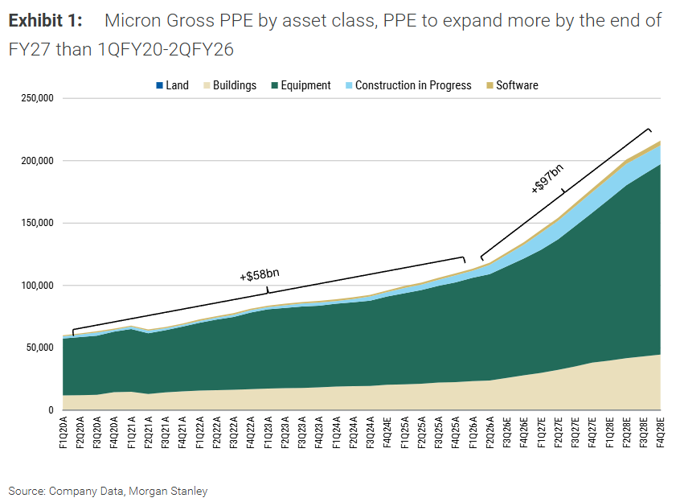
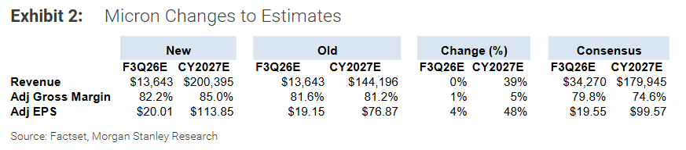
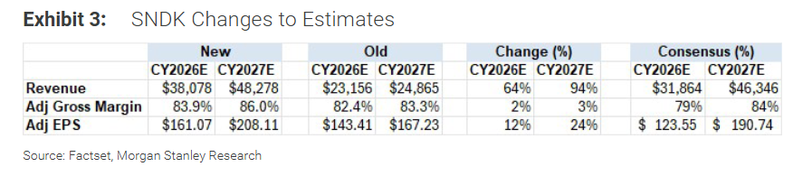

# 存储缺口为什么难补？大摩：无尘室不足+光刻机产能受限，想扩也扩不了

- 页面显示时间：2026-06-03T20:14:48+08:00
- 页面署名：卜淑情
- 标注来源：未单列，见正文
- 原文：[华尔街见闻](https://wallstreetcn.com/articles/3773787)
- 取得时间：2026-11-04T16:04:02+08:00
- [HTML阅读版](article.html) · [来源记录](metadata.json)

## 导语

存储芯片正成为AI时代最稀缺的战略资源。摩根士丹利指出，受无尘室建设周期漫长、EUV光刻机供应受限等物理瓶颈影响，DRAM和NAND供需失衡局面未来2至3年难以缓解。AI云厂商持续高价抢购HBM和高性能存储，推动存储价格进入上升周期。

---

AI算力军备竞赛正在将存储芯片市场推入一场结构性短缺，而这一缺口在未来数年内几乎无解。

据追风交易台，摩根士丹利在6月3日发布的最新研究报告中指出， **DRAM已成为AI基础设施扩张的核心瓶颈，NAND供应同样极度紧张，供需失衡局面预计将持续2至3年甚至更长时间。**

报告同步 **大幅上调美光和闪迪的目标价，其中美光目标价从520美元上调至1050美元，闪迪目标价从1100美元上调至1750美元，两只个股均维持增持评级。**

大摩分析师Joseph Moore在报告中强调，制约供给扩张的核心障碍并非资本意愿，而是物理层面的硬约束——无尘室产能不足与EUV光刻机供应受限，使得存储厂商即便有意大规模扩产，实际落地速度也将受到严格限制。这一判断直接支撑了大摩对存储股盈利周期"更长久、更高峰"的核心论点，并推动其将美光CY2027年每股收益预期上调48%。

## 供给扩张的物理天花板

大摩报告明确点出，此轮存储短缺之所以"没有快速解法"，根本原因在于扩产面临两大不可绕过的物理瓶颈：无尘室建设周期漫长，以及EUV极紫外光刻机产能受限。

无尘室的建设从规划到投产通常需要数年时间，这意味着即便存储厂商现在启动扩建，新增产能也难以在短期内形成有效供给。与此同时，EUV光刻机作为先进制程存储生产的核心设备，其全球供应本身即受到严格约束，进一步压缩了厂商快速响应市场需求的空间。

大摩在报告中指出，DRAM的比特供给增长将在2027至2028年随新产能陆续投产而加速，但整体节奏仍受制于建设工期与产线爬坡时间。此外，HBM（高带宽内存）生产对晶圆的高消耗比，也在结构上持续压缩普通DRAM的可用供给。

## DRAM：AI基础设施的核心瓶颈

大摩将DRAM定性为当前AI基础设施扩张的"首要瓶颈"，超大规模云厂商（hyperscaler）的采购意愿依然强劲，且支付溢价的意愿持续维持高位。

报告预测，DRAM价格将在5月季度环比上涨40%，8月季度再涨15%。大摩指出，其在中国台湾供应链调研中听到的涨价预期甚至更高——部分供应链人士预计单季涨幅达20%或以上——但大摩选择采用相对保守的假设，并提示并非所有业务都会按季度调价节奏同步重定价。

基于更高的定价假设，大摩将美光 CY2026/CY2027年调整后每股收益预期分别上调4%和48%，新预测值分别为每股约20美元（F3Q26单季）和113.85美元（CY2027全年），均显著高于市场一致预期。

## NAND同样紧绷，闪迪受益于云端需求

NAND市场的供需格局同样偏紧。大摩指出，超大规模云厂商正在持续抢占高性能NAND份额，这一趋势正在从结构上重塑这一品类的需求画像，而供给侧的调整明显滞后。

闪迪的合资伙伴铠侠在近期投资者日上仅将长期比特增长预期从20%小幅上调至22%，且资本支出计划维持低位，约为每年4700亿日元。大摩认为，铠侠对智能手机和PC市场需求的保守预期，是其资本开支维持克制的主要原因。

尽管移动端和PC端需求疲软，但大摩强调，这并未对NAND整体定价环境构成拖累。报告将闪迪 CY2026/CY2027年每股收益预期分别上调12%和24%，同样以更高定价为核心驱动。大摩将闪迪目标价上调至1750美元，基于28倍穿越周期每股收益62.50美元的估值框架。

## 估值仍有空间，多重催化剂待释放

尽管美光和闪迪股价在2025年已大幅跑赢市场，并延续至2026年，大摩认为强势行情尚未终结。

报告指出，两只个股基于CY2027年预期的市盈率均低于10倍，估值仍处于合理区间，存在进一步扩张空间。大摩认为，随着投资者逐步将更长的盈利持续性纳入定价，估值倍数的提升有望成为未来回报的更大驱动力。

大摩列出的近期催化剂包括：2026年下半年HBM合同重新谈判、2027年起启动的股票回购计划（大摩预计美光在FY2027至FY2028年间回购规模达500亿美元），以及闪迪在数据中心市场渗透率的持续提升。

对于市场近期热议的长协（LTA），大摩将其定性为"高位持续"预期的结果而非原因，认为这是超大规模云厂商为锁定未来供应而主动做出的战略承诺，本身即印证了需求端的长期确定性。

## 资本开支大幅扩张，折旧压力可控

大摩对美光资本开支的预测远高于市场一致预期。报告预计美光 FY2027/FY2028年资本开支分别为440亿美元和400亿美元，而市场一致预期分别为376亿美元和369亿美元。

大摩承认，更高的资本开支将对自由现金流形成拖累，但其详细的折旧摊销模型显示，D&A的增量冲击在财务上可以消化。与此同时，新增产能带来的比特增长，在市场持续偏紧的情景下，有望转化为额外的营收和每股收益上行空间。

大摩将美光目标价上调至1050美元，基于29.5倍穿越周期每股收益35美元，与半导体板块整体估值水平相当，并将FY2021至FY2028年平均盈利能力作为穿越周期盈利基准。

 

 

\~\~\~\~\~\~\~\~\~\~\~\~\~\~\~\~\~\~\~\~\~\~\~~

以上精彩内容来自[追风交易台](https://mp.weixin.qq.com/s/uua05g5qk-N2J7h91pyqxQ)。

更详细的解读，包括实时解读、一线研究等内容，请加入【 [**追风交易台▪年度会员**](https://wallstreetcn.com/shop/item/1000309) 】

风险提示及免责条款

市场有风险，投资需谨慎。本文不构成个人投资建议，也未考虑到个别用户特殊的投资目标、财务状况或需要。用户应考虑本文中的任何意见、观点或结论是否符合其特定状况。据此投资，责任自负。
