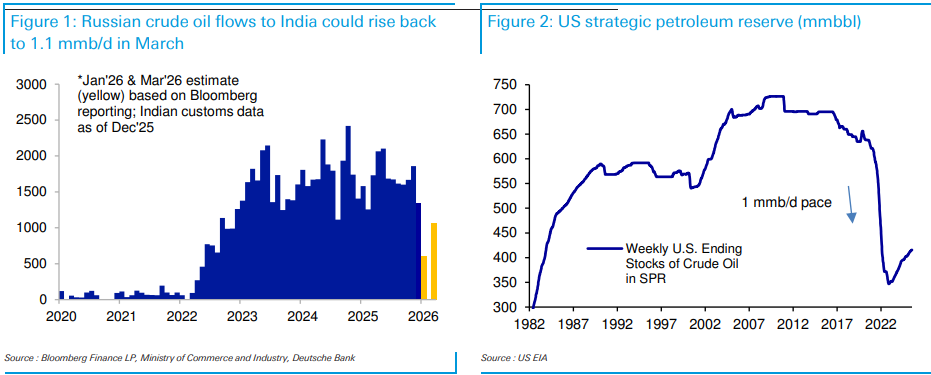

# 对于油价，除了海峡重启，“其他都不重要”

- 页面显示时间：2026-03-10T15:55:01+08:00
- 页面署名：赵颖
- 标注来源：未单列，见正文
- 原文：[华尔街见闻](https://wallstreetcn.com/articles/3767113)
- 取得时间：2026-11-04T16:03:33+08:00
- [HTML阅读版](article.html) · [来源记录](metadata.json)

## 导语

德意志银行最新研报指出，油价突破100美元/桶，意味着市场正定价逾一个月的海峡中断；若升至130-150美元，则对应三个月关闭预期。SPR释放、俄油豁免均杯水车薪——每日300万桶的释放能力远不及1700-2000万桶的缺口。特朗普明言油价不会约束军事决策，海峡重启时间表成为一切的答案。

---

当下霍尔木兹成为投资者紧盯的唯一变量，目前市场对其中断的定价已超过1个月。

据追风交易台，德意志银行大宗商品研究分析师Michael Hsueh于2026年3月9日发布最新研报，核心结论直截了当、毫不含糊：霍尔木兹海峡何时能够安全重开，是当前油价走势的唯一决定性变量。

**无论是战略石油储备（SPR）释放、俄罗斯原油豁免，还是油价上限等政策工具，在海峡重开问题明朗化之前，均无法从根本上扭转油价走势。**

当前市场油价已突破100美元/桶，按德银模型测算，这意味着市场正在定价超过一个月的海峡中断。若油价升至105-115美元/桶区间，则对应市场定价约两个月的中断；若进一步升至130-150美元/桶，则意味着市场预期长达三个月的关闭。当前最关键的操作逻辑只有一个：密切关注海峡重开的时间节点与安全条件。

## 油价已超越一个月中断定价，上行空间仍存

报告指出，油价突破100美元/桶，已超过此前"模糊关闭"情景下80-100美元/桶的定价区间，意味着市场已将中断时长的预期从一个月延伸至更长周期。105-115美元/桶对应约两个月中断，而130-150美元/桶则对应三个月关闭情景。

**从下行情景来看，若军事护航商业船队能够在3月18日前后启动，并允许商业通行量先以50%速度恢复，继而在4月初达到100%，则实际中断时长将接近一个月。**

在此假设下，布伦特原油价格有望回落至90美元/桶附近，具体取决于市场对油轮持续受攻击风险的判断。

## 特朗普明确表态油价不会约束军事决策、印度获俄油豁免也杯水车薪

报告的一个重要观察是，美国决策层似乎不存在因油价过高而约束军事行动的门槛。据新华社，针对国际油价上涨，美国总统特朗普8日在社交媒体说，为了“美国及世界的安全与和平”，这只是一个“非常小的代价”。

此外，美国财政部长贝森特虽宣称正在研究平抑油价的政策措施，但目前落地的实质性举措仅为向印度炼油商发放豁免许可，允许其接收已在途的俄罗斯油轮货物。

据估算，这一豁免将使印度3月份从俄罗斯的进口量升至3,300万桶，折合日均约110万桶/日，相比1月份估计的约60万桶/日有所提升，增量约为50万桶/日。

然而，报告明确指出，这一增量“在任何其他时期都是有意义的"，但在当前霍尔木兹海峡中断导致全球供应损失1,700-2,000万桶/日的背景下， **其影响几乎可以忽略不计。** 值得注意的是，3月的进口速度可能仍低于印度商业和工业部数据所记录的去年12月水平。

## SPR释放：情绪安抚剂而非根本解决方案

报告对SPR释放的效果给予了较为审慎的评价。财政部长贝森特表示将持续宣布平抑市场的措施，G7据报也在讨论协调释放紧急石油储备。

但德银分析指出，SPR释放存在三大根本局限：

> **其一，储量有限。** 一旦大规模释放，反而可能引发市场对供应储备耗尽的更大恐慌。
>
> **其二，存在供应时滞。** 日本政府披露，SPR释放通常需要约一个月时间（包含拍卖流程）；美国能源部则表示，最快可在宣布后13天开始交付，但具体取决于物流安排。
>
> **其三，释放速率严重不足。** 美国2022年SPR释放高峰期达到约100万桶/日，即便假设美国可提升至150万桶/日，加上其他IEA成员国合计再贡献150万桶/日，总计也仅为300万桶/日，远低于霍尔木兹海峡中断带来的每日1,700-2,000万桶的缺口。

因此，报告认为，SPR释放若不伴随海峡重启的明确前景，充其量只是短期情绪层面的安慰，而非供需层面的实质解决。

此外，报告特别强调了海峡重启的技术难度。军事海军分析人士此前判断，美军最早可能在上周中段起的10-14天后才会为商业船队提供军事护航。 **这意味着海峡重启最乐观的时间窗口可能在3月中旬至下旬。**

报告最后提出了一个潜在的供应恢复加速剂：若霍尔木兹海峡重启，沙特、阿联酋、科威特等拥有闲置产能的OPEC成员国可能临时提产，以弥补此前的供应缺口。德银认为此举符合这些国家的利益——既能防止高油价对需求造成持久损害，又能短期内获得收入提升，但目前尚无任何来自OPEC国家的相关表态或信号。

 

\~\~\~\~\~\~\~\~\~\~\~\~\~\~\~\~\~\~\~\~\~\~\~~

以上精彩内容来自[追风交易台](https://mp.weixin.qq.com/s/uua05g5qk-N2J7h91pyqxQ)。

更详细的解读，包括实时解读、一线研究等内容，请加入【 [**追风交易台▪年度会员**](https://wallstreetcn.com/shop/item/1000309) 】

风险提示及免责条款

市场有风险，投资需谨慎。本文不构成个人投资建议，也未考虑到个别用户特殊的投资目标、财务状况或需要。用户应考虑本文中的任何意见、观点或结论是否符合其特定状况。据此投资，责任自负。
