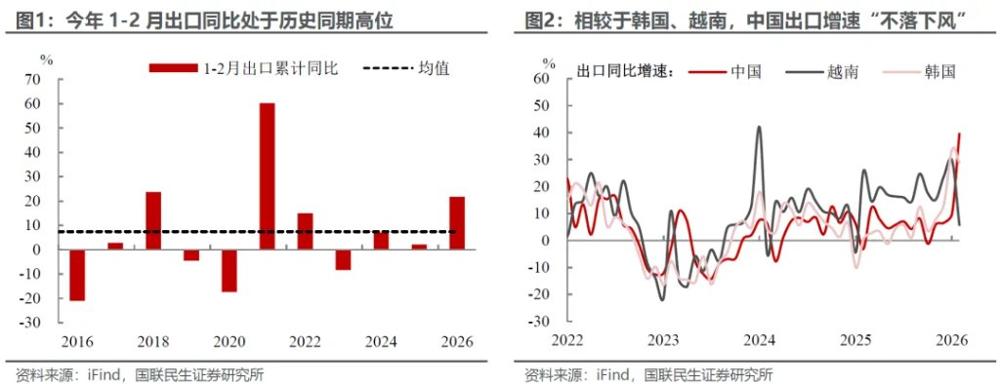
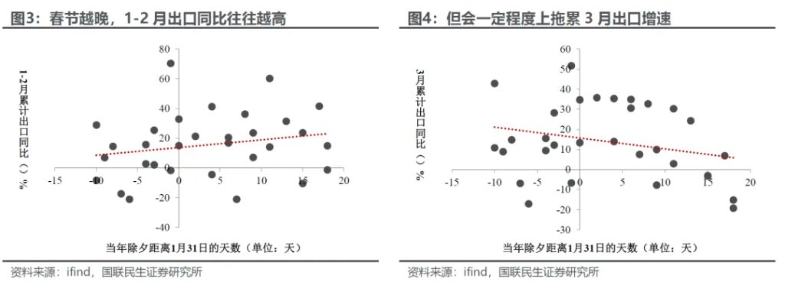
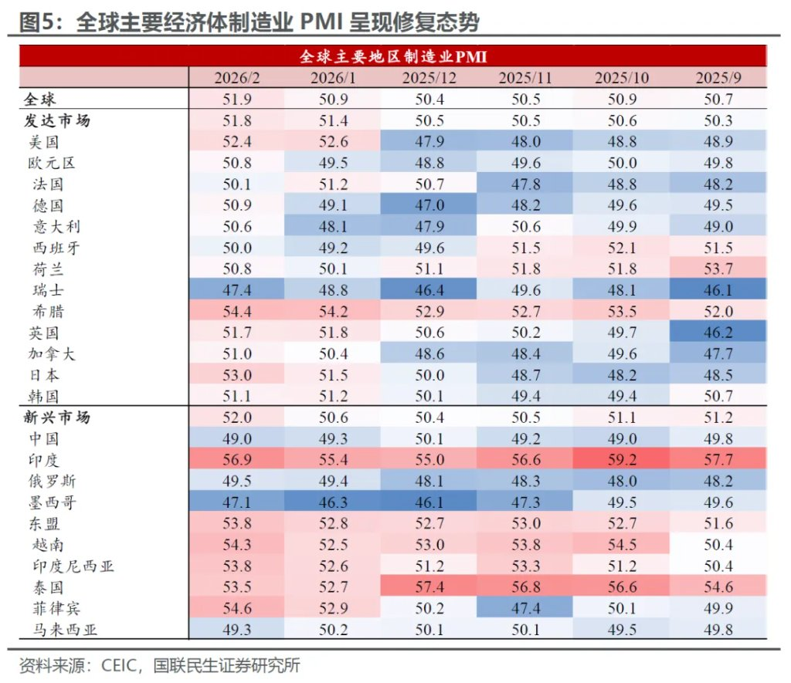
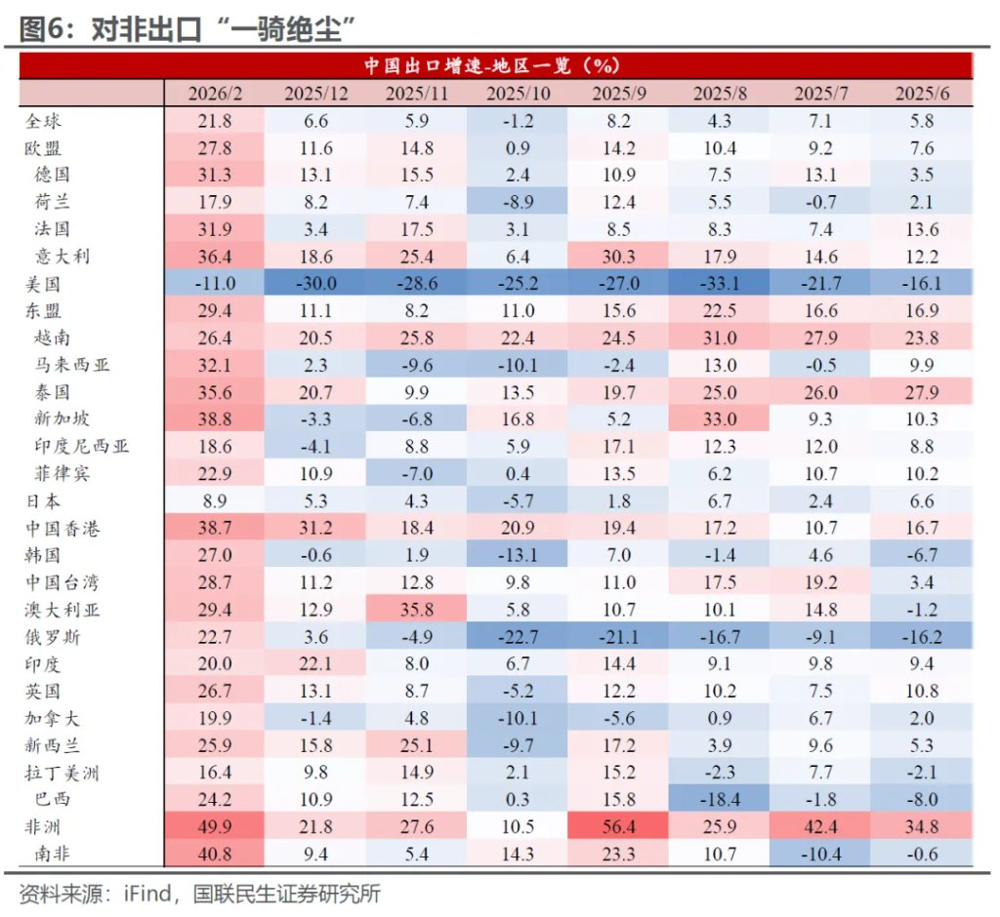
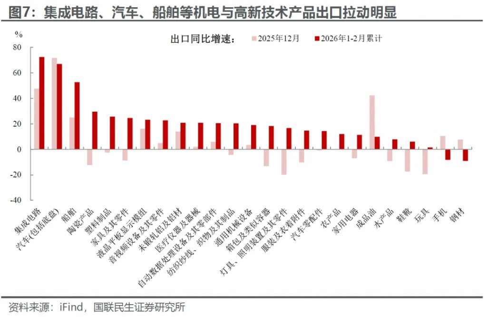
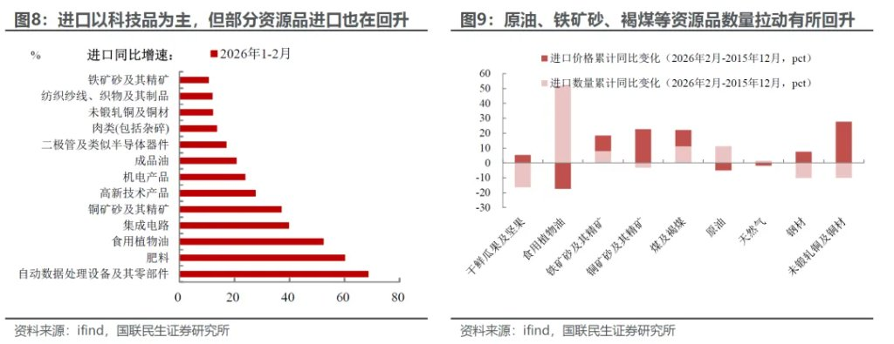

# 开年外贸：闪耀的非常信号

- 页面显示时间：2026-03-10T17:29:17+08:00
- 页面署名：李佳
- 标注来源：国联民生陶川团队
- 原文：[华尔街见闻](https://wallstreetcn.com/articles/3767144)
- 取得时间：2026-11-04T16:03:29+08:00
- [HTML阅读版](article.html) · [来源记录](metadata.json)

## 导语

国联民生陶川团队表示，1-2月我国出口同比增长21.8%，处于近十年季节性高位。除春节错位效应外，海外资本开支周期回暖、对非洲等新兴市场开拓、以及光伏退税预期下的“抢出口”构成三大额外支撑。进口同步修复反映内需回暖，但增速略弱于出口。高贸易顺差料将延续，为经济增长和人民币汇率提供支撑。

---

**1-2月进出口以两位数增速闪耀登场，印证了开年外贸的强现实，但更重要的是这一超预期下的强现实将如何演绎？** 我们认为除季节性因素之外，海外资本开支周期、区域开拓，以及光伏出口退税下的抢出口则是三个额外支撑。

**从纵向看** ，尽管存在春节因素的扰动，但对比历史同期，1-2月出口增速（21.8%）在近十年间仅略低于2018和2021年，处于季节性高位； **从横向看** ，1-2月我国出口相较韩国、越南等主要出口国家的高增长同样“不落下风”。

我们在去年的年终报告《2026年中国宏观展望：十问十答》中提示， **今年“出口进”是贯穿宏观经济的核心线索之一** ，1-2月出口的亮眼表现已对此形成初步印证。但在闪耀的开年数据映射下， **今年出口究竟能“进”到什么程度？**

**开年出口强劲的背后，存在春节错位效应的短期扰动。** 从历史经验来看，由于制造商通常会在春节前加大出口， **因此春节时点靠后往往会抬高1-2月出口、压低3月出口表现。** 今年春节较去年延迟近20天，进一步推动了1-2月企业的抢订单行为。

**除了季节性因素以外，还有哪些不寻常的因素支撑出口的高增？**

**其一，出口的强势表现与海外资本开支周期形成强映射。年初以来全球主要经济体制造业景气度普遍改善，全球制造业PMI一度跃升至51.9%。** 主要经济体如美国、欧元区等均重回荣枯线以上，外部需求回暖趋势清晰，对我国出口形成明显拉动，这一点从年初韩国出口的亮眼表现也能得到印证。

**其二，企业订单加速转移新兴市场，对非洲出口再度领跑** 。 **1-2月对非出口增速接近50%，仅略低于去年9月的阶段性高位，成为我国出口重要增长极** ；同时，以东盟、中国香港为代表的转口贸易以及欧洲市场均保持两位数高增，共同构成年初出口的核心拉动力量；

**其三，光伏出口退税取消或拉动部分行业“抢出口”。** 受4月光伏出口退税政策调整预期影响，企业存在一定提前出货行为，带动1-2月新能源汽车、电力电子相关设备、塑料玻璃等相关产业链出口明显走强。

**相对出口的强劲，进口同样“不落下风”，反映内需存在一定修复态势。** 虽然1-2月进口增速靠前的产品仍主要以自动数据处理设备、集成电路等高新技术产品和机电产品为主，科技属性更高，但传统内需和资源品进口增速也在逐步回温。而且从量价上来看，相对去年，铁矿砂、原油、褐煤等多数产品进口数量同比增速出现改善，不完全是价格拉动，这意味着内需呈现一定修复态势，不过整体增速依然略弱于出口。

**往后看，在出口强于进口的背景下，高贸易顺差格局有望延续。** 这一方面有望为“十五五”开局下的经济增长提供平稳支撑；另一方面，经常账户顺差的高增也将为汇率提供坚实基本面支撑，带动人民币升值。

本文来源：[国联民生陶川团队](https://mp.weixin.qq.com/s/qOnZVirZdXoNDsNuhfz6fQ)

风险提示及免责条款

市场有风险，投资需谨慎。本文不构成个人投资建议，也未考虑到个别用户特殊的投资目标、财务状况或需要。用户应考虑本文中的任何意见、观点或结论是否符合其特定状况。据此投资，责任自负。
