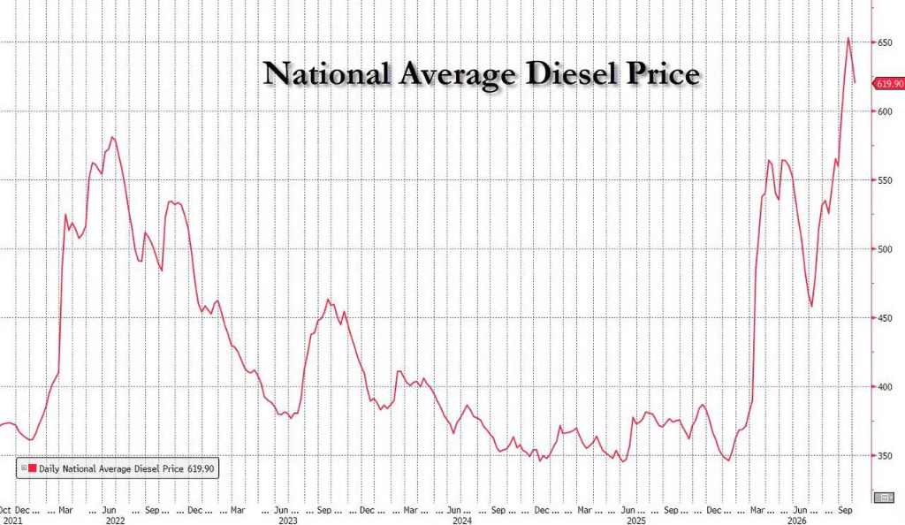

# 当前左右市场的最大变量：柴油价格

- 页面显示时间：2026-10-12T15:32:37+08:00
- 页面署名：许超
- 标注来源：未单列，见正文
- 原文：[华尔街见闻](https://wallstreetcn.com/articles/3783417)
- 取得时间：2026-11-04T16:03:34+08:00
- [HTML阅读版](article.html) · [来源记录](metadata.json)

## 导语

特普柴油协议虽难解供需之渴，却掀起重塑全球风险定价的多方博弈。当前“柴油价差即利率波动”，能源风险正跨资产深度传导。美股平静表象下，内部结构分化已达历史极值。后市紧盯欧洲储备动向与地缘局势，警惕极端失衡下随时爆发的脆弱暗流！

---

特朗普与普京的一通电话，将柴油价格推至全球市场的聚光灯下。从利率波动到股市结构，从欧洲储备释放到俄罗斯解禁出口，一场围绕柴油的多方博弈正在重塑投资者的风险定价框架。

据央视新闻报道，10月9日，美国总统特朗普在其社交媒体“真实社交”上发文称，他刚刚与俄罗斯总统普京进行了一次“非常成功”的通话。特朗普称，双方已达成一致，俄罗斯将立即向美国及全球市场供应超过30万吨柴油，随后在11月再供应50万吨，紧接着还将供应100万吨。克里姆林宫随即确认，普京重申俄罗斯愿向美国及全球市场供应石油和石油产品。俄副总理诺瓦克进一步表态，俄方将立即提前解除柴油出口限制，10月、11月、12月对外追加供应量分别为30万吨、50万吨和100万吨。

然而市场反应审慎——原油期货几乎纹丝不动，国债收益率同样未见明显波动。

与此同时，乌克兰总统泽连斯基公开批评这一决定，称放松对俄制裁"正中莫斯科下怀"，并将延长战争。他同时表示，只要俄罗斯不打击乌克兰能源基础设施，乌方可停止攻击俄罗斯炼油厂，并称美方了解乌克兰的谈判立场。这一表态在强硬措辞之外，隐含了谈判的可能性。

## 供应承诺有限，市场理性冷对俄罗斯柴油协议

市场对特朗普-普京通话给出的"冷淡"回应并非无据。

**规模是第一个问题。** 诺瓦克所披露的供应量——10月30万吨、11月50万吨、12月100万吨——在全球柴油贸易体量中属于边际增量。按当前美国消费水平测算，200万吨供应量仅相当于约4天的消耗量，难以从根本上改变供需格局。

**第二个问题是全球定价机制的现实。** 柴油是全球定价商品，局部供应增加并不必然压低特定地区的终端价格。Academy Securities策略师Peter Tchir指出，即便美国从俄罗斯采购更多柴油，也只是改变了全球商品流向，对本地零售价格的直接传导十分有限。

**第三个问题是交付能力。** 乌克兰对俄罗斯能源基础设施的持续打击，以及航运层面的制裁压力，均给俄方的实际履约能力带来不确定性。

自美伊冲突爆发以来，美国柴油全国平均价格已上涨约70%，10月8日达到每加仑6.28美元。此前峰值为每加仑6.53美元。柴油价格持续高企，已对卡车司机和农业用户造成显著成本压力，也成为美国选民关注的核心生活成本议题之一。

## 欧洲储备释放存变数，IEA协调机制面临考验

在俄罗斯协议之外，另一条更重要的供应线正在欧洲展开。

10月2日，美国总统宣布欧洲将释放部分紧急储备，法国总统马克龙以G7轮值主席国身份予以确认。讨论中的规模约为1亿桶，包含柴油和原油，释放期约为4个月。

然而欧洲内部并不统一。据报道，德国态度明显迟疑，法国则表现积极，其他成员国反应相对沉默。国际能源署（IEA）本周三将召开会议，讨论储备释放的品种和时间表，焦点据悉集中在柴油上。

需要注意的是，IEA仅拥有建议权，而非执行权。每个成员国自行持有并控制本国储备，是否释放、何时释放，最终取决于各国政府的独立决策。这意味着即便IEA达成共识，协调落地的过程仍存在较大不确定性。

Tchir指出，俄罗斯协议的达成，反而可能影响欧洲各国决策者对储备释放的紧迫感判断，进而干扰这一规模更大、影响更为深远的供应侧安排。他认为，市场周五对俄罗斯协议本身反应平淡，但尚未充分消化该协议对欧洲储备释放进程可能产生的连锁效应。

## 柴油即利率波动，能源风险向债市传导

能源市场的压力并未止步于大宗商品，其传导链条已延伸至债券市场。

野村证券跨资产策略师Charlie McElligott在10月8日的报告中明确指出， **欧洲柴油裂解价差与欧元区1年1年利率波动率自今年2月以来几乎同步运动——后者目前为112.6，前者则维持在85的高位。他的判断是：柴油裂解价差等于利率波动率，利率交易员实际上已在交易柴油。**

逻辑链条在于： **欧洲和亚洲面临能源短缺，全球炼油产能存在结构性瓶颈。储备释放仅能提供约一个月的缓冲，无法解决根本问题。McElligott警告，无论俄罗斯协议如何表述，"无论多少条Truth Social帖子，都无法炼出一桶柴油"。**

反映在国债市场上，10年期美债收益率本周从最高5.35%回落至5.24%收盘，周内小幅下行。法国国债收益率同样从上周四峰值回落，周五报收4.85%。衡量债市波动率的MOVE指数降至近两周低点，但绝对水平仍处高位。Tchir表示，债市多空双方均从本周价格走势中找到了各自的支撑依据，下周方向仍不明朗。

## 股指平静之下，结构性分化已达历史极值

债市的压力同样向股市传导，但表面数字掩盖了内部的深度分化。

McElligott指出，标普500指数近两个月几乎原地踏步，但85%的成分股已陷入技术性调整。自3月30日以来，标普500累计上涨23%，其中仅十只股票就贡献了70%的涨幅——英伟达单独贡献13%，美光、苹果和微软各贡献约9%，其余490只股票合计仅贡献30%。

过去一个月，标普500指数整体仅移动0.8%，而成分股平均波动幅度高达8.9%，两者之差达8.1个百分点，位于过去30年的第95百分位。利率敏感型板块在过去一个半月遭到明显压制：金融板块下跌7.7%，材料板块下跌7.9%，REITs下跌9.8%，医疗保健、工业和公用事业同样录得负收益。

McElligott将当前市场相关性之低定性为过去25年中仅有两次可比的历史先例，分别是2007年全球金融危机前夕和2018年的"波动率末日"（Volmageddon）事件。

期权市场同样呈现出罕见的结构： **认沽偏斜处于过去一年的第0.4百分位，认购偏斜则高达第99.6百分位。市场参与者几乎放弃了下行保护，"唯一的恐惧是踏空上涨"。McElligott警告，一旦柴油危机触发利率波动率的再度攀升，当前这一平静结构的脆弱性将迅速暴露。**

## 后市关键：欧洲决策与伊朗局势

综合当前局面，决定柴油价格走势的关键变量仍集中在两处。

其一是欧洲。IEA本周三的会议及各成员国随后的决策将直接影响近期柴油供应预期。泽连斯基在批评俄罗斯协议的同时，明确保留了谈判空间，这一表态的后续走向，将对欧洲政策制定者的判断产生影响。

其二是伊朗局势。Tchir指出，伊朗在霍尔木兹海峡附近的袭击行动仍在持续升级，特朗普政府对伊朗的最终政策取向尚不明朗。他同时提及，俄罗斯协议的达成在一定程度上折射出特朗普政府正将注意力从中期战略目标转向短期成本控制，这对能源价格而言并非利好信号。

Tchir总结称，与上周相比，"收益率状态"的边际改善客观存在，但尚不足以发出全面利好信号。能源市场的结构性压力依然未解，柴油价格能否真正"大幅、快速下跌"，仍取决于地缘政治与政策协调的多重变量能否同向共振。

风险提示及免责条款

市场有风险，投资需谨慎。本文不构成个人投资建议，也未考虑到个别用户特殊的投资目标、财务状况或需要。用户应考虑本文中的任何意见、观点或结论是否符合其特定状况。据此投资，责任自负。
