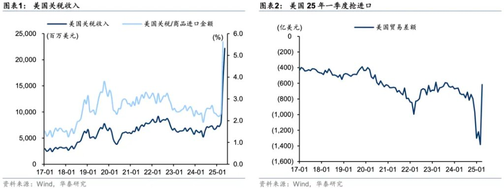
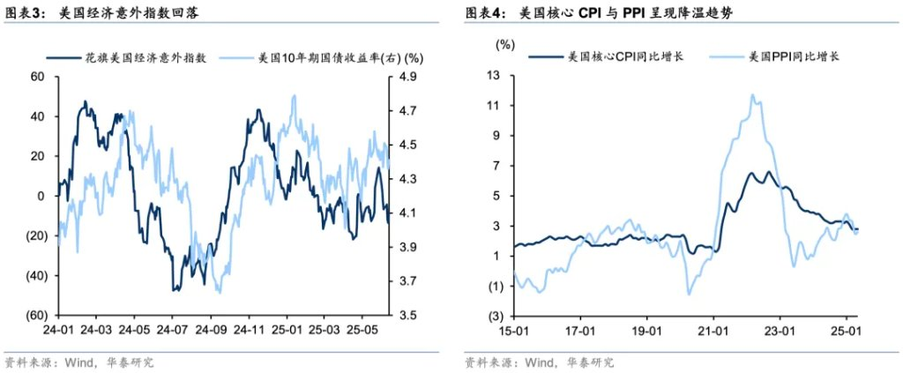
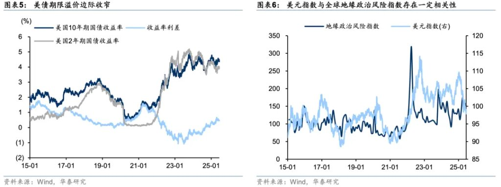
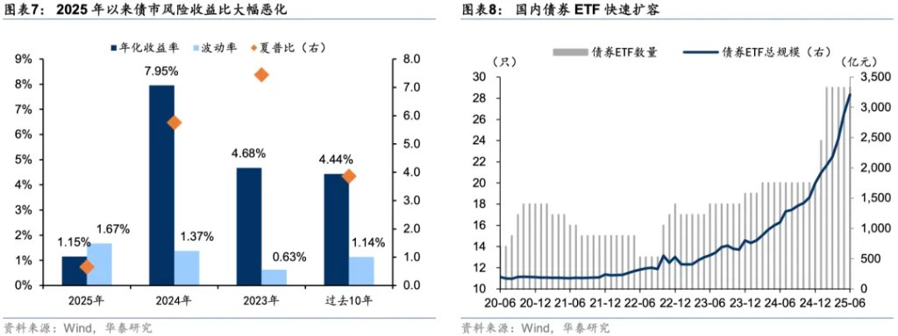
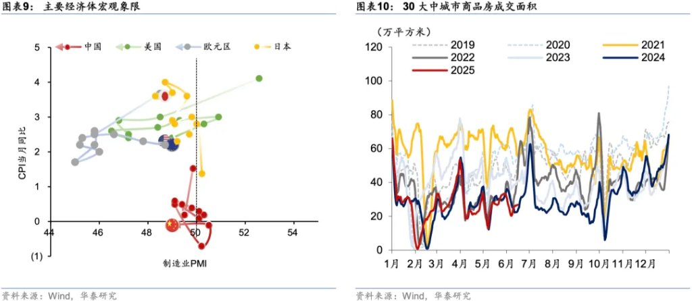
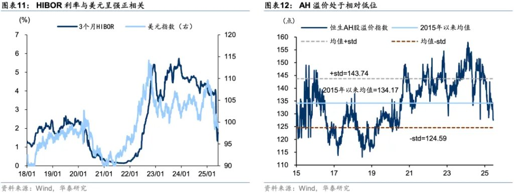
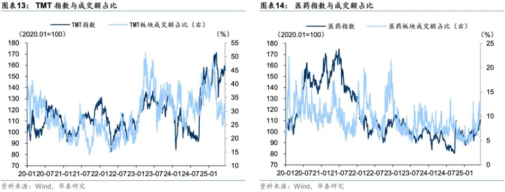
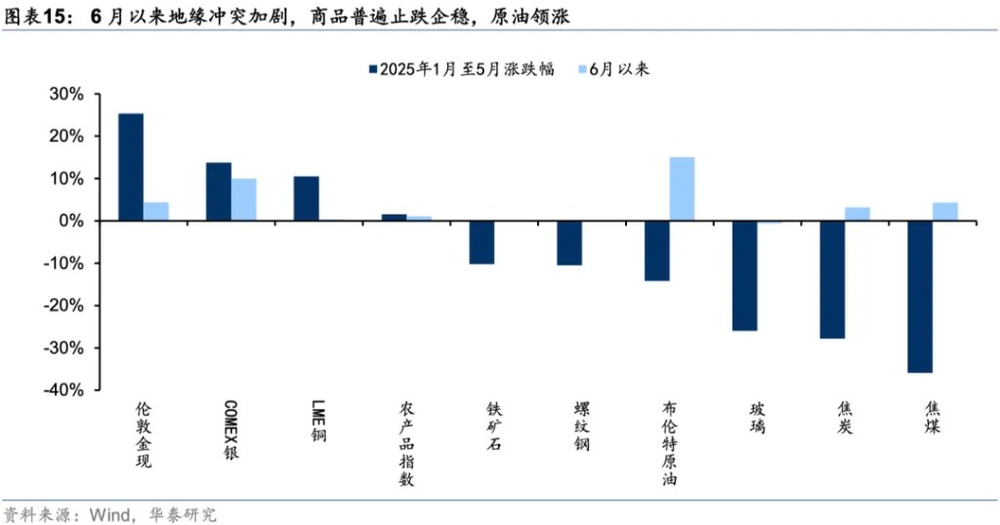
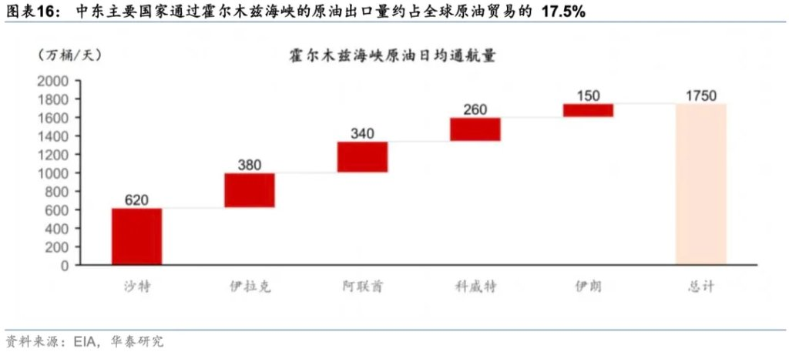

# 当前市场的五大共识与五大预期差

- 页面显示时间：2025-06-19T10:16:20+08:00
- 页面署名：董静
- 标注来源：华泰证券张继强、陶冶等
- 原文：[华尔街见闻](https://wallstreetcn.com/articles/3749421)
- 取得时间：2026-11-04T16:03:37+08:00
- [HTML阅读版](article.html) · [来源记录](metadata.json)

## 导语

华泰证券认为，当前市场五大共识包括：关税影响力度降低、美债利率易上难下、国内利率低位震荡、港股优于A股且热点集中于创新药等、商品需求难起色但看好黄金。对应预期差为：关税对基本面影响存在滞后效应；美债利率下半年或有阶段性下行机会；基本面数据若超预期放缓，债市仍有波段机会；创新药等热点板块回调风险上升，AH溢价或企稳；地缘冲突推高油价，供给稀缺资源品具战略配置价值。

---

**市场的共识与潜在预期差**

**近期影响资产的宏观主线发生切换，市场对关税的敏感度在下降，对经济数据、地缘局势的关注度在提升，而前期形成的市场共识也开始出现分歧与预期差。** 我们尝试梳理了五组市场共识与潜在预期差，以供投资者参考，并建议把握共识反转后的交易机会。

**共识一：关税对市场影响力度降低，逐渐退化为扰动性因素。** 中美伦敦经贸会谈结束，双方达成协议框架，短期贸易摩擦进一步升温的概率不高，且市场也对谈判结果计入了较多乐观预期。

**预期差：美国关税降级后代表预期的软数据在回暖，不过代表实际基本面的硬数据却开始出现降温迹象，情绪冲击淡化，但经济影响刚刚开始。** 关税对基本面影响可能偏滞后但不会缺席：一是美国一季度存在明显抢进口累库存行为，超额进口大约能够维持2-3个月，企业短期或并未明显提高产品价格；二是高利率、高关税、资本市场的大幅波动，导致消费者信心下滑，终端需求放缓，服务型通胀呈现降温趋势；三是2018年对内减税与对外关税同时实施，但本轮为先关税紧缩后减税扩张，政策的时间错配导致关税通胀传导系数大幅降低，若后续减税政策落地，通胀仍有上行压力。对国内而言，考虑到一季度的抢出口效应，关税对基本面影响或同样存在滞后效应，随着新增30%的关税陆续落地，对三四季度外需仍有不小扰动，关注后续企业盈利数据。

**共识二：美国债务问题恶化，美债利率易上难下，美元或长期走弱。** 美国政府债务问题长期困扰美元、美债。今年以来多因素共振冲击美元信用+动摇美国例外论，加速了全球去美元化的进程。而短期财政赤字易松难紧，主权信用评级下调，政策不确定性加大等推升美债期限溢价，削弱避险属性。

**预期差：长期问题在短期或已定价较为充分，美国基本面降温→美联储降息，下半年美债利率或有阶段性下行机会。** 美债期限溢价、主权CDS利差等近期均边际回落，显示长期债务问题在短期或已定价相对充分。而美国经济降温叠加美国财政部创纪录回购100亿美元国债，美债需求有所回暖，短期或仍有下行空间。不过，以伊冲突推升油价，增加了经济滞胀风险，导致美债利率边际上行。

**美元已跌至三年以来低位，下半年若美国基本企稳+美股科技重塑对全球资金的吸引力，外部地缘风险扰动加剧，短期去美元化进程或有望放缓或阶段性逆转。** 美元、美债的避险属性回落更多源于国内市场的不确定性，但地缘冲突加剧等外部不确定性仍对美元形成较强支持。历史上看，美元指数与全球地缘政治风险指数存在较强相关性，而近期伊以冲突升级或推升美元的避险需求。此外，近期美股表现强势，美国经济降温但维持一定韧性，叠加美债利差优势，美元短期进一步下跌空间或有限。

**共识三：国内利率低位窄幅震荡，较难获得超额回报，而债券指数基金发展正当其时。** 随着国内进入低利率时代，赔率大幅降低，债市的预期收益与夏普比明显恶化。随着债市收益率的降低，主动管理基金越来越难取得alpha收益，机构开始转向被动化与多元化投资，债券ETF等指数基金产品快速扩容。

**预期差：外部地缘冲突影响风险偏好，关税扰动下外需或有放缓，而内部消费、地产仍有待企稳，若基本面数据超预期放缓，波段性甚至小趋势机会仍值得把握。** 全球范围看，关税的负面冲击逐步显现，各主要经济体5月制造业PMI均处于收缩区间，且美国政策、地缘风险等不确定性仍较大，企业投资信心不足。国内方面，5月PPI降幅有所扩大，显示内需偏弱； 5月各线城市二手房价环比降幅扩大，6月以来新房与二手房热度有所下行；部分地区国补暂停、餐饮消费增长放缓等影响不容忽视。总体而言，三季度基本面对债市方向仍偏多。

**共识四：行业上短期热点在创新药+新消费+稳定币，港股相对A股更优。** 港股受益于低估值+离岸美元流动性宽松+新经济占比更高等优势，今年以来在全球权益资产中表现亮眼，弹性明显优于A股。结构上看，创新药、新消费成为资金青睐的方向，而港股低估值的金融板块也同样获得配置型资金的持续增持。

**预期差：创新药等热点板块近期积累涨幅较大，阶段性回调风险有所上升，关注AI+机器人等产业主线是否重新回归，而AH溢价在跌至2021年以来低位后短期或有望企稳。** 长期看，随着港股活跃度的逐步提升，A股相对港股的溢价有望系统性收窄。不过短期来看，AH股溢价已经跌至近5年来的低位，进一步下跌空间或相对有限，且港股对地缘局势更加敏感，短期可能成为AH溢价回升的触发剂。结构上看，创新药、新消费等板块资金拥挤度偏高，而TMT等板块成交占比高位回落。叠加微软、英伟达等业绩普遍超预期，关注AI产业逻辑是否回归。

**共识五：商品需求难有起色，供给约束带来价格分化行情，普遍看好黄金，长期看铜或优于原油。** 关税的影响陆续显现，主要经济体5月制造业PMI均回落至收缩区间，美国就业市场也呈现降温趋势。虽然各国均倾向于财政扩张，但更多是对冲关税负面影响，商品的需求或较难看到明显好转。相较之下，供给约束带来的资源稀缺性，提供了更高的安全边界以及价格支持。中长期看，关注逆全球化趋势下供给稀缺资源品的战略配置价值，供给视角下黄金\>铜\>黑色系\>原油。

**预期差：地缘局势持续升温，原油低位大幅反弹表现强势，不确定性环境下资产配置需要重视赔率思维。** 6月以来，俄乌冲突的升级以及以伊冲突的全面扩大快速推高油价，月内底部反弹超20%。短期来看，油价不确定性处于高位：从供需角度看，伊朗原油产量约为300万桶/天，其中约有一半用于出口，而OPEC闲置产能超400万桶/天，基本可以覆盖潜在供给缺口；更大的尾部风险在于伊朗是否会封锁霍尔木兹海峡来反制，该海峡承担了全球近20%的石油贸易量。不过从历史上看，由于地缘冲突导致的油价上涨，持续时间并不长，随着局势的明朗，后续或回归基本面定价。中长期看，地缘冲突与贸易摩擦加剧，供给稀缺的战略资源品仍具备较高的配置价值。

注：本文有删减。

本文作者：张继强、陶冶、王建刚，来源：[华泰证券固收研究](https://mp.weixin.qq.com/s?__biz=Mzg2Mjg1NTg3NA==&mid=2247506067&idx=1&sn=b8e4b229246061c46c2e47af953699b1&chksm=cf0c64d506d40413325c6d186fcd5291bad24c732acc7a1b282d44bf822e509b055c987150df&mpshare=1&scene=23&srcid=0619cBhJwrNsWyD4fPBJXOMz&sharer_shareinfo=a32d9506d3b548141838d8c85b38521c&sharer_shareinfo_first=a32d9506d3b548141838d8c85b38521c#rd)，原文标题：《【华泰资产配置】市场的共识与潜在预期差》

风险提示及免责条款

市场有风险，投资需谨慎。本文不构成个人投资建议，也未考虑到个别用户特殊的投资目标、财务状况或需要。用户应考虑本文中的任何意见、观点或结论是否符合其特定状况。据此投资，责任自负。
