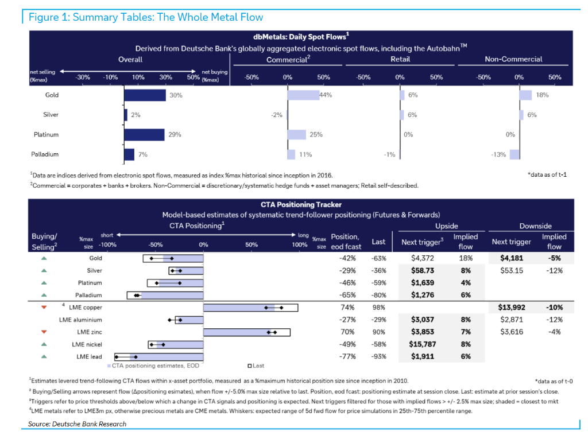
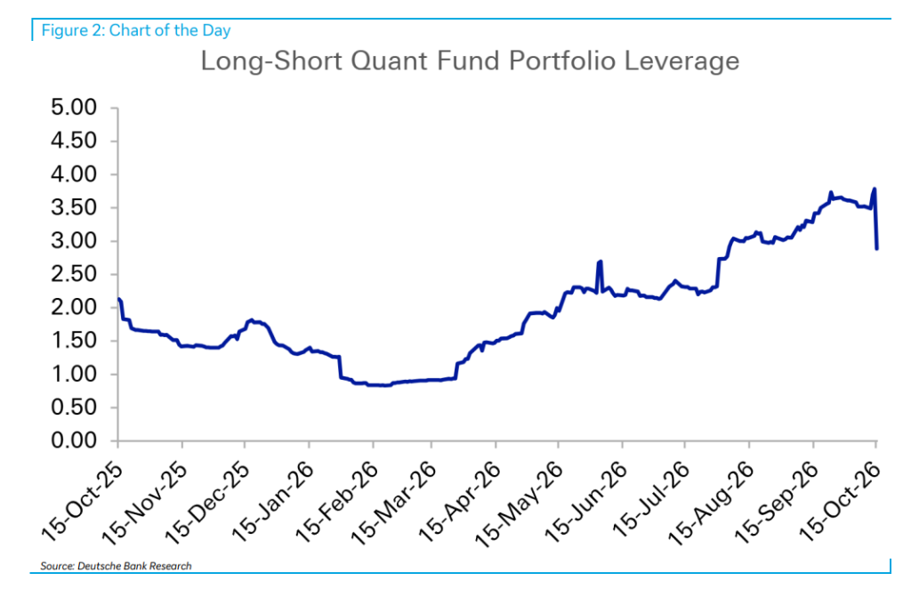

# 德银：黄金量化抛压接近“绝对耗尽”，CTA空头回补或点燃Q4反弹行情

- 页面显示时间：2026-10-16T19:40:58+08:00
- 页面署名：卜淑情
- 标注来源：未单列，见正文
- 原文：[华尔街见闻](https://wallstreetcn.com/articles/3783795)
- 取得时间：2026-11-04T16:03:32+08:00
- [HTML阅读版](article.html) · [来源记录](metadata.json)

## 导语

德银认为，量化基金风险平价组合去杠杆规模已达2010年以来第90百分位，黄金算法卖盘接近"绝对耗尽"，CTA空头回补或形成自我强化的买入循环，支撑四季度金价走强。不过，金价仍需突破约4370美元/盎司才能触发新一轮大规模程序化买入。

---

量化基金去杠杆引发的动量冲击正在接近尾声，黄金市场或迎来关键转折点。

据追风交易台，德意志银行金属研究主管Daniel Ghali在10月15日发布的最新《德银金属全流量报告》中指出， **量化基金风险平价组合的去杠杆规模已达到其2010年以来完整样本的第90百分位，触发了跨全球市场的无差别资金流动。** 在此背景下， **黄金的算法卖盘已接近"绝对耗尽"，CTA基金被迫回补约20%的净空头头寸，有望形成自我强化的算法空头回补循环，为四季度金价走强奠定基础。**

德银模拟数据显示，在几乎所有价格情景下， **算法交易系统目前均偏向买入黄金。** 与此同时，现货流量追踪数据显示，即便在强于预期的CPI数据公布后金价承压，当日现货黄金净流入仍录得强劲表现，买盘主要来自商业参与者。这一组合信号进一步强化了德银对黄金短期走势的乐观判断。

## 去杠杆规模达历史极端水平，贵金属获无差别买盘

德银更新的多空量化基金风险平价图表显示，波动率目标组合的杠杆率在最近一个交易日出现大幅下滑，去杠杆规模在其2010年以来的完整样本中排名第90百分位，属于历史极端水平。

**这一去杠杆过程在贵金属市场引发了无差别买盘——由于CTA基金此前在贵金属板块持有净空头头寸，量化基金的去杠杆行为反而推动了贵金属的被动买入。** 德银预计， **本次去杠杆将迫使CTA基金在黄金上回补相当于最大仓位规模20%的空头，在白银上增加7%，在铂金上增加13%，在钯金上增加15%。**

值得注意的是，铂金和钯金的CTA持仓已达到"有效最大空头"水平，而白银此前仍有相当大的做空空间。德银指出，杠杆动态因与全球市场协方差矩阵高度关联，且相关性随时间变化，预测难度极大，但当前AI担忧情绪升温、美联储加息预期前置的宏观环境，是理解此次去杠杆背景的重要参照。

## 算法卖盘耗尽后，金价反弹路径逐渐清晰

德银认为，黄金市场正处于算法卖盘耗尽后的关键窗口期。其模拟结果显示，在几乎所有价格情景下，算法系统目前均偏向买入黄金，CTA空头回补所带来的价格上行动能，将进一步触发后续的程序化买入指令，形成自我强化的正反馈循环。

不过，德银同时指出， **CTA基金需要金价升至约4370美元/盎司附近，才能触发下一轮大规模程序化买入程序。** 这意味着，在算法驱动的初步反弹之后，行情能否持续向上，仍有赖于两大支撑 **：一是韧性较强的结构性实物需求，二是裁量型资本（discretionary capital）的充裕"干火药"能否被激活入场，共同推动金价开启下一轮上涨。**

此外，德银还指出，在股市出现较大幅度下跌的情景下，黄金目前有望扮演相对避险资产的角色——这正是量化基金去杠杆机制当前有利于黄金买入的直接体现。

## 历史回响：当前环境与2022年10月低点形成共鸣

德银援引历史类比，将当前市场环境与2022年10月黄金低点进行对照。报告指出， **在2022年那轮近年来最激进的加息周期深处，金价始终未能有效跌破关键支撑。** 彼时，上海黄金溢价持续维持在+2%以上，暗示全球最大消费市场存在异常强劲的需求，但西方投资者受2011年金价大跌记忆影响，情绪持续偏空。

最终，2022年11月4日，金价在非农就业数据超预期、加息预期进一步强化的背景下逆势上涨。随后，市场才得知中国央行在此前一个月实现了三年来首次官方黄金储备增持，当年最终录得1950年有数据以来最大规模的官方部门购金量，非央行官方部门需求贡献了主要增量。

德银认为，回望历史，黄金多年牛市的起点在事后看来几乎显而易见，但在当时，需要投资者在噪音最嘈杂之际保持定力。这一历史叙事，与当前市场环境形成了清晰的回响。

## 铜与锌承压，但铜市基本面支撑依然坚实

与贵金属形成鲜明对比的是，此次量化去杠杆对铜和锌造成了显著的抛售压力。德银预计，CTA基金将在铜上卖出相当于最大仓位规模24%的头寸，在锌上卖出20%，原因在于去杠杆冲击正在席卷这一拥挤的动量交易。

尽管如此，德银对铜的中长期前景维持乐观。报告指出，铜市场的微观结构支撑极为强劲，当前铜市供应紧张程度在有记录以来堪称最为稀缺的环境之一。德银认为，无论此次动量冲击如何演绎，铜价仍有大幅上涨的空间，当前的抛售压力并不改变其基本面逻辑。

 

 

\~\~\~\~\~\~\~\~\~\~\~\~\~\~\~\~\~\~\~\~\~\~\~~

以上精彩内容来自[追风交易台](https://mp.weixin.qq.com/s/uua05g5qk-N2J7h91pyqxQ)。

更详细的解读，包括实时解读、一线研究等内容，请加入【 [**追风交易台▪年度会员**](https://wallstreetcn.com/shop/item/1000309) 】

风险提示及免责条款

市场有风险，投资需谨慎。本文不构成个人投资建议，也未考虑到个别用户特殊的投资目标、财务状况或需要。用户应考虑本文中的任何意见、观点或结论是否符合其特定状况。据此投资，责任自负。
