# 我去了趟杭州，没想到租金下滑的这么厉害

- 页面显示时间：2025-01-04T09:24:29+08:00
- 页面署名：潘凌飞
- 标注来源：真叫卢俊
- 原文：[华尔街见闻](https://wallstreetcn.com/articles/3738373)
- 取得时间：2026-11-04T16:03:26+08:00
- [HTML阅读版](article.html) · [来源记录](metadata.json)

## 导语

2024年全国租金都在降，宏观体感上一线微跌，二线全跌。最让人意外的还是杭州，2024年底租金累计跌幅在5.38%，这个数字全国第二，新一线城市中排名第一。

---

确实，2024年全国租金都在降

宏观体感上一线微跌，二线全跌

而且市场已经没有所谓淡季旺季了，我联系的几个中介去年最大感受就是，连毕业季都没往年热闹了

比如我们base的上海去年就有强烈体感

*一位徐泾的同事2023年月租金4400元，到2024年底尝试和房东商量降租，还没发力房东就先自砍一刀降了200元*

*包括刚刚过去的12月，我计划从宝山换租到浦东中环跟着中介看了十几套，平均每套基本能砍掉300元*

但最让我意外的还是 **杭州**

各位也看到了杭州的数字，2024年底租金累计跌幅在5.38%

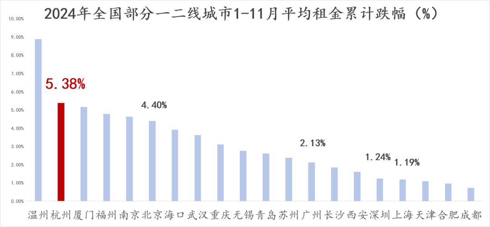

数据来源：中指数据CREIS

这个数字全国第二，新一线城市中排名第一

杭州这座城市我们之前踩盘过很多次了，给我的印象除了亚运会，就属它抢人最积极、也是最成功的

这几年眼看着越来越多的年轻人扎堆杭州，把这里当成梦开始的地方

作为新一线的领头城市之一，想不到如今租金下跌竟然如此疯狂

杭州到底怎么了？

**或者说，杭州的租赁市场到底怎么了？**

所以这次我连夜定了虹桥到杭州东的高铁票

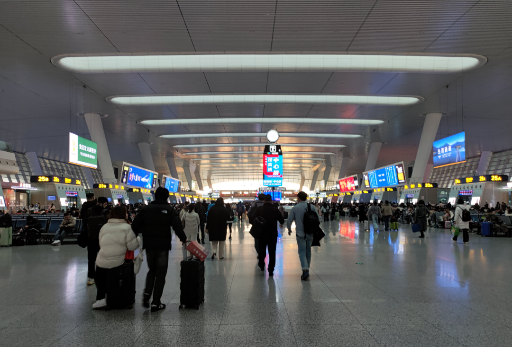

杭州东站候车厅实拍

实地去看了杭州市区、城东、奥体等热门板块的7个典型小区后

很意外发现，它们的租赁情况竟然是这样的  

 

***01***

尤其这几类房子，降到了我没想到的程度

比如之前最贵现在也放下身段的 **市中心** **老破小**

前些年杭州市区老破小因为地段好，租金一直居高不下

比如凤起路上的十五家园

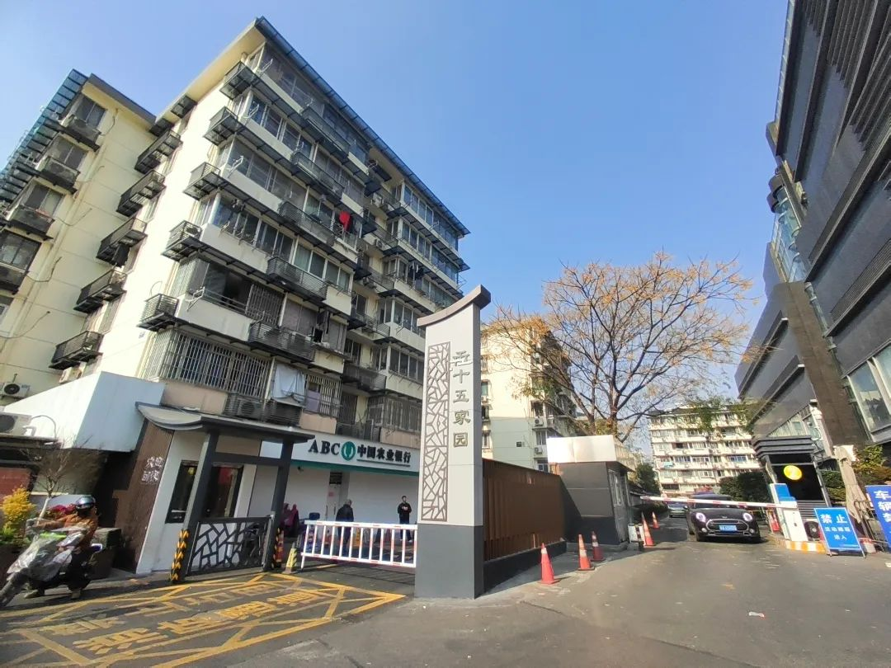

十五家园实拍

就挨着沪上阿姨们最爱的环北丝绸城，黄金地段，绝对中心

但据中介说，去年这边普降 **10-15%**

2023年末十五家园一套50㎡2房，租金至少4000元/月

但如今，我去看了一套面积差不太多的45㎡2房

而且是精装修，租金3500元/月

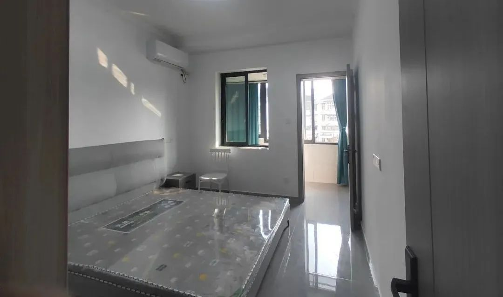

十五家园45㎡2房

面积差只有5平，但我轻轻一算，同比跌去了12.5%

包括马路对面林司后小区的一套52㎡两房

中介告诉我这套房子在他们平台已经调过3次价格了，前两天刚降到标红的位置

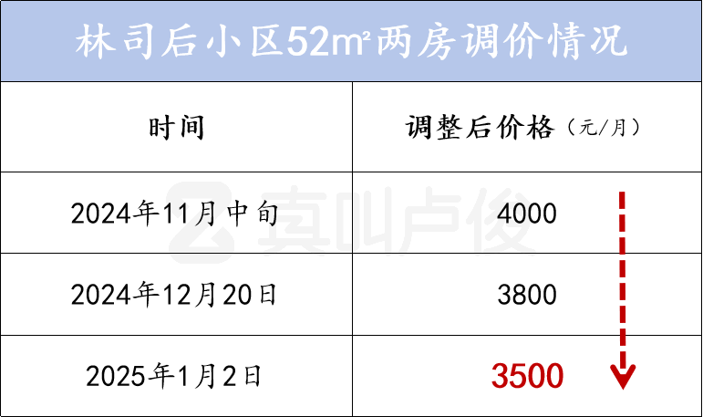

而且这里的房东非常爽快，直接砍三百都能迅速接受，问什么时候住进来

只能说越到年底房东的焦虑越直观啊  

看完老破小，当然也得看 **次新房**   

而说到这个就不得不提城东的次新扛把子，绿城杨柳郡了

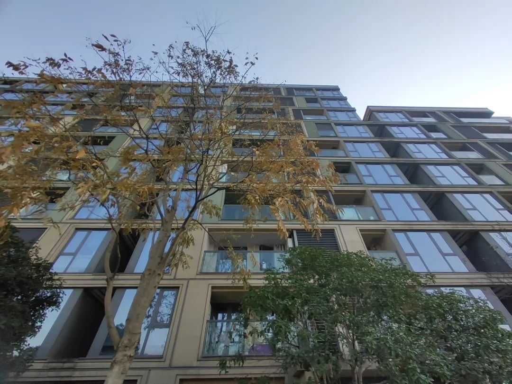

中介告诉我这里的市场一直挺好的，往年一年可以租出去300多套，百平三房每月可以租到8000元以上

2024年当然也降下来了，但大部分房东心态反而挺稳的

我统计了下链家2024年底该户型全部挂租房源的价格

目前平均月租确实还保持在7200元/月以上，跌了 **9.2%**

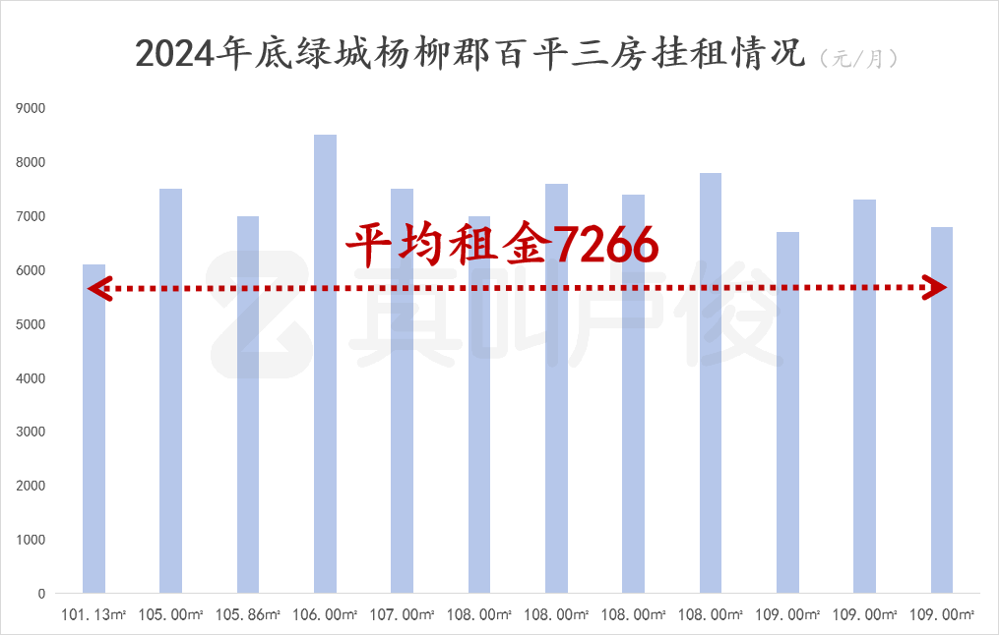

其中一套价格最低的，是低楼层的109平三房，租金6800元/月

我问每月6500元能租吗

中介有些为难说房东可能不会一下子给这么大空间，因为前两年都是月租7500-8000元的

和前面老破小的房东一对比，这里的次新房东确实要更自信一些

还有一类房源也在下跌

就是往年投资人士喜欢的 **公寓、大平层** 之类

但两者还是有区别

我先去看的是公寓，站在丽晶国际中心楼下

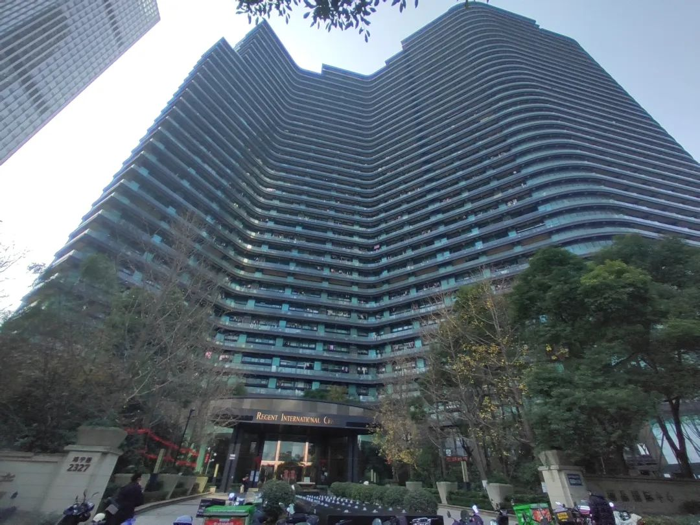

脑海中还是之前2万名网红主播挤在隔断间的场景

但走进去才发现，从2018年“限酒令（严禁小面积酒店式公寓）”严控之后，这里的租赁市场还算比较健康的

前两年的一室一厅是2900元/月，如今房东挂出来的价格在2500元/月，跌幅13.8%

中介非常热情，现场又替我砍了380元

而几个热门板块的公寓小区，跌幅也有高有低  

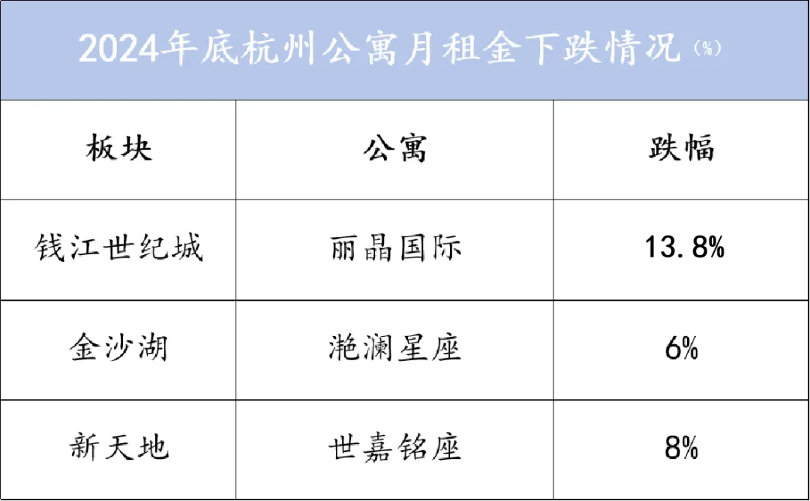

来源：市调及网络公开数据，仅供参考

不过和整个市场基调相比，程度都不算太夸张

至于一些新晋大平层就是另一种情况了

尤其最受欢迎的奥体、钱江世纪城等网红板块，租金本身就抬得比较高

比如奥体，就一直是杭州租金第一梯队  

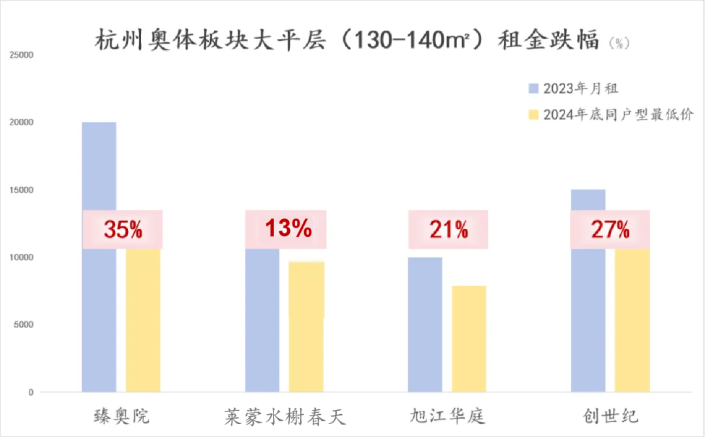

整理自：链家、网络公开信息，仅供参考  

但2024年下滑空间也大一些  

尤其头部天花板级别的臻奥院

中介透露前年底的租金在2万/月，2024年尾也来到了1.3万/月的下限

包括创世纪和旭江华庭这些豪宅小区，都面临同样的情况

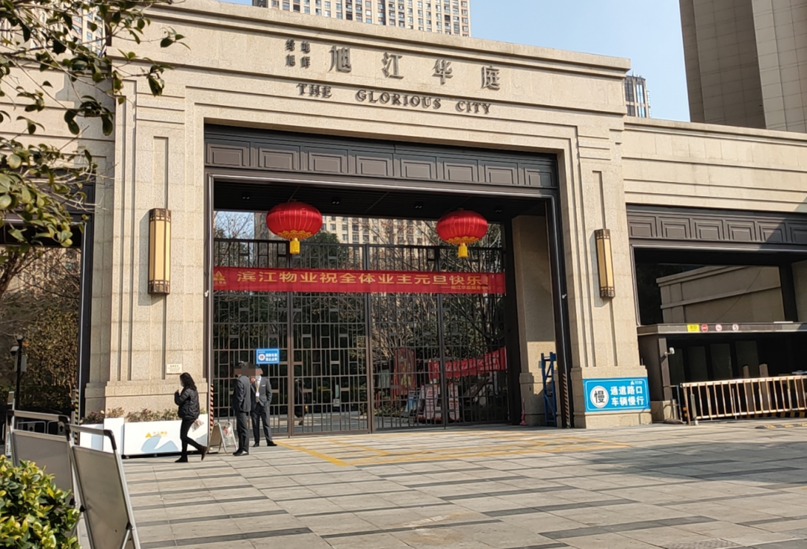

尤其我去看的旭江华庭一套大户型，上一任租客12月初搬走的

目前已空置一个多月，接下来就是农历新年，还将面临大概2个月的空窗期  

所以房东也很nice，在这个基础上可以再砍300还包物业费

而且除了绿城杨柳郡的中介，其他板块的中介小哥们对砍价都比较有信心

毕竟谁也不想空着1月、2月大几千的租金不要，就为了跟租客还那几百块钱

可见对大部分杭州本地房东来说，2024年估计是最难留住租客的一年

 

***02***

**不只这些小区的房东，其实整个租赁市场的数据都不太乐观**

我整理了下近几年杭州的租金数据

发现这座城市的租赁市场不是从今天才开始异样的  

而是近四年都不太乐观

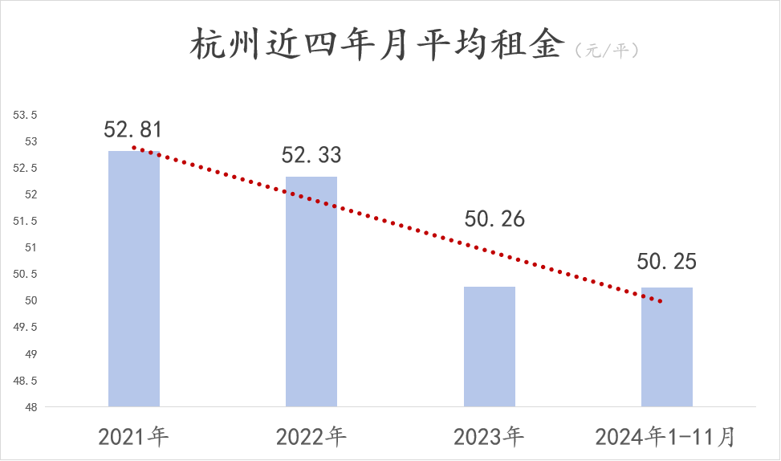

数据来源：杭州贝壳研究院

2021年杭州月平均租金还在52.81元/平

但到2023年，平均月租金已经走到了50元的临界点上

去年目前只有前11个月的平均数据，看起来和23年基本持平

但再加上低谷的年尾，这个数字能不能稳住其实不好说

而去年11月份，杭州月租金已经来到了 **近四年最低**

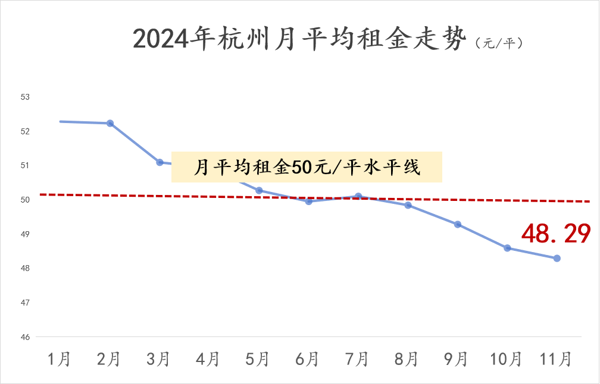

数据：国信达

除了去年7月份的毕业季环比微弱上涨，但幅度小到几乎可以忽略不计

整体看就是滑滑梯一样，从年头一路下滑到年末

照这个走势，全年平均数能否维持住2023年的50元基准线还是不太乐观的

这种大环境下，去年杭州几乎没有一个板块能逃过降租的命运

贝壳研究院数据显示，杭州十区118个板块中有90个板块房租下跌，占比超过7成

于是我又选取了其中八个区域的24个代表板块，并一对一线上市调了当地中介，得到了一个均值

也就是全市平均下跌 **13.7%** 的样子

具体情况就是这样

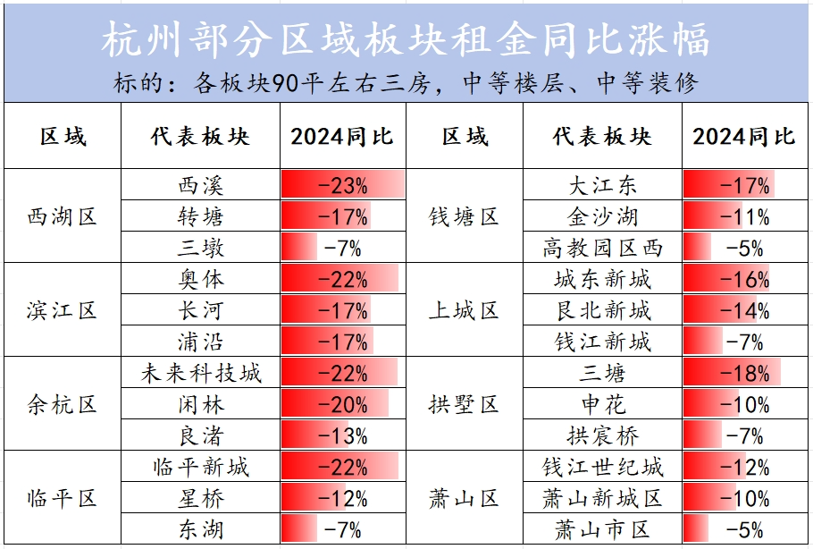

数据来源：2025年1月1日市调，仅供参考

选取范围为8个区域24个代表板块，不代表全市数据  

可以看到，每个区域都有那么一两个板块房租下降蛮厉害的

比如滨江的奥体、余杭的未来科技城，以及西溪和临平新城板块，都超过了 **20%**

尤其奥体一带、和未来科技城  

以我市调的90平三房这个标的来看，这两个板块年末月租金比去年同期都降了1200元

但也有区域降幅并不算大，基本在 **5%-10%** 之间

比如位置偏远的临平东湖和萧山市区

本身板块租金水平就没那么高，水分比较少

2024年挤出空间也只有200-300元左右

但据各板块的中介感知，总的来说这一年杭州房租同比降了300-1000元不等

电话中他们语气有些无奈，用词都是 *“降得非常多”、“这个价格以前不可能租到的”*

但根据我实地踩盘的结果来看，如果愿意讨价还价，那这些挂出来的租金都不是最低

实际上房东的心理底价可以再减200元，甚至更多

当然也有一部分房东着急出租，2024年底前直接挂出了底价

但似乎也是一种试探

截图来自：杭州链家  

如果问的人多了但过年前还是租不掉，价格也只能进一步下调了

 

***03***

**所以，为什么偏偏是杭州？**

这几年我们平台关注杭州也算比较多的了

不难发现，实际上这么大范围的全面降租，对杭州来说早就有迹可循

首先一个最直接的原因就是 **产业** **结构** 不够多元

过去十余年杭州因电商而起

每个新一线都希望有自己的阿里巴巴，但显然不是所有城市都叫杭州

从电商之都到网红之都，这条长板足够长，长到可以带动一个城市飞速向前

但背后，其他短板就显得有些无力了

所以当直播电商行业从狂奔走到紧缩

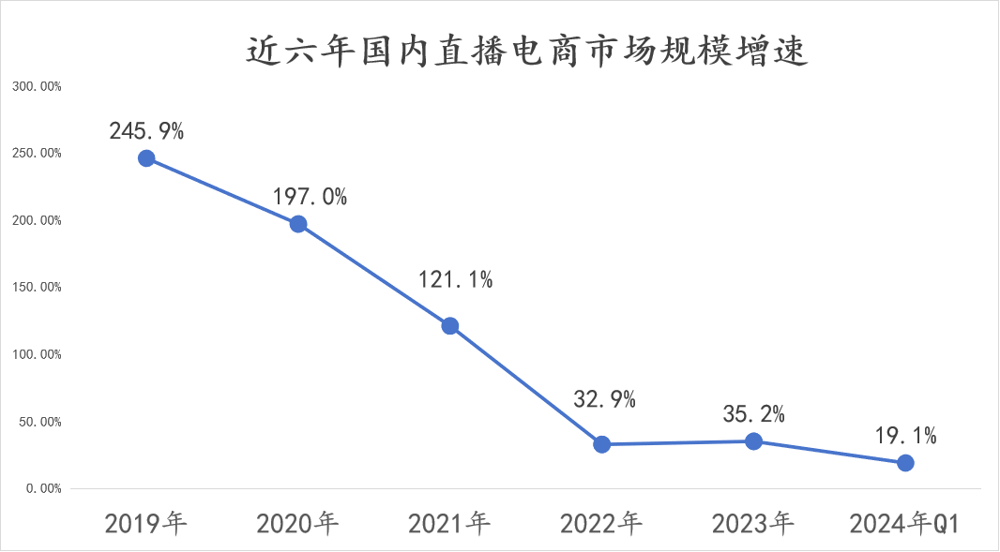

数据来源：艾瑞咨询

也就没那么多慕名而来的网红主播和年轻人继续留在杭州了

尤其一些头部大主播已经举家撤走

比如前年向太在世茂智慧之门租下了一整层，斥资百万装修

然而才过了一年多已经人去楼空

不得不说网红大批撤出杭州之前，确实帮家人们把房租的价格打下来了

而同样退场的还有投资客们

尤其那些这几年买了新房的房东，伴随房价下跌，看情况已经不打算卖房了

于是整个市场上有 **巨量次新房** 转售为租

比如前文提到的杨柳郡，所在的艮北新城就是一个大型居住区

作为艮北超级大盘，光是绿城杨柳郡就有将近5000户家庭

而这个区域内的九和路、新塘路上，这些灰色方块大部分都是次新或待交付小区

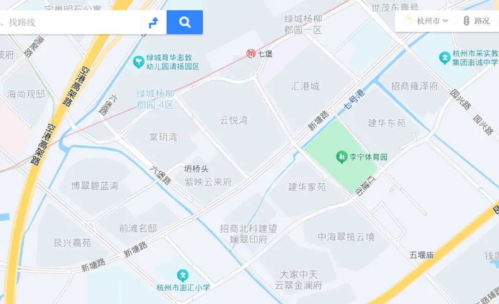

我粗略数了数，加起来就不止15个

可想而知是什么样的房源体量

包括勾庄、奥体附近的亚运村等板块，近几年交付的新房也聚在了一起

这些次新集中交付的板块或周边，来到2024年就形成了严重踩踏

租金直线下滑也是意料之中

而且，杭州的新房还在源源不断供应

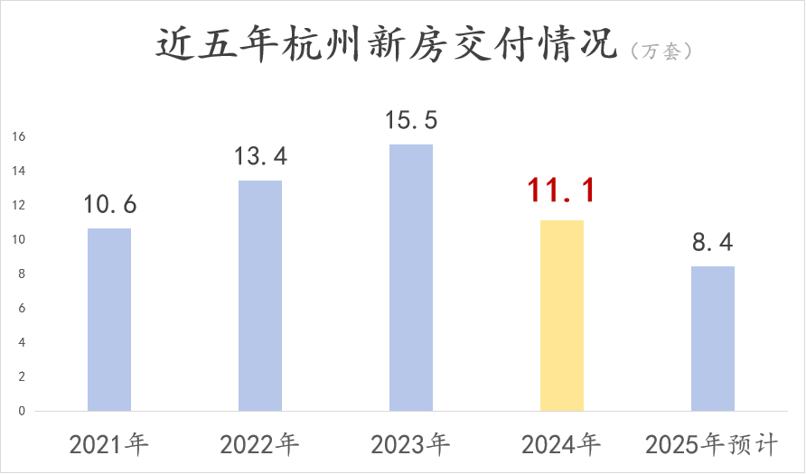

数据来源：潮新闻美好生活研究院

很明显，到2023年杭州新房交付来到了一个高峰期

除了那些本来就不打算卖的房东，还有此前触发5年限售的热门新房，到了2024年依然在限售范围

也只能纷纷流入租赁市场

于是这一年杭州房东的日子就更加不好过了

但是这还没算上 **保租房** 的体量

之前[天量保租房](https://mp.weixin.qq.com/s?__biz=MzIxODgyOTA5NA==&mid=2247787826&idx=1&sn=d0136b0ac904ec83b84bbbdc8853c1bc&scene=21#wechat_redirect)那篇文章中，我就替大家统计过杭州的数据

2024年6月底杭州实际筹集保租房6.01万套（间），而新增供应是1.3万套

不仅交付量大，租金也并不算太高

比如亚运村的宁巢美地公寓，40平一室户月租金2350元，60平也只要3500元  

和市场价相比，相当于打六折  

大量交付加上和6、7折的租金，对2024年租赁市场形成冲击也是不容忽视的

 

***04***

其实这次实地踩盘+线上市调完，心情一度很唏嘘

如今的杭州确实面临一些挑战，从租金下滑反映出的一系列问题也真实存在

不过除了产业单一、供应过量，杭州的租赁市场也是多方导致的结果

一个最基本的因素就是这两年楼市本身就在调整期

很多受影响较大的二线城市，也开始适应行业下一阶段

杭州当然也不例外

但通过这两年实地踩盘，我们能感受到杭州这座城市的底色依然是 **年轻化**

比如为了抢人直接发钱、提供应届生免费住宿的“[春雨计划](https://mp.weixin.qq.com/s?__biz=MzIxODgyOTA5NA==&mid=2247780891&idx=1&sn=d2232d9eca7e4a811a0cf7489240c883&scene=21#wechat_redirect)”等等...

包括最近智联招聘的一份数据，也体现了杭州在年轻人心里的真实地位  

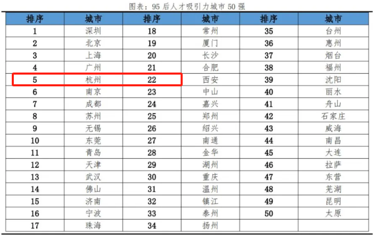

来源：泽平宏观、智联招聘

95后最喜欢的城市中，杭州是全国仅次于北上广深的第一城

这一点是当之无愧的，也是杭州这么多年主动寻求年轻化的结果

相信这段行业调整期过后，杭州这座城市的未来依然会更好

 

本文作者：真叫卢俊团队，来源：[真叫卢俊](http://mp.weixin.qq.com/s?__biz=MzIxODgyOTA5NA==&mid=2247788897&idx=1&sn=1dfb62829aaa1d9291cd53604960e13b&chksm=969c294f659c17d1dd1f4a972e54b546a8db1632fa8aeff3abdf546760b2b23a2de3f8af5a65&scene=0&xtrack=1) (ID:gh_30ed65343713)，华尔街见闻专栏作者，原文标题：《我去了趟杭州，没想到租金下滑的这么厉害》  

 

风险提示及免责条款

市场有风险，投资需谨慎。本文不构成个人投资建议，也未考虑到个别用户特殊的投资目标、财务状况或需要。用户应考虑本文中的任何意见、观点或结论是否符合其特定状况。据此投资，责任自负。
