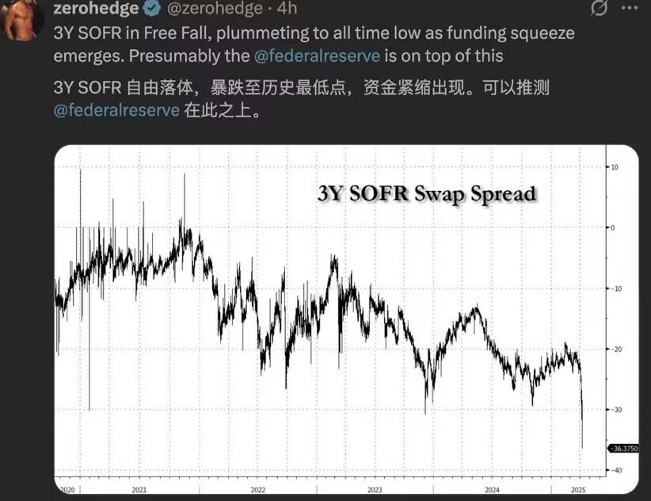

# 打崩对冲基金的，可能是这笔事关美债的交易

- 页面显示时间：2025-04-09T16:03:47+08:00
- 页面署名：李笑寅
- 标注来源：未单列，见正文
- 原文：[华尔街见闻](https://wallstreetcn.com/articles/3744862)
- 取得时间：2026-11-04T16:03:17+08:00
- [HTML阅读版](article.html) · [来源记录](metadata.json)

## 导语

为了应对贸易战带来的经济前景恶化，美国的银行正在抛售美债以筹集现金，这一举动推动互换合约的表现超过美债，导致曾经备受对冲基金青睐的“押注美债优于互换”的互换利差交易加速崩溃。

---

曾经备受青睐的“美债优于利率互换”的交易策略，由于特朗普总统的关税政策，正面临加速瓦解。

**据报道，随着近期贸易局势愈发紧张，令企业前景黯淡，银行开始抛售美债以满足客户的流动性需求，推动互换合约的表现超过美债，使得“押注美债表现将优于利率互换”的互换利差交易加速崩溃。**

利率互换是一种衍生品合约，指双方交换固定利率和浮动利率的现金流。基于“押注美债表现优于互换”的交易即做多美债、做空利率互换，这意味着当互换利差走阔时，对冲基金往往从中获益。

周二，3年期SOFR（担保隔夜融资利率）互换利差已跌至历史最低点，反映美债市场流动性显著紧缩。

Columbia Threadneedle的利率策略师Ed Al-Hussainy直言：

> “过去六周中最剧烈的市场走势就是这种互换利差交易走向崩溃。这告诉我们，银行现在寻求筹集和保留现金。”

## 流动性成焦点，银行卖美债、买互换

为了应对因贸易战加剧而产生的市场动荡，银行被迫采取行动。

交易员在接受媒体采访时表示，银行正在出售其持有的美债以筹集现金。与此同时，为了在债券上涨的情况下保持对利率的敞口，银行增加了互换合约。

**这一操作导致了互换合约的表现大幅优于美债，从而推动互换利率远低于美债收益率。周二，30年期互换利率与同期限美债之间的利差出现了数年来最大单日波动，创下历史最低水平。**

## Bowman听证会成关键催化剂

今年2月，押注“美债优于互换”的交易一度被推向高峰。

当时，市场猜测特朗普将提名联邦储备委员会委员Michelle Bowman担任央行监管副主席一职，而Bowman此前曾讨论过放松美债流动性的潜在监管，激发了市场押注互换利差扩大的赌注。

尽管目前该交易面临崩溃，但TD Securities策略师表示，它仍有潜力，特别是在Bowman将于周四在参议院银行委员会确认听证会上接受审核的情况下。

TD策略师Gennadiy Goldberg和Molly Brooks在周二的一份报告中表示：

> “我们仍然认为，放松监管应该会在未来几个月推动长期互换利差走阔。”

## 税收政策不确定性进一步打压美债

除了关税的影响，还有其他因素也在影响着美债与互换的相对表现。

据报道，美国国会正计划通过一系列新的减税措施，并延长特朗普2017年的减税政策。 **如果未能采取相应的抵消措施，预算赤字可能会膨胀，导致投资者预期美国财政部将发行更多美债。**

Al-Hussainy分析道：

> “直到大约一个月前，互换利差还在交易‘银行资本改革’的预期。 **现在，关税方面的紧张局势进一步将叙事从这一焦点转移开。** ”
>
> “国库券供应预期的上升，加上银行因经济前景恶化而更加保守地管理资产负债表，共同导致了当前市场格局的形成。”

商品期货交易委员会(CFTC)数据显示，在4月1日（即特朗普公布关税计划前一天）截止的一周，资产管理公司和对冲基金的策略出现了分化。

总体上，资产管理公司增加了约438000份10年期美债期货合约的净多头头寸，而对冲基金则增加了约375000份10年期美债期货合约的净空头头寸。

风险提示及免责条款

市场有风险，投资需谨慎。本文不构成个人投资建议，也未考虑到个别用户特殊的投资目标、财务状况或需要。用户应考虑本文中的任何意见、观点或结论是否符合其特定状况。据此投资，责任自负。
