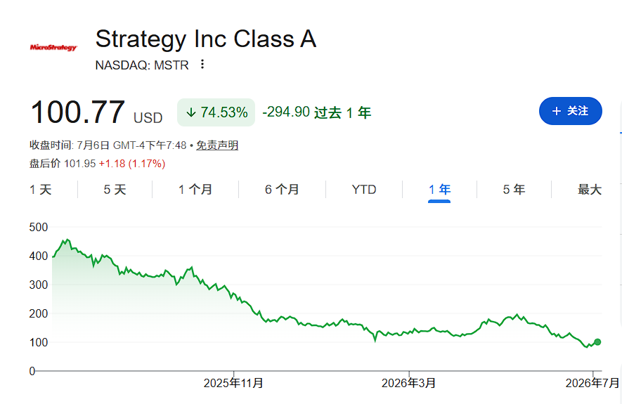

# 持有全球4%的比特币！市场紧盯MSTR“卖币逻辑”，股价一年已跌75%

- 页面显示时间：2026-07-07T08:14:15+08:00
- 页面署名：董静
- 标注来源：未单列，见正文
- 原文：[华尔街见闻](https://wallstreetcn.com/articles/3776330)
- 取得时间：2026-11-04T16:03:50+08:00
- [HTML阅读版](article.html) · [来源记录](metadata.json)

## 导语

Strategy的核心估值指标mNAV已跌破1，意味着市场对其估值已低于其比特币持仓价值，这从根本上动摇了其"以溢价股票换取比特币"的商业逻辑。公司已打破“永不卖币”承诺，开始套现支付股息。市场高度警惕其现金流枯竭后可能引发的系统性抛售危机。

---

Strategy正在用比特币为自己的资本结构买单。这家全球最大的企业比特币持有者，正面临一场由自身商业模式所引发的数学困局—— **当股价溢价消失、融资窗口收窄，"永不卖币"的承诺已悄然让位于现实的流动性压力。**

[华尔街见闻文章](https://wallstreetcn.com/articles/3776315)写道，Strategy于7月6日披露，在6月29日至7月5日期间出售3588枚比特币，套现约2.16亿美元，用于支付旗下优先股股息。 **这是公司历史上规模最大的一次比特币出售，也是其自2020年启动比特币战略以来的第三次出售。**

在这一消息公布后，MSTR股价盘中一度跌超5%，比特币跌至约6.18万美元，低于公司约7.57万美元的平均持仓成本。公司第二季度确认数字资产亏损83.2亿美元，同期比特币价格下跌14%。

**市场的警惕情绪不仅来自出售本身，更来自其背后的逻辑转变。** Strategy持有843775枚比特币，约占全球比特币总量的4%，任何大规模抛售都可能对币价形成显著冲击。

据华尔街日报分析 **，Strategy的核心估值指标mNAV已跌破1，意味着市场对其估值已低于其比特币持仓价值** ，这从根本上动摇了其"以溢价股票换取比特币"的商业逻辑。

## "永不卖币"承诺松动，出售规模百倍扩大

Strategy曾长期 **将"永不出售比特币"视为商业模式** 的根基，但这一承诺已出现明显裂缝。

今年5月底，公司首次打破惯例，出售32枚比特币，套现约250万美元，用于支付优先股股息，并强调此举仅为履行对优先股投资者的承诺，不代表战略转向。

然而， **最新一轮出售规模已扩大至3588枚，约为5月出售量的百倍。** 据公司披露，其中1363枚以均价约5.93万美元售出，其余2225枚以约6.08万美元售出。

[华尔街见闻文章](https://wallstreetcn.com/articles/3776315)写道，此次出售所得将专项用于支付STRF、STRE、STRK、STRD四只优先证券的第二季度股息，以及STRC的6月月度股息。出售比特币已不再是一次性象征性操作，而是正逐步融入公司的常规融资体系。

值得注意的是，Strategy于6月29日正式宣布，董事会已授权出售最多12.5亿美元的比特币，用于回购股票及支付利息和优先股股息。这标志着公司在官方层面正式放弃了"死守比特币"的哲学。

值得注意的是， **支撑这一商业模式运转的资本结构，正承受越来越大的压力。**

分析师Zach Pandl指出，Strategy每年仅优先股股息支出就高达约15亿美元，而其软件业务现金流远无法覆盖。当现金储备不足时，公司只能继续融资或出售比特币。

截至7月5日，Strategy持有843775枚比特币，现金储备25.5亿美元。公司估计，这笔现金缓冲可为其提供约17个月的利息和优先股股息支付空间，无需动用加密资产。

Strategy的运营逻辑愈发清晰： **融资顺畅时持续买币，融资趋紧时出售少量比特币支付股息，以维持资本运作体系的闭环** 。

尽管5月底首次出售后，公司很快又买入1550枚比特币，4月和5月也曾分别完成25.4亿美元和20亿美元的大规模买入，但随着比特币价格承压，这一体系的可持续性正受到质疑。

## mNAV跌破1，核心商业逻辑遭遇根本性挑战

Strategy商业模式的核心， **在于利用股票溢价作为"货币"持续买入比特币。** 而这一逻辑的量化锚点，正是公司自创的mNAV指标。

据华尔街日报分析，Strategy将mNAV定义为公司企业价值相对于其比特币持仓价值的倍数。在鼎盛时期，该指标长期维持在高溢价水平，使公司得以不断发行股票购入更多比特币，运作方式类似于传统并购型公司以高估值股票为货币进行连续收购。

然而，随着MSTR股价过去一年累计下跌约75%，mNAV上月一度跌破1，意味着市场对Strategy的估值已低于其比特币持仓的账面价值， **这套"滚雪球"逻辑开始反向运转** 。

更值得警惕的是， **这一指标本身存在系统性高估问题。** 华尔街日报指出，Strategy在计算企业价值时，采用债务本金和优先股面值，而非市场价值。然而，随着公司债券和优先股价格随股价大幅下跌，这一计算方式已严重失真。

> 以6月26日为例，Strategy公布的mNAV约为0.99，但若以市场价值计算债务和优先股，实际mNAV仅约为0.89。当时，公司债务以7%的折价交易，各系列优先股合计折价约28%。

截至上周四收盘，Strategy官网显示mNAV为1.09，但以市场价值计算后实际仅约为1.04，溢价空间已极为有限。

## 抛售压力与市场连锁反应

Strategy的比特币持仓规模，使其任何出售行为都具有市场层面的系统性意义。

Strategy持有的比特币约占全球比特币总量的4%。即便是5月份仅出售32枚比特币、套现250万美元的小规模操作，也已对比特币价格和MSTR股价产生了明显的下行压力。

分析认为， **此次出售3588枚虽仍仅是其持仓的极小部分，但市场对潜在大规模抛售的担忧已显著升温。**

按照Strategy自身的逻辑，当mNAV持续处于折价状态时，公司理应出售比特币以回购自身证券。投资者正密切关注这一信号是否会演变为大规模行动。

为稳定优先股价格，Strategy于6月29日将其最大优先股系列STRC的股息率上调至12%，试图吸引买盘、推动价格回归面值。 **这一举措本身也表明，公司对优先股市场价格的关注程度，远超其在mNAV计算中所呈现的态度。**

华尔街日报指出，若市场再度将Strategy估值定格于折价区间且持续不退，公司将面临现金耗尽、被迫大规模动用比特币储备的局面。Strategy或许为自己争取到了一些时间，但这段时间究竟还有多长，目前无人能够确定。

风险提示及免责条款

市场有风险，投资需谨慎。本文不构成个人投资建议，也未考虑到个别用户特殊的投资目标、财务状况或需要。用户应考虑本文中的任何意见、观点或结论是否符合其特定状况。据此投资，责任自负。
