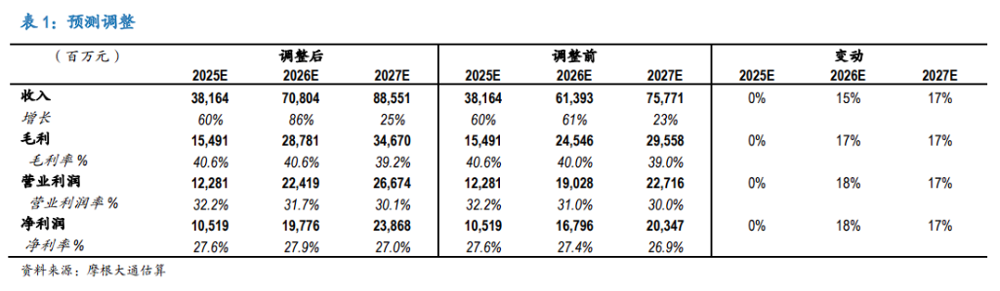

# 摩根大通谈“光模块”：1.6T可插拔光模块或“超预期”，“CPO冲击”预计到2027年以后

- 页面显示时间：2025-09-16T11:06:17+08:00
- 页面署名：董静
- 标注来源：未单列，见正文
- 原文：[华尔街见闻](https://wallstreetcn.com/articles/3755662)
- 取得时间：2026-11-04T16:03:59+08:00
- [HTML阅读版](article.html) · [来源记录](metadata.json)

## 导语

摩根大通认为，1.6T可插拔光模块放量节奏将超市场预期，主要受AI系统带宽需求增长和ASIC解决方案驱动。基于此，上调中际旭创2026年收入预测至708亿元，2027年至886亿元，目标价上调至430元。对于市场担忧的CPO技术冲击，摩根大通认为其规模化应用要到2027年后，短期内可插拔光模块仍是主流技术。

---

在近期中国光博会（CIOE）之后，摩根大通认为，1.6T可插拔光模块放量节奏或将超市场预期，短期内“CPO冲击”难现，中际旭创有望在未来数年持续受益。

9月16日，据追风交易台消息，摩根大通在最新研报中称， **市场对1.6T可插拔光模块的需求潜力可能仍有低估，其放量节奏或将超出预期** ，直接利好龙头厂商中际旭创的业绩增长。基于此，摩根大通已将中际旭创2026年和2027年的盈利预测分别上调18%和17%。

对于市场普遍担忧的下一代技术——光电共封装（CPO），摩根大通认为：

> 短期内不会构成颠覆性冲击，其规模化应用预计要到2027年以后，这意味着可插拔光模块在未来数年内仍将是主流技术，主要考虑到终端客户的成本/性能效率。即使2027年后可能过渡至下一代技术，中际旭创仍有望成为主要参与者。

## 1.6T可插拔光模块超预期

摩根大通在参加了中际旭创的投资者日活动后，进一步强化了其对1.6T可插拔光模块市场的乐观看法。

指出，除了2026年800G需求的持续强劲外，1.6T可插拔光模块在2026至2027年的出货量存在显著的上行空间，这主要基于两大驱动因素：

> **800G升级需求正轨：** 随着AI系统的不断演进，网络带宽需求呈指数级增长，从800G向1.6T的升级路径清晰且确定。
>
> **ASIC解决方案带来额外需求：** 专用于AI计算的ASIC芯片解决方案也将催生对高速光模块的潜在需求，这为1.6T市场打开了额外的增长空间。

摩根大通认为，对于中际旭创而言，这一趋势是重大利好。 **公司目前在其800G和1.6T可插拔产品中广泛应用硅光解决方案，更高的出货量不仅直接增加销售额，更重要的是能够通过规模效应优化成本结构，从而提升整体盈利能力。**

从具体数据看，摩根大通维持800G出货量假设不变，但上调了1.6T出货量预测。基于此调整，该行将中际旭创2026年收入预测从613.93亿元上调至708.04亿元，增幅达15%；2027年收入预测从757.71亿元上调至885.51亿元，增幅达17%。

2026年调整后净利润预测从167.96亿元上调至197.76亿元，每股收益预测从15.12元上调至17.80元；2027年调整后净利润预测从203.47亿元上调至238.68亿元。

摩根大通预计，中际旭创2025-2027年销售额/盈利年复合增长率分别为55%/66%。值得注意的是，摩根大通对毛利率的预测相对保守，约为40%，这为盈利预测提供了潜在上行空间。

摩根大通维持 **中际旭创"增持"评级，目标价从366元上调至430元** ，基于20倍的一年期动态市盈率得出。分析师指出，该股目前对应19倍的2027年预期市盈率，而同业对应25-30倍，估值仍有提升空间。

## CPO冲击”被推迟

研报称，尽管CIOE展会上展示了包括光电共封装（CPO）、近封装光学（NPO）和共封装铜互连（CPC）在内的多种下一代连接方案，引发了投资者对技术路线图的担忧，但摩根大通明确指出，这些替代方案不会立即造成颠覆性影响。

该行认为， **在3.2T解决方案大规模放量之前，可插拔光模块凭借其在成本与性能效率上的综合优势，仍将是终端客户的首选和主流技术。这意味着CPO等技术的规模化采用和过渡预计将发生在2027年以后。**

摩根大通称，即便2027年后市场可能采用或过渡至下一代技术，中际旭创依然具备竞争优势。

分析师强调，中际旭创在光学和组件集成方面拥有专业经验，同时与头部客户建立了紧密关系，这些都是公司在技术变迁中保持领先地位的重要支撑。

 

\~\~\~\~\~\~\~\~\~\~\~\~\~\~\~\~\~\~\~\~\~\~\~~

以上精彩内容来自[追风交易台](https://mp.weixin.qq.com/s/uua05g5qk-N2J7h91pyqxQ)。

更详细的解读，包括实时解读、一线研究等内容，请加入【 [**追风交易台▪年度会员**](https://wallstreetcn.com/shop/item/1000309) 】

风险提示及免责条款

市场有风险，投资需谨慎。本文不构成个人投资建议，也未考虑到个别用户特殊的投资目标、财务状况或需要。用户应考虑本文中的任何意见、观点或结论是否符合其特定状况。据此投资，责任自负。
