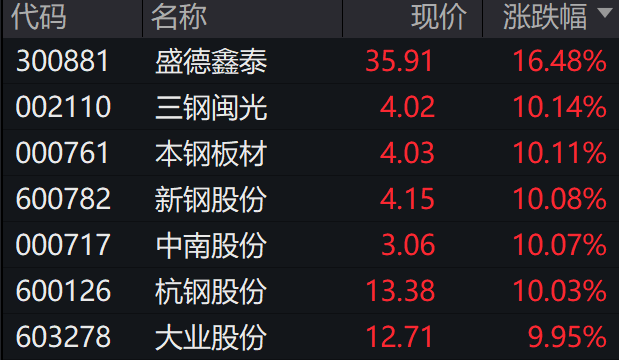
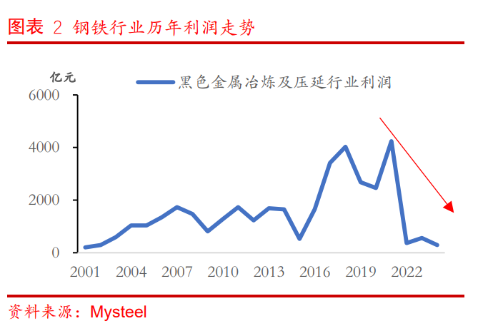
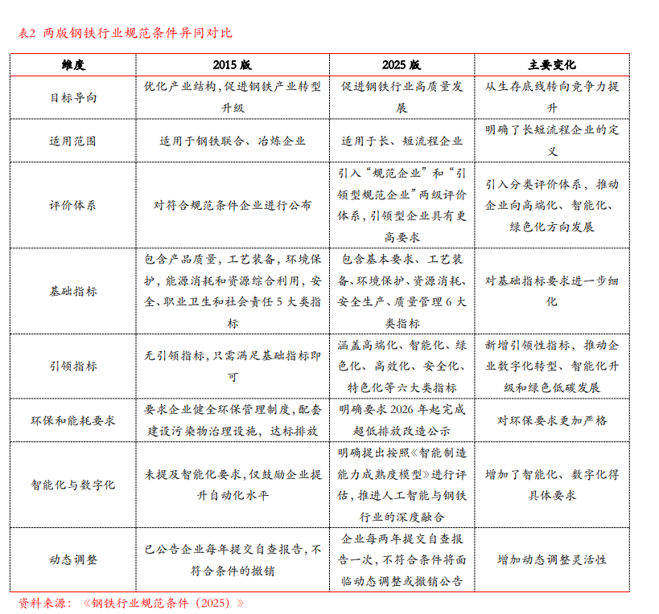
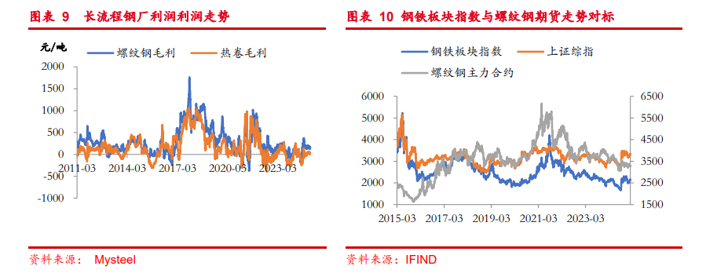

# 新一轮钢铁供给侧改革能否全面开启？

- 页面显示时间：2025-02-26T21:26:33+08:00
- 页面署名：赵颖
- 标注来源：未单列，见正文
- 原文：[华尔街见闻](https://wallstreetcn.com/articles/3741946)
- 取得时间：2026-11-04T16:03:33+08:00
- [HTML阅读版](article.html) · [来源记录](metadata.json)

## 导语

东海期货认为，从行业现状、对冲外需不确定性以及完成十四五规划能耗目标来看，本轮供给侧改革2.0的讨论并非空穴来风。一旦政策落地，最直接的影响是行业利润的阶段性扩张，但扩张幅度可能低于上一轮政策，预计可能到300-400元/吨之间。

---

2月26日周三，钢铁板块集体走高，三钢闽光、本钢板材、新钢股份、凌钢股份、华菱钢铁等纷纷涨停。

消息面上，工信部此前发布新版《钢铁行业规范条件（2025年版）》，与此同时中辉期货对近期的减产传闻评价称，压产将有助于钢材企业进一步转型升级。

新一轮钢铁供给侧改革能否全面开启？东海期货在2月24日的报告中分析了可行性，其认为本轮供给侧改革2.0的讨论并非空穴来风，从当前行业现状来看存在一定必要性。

同时，东海期货将两轮改革进行了对比，本轮政策手段可能会与 上一轮有所不同，更多是以超低排放改造、能耗强度、碳排放权，且政策力度相比2016年-2018年或较为温和。

**东海期货预计，一旦政策落地，最直接的影响是行业利润的阶段性扩张，但扩张路径可能和之前也有所不同，且扩张幅度可能低于上一轮政策，预计可能到300-400元/吨之间。**

## 供给侧改革2.0的必要性

东海期货认为，从行业现状、对冲外需下滑以及完成十四五规划能耗目标来看，本轮供给侧改革2.0的讨论并非空穴来风。

**东海期货表示，从去年下半年开始，供应端政策已经开始有所收紧，2024年7月工信部宣布暂停了钢铁产置换。上一轮产能置换暂停的时间是在2020年1月，之后当年底即出台了粗钢平控政策。**

从行业来看，当前钢铁行业需求、利润表现不佳，东海期货表示：

> 自2021年地产行业周期性见顶以来，钢铁行业需求近几年持续下滑，价格走势偏弱令利润持续压缩。2024 年黑色金属冶炼及压延行业利润为291.9 亿元，比2023年回落 272.9 亿元，且利润下滑趋势尚未看到改善迹象。
>
> 

与此同时，外需市场的不确定性也在增加，东海期货表示：

> 尽管钢材出口表现亮眼，但贸易保护主义抬头，使得2025年外需面临较大压力。全球加征关税对中国钢材出口的影响量可能在1146万吨左右，占2024年钢材出口总量约 10%。不过，考虑韩国、日本、越南、巴西四个国家的粗钢产量较大，因此实际影响可能小于这一比例。 

此外，2025年是“十四五”规划的收官之年，钢铁行业作为碳排放大户，面临着完成能耗和碳排放目标的艰巨任务。

## 本轮供给侧改革力度或更温和

东海期货研报指出，本轮供给侧改革与上一轮有相似的背景，都是在行业下行周期、出口承压的情况下启动。但不同之处也显而易见：

> - 目标导向不同： 上一轮侧重“去产能”，本轮更强调“高质量发展”，通过提“质”带动“量”的下降。
> - 政策手段不同： 上一轮以行政手段为主，本轮更注重市场化调节，通过超低排放改造、能耗强度、碳排放权等手段，倒逼企业升级。
> - **力度或更温和： 本轮政策力度可能相对温和。**
>
> 

## 对黑色金属板块影响几何？

东海期货认为，一旦政策落地，最直接的影响将是钢铁行业利润的阶段性扩张。但扩张路径和幅度，都可能与上一轮不同：

> **利润扩张路径： 考虑到钢材需求仍在下行，而铁矿石供应偏紧格局有所缓解，本轮利润扩张可能表现为钢材价格平稳或小幅下跌，铁矿石价格大幅下跌，而不是像上一轮那样出现明显的“劈叉”。**
>
> **利润扩张幅度： 预计利润扩张幅度可能低于上一轮，或在300-400元/吨之间，不太可能出现上轮政策中1000元/吨以上的情况。**
>
> 

此外，东海期货还特别提到了原料端可能出现的强弱逆转， 焦煤价格已跌至低位，且不排除会有针对煤炭的供应调节政策，1000元附近继续看空焦煤可能面临风险。铁矿石进入扩产周期，价格可能出现趋势性下行。

本文摘取自东海期货报告《 新一轮钢铁供给侧改革能否全面开启？》

风险提示及免责条款

市场有风险，投资需谨慎。本文不构成个人投资建议，也未考虑到个别用户特殊的投资目标、财务状况或需要。用户应考虑本文中的任何意见、观点或结论是否符合其特定状况。据此投资，责任自负。
