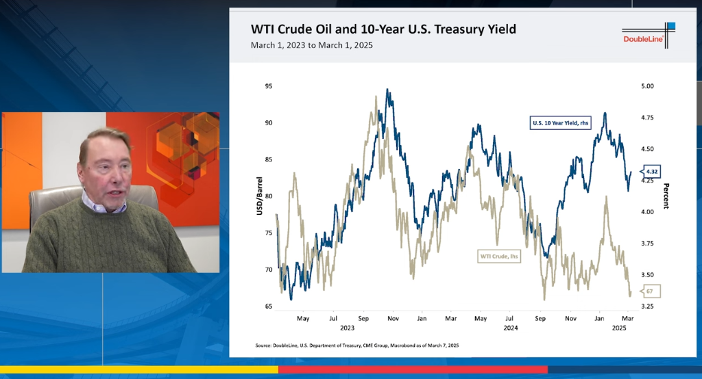
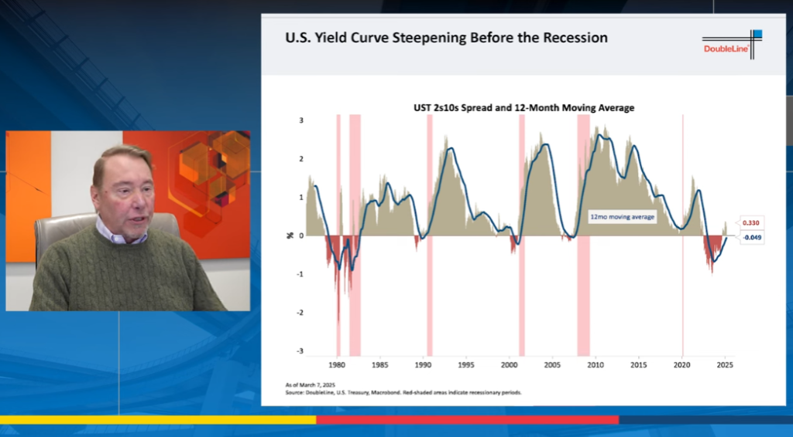
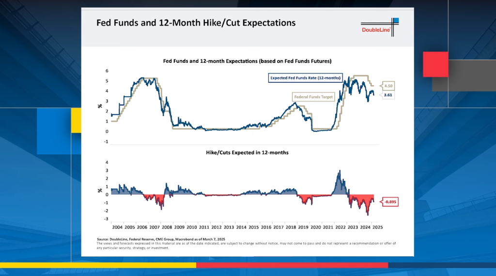
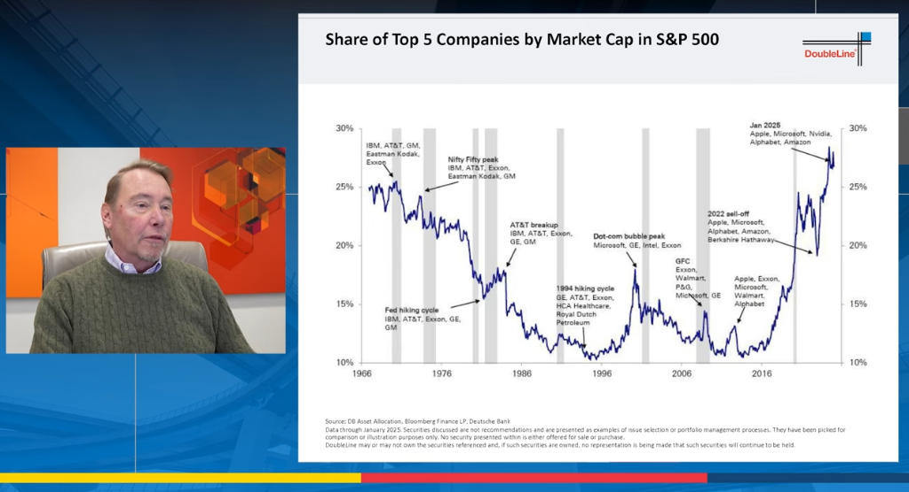
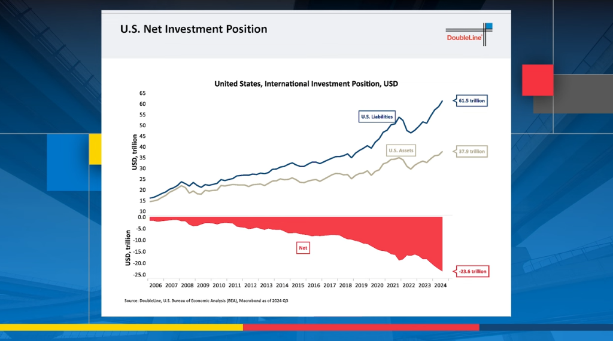
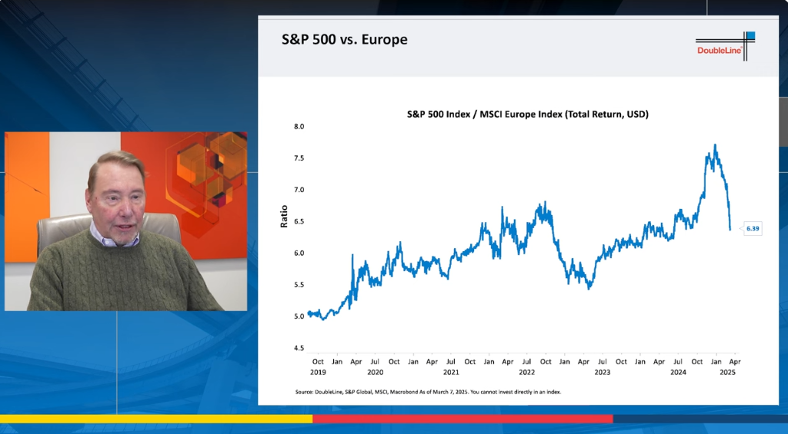

# 新债王：金价有望冲向4000美元，美国今年衰退可能性高达60%

- 页面显示时间：2025-03-14T17:24:29+08:00
- 页面署名：卜淑情
- 标注来源：未单列，见正文
- 原文：[华尔街见闻](https://wallstreetcn.com/articles/3743062)
- 取得时间：2026-11-04T16:03:34+08:00
- [HTML阅读版](article.html) · [来源记录](metadata.json)

## 导语

Gundlach认为，3000美元的金价预测有些保守，目前金融体系似乎正处于动荡之中，全球央行增持黄金的大趋势不会变。他再次强调了对非美市场尤其是欧洲股市的看好，预测10年期美债收益率还有进一步下降的空间。

---

DoubleLine首席执行官兼首席信息官兼创始人、“新债王” Jeffrey Gundlach在最近的一场直播中表示， **从纯美国投资转向多元化投资的时机已经成熟** ，再次强调了对非美市场尤其是欧洲股市的看好。

Gundlach认为，美股当下正处于严重高估的水平，MAG 7在标普500中的市值占比过高，投资者应避免过度集中于少数大型科技股。对于美国经济，Gundlach认为 **2025年衰退的可能性达到60%** ，比有些经济学家预测的（30%-40%）更加悲观。

他还指出，随着全球经济进入长期利率上升的新阶段，美债收益率的领先指标从铜/金比变成原油和美元，如今两个指标都显示， **10年期美债收益率可能还有进一步下降的空间。**

Gundlach重申了对黄金的看好， **预测金价有望突破3000美元大关，甚至冲向4000美元** 。他认为目前金融体系似乎正处于动荡之中，全球央行增持黄金的大趋势不会变。

**见闻总结亮点如下：**

> 我们进入2025年时，风险市场，尤其是(美国)股市，被严重高估。标普500的远期市盈率中位数处于第98百分位，几乎从未如此高过。非美国股市稍微便宜一些，除了中国、新兴市场和KBW地区银行，其他所有市场都高于平均水平。
>
> 一旦美元进入下行趋势，欧洲股市将开始表现优异，而这一趋势似乎已经形成。我重申我的建议：一是投资欧洲股票，我在大约三年半前就提到过，还有其他非美国股票。
>
> 我看到很多有趣的预测，人们说黄金将达到3000美元，但这并不是一个大胆的预测，因为起点已经是2900多美元。真正的预测是在1800美元时做出的，而不是在2900多美元时。我大胆预测，黄金可能会达到4000美元。
>
> 我不认为这种趋势（央行增持黄金）会停止。黄金的特性正在发生变化。过去央行在抛售黄金，但现在它们又重新开始大量持有黄金。我认为这是对黄金作为一种独立于金融体系的价值储存手段的认可，而目前金融体系似乎正处于动荡之中。
>
> 我们曾经使用铜金比率，但一旦长期利率下降的通缩世界被长期利率上升的世界取代，它就失效了。我认为现在正处于这样一个世界。因此，我一直在寻找近年来有效的指标，其中一个显然有很强相关性的是原油价格。现在，这表明收益率相对于原油价格仍然较高，原油价格已经从一年前的80美元左右大幅下跌至67美元，甚至更低。另一个高度相关的指标是美元。美元指数（黄线）显示，（美国）10年期国债收益率可能还有进一步下降的空间。
>
> 政府似乎承认他们不像特朗普第一任期时那样关心股市，他们更感兴趣的是度过经济转型期。上次我听到“转型”这个词是在2022年，当时美联储称通胀是“过渡性”的。我们将看看这是否真的是经济转型。
>
> 看起来衰退的可能性正在上升。我们看到经济学家将今年衰退的概率下调至约20%，但现在我听到一些人将他们的估计提高到30%到40%。我认为2025年衰退的可能性约为60%。
>
> 通过降息100个基点，美联储现在更符合加息/降息预期和两年期国债收益率，现在约为3.9%。因此，美联储今年可能会降息一次，也许一次半。
>
> 当时人们谈论美国的信用评级面临风险，政府关门，一家评级机构对国债进行了部分降级，我认为这是愚蠢的，现在仍然这么认为。
>
> （美国进口和出口）价格可能会随着关税问题的演变而继续上涨。目前关税问题似乎每小时都在变化，时而实施，时而取消，似乎并没有一个明确的逻辑。我知道特朗普喜欢在公共场合谈判，并且说一些他可能并不真正相信的话，比如“加拿大将成为第51个州”。我不认为他真的相信这一点，但他只是喜欢挑衅别人。
>
> 标普500指数中前五大公司（苹果、微软、英伟达、谷歌和亚马逊），它们的市值占比在过去几年发生了显著变化。2020年左右，从大约15%~17%开始，然后上升到28%。如果你再加入两家公司，如果你投资于标普500指数基金，到2024年底，你的投资组合中几乎有一半是由这七家公司构成的。这就是为什么我一直在建议投资者持有等权重的美国股票或标普500指数。
>
> 如果美国贸易加权美元下跌，这是我从长期趋势来看的预期，那么新兴市场应该会跑赢。美元必须非常有说服力地跌破这个指数，大约在118以下，我们才会看到一些向下的动能。

**以下为新债王直播文字实录全文，由AI翻译：**

欢迎大家，感谢大家参加今天的“总回报”网络直播。距离大师高尔夫锦标赛只有一个月的时间了，时间飞逝，尤其是当你年纪渐长时，这种感觉尤为明显。

今天的主题是“Not in My Neigh borhood”。我差点把它命名为“在我的社区”，因为屏幕上的图片是帕利塞德斯地区的街道。人们常常认为自己的生活不会受到某些事件的影响。比如，没有人会想到自家后院会发生野火，烧毁一个密集社区中的大约6000到7000栋建筑。但今天的讨论重点是投资主题， **我们将探讨如何从纯美国投资转向多元化投资。** 过去三年左右，我一直在频繁讨论这个话题。 **现在，时机似乎已经成熟** ，我们将深入探讨。

DOGE也让我想到了“Not in My Neigh borhood”这个概念。很多人不喜欢联邦政府的浪费和腐败，但一旦有人开始真正削减开支，人们又不希望自己的利益受到影响。这就像你无法在不削减某些东西的情况下削减开支。你必须找到欺诈、浪费和腐败，并真正削减它们。我非常支持这种做法，因为这是我们唯一能够整顿财政的方式。

我还想说，Mag 7（指七大科技股）的势头股，尤其是Mag 7，曾经被认为是不败的，表现持续优异。但事实并非如此。每个行业都有脆弱性，我们现在显然已经开始看到这一点。

接下来，我将通过幻灯片展示来继续讨论。这是我们2025年的起点，实际上是2024年底，12月27日。我们进入2025年时，风险市场，尤其是股市，被严重高估。我们可以看到，这分为三个部分。左边是美国股市，X轴是数据系列的起始时间。我们将2024年12月27日的估值与X轴上的起始时间到今天的时间段进行比较。例如， **标普500的远期市盈率中位数处于第98百分位，几乎从未如此高过。** 这让我想起了2021年，当时我谈到市场被高估的情况。当然，2022年对股票和债券市场来说都是灾难性的一年。

美国市场的情况显而易见，但你会发现，除了小盘股，我们在进入2025年时确实处于高估的顶端十分位。 **中间的非美国股市稍微便宜一些，除了中国、新兴市场和KBW地区银行，其他所有市场都高于平均水平。** 在非美国股市中，年底时没有真正超级便宜的估值。

接下来我们看到固定收益市场，情况各不相同。公司债券利差几乎是有史以来最窄的，整体公司债券也是如此。随着你进入评级较低的垃圾债券，它们的估值相对于历史（追溯到1990年代）并不那么高。然后我们看到，CMBS（商业抵押贷款支持证券）的估值相对于1997年以来的历史明显最便宜。这就是我们进入2024年时的背景。那么，到3月7日发生了什么？

当然，自那以后，一些情况变得更糟，但我们看到道琼斯指数是标准股票指数中表现最好的，略有上涨。当然，现在情况并非如此。标普500下跌了1.6%，纳斯达克下跌了超过5%。当然，过去几天的损失更加严重。罗素2000指数表现更差。非美国股市，全球股市实际上有小幅上涨，但欧元区上涨了12.4%，这是基于近期历史非常不寻常的高表现。我们还看到，富时指数表现良好，上涨了9.6%，而耐克略有回落。然后我们进入固定收益市场，它的表现优于主要股票指数，而且这一差距显然在扩大。我认为，综合指数至今的表现比纳斯达克高出约12个百分点，债券基本上都在上涨。这只是一个你站在哪里的问题。表现最差的是浮动利率债券，因为利率下降，浮动利率债券没有从中获得相同的价格收益。

我们看到，今年美元走弱，美元指数下跌了4.3%。这也是欧元区股票相对于美国股市表现如此出色的部分原因。

这是我过去三年，甚至更长时间一直在谈论的话题， **一旦美元进入下行趋势，欧洲股市将开始表现优异，而这一趋势似乎已经形成。** 我们看到欧元、日元等货币对美元都在升值。然后我们看到能源板块大幅下跌，下跌了6%。油价下跌，这是政府的目标之一。我们将看看这是否会持续。大宗商品市场整体上涨了5.7%（彭博大宗商品指数）和1.2%（高盛大宗商品指数）。最大的赢家是金属，黄金、铜和工业金属都在上涨，尤其是铜涨幅很大。

黄金继续其牛市，我们已经谈论了几年，自从黄金跌至1800美元以来，现在它已经接近3000美元。我看到很多有趣的预测，人们说黄金将达到3000美元，但这并不是一个大胆的预测，因为起点已经是2900多美元。真正的预测是在1800美元时做出的，而不是在2900多美元时。 **我大胆预测，黄金可能会达到4000美元。** 我不确定今年是否会实现，但我认为这是黄金长期盘整在1800美元左右的预期目标。所以，今年到3月7日为止，市场表现参差不齐，有涨有跌。

我们将彭博综合债券指数的表现放在其历史背景中来看。这里有过去四十九年的综合指数表现数据，今年是黑线，比其他线更粗。我们可以看到，今年是四十九年中的第5名，所以到目前为止，这是一个表现最好的十分位年份。我们在这里指出2022年，那一年完全脱离了历史背景。30年前，我们认为1994年是一个糟糕的年份，因为它略微下跌。但2022年的表现远远超出了其他年份的经验。

这是综合指数的回撤历史。由于我们从80年代到2022年或2021年处于一个长期牛市，回撤并没有持续很长时间，因为随着长期利率下降，市场创下了新高。2020年8月20日开始的那次回撤，我不知道是否会被超越。如果我们可能需要多年的新债券发行和经济轮动才能实现这一点。但现在，我们距离综合指数价格的峰值已经55个月了，回撤仍然有17.2%。这是一个相当大的价格回撤。

这是30年期国债，期限最长的债券。我们看到，它的价格仍然比2020年8月的峰值低48%，就像整体指数一样。因此，国债从峰值以来的损失仍然巨大，很快就要满五年了。

这是我们过去10年的收益率图，左上角是两年期国债收益率，随着美联储加息，它急剧上升，最终加息了500个基点，525个基点。两年期收益率在几年前见顶，现在约为4%。五年期国债收益率略高，为4.09%，与两年期的模式非常相似。左下角的10年期国债也是如此。因此，我们说，我们已经几年没有达到新的利率高点，30年期国债也是如此。因此，这看起来像是整个收益率曲线的一致走势，但有时会出现倒挂，现在我们再次处于一个相当分散的收益率曲线中。

**我们曾经使用铜金比率，但一旦长期利率下降的通缩世界被长期利率上升的世界取代，它就失效了。我认为我们现在正处于这样一个世界。因此，我一直在寻找近年来有效的指标，其中一个显然有很强相关性的是原油价格，屏幕上显示的是原油价格（黄线）和10年期美国国债收益率（蓝线）。除了2024年第四季度的那个例外，它们看起来几乎是同一条线。现在，这表明收益率相对于原油价格仍然较高，原油价格已经从一年前的80美元左右大幅下跌至67美元，甚至更低。**

另一个高度相关的指标是美元。这个几乎完全一致，几乎是同一条线。这也表明， **美元指数（黄线）显示，（美国）10年期国债收益率可能还有进一步下降的空间。**

**我猜这需要更多的经济焦虑，也许是一些真正的衰退风险。政府似乎承认他们不像特朗普第一任期时那样关心股市，他们更感兴趣的是度过经济转型期。上次我听到“转型”这个词是在2022年，当时美联储称通胀是“过渡性”的。我们将看看这是否真的是经济转型。** 这就是10年期国债收益率的现状。

正如我所说，收益率曲线曾经倒挂，现在已经不再倒挂。现在两年期和10年期的利差为33个基点，曾经是负108个基点。因此，收益率曲线的陡峭化相当显著。红色阴影区域是衰退期。通常，当曲线不再倒挂时，你会预期衰退。现在这还没有发生，至少官方上还没有。但如果你看蓝线，即12个月移动平均线，它还没有超过零线，尽管它已经非常接近了。如果你看那些衰退期的柱状图，真正的决定性时刻似乎是当12个月移动平均线超过零线时，这应该很快就会发生。

因此， **看起来衰退的可能性正在上升。我们看到经济学家将今年衰退的概率下调至约20%，但现在我听到一些人将他们的估计提高到30%到40%。我认为2025年衰退的可能性约为60%。这张图表支持了这一观点。**

这是联邦基金利率和美联储12个月加息/降息预期的图表。我们看到，在9月开始降息之前，美联储的目标利率（黄线）与加息/降息预期（底部面板）大相径庭。它也与两年期国债收益率（与加息/降息预期类似）大不相同。通过降息100个基点，美联储现在更符合加息/降息预期和两年期国债收益率，现在约为3.9%。因此， **美联储今年可能会降息一次，也许一次半。** 最近几天，市场重新调整了预期，认为美联储今年可能会降息超过两次。我对此持怀疑态度，但我们将看看数据如何发展。

这是市场对2025年美联储降息的定价波动。我们追溯到2023年底，看到在前九个月的大部分时间里，市场定价了很多降息，从9月开始，很多降息预期被取消。最近一个月，降息预期再次被定价。因此，这就像过山车一样，从大约一次降息到八次降息，然后又回到一次降息，现在又回到更多降息。

因此，这种情况继续波动。这是两年期和10年期收益率曲线与U3（总体失业率）的关系。收益率曲线的走势，两年期和10年期的利差表明失业率应该上升。它开始上升，然后放缓。因此，这预示着就业状况将进一步恶化。当然，如果政府削减工作岗位和浪费，失业率可能会显著上升。我们将看看这是否重要，因为这是失业率，或者因为它是一个目标子行业，所以影响较小。我们将看看会发生什么。

这是仍然预示衰退的图表。这是失业率与其36个月移动平均线的关系。它看起来在上升，但后来停滞了。

与此最相似的时间点是2000年和2007-2008年的风险资产峰值。这个图表比那些时期稍微平坦一些，但我们还没有看到像2007年之后的巨大加速。接下来，我将展示一些显示年初至今实际变化的经济图表。第一个是会议委员会对未来六个月就业减少的预期，它直线上升。这可能与政府机构有关，但它已经超过了10年前甚至更早的峰值。自2010-2011年以来，我们还没有看到它如此快速上升的情况。 **当时人们谈论美国的信用评级面临风险，政府关门，一家评级机构对国债进行了部分降级，我认为这是愚蠢的，现在仍然这么认为。** 但上次这个峰值确实导致了衰退。我们将看看这次会发生什么。

但这是一个在短时间内发生的巨大变化。这是亚特兰大联储的GDP预测，它一直在2%到2.5%的范围内波动。你会注意到，今年早些时候，蓝筹经济学家与亚特兰大联储的GDP预测一致，然后突然之间，随着关税问题的加剧，我们看到经济出现了巨大的扭曲，其中之一是第一季度的实际GDP，亚特兰大联储现在估计为负2.5%。我们已经很久没有看到这样的数字了。我不知道为什么在一天之内发生了如此巨大的变化，从大约负1.5%大幅下调。因此，我将密切关注这一点。

这是另一个令人不安的趋势，但它并不新鲜。这是按财政年度划分的联邦赤字。财政年度从10月开始。你会注意到，随着时间的推移，我们每年都在进一步陷入赤字问题，财政赤字在上升。2021年很糟糕，2022年更糟，2023年是全年最糟糕的一年。2024年则开局非常不妙。因此， **希望我们能在削减一些欺诈性项目上取得进展，政府似乎完全愿意实施并保留这些项目。** 当然，我们希望这些项目消失。我认为，政府资金的错配程度很难被高估。

这是财政部自2007年以来的月度债券发行量。这很有趣。你会注意到，为应对新冠疫情而发行的大量债券与我们在过去一年中的大量借款相匹配。这会创下新纪录吗？我当然希望不会。但在被认为是全球经济增长的情况下，债务数量与财政刺激和货币印刷的最壮观反应相同，这确实令人沮丧。我们现在发行的债务数量与那7万亿美元的货币印刷时期相同。

这是我以前从未使用过的图表，但我认为它非常有趣。我们有预算赤字与失业率的关系。预算赤字占GDP的百分比在Y轴上，失业率在X轴上。你可以看到从1960年到2017年的趋势。当失业率高时，赤字也高以应对失业率；当失业率低时，赤字相对较低，甚至在某些年份没有赤字，反而有盈余。

但现在让我们看看2016年到2024年发生了什么。我们看到失业率在X轴的左侧，但预算赤字在底部附近，占GDP的7.2%，是自那以来的最高水平。我们还没有进入衰退。

我知道我经常提到这个问题，但这次不会过多讨论。我更希望我们能够真正解决预算问题。我之前有一个问题，就像一个“你为什么不停止虐待你妻子”的问题。有人问我，你是否仍然支持特朗普政府所做的一切？我从未支持过特朗普政府所做的一切。我不喜欢州和地方税收抵免上限，我不喜欢特朗普实施的减税政策，我不喜欢任何一届政府所做的一些事情。所以，让我们看看接下来会发生什么。我确实支持削减预算的想法。我希望我们至少能找到1.5万亿美元的削减空间。这看起来似乎是一个艰巨的任务。

接下来是整体和核心CPI，我们将讨论通胀问题。现在，通胀进展是美联储面临的麻烦之一。他们一直在新闻发布会上说我们在取得进展，让我们看看下周会发生什么，但事实上我们并没有取得真正的进展。核心通胀率远高于2.0%的目标，CPI为3.3%，整体通胀率为3.0%，而这一数字在最近一次读数中实际上还在上升。这是核心生产者CPI，这实际上是生产者价格指数。它们对美联储来说甚至更加不合作。我们看到最终需求价格接近零，但现在已经急剧上升，达到3.5%的年增长率。最终需求价格剔除食品和能源的核心部分，虽然没有以同样的速度上升，但也没有像之前那样大幅下降，因为它本身就不那么波动。

接下来的幻灯片，我认为对美联储来说是最令人担忧的，那就是CPI的月度变化。上图是整体通胀率。它不仅每个月都在上升，而且几乎是单调上升的。在过去八个月中，每个月的通胀率都等于或高于前一个月。最近一个月的通胀率为0.5%，这意味着年化通胀率远高于2%的目标。中间图显示食品价格在过去几个月以及前一个月都在上涨。然后我们看到能源价格在过去几个月中得到了更好的控制，除了最近两个月。因此，我认为是上图的月度通胀率让美联储感到担忧。核心CPI也是如此，最近一次读数非常糟糕，核心通胀率为0.45%。明天将公布新的数据，预计会比这个数字好一些，但让我们看看实际情况如何。

你可以看到企业CPI的月度环比变化已经停止下降。我们看到二手车和卡车价格在经历了大流行期间的大规模价格上涨后，经过一段时间的回调，现在又开始上涨。然后我们看到业主等价租金正在逐步放缓。这种情况可能会继续，也许不会在亨廷顿帕利塞兹发生，那里令人惊讶的是，尽管该地区需要做很多工作才能恢复到之前的水平，但房价至少在报价或挂牌价格上仍然很高。

接下来是超级核心通胀率。现在没有人再谈论这个指标了。我想美联储可能是因为它不符合预期而将其搁置。超级核心通胀率剔除了超级核心服务（不含住房）。也就是说，既没有食品，也没有能源，也没有住房，这几乎涵盖了大多数人生活方式中需要购买的大部分内容。

我们说最近一个月的超级核心通胀率为0.7%和0.6%，这是一个令人震惊的数字，类似于吉米·卡特时期的通胀水平。

我们还看到医疗服务价格有所缓解，但机动车保险价格仍然糟糕，每月上涨2%。在过去三年中，保险价格已经上涨了大约160%。

接下来是出口和进口价格的同比变化。这些数据没有经过季节性调整，也没有任何质量调整或类似的处理。它们曾经非常通胀，然后在2023年和2024年有所回调，但现在又开始上涨。我们看到出口价格同比上涨了2.7%，美国进口价格同比上涨了1.9%。这还没有考虑到进一步实施关税的影响。所以，我猜这些 **价格可能会随着关税问题的演变而继续上涨。目前关税问题似乎每小时都在变化，时而实施，时而取消，似乎并没有一个明确的逻辑。我知道特朗普喜欢在公共场合谈判，并且说一些他可能并不真正相信的话，比如“加拿大将成为第51个州”。我不认为他真的相信这一点，但他只是喜欢挑衅别人，我想。**

接下来是一年期通胀预期，这令人震惊。很难想象美联储会在一年期通胀预期达到4.0%的情况下降息。这些短期通胀预期是我们过去一年中看到的最高水平之一。然后还有密歇根大学的消费者通胀预期，这一指标再次飙升至4.3%，与一年期通胀预期相当。所以，通胀预期可能是因为人们认为关税会导致通胀上升，也许确实会。

这对美联储来说是一个令人担忧的问题，也对利率下降的预期产生了影响。接下来是彭博大宗商品指数，该指数最近显示出一些复苏迹象，主要是由于铜和黄金等大宗商品价格上涨，而不是因为能源价格上涨。目前该指数高于其正在缓慢上升的200日移动平均线。所以，大宗商品整体上不再下跌，并显示出一些复苏迹象。这显然对通胀前景不利。

再看黄金，3月7日收盘价为2090.5美元，今天的价格几乎与当时相同。你可以看到我在图中提到的黄金在1800美元附近的盘整区间，然后最终突破2000美元。当它突破2000美元时，你可能会预期其上涨幅度几乎与盘整区间的宽度相当。在我看来，这表明黄金价格可能会突破3000美元，甚至可能达到4000美元。

我们会继续观察。这也是黄金表现强劲的原因之一。国际货币基金组织（IMF）的数据显示，全球央行的黄金储备正在迅速增加。从2010年开始，黄金储备从340亿美元增加到410亿美元。虽然这里的绝对规模并不大，但增长速度非常快。 **我不认为这种趋势会停止。黄金的特性正在发生变化。过去央行在抛售黄金，但现在它们又重新开始大量持有黄金。我认为这是对黄金作为一种独立于金融体系的价值储存手段的认可，而目前金融体系似乎正处于动荡之中。**

接下来是美国商品贸易平衡，这肯定与关税预期有关。我们看到美国商品贸易逆差在最近一个月达到了1560亿美元，甚至超过了疫情期间的水平。现在贸易逆差已经达到了1560亿美元。

这与“不在我的街区”这一主题有关。似乎央行的行为正在发生变化，这与地缘政治有关，而最终，我们相信这可能会导致资金流动发生变化。这可能会对所谓的“美国例外主义”产生重大冲击，我将其定义为美国金融市场在过去的表现优于其他国家。我们将在接下来的几分钟内探讨这一问题。

接下来是美国进口商品的平均关税率，这一数据可以追溯到1930年。我们看到过去几十年关税率比现在高得多，尤其是在1950年之前。现在，在特朗普时期，关税率似乎又开始上升。过去几年我们实施了大量关税，但这里显示的是耐用消费品进口的平均关税率（金色线），所有进口商品的平均关税率（蓝色线），以及特朗普时期的关税率（红色点）。

接下来是我们的贸易伙伴。美国进口占各国总出口的比例显示，墨西哥有80%的总出口流向美国，加拿大也接近这一比例，达到70%以上，而日本只有20%。这就是为什么美国与墨西哥和加拿大之间的贸易关系如此复杂，因为它们是美国的主要贸易伙伴。我理解特朗普关税政策背后的逻辑，即所谓的“互惠”，因为我们的进口商品被征收的关税似乎比我们出口到其他国家的商品关税更高。所以，这里肯定会发生一些变化，而市场到目前为止的反应似乎表明，这可能会对一些被认为是永恒趋势的事情产生重大冲击，比如人们认为美国金融市场永远会表现更好，或者美国的贸易地位永远不会改变。相信我，这种情况确实可能发生。

我知道这一点，因为1月9日我的房子着火了。幸运的是，只是外部或景观受损，房子内部没有损坏，但清理和修复仍然需要大量的工作和费用。

接下来是固定收益领域的利差情况。我们进入债券市场的细节。黄色菱形表示2024年12月的数据，而“当前”则是昨天的数据。我们看到一些板块的利差基本保持不变。我们看到在杠杆贷款市场和高收益债券市场中，AAA级债券利差有所收窄。CMBS中的BBB级债券利差也略有收窄，但年初至今，利差总体变化不大。首先，它们在年初有所收紧，这在新年伊始是常见的现象。但随着近期国债市场的反弹，许多板块的利差又回到了之前的水平。

例如，高收益债券市场与国债市场收益率的利差曾低至252个基点，现在又回升到300个基点以上。所以高收益债券利差扩大了大约50个基点。这并不是因为高收益债券价格下跌，而是因为高收益债券市场未能跟上国债市场的价格上涨。实际上，在许多信用债市场中，价格并没有上涨，只是在价格上“停滞不前”。

接下来是企业高收益债券市场中，AAA级债券与BB级债券之间的利差。我们说BB级债券利差有所扩大，而AAA级债券利差（蓝色线）的移动平均线（浅棕色线）显示，总体上AAA级债券利差有所收窄，但与过去相比，仍相对较高。从移动平均线来看，高收益债券市场的违约率开始上升，而在贷款市场中，违约率也有所上升。我们看到高收益债券市场的违约率为2.8%，这并不是一个很高的违约率，但它已经从下降趋势转为上升趋势。贷款市场的违约率达到了一个新的局部高点，这并不令人惊讶，因为美联储的利率仍然比周期底部高出425个基点。

因此，这些浮动利率市场的公司支付的利率比几年前高出超过4个百分点，随着时间的推移，越来越多的债券以更高的利率重新定价，这会对公司造成压力。我们还看到违约债券的回收率，高收益债券的回收率约为42美分，这是一个不太理想的回收率，自2017年以来也没有比这更好过。我们看到优先留置权贷款的回收率为62美分，这一回收率在过去几年中相对稳定。

接下来是非机构CMBS市场。我们看到AAA级债券已经恢复到疫情前的水平。AA级债券也几乎恢复到疫情前的水平，但略有波动。这与我们在高收益债券市场中看到的现象相同，并不是CMBS价格一定下跌，而是它未能跟上国债市场的步伐，尤其是考虑到其较短的久期。然后我们说，CMBS市场中的BBB-级债券从未接近恢复到疫情前的水平。它们最近有所上升，但在2023年下半年到2025年初，利差大幅收窄，从约900个基点降至约400个基点。所以，这些利差与非国债市场的大多数利差一样，最近略有上升。

接下来是标普500指数，它在2024年底时远高于其200日移动平均线，当时市场估值过高。我们已经回到了200日移动平均线，并且现在低于这一水平。这是截至昨天的情况。虽然看起来标普500指数在收盘时可能会进入上涨区间，但今天并没有实现，它出现了小幅下跌。所以，我们现在低于标普500指数的200日移动平均线，市场似乎仍有一定的下行趋势。

接下来是一个大问题： **标普500指数中前五大公司的市值占比。苹果、微软、英伟达、谷歌和亚马逊这五家公司，它们的市值占比在过去几年发生了显著变化。2020年左右，我们从大约15%~17%开始，然后上升到28%。如果你再加入两家公司，如果你投资于标普500指数基金，到2024年底，你的投资组合中几乎有一半是由这七家公司构成的。** 这就是为什么我一直在推荐——我在年底时推荐过，在Just Markets网络直播中也推荐过，在圆桌论坛中也推荐过—— **建议投资者持有等权重的美国股票或标普500指数。**

我们说市值加权投资组合现在肯定受到了打击，因为那些曾经的“高飞者”并不能免于高估值的后果。它们最终会受到过去几年它们所拥有的惊人相对强势的冲击。

所以，接下来是等权重与市值加权的对比，我们看到了一个巨大的循环。这与我们在全球金融危机期间看到的集中度相似，当时金融股在标普500指数中的权重过高，随后一路下跌至0.625，之后又回升至与全球金融危机时期相同的高位。目前虽然还不确定，但似乎已经出现了破位迹象。在较短的时间内，等权重表现已经至少比市值加权表现高出几个百分点。

接下来是其中一个最令人惊叹的现象，这也是我将这次演讲命名为“不在我的街区”的主要原因。我们看到美国股票与全球其他地区股票的对比，可以追溯到20世纪70年代的“漂亮50”泡沫，这正是目前这种现象让我联想到的。我还记得“漂亮50”，我足够年长，经历过那个时期。当时人们认为美国股市中仅仅50只股票的集中度是荒谬的，但随后从高位下跌了约80%。再看互联网泡沫时期，虽然没有“漂亮50”那么糟糕，但美国股票相对于全球其他地区股票的估值已经非常离谱。我们有理由相信，推动美国股票跑赢的这种资金流动是脆弱的，并且可能会逆转，稍后我们会讨论这一点。

但看看自2024年12月24日以来的巨大逆转，这已经是一个相当大的反转。我相信这种趋势还会继续。因此， **我重申我的建议：一是投资欧洲股票，我在大约三年半前就提到过，还有其他非美国股票。** 这是股票价格与全球其他地区股票的对比，我们把时间范围缩小到过去十年左右，可以看到这种逆转的幅度。我们几乎已经回到了2022年的水平，尽管还没有完全达到。这是美国的投资地位，这基本上显示了外国投资者对美国的净投资。所以，外国投资者对美国的投资从大约十五年前的3万亿美元增加到了23.6万亿美元。当有20万亿美元的资金净流入美国时，这显然会推动美国市场跑赢外国市场。

但随着目前围绕关税问题的种种纷争，以及欧洲突然觉得美国不再愿意永远为北约买单，欧洲需要开始自我防御，德国、英国和其他欧洲国家可能会重新工业化，以便在防御上更加自给自足。这几乎不可避免地会导致资金流动逆转，并可能导致非美国股票相对于美国股票的持续跑赢，甚至可能是多年，甚至十年的跑赢。

再看看欧洲的情况，这是令人难以置信的。我们双线资本（Double Line）第一次投资欧洲是在2021年左右，这是双线资本历史上第一次投资欧洲。起初并不顺利。当蓝色的线开始再次上升时，美国又开始跑赢了。然后在2022年，欧洲似乎真的开始有起色了，跑赢了美国，但那是在熊市期间。我一直认为在股市下跌时，美国会表现不佳，事实也确实如此。现在我们又回到了2021年的水平。所以，如果你在2021年买入欧洲股票而不是美国股票，那么在2023年到2025年期间会经历一段痛苦的时期，但现在欧洲股票已经有了很大的动能。

再看看美元指数，在这个显示中看起来并不明显，但它确实有显著的下跌趋势，尤其是对欧元而言。

这也是我认为欧洲股票能够开始跑赢的原因之一，美元从几年前的高位开始走弱，并且在过去几个月内又下跌了几个百分点。再看看新兴市场，美国股票相对于标普500指数和新兴市场股票的表现是如此出色，这种趋势已经持续了10年。你可以把时间拉得更长，这种趋势依然显著。除了2022年熊市期间出现了一次短暂的逆转外，其他时间都没有出现过逆转。

这再次表明， **在负面市场中，美国可能会表现不佳，而不是跑赢。** 我的预测是， **在下一次经济衰退中，美元会下跌，美国市场会表现不佳。** 这并不是说“这次不一样”，因为我在之前的网络直播中多次提到，我们目前并没有处于一个长期下降的利率环境中，而是处于一个长期上升的利率环境中，尤其是在长期利率方面。我相信，在下一次经济衰退中，美元会下跌，美国市场会表现不佳，而10年期和30年期国债收益率可能会进一步上升。

这是一个非常不同的环境，因为背景已经发生了变化。所以，新兴市场甚至也开始跑赢了。这并不是在选举之后才开始的，新兴市场在选举之前就已经开始见顶并反转，但更近期的情况确实是这样的。

这是标普500指数相对于摩根士丹利新兴市场指数的相对表现，我们将其与美元贸易加权指数进行了对比。这并不是迪西指数，而是贸易加权美元指数，它与新兴市场相关性更高，而不是像迪西指数那样以欧元为主导。可以说，这两条线是相似的。

所以，我们在这里看到的是， **如果美国贸易加权美元下跌，这是我从长期趋势来看的预期，那么新兴市场应该会跑赢。美元必须非常有说服力地跌破这个指数，大约在118以下，我们才会看到一些向下的动能。** 所以，就在这里结束吧。这将结束2025年3月11日的市场网络直播。今年的开局很有趣，看起来肯定不会是2024年的翻版。所以，祝大家好运。感谢大家今天的关注。感谢大家对双线资本的信任和信心。暂时再见。

风险提示及免责条款

市场有风险，投资需谨慎。本文不构成个人投资建议，也未考虑到个别用户特殊的投资目标、财务状况或需要。用户应考虑本文中的任何意见、观点或结论是否符合其特定状况。据此投资，责任自负。
