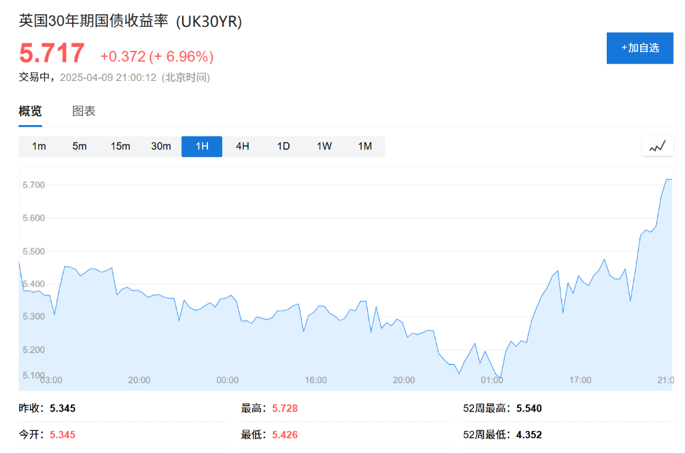
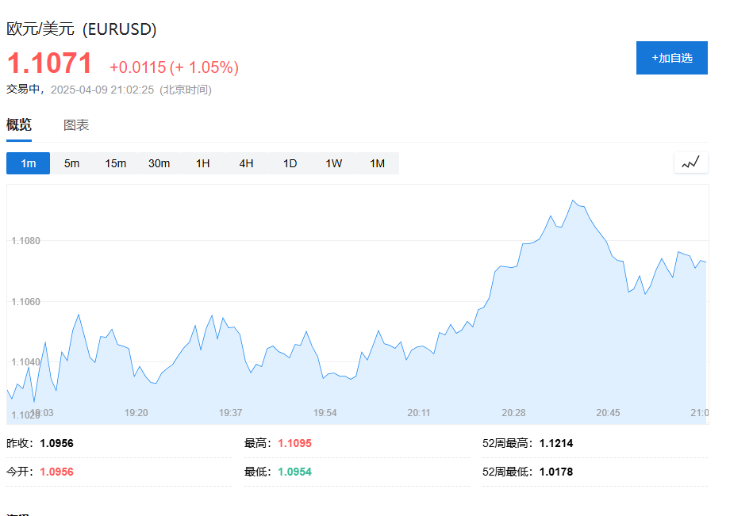

# 本轮关税战第一个倒下的：英国？

- 页面显示时间：2025-04-09T21:30:32+08:00
- 页面署名：张雅琦
- 标注来源：未单列，见正文
- 原文：[华尔街见闻](https://wallstreetcn.com/articles/3744911)
- 取得时间：2026-11-04T16:03:17+08:00
- [HTML阅读版](article.html) · [来源记录](metadata.json)

## 导语

周三，美债收益率暴涨带动下，英国30年期国债收益率飙升25个基点，创下1998年以来的最高水平。与此同时，欧元兑英镑上涨0.7%。这或许令现任财政大臣Rachel Reeves倍感压力，她的财政预算中几乎没有增加支出的空间，反而不得不削减开支以实现财政平衡。

---

关税冲击波席卷全球债市。美债收益率暴涨带动下，英国借贷成本创27年新高。

周三，英国30年期国债收益率飙升25个基点，至5.60%，超过今年1月创下的多年高点，创下1998年以来的最高水平。与此同时，欧元兑英镑上涨0.7%，至0.8645，为2024年1月以来的最高水平。

**这一走势显然令现任财政大臣Rachel Reeves倍感压力，她的财政预算中几乎没有增加支出的空间，反而不得不削减开支以实现财政平衡。**

与此同时，尽管英国央行近期持续降息，但债券抛售潮仍在推高英国借贷成本。周三，[英国央行警告称，](https://wallstreetcn.com/articles/3744894?keyword=%E8%8B%B1%E5%9B%BD%E5%A4%AE%E8%A1%8C)对冲基金面临大量追加保证金压力，市场进一步大幅调整的风险依然很高。

State Street Bank and Trust Co的欧洲、中东和非洲宏观策略主管Timothy Graf表示：

> "在任何收益率上升的环境中，由于财政空间耗尽，英国国债将无法表现良好。"

## 财政规则"坚如磐石"，投债券投资者信心动摇

自2020年以来， **英国的公共债务负担增速超过了其他主要发达经济体。** 根据国际货币基金组织的数据显示，英国的政府债务占GDP的比例从2019年的85.7%上升至2024年的101.8%，增幅超过16个百分点，仅次于新加坡，为40个发达经济体中增幅最大的。

目前，英国在债务利息上的支出约为1050亿英镑，远高于通用信贷（880亿英镑）、国防（375亿英镑）、投资（720亿英镑）或教育（900亿英镑）的支出。 这种支出结构对公共服务造成了挤压。

对此，英国财政大臣Rachel Reeves计划通过削减部门支出和福利，实施一项规模近150亿英镑的财政修复计划。但这对英国长期国债受到的打击尤为严重。 **英国国债管理办公室周三出售45亿英镑（约58亿美元）五年期债券时，需求指数降至今年最低。**

为了安抚债券投资者，英国首相Keir Starmer近日试图向债券投资者传达稳定的信息，重申政府的财政规则“不可改变”。

彭博社策略分析师Ven Ram表示：

> "如果市场走势持续，且经济相对政府预测继续疲软，Reeves可能不得不提高税收，这可能会对长期国债形成恶性循环。"

## 欧元意外崛起：投资者寻找新避风港

在债券市场风险持续增加以及关税引发的经济预期动荡中，投资者开始寻找新的避风港。

**欧元成为特朗普重塑全球贸易秩序计划中的一个意外赢家。** 尽管欧洲受到关税的打击比英国更严重，但市场参与者认为随着近年来流入美元资产的大量资金逆转，欧元将成为更大的受益者。

这导致英镑兑欧元下跌。欧元上涨最多0.6%至超过86便士，达到2024年4月以来的最高水平。自今年早些时候几乎触及与美元平价后反弹以来，欧元在过去一个月也优于大多数G-10同行表现。

期权市场显示，投资者对欧元相对于英镑的信心重新增强，所谓的一个月风险逆转现在显示出自1月21日以来对欧元的最强倾斜。本周交易的引用欧元-英镑对的期权中，超过四分之三都瞄准欧元上涨。

风险提示及免责条款

市场有风险，投资需谨慎。本文不构成个人投资建议，也未考虑到个别用户特殊的投资目标、财务状况或需要。用户应考虑本文中的任何意见、观点或结论是否符合其特定状况。据此投资，责任自负。
