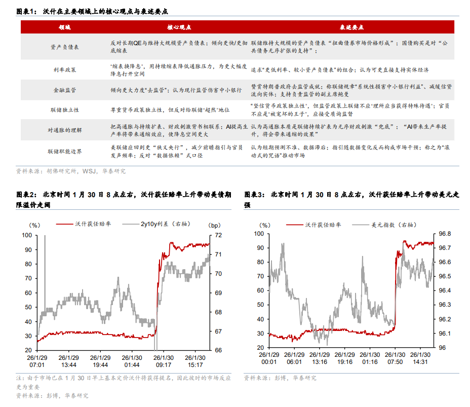

# 沃什接任联储主席的变与不变？

- 页面显示时间：2026-02-03T15:55:32+08:00
- 页面署名：赵颖
- 标注来源：华泰证券
- 原文：[华尔街见闻](https://wallstreetcn.com/articles/3764834)
- 取得时间：2026-11-04T16:03:16+08:00
- [HTML阅读版](article.html) · [来源记录](metadata.json)

## 导语

华泰证券认为，美联储相关政策取向可能有所转变，沃什或试图推动“降息+缩表”的政策组合，美联储与特朗普的沟通可能更为顺畅。但特朗普政府呵护资本市场以及广义流动性的取向不变，货币政策总体取向仍然偏宽松。中期看，联储独立性被侵蚀，美元内在价值下降的趋势或不会改变。

---

## 一、 凯文·沃什被提名为联储主席候任人

**北京时间1月30日，特朗普宣布提名凯文·沃什为下一任联储主席。** 2026年以来，市场对美联储主席预期一波三折，四个主要候选人中，哈塞特、里德均一度领跑，但最终特朗普选择了前美联储理事凯文·沃什。沃什曾在2006年被小布什任命为联储历史上最年轻的理事，但由于在QE等问题上与伯南克存在分歧，2011年辞去联储理事职务，目前担任胡佛研究所（Hoover Institution）访问学者。2017年，沃什曾与鲍威尔竞争联储主席职位，并最终输给了鲍威尔。 **往前看，沃什需要经过参议院确认，然后才能接替米兰当前的联储理事职位，并在2026年5月16日接替鲍威尔成为联储主席。**

## 二、沃什担任联储主席的两个可能变化

**1）联储相关政策取向可能有所转变，沃什或试图推动“降息+缩表”的政策组合**

从利率来看，沃什认为，当前AI带来生产率提升，将会抑制通胀，且如果央行能够大幅缩表也将降低通胀压力，从而为降息打开空间。从资产负债表来看，沃什长期批评联储维持较大资产负债表对市场造成扭曲、并且影响财政持续性，希望能够更大力度缩减资产负债表，并停止购买MBS等资产。从政策顺序上，沃什可能先推动降息，然后试图进行缩表，但市场的波动可能对其带来明显制约。一方面，缩表可能导致市场产生过激反应，考虑特朗普政府对资本市场较为呵护，市场波动将对其产生制约。

具体而言，缩表可能推高期限溢价以及长端利率，并可能导致准备金规模下降，而当前的金融市场已习惯于2008年以来的充裕准备金框架，缩表或将带来短期金融市场动荡。另一方面，联储在2025年12月会议宣布重启扩表，沃什需要说服其他联储委员转向缩表+降息的组合，故推进速度可能受到影响。此外，沃什支持在金融领域进一步放松监管，批评联储前瞻指引，具体来看：

- **去监管方面，** 沃什对本届特朗普政府整体的去监管成就表示赞赏，且主张联储在银行领域实施更大力度去监管。在“美联储领导力的崩溃”（The Federal Reserve’s Broken Leadership）一文中，沃什认为特朗普正在将家庭和企业从管理机构的桎梏中解放出来，并直言美联储的规章制度系统性地损害了中小银行的利益，减缓了信贷流向实体经济，且表达了对负责监管的联储副主席鲍曼的支持。
- **前瞻指引方面，** 沃什认为联储应减少前瞻指引、联储官员应降低发声频率，反对“数据依赖”，他认为对经济数据的短期预测准确度有限且经济数据本身也是滞后的，故这种指引的准确度有限，反而形成对市场的干预，沃什称之为“滚动式的咒语”来推动市场（Moving markets with rolling Fed in cantations）。
- **联储独立性方面，** 沃什主张尊重联储的独立性，但也强调不应给予联储“超然”的地位。沃什表示其“坚信货币政策的独立性是一项明智的政治经济学选择”，但强调在监管政策上，美联储不应该“理所应当”地获得特殊待遇。沃什认为当联储的货币政策效果不佳时，联储官员不应该被视为“被宠坏的王子”而是要接受严肃质询和强力监督，犯错也应该受到应有的谴责。但如何评价货币政策的对错和什么问题能够被当做质询联储官员的依据，沃什并没有明确，因而相对模糊的独立性边界也可能为独立性受到实质性侵蚀埋下隐忧。

**2）与总统的沟通可能更为顺畅**

当前白宫与联储的对立达到了历史上的极值水平。特朗普打破了传统的行政干预禁忌，不仅在社交媒体和公开场合持续对联储主席鲍威尔施加高压，更采取了实质性的“清洗行动”，包括解雇被视为进步派代表的理事丽莎·库克（Lisa Cook），甚至授权司法部史无前例地起诉现任联储主席。沃什担任联储主席有望显著改善白宫与联储之间的对立关系。沃什与特朗普家族关系密切，据Politico报道称，沃什的岳父是特朗普自大学以来的长期密友。上述私人关系有助于使得沃什与特朗普之间建立信任关系，更为顺畅的沟通也避免了白宫与联储通过媒体喊话的“隔空交火”，避免特朗普将货币政策决议政治化解读。

## 三、一些基本的逻辑和中期政策框架不会变化

**1）特朗普政府呵护资本市场以及广义流动性的取向不变，货币政策总体取向仍然（相对经济的强度）偏宽松。**

沃什在2025年4月的讲话中批评联储“不对称”政策的路径依赖，即经济遭遇困难时联储积极干预，鼓励财政支出，但经济处于繁荣时期，联储却未能采取对称的行动呼吁纪律或收紧政策；沃什提出“经济印记”（economic imprinting）的概念，即救市措施使得经济自身的调节能力（即承受痛苦和自我修正的能力）下降，为了避免短期市场调整带来的痛苦，联储在下一次危机时不得不继续提供支持，结果是积累了更大的长期风险（资本错配、资产泡沫）。但是，沃什也指出，联储是为了应对恐慌而建立的（1913年《联邦储备法》），且在危机时刻（如2008年），美联储通过非常规手段（如降息、量化宽松）来稳定市场是必要的。因此，如果金融市场发生明显下跌，或者遭遇严重流动性问题，沃什领导的联储仍将呵护市场，提供Fedput。特别是考虑到，2026年为中期选举，特朗普极度重视经济和市场表现，例如特朗普在达沃斯讲话中提及美国股市52次创新高，金融市场波动会影响特朗普选情，沃什与特朗普家族的长期关系可能使得其更倾向于提供Fedput。

**2）中期看，联储独立性被侵蚀，美元内在价值下降的趋势或不会改变。**

当前美国政府财政持续性和高利率的矛盾仍没有实质性的解决办法。国防开支扩大、高利率下政府利息支出上升以及社会福利等刚性支出扩大使得美国财政赤字率易涨难跌，而特朗普政府推动的“大而美”法案更是十年新增赤字4.1万亿美元，导致美国未来十年财政赤字率维持在6%左右，这意味着美国政府净债务/GDP比例将从当前的97%进一步攀升，CRFB预计2034年达到127%。但是，无论之后沃什领导的联储与白宫是“正面冲突”还是“相互合作”，白宫对联储政策的影响都可能趋势性加大，联储独立性或将受到长期侵蚀。特朗普自再度执政以来，已然突破了联储决策和白宫立场之间的“防火墙”，即使沃什担任联储主席，不管其是否对特朗普“忠诚”，预计特朗普都不会放弃对联储的施压，联储独立性被侵蚀的趋势或不会改变。

## 四、关注金融短期波动，但资产配置仍应该以“不变”的长期逻辑为锚

1月30日，由于沃什此前被认为是通胀鹰派，因此其被任命为联储主席导致美债收益率回升，美元走强，风险资产也有所调整。但资产配置应该以“不变”的长期逻辑为锚，我们重申《金价近五千、银价破一百的启示》（2026/1/25）的结论，随着全球地缘政治重构和财政可持续性恶化均驶入“快车道”，①全球变局下黄金、白银的走势提示，货币“含金量”下降、“估值锚”快速向上漂移，对供给稀缺实物资产和核心股权资产的定价体系或许需要有所调整。②全球大宗商品、包括AI和国防军工航天等领域稀缺关键商品的供需平衡变化可能持续推动更广义的商品、资源品价格重估，鉴于2026年之后与2025年前相比，全球投资周期将更为“耗材”，且AI基建及国防军工等核心需求增量的价格敏感度较低；同时，中国地产相关耗材量下降接近尾声，全球资源品需求不再享有这一趋势带来的“缓冲”。

本文来源：华泰证券

风险提示及免责条款

市场有风险，投资需谨慎。本文不构成个人投资建议，也未考虑到个别用户特殊的投资目标、财务状况或需要。用户应考虑本文中的任何意见、观点或结论是否符合其特定状况。据此投资，责任自负。
