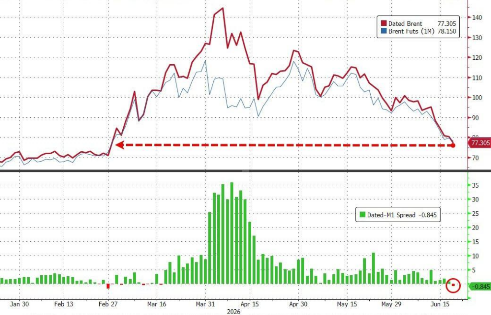
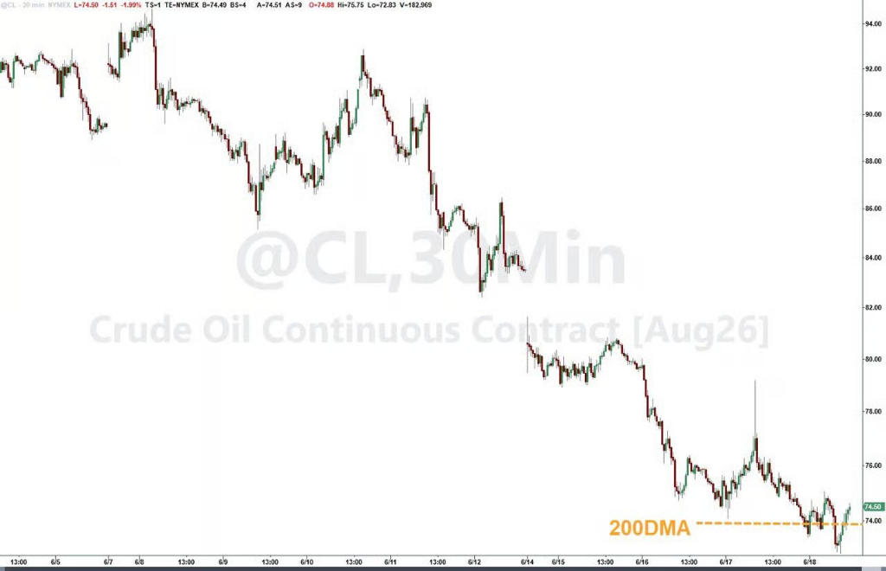
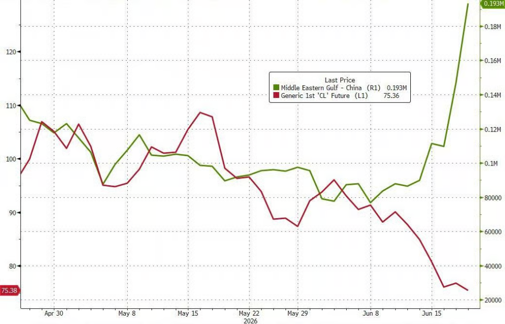
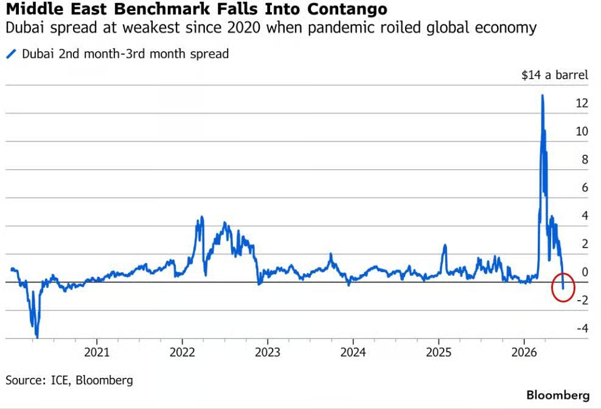

# 油价跌回“伊战前水平”，市场反应过度了吗？

- 页面显示时间：2026-06-19T11:14:23+08:00
- 页面署名：张雅琦
- 标注来源：未单列，见正文
- 原文：[华尔街见闻](https://wallstreetcn.com/articles/3775072)
- 取得时间：2026-11-04T16:03:34+08:00
- [HTML阅读版](article.html) · [来源记录](metadata.json)

## 导语

美伊签署框架协议并解封海峡，推动布伦特原油跌破77美元。但分析师警告，金融市场的复产预期与实际市场的供给吃紧存在背离：全球库存持续大减，而运费高企三倍、船东谨慎令物流面临瓶颈。市场虽已提前计入地缘溢价消除，但实际供应恢复仍需时日。

---

布伦特原油本周跌破77美元/桶，几乎抹去自伊朗战争爆发以来全部地缘政治溢价，创下战事启动以来最低水平。然而，多位分析师警告，期货市场正在为一场尚未真正发生的供应恢复定价，金融市场的乐观情绪与物理原油市场的现实之间，正出现显著背离。

周三晚，美伊两国签署14点框架谅解备忘录，美国中央司令部随即确认已解除对霍尔木兹海峡的封锁，并有油轮通过该水道的相关报道。布伦特原油盘中一度跌至76.54美元/桶，收盘小幅回升至79.85美元；WTI收跌0.2%至75.85美元，触及战事以来最低水平。美国全国平均零售油价随之跌破每加仑4美元，降至3.999美元，但仍较战前高出约1美元。

自5月峰值逾100美元/桶以来，布伦特累计跌幅已超25%，市场迅速为中东大量原油即将重返全球市场押注。 **然而，从航运保险缺位、油轮运费仍为战前三倍，到国际能源署（IEA）测算的全球库存持续以每日近400万桶的速度流失，基本面现实远比市场定价复杂。**

这场金融市场与物理市场之间的赛跑，正成为当前油价走势的核心分歧。多家机构分析师认为此轮下跌存在超调风险，但也有观点指出，伊朗制裁松绑预期尚未充分计入价格，若正式确认，油价仍面临进一步下行压力。

## 霍尔木兹解封，情绪主导跌势

此次油价急跌的直接导火索，是美伊谅解备忘录的签署。根据协议框架，德黑兰将重新开放霍尔木兹海峡——这条水道在正常情况下承载全球每日约五分之一的石油贸易流量——作为交换，华盛顿将解除对伊朗港口的封锁及其石油销售制裁，并开启为期60天的核协议谈判窗口。伊朗还承诺永不研发或获取核武器。

市场的反应是即时的： **先抛售，再问问题。** 特朗普在TruthSocial上高调宣称："石油在流动……股市在咆哮……不客气！"

高盛分析师Yulia Zhestkova Grigsby在研究报告中估计，波斯湾石油出口有望于7月底前恢复至战前水平，但同时指出全面复苏仍面临若干障碍。Kpler高级原油分析师Navin Das亦表示，协议签署后的油价下跌，反映了价格曲线中地缘政治风险溢价的有限回落，叠加市场对霍尔木兹流量恢复的预期，共同对现货价格构成压力。

## 航运市场尚未买账：运费仍为战前三倍

然而，与期货市场的乐观形成鲜明对比的是，航运市场至今未能反映这份和平预期。

据报道，中国石油化工股份有限公司本周尝试为6月25日至30日期间租用一艘超大型油轮（VLCC）装载伊拉克原油，共收到6份报价， **运费均接近战前水平的三倍，最终仍未能成交。** PetroChina给出的理由直接说明了问题所在："有油轮，但太贵了，而且无法保证你能通过海峡。"与此同时，印度石油就同期发出的租轮招标收到了零份报价；中化集团仍在寻船。

Argus Media海湾与中东市场编辑Nader Itayim指出，市场对协议影响过于乐观，可能高估了影响规模和供应恢复正常的速度。"尽管海湾合作委员会地区存在待出口的石油，供应增量未必会立刻到来，"他表示，"在流量恢复正常水平之前，物流瓶颈仍有待克服。"

高盛分析师Yulia Zhestkova Grigsby在报告中亦写道，许多船东对过峡指引仍持谨慎态度，托运人的风险规避是潜在制约因素，加之伊朗在未来60天核协议谈判期间的地缘政治目标，均构成不确定性。

## 库存数据发出警告：基本面并不支持乐观

物理原油市场的基本面，为此次急跌画出了一道清晰的警示线。

IEA估计，自今年2月底战事爆发以来，全球库存一直以每日近400万桶的速度流失。美国原油库存在过去9周内已减少逾5000万桶，库欣（Cushing）储油中心的库存水平徘徊于多数分析师认为的操作底线附近。对于那些数月来持续消耗战略与商业储备的国家而言，最终仍需补库。

从布伦特期货曲线来看，油价要回落至战前低点（70美元/桶）附近，预计需要等到2031年3月——这与眼下期货市场的激进定价，形成了显著落差。

彭博亦指出，霍尔木兹若实质性恢复流量，亚洲市场将面临另一重压力：亚洲炼厂此前已将被扰乱的中东原油替换为美国及其他替代货源，部分压缩了加工量，而此刻正面临波斯湾原油的突然涌入。这已导致中东原油期货曲线翻转至看跌的远期升水（contango）结构，市场正在为近期过剩而非短缺定价。

## 协议框架本身仍留悬念

除供应恢复节奏外，协议文本本身亦存在若干模糊之处，为市场增添了额外的不确定性。

谅解备忘录规定，商业船只"仅在60天内免收通行费"，但特朗普向媒体表示，60天后海峡将继续"免费通行"，该表述并未写入协议正文。Itayim亦强调，这份协议并非一份市场可以完全倚赖的综合性和平安排，而是一份旨在减少冲突、为后续谈判开窗的临时性框架，市场因此仍将在价格中维持一定风险溢价。

Kpler分析师Navin Das则提示了另一面： **价格曲线远端已开始部分反映伊朗制裁松绑的可能性，但该因素尚未被充分计入——若60天谈判窗口结束后制裁解除获得正式确认，油价仍面临进一步下行压力。**

多方分析的汇聚点指向同一个核心矛盾：金融市场以协议签署为信号，迅速一次性消化了供应恢复预期；而物理市场——包括航运保险、油轮调度、矿区排雷和生产重启——所遵循的是截然不同的时间表。当前，市场正将一份初步框架协议当作一份已经完成的复产计划来交易，而物理市场仍在等待看到它真正落地。

风险提示及免责条款

市场有风险，投资需谨慎。本文不构成个人投资建议，也未考虑到个别用户特殊的投资目标、财务状况或需要。用户应考虑本文中的任何意见、观点或结论是否符合其特定状况。据此投资，责任自负。
