# 港股科技估值重估，还有多少空间？

- 页面显示时间：2025-02-26T17:08:35+08:00
- 页面署名：鲍奕龙
- 标注来源：长江证券戴清
- 原文：[华尔街见闻](https://wallstreetcn.com/articles/3741906)
- 取得时间：2026-11-04T16:03:34+08:00
- [HTML阅读版](article.html) · [来源记录](metadata.json)

## 导语

长江证券表示，参考美股科技龙头估值方式，港股中市值排名前十的AI相关个股的PE-TTM（31.92x）、PS-TTM（3.13x），分别较美股存在 96.8%、286.3%的理论上行空间，而 PEG 差距为 35.2%。

---

## 回顾：港股市场上涨，医疗保健领涨

近期港股交易线索：2025 年 2 月 17 日至 21 日，恒指上涨 3.79%，恒生科技上涨 6.03%。行业表现上，电信服务领涨。驱动因素： 1）AI 技术突破：国产 AI 大模型 DeepSeek 春节期间发 布的大模型在多项基准测试中超越 OpenAI 、Meta 等公司产品，这提振了市场对中国AI 技术自主可控的信心，带动港股科技股的估值修复。2）个股方面：阿里巴巴发布 2025 财年第三季度财报，良好的业绩以及增加对AI资本开支的投入，直接推动了其股价上涨，也带动了相关板块的上涨，为港股市场的整体上涨贡献了力量。

## 展望：港股从“红利牛”迈向“AI 牛”

在“AI+”产业链爆发的背景下，港股正从“红利牛”迈向“AI 牛”。过去 3 年，港股科技互联网公司的估值受到了宏观环境的较大影响，一方面，走向行业成熟后的科技互联网的业绩随着国内经济预期波动，由成长股蜕变成价值股，期间估值中枢不断下移；另一方面，整体港股估 值受短期海外流动性影响，美债利率和美元高企压制港股表现，因此有较为稳定的现金流和红利的公司更受投资者青睐。随着 AI 格局改变，拥有较多 AI 应用和底层技术的港股科技公司或 迎来产业生命周期的“第二春”，从价值股重新蜕变为成长股，业绩兑现或许需要一些时间，但估值的重构已经出现。

## 焦点：中国科技股估值重估正当时，未来还有多少空间？

DeepSeek 技术突破引发的 AI 产业热潮呈现出区域分化特征，中国市场相关板块受提振明显，全球投资者持续参与中国科技估值重估行情 。A 股、港股及中概股市场的  AI  概念股受到   DeepSeek 的利好刺激，整体呈现强势上涨态势。从行情爆发（2025 年 1 月 27 日）至 2 月 21  日，三大市场与 AI 相关的个股加总的净值曲线分别录得 23.4%、27.0%和 29.2%的涨幅但美  股同期却呈现反向走势，美股相关 AI 个股的净值曲线却逆势回调 14.8%。

**在中国科技估值重估的趋势逐渐成为市场共识的背景下，港股情绪指标在短期处于高位** 。在策略框架中，短期看情绪，中期看估值，长期看产业趋势和业绩兑现，目前短期情绪较高以及长期产业趋势也较为清晰，但是关于中国科技的估值能重估到哪个位置是市场焦点。我们以两个视角来看待这个问题，首先是对标美股科技龙头的估值体系，前提假设是全球资金认可中国科技公司的估值重构逻辑，其次是对比港股互联网在历史上较高的估值位置，除了对产业变化进行估值之外，还需要国内外宏观环境进一步支持。

**首先，我们按照对标美股科技龙头的方式来展望中国科技估值重估的空间，理论上目前港股科技仍有较大的修复空间** 。A 股市场市值排名前十的 AI 相关个股的平均  PE-TTM、PS-TTM、  PEG 均超过美股市场市值排名前十的 AI 相关个股的平均指标。而港股和中概股市场则显著低于美股市场，其中，港股中市值排名前十的AI相关个股的 PE-TTM（31.92x）、PS-TTM（3.13x） 分别较美股存在 96.8%、286.3%的理论上行空间，而 PEG 差距为 35.2%。

**其次，参考港股互联网在历史上较高的估值位置 ，重点关注港股科技能否重现 2020~2021 年的牛市行情**  。在 2021 年恒生指数估值曾攀升至近十年高位，而恒生科技的市盈率与市售率同样达到高点，主要受全球流动性宽松、中国经济复苏预期以及互联网等行业业绩修复驱动。

## 不同市场的科技估值已经到达什么位置？

DeepSeek 技术突破引发的 AI 产业热潮呈现出区域分化特征， 中国市场相关板块受提振明显，全球投资者持续参与中国科技估值重估行情 。具体来看，A 股、港股及中概股市场的 AI 概念股受到 DeepSeek 的利好刺激，整体呈现强势上涨态势。从行情爆发 （ 2025 年 1 月 27 日）至 2 月 21 日，三大市场与 AI 相关的个股加总的净值曲线分别 录得 23.4% 、27.0%和 29.2%的涨幅，反映出投资者对中国市场 AI 产业应用前景的积极预期，全球投资者持续参与中国科技估值重估的行情当中。但美股同期却呈现反向走势，美股相关 AI 个股的净值曲线逆势回调 14.8%。

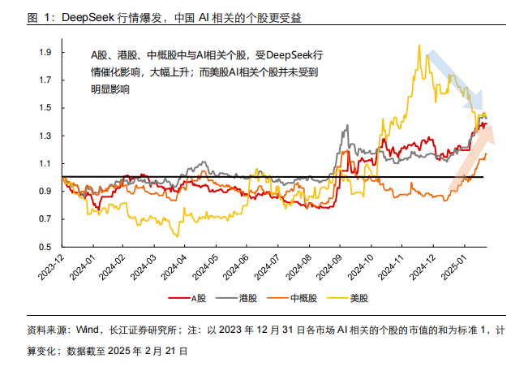

**在中国科技估值重估的趋势逐渐成为市场共识的背景下，港股的情绪指标在短期处于高位** 。截至 2025 年 2 月 21 日，恒生指数已回归至 2013 年以来的历史均值水平附近，风险溢价回落至 2013 年均值-2倍标准差附近，接近历史低位。与此同时，市场情绪指标 呈现过热信号：恒生指数与恒生科技指数的“贪恐指数”同步攀升至 80 左右。而资金活跃度则显示高度集中特征——恒生科技与恒生综合指数的成交额占比升至 2020 年7月27日以来的 95.9%分位，逼近历史峰值水平，表明当前市场资金正大规模涌入科技板块。

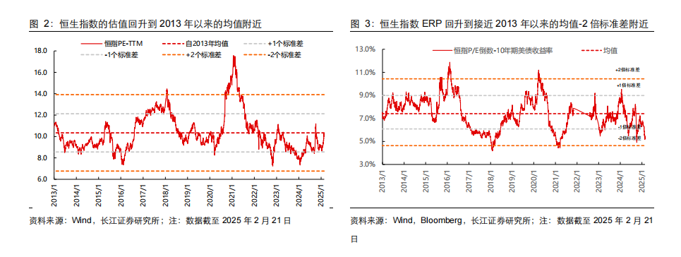

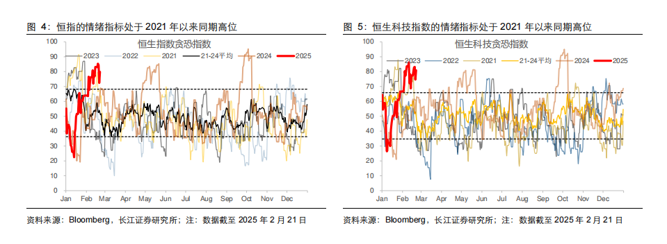

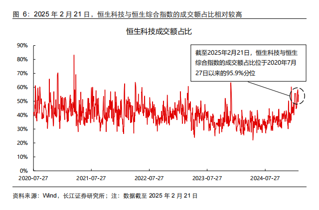

**港股特别是互联网等科技板块的行情持续性成为市场焦点，我们从两个视角来展望未来估值还有多少空间** 。在策略框架中，短期看情绪，中期看估值，长期看产业趋势，目前短期情绪较高以及长期产业趋势也较为清晰，但是关于中国科技的估值能重估到哪个位 置是市场焦点。我们以两个视角来看待这个问题，首先是对标美股科技龙头的估值体系，前提假设是全球资金认可中国科技公司的估值重构逻辑，其次是对比港股互联网在历史上较高的估值位置，除了对产业变化进行估值之外，还需要国内外宏观环境进一步支持。

**首先，我们按照对标美股科技龙头的方式来展望中国科技估值重估的空间，理论上目前港股科技仍有较大的修复空间** 。我们从 PE、PS和PEG 等不同估值方式进行对比统计，  1）截至 2025 年 2 月 21 日，美股市场市值排名前十的AI相关个股的平均 PE-TTM、  PS-TTM、PEG 均低于 A 股市场市值排名前十的 AI 相关个股的平均指标，A 股市场市值排名前十的 AI 相关个股（以下称 A 股主要 AI 个股）的平均PE-TTM为83.22x，距离美股市场市值排名前十的AI相关个股（以下称美股主要 AI 个股）的平均 PE-TTM 存  在 24.49%的空间；A 股主要 AI 个股的平均 PS-TTM 距离美股主要 AI 个股的存在 33.41%  的空间；A 股主要 AI 个股的平均PEG 距离美股主要AI个股的存在1.28%的空间。2） 港股和中概股市场则显著低于美股市场，其中，港股中市值排名前十的AI 相关个股的PE-TTM（31.92x）、PS-TTM（3.13x）分别较美股存在 96.8%、286.3%的理论上行空间，而 PEG 差距为 35.2%，我们认为港股科技股向美股龙头的估值体系进行靠拢的重要条件是 AI 行情从海外映射切换至国内产业景气兑现，而这正在逐步验证中，近期外资大幅流入港股科技股的现象表明，在一定程度上外资也开始认可这一逻辑。

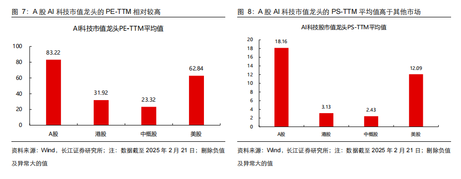

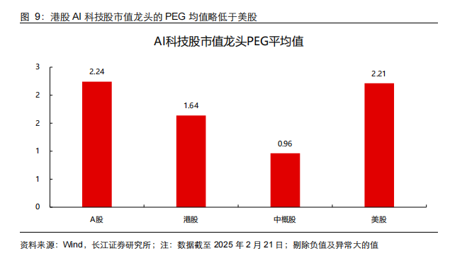

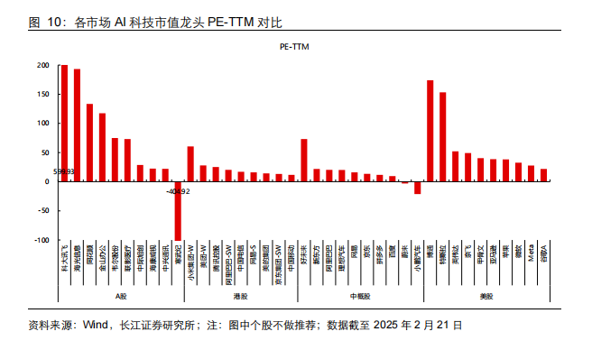

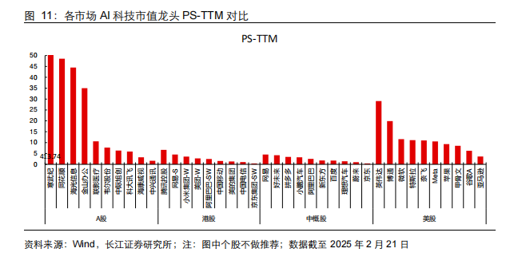

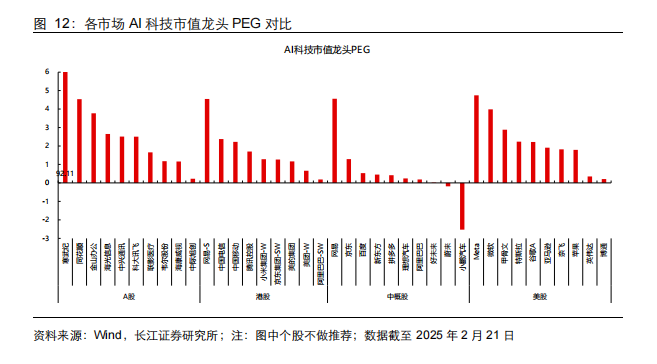

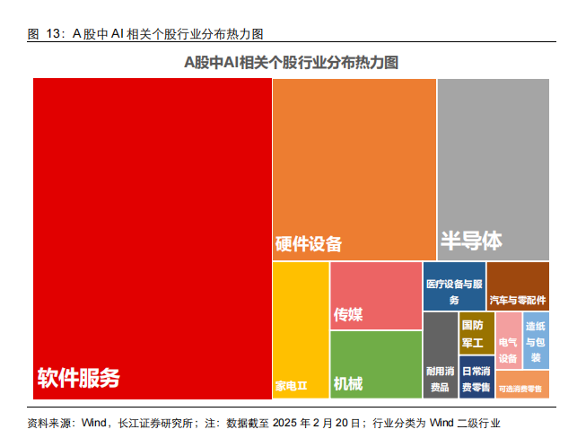

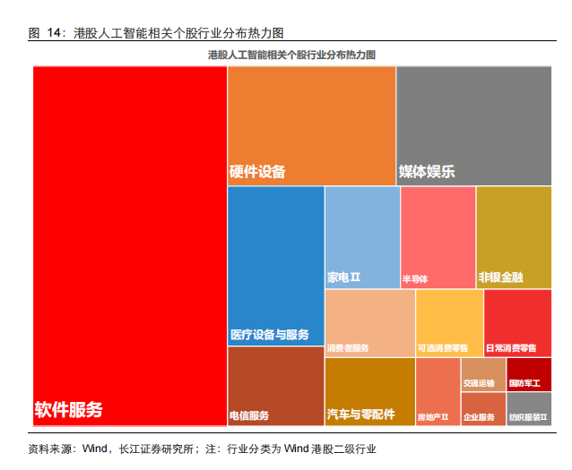

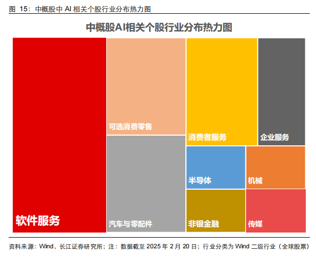

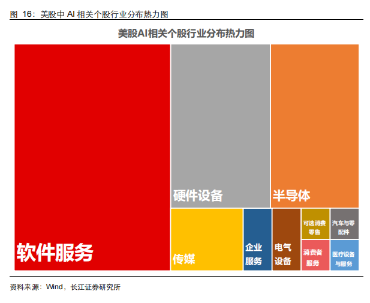

**其次 ， 参考港股互联网在历史上较高的估值位置，重点关注港股科技能否重现 2020~2021 年的牛市行情** 。近期与部分投资者讨论，港股科技公司的估值已经出现大幅修复，未来能否进一步突破最近3年的天花板，市场能否给予 2020~2021 期间的科技股的估值水平，我们认为最为核心在于业绩端的兑现、全球流动性环境以及互联网等相关政策环境，而这些因素大多都朝着积极的方向在变化中。

我们回顾历史，港股曾在 2020 年底至 2021 年初，凭借科技权重股的上涨进而“牛冠全球”。在 2021 年恒生指数估值曾攀升至近十年高位，而恒生科技的市盈率与市售率同样达到高点，主要受全球流动性宽松、中国经济复苏预期以及互联网等行业业绩修复驱动。1）全球流动性宽松：美联储等央行维持超低利率和大规模购债，资金涌入港股等新兴市场。2）中国经济复苏预期：在政策支持下企业盈利逐步改善，提振市场信心。3）互联网等行业业绩修复：由于居家办公催生出更多互联网产品的需求，相关板块的业绩修复，叠加互联网的红利仍在，带动港股指数估值上涨。

**展望后市，港股正从“红马牛”迈向“AI 牛”** 。过去3年，港股的科技互联网公司的估值受到宏观环境的极大压制， **一方面** ，走向行业成熟后的科技互联网的业绩随着国内经济预期的波动，由成长股蜕变成价值股，期间估值中枢不断下移， **另一方面** ，整体港股估值受短期海外流动性的影响，美债利率和美元高企压制港股表现，因此有较为稳定的现金流和红利的公司受到更大的青睐。随着AI格局的改变，拥有较多AI应用和底层技术的港股科技公司或迎来产业生命周期的“第二春”，从价值股重新蜕变为成长股，业绩的兑现或许需要一些时间，但估值的重构已经出现。

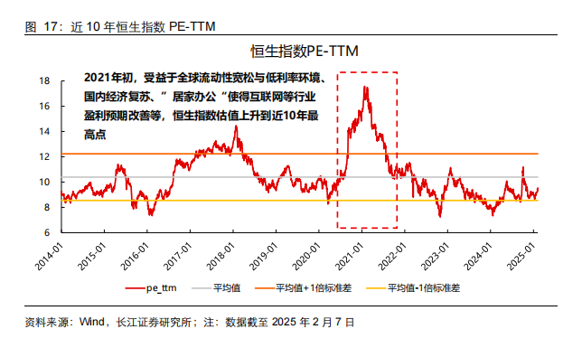

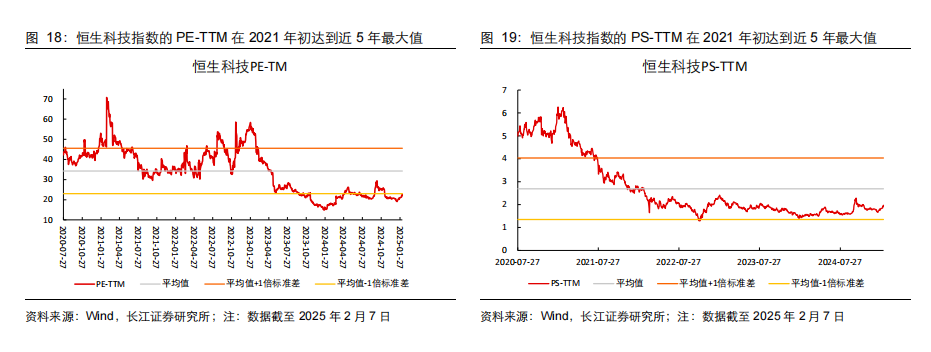

本文作者：戴清，来源：长江证券，原文标题：《港股科技估值重估，还有多少空间？》，内容有删减

风险提示及免责条款

市场有风险，投资需谨慎。本文不构成个人投资建议，也未考虑到个别用户特殊的投资目标、财务状况或需要。用户应考虑本文中的任何意见、观点或结论是否符合其特定状况。据此投资，责任自负。
