# 用户增速骤降62%，摩根士丹利测算Muse每用户月成本最高130美元

- 页面显示时间：2026-10-12T15:35:16+08:00
- 页面署名：董静
- 标注来源：未单列，见正文
- 原文：[华尔街见闻](https://wallstreetcn.com/articles/3783420)
- 取得时间：2026-11-04T16:03:54+08:00
- [HTML阅读版](article.html) · [来源记录](metadata.json)

## 导语

大摩揭示，Muse基准情景下每用户月服务成本高达37美元，年成本445美元，已超过Meta全球用户平均年收入70美元。更致命的是，真正变现最早要等到2027至2028年。与此同时，亚马逊、Costco、Netflix相继封锁Muse访问，当前日活用户仅约270万，远不及“10亿用户”的估值预期。11月4日三季报将是第一道硬考验。

---

Meta于9月8日正式推出AI智能体Muse，随即引爆市场热情—— **Meta股价在12个交易日内飙升27%，峰值触及777.59美元，远期市盈率从8月底的14倍跳升至21倍** 。然而，仅仅一个月后，增长裂缝已然显现。

另类数据机构TickerTrends的数据显示， **Muse日均净新增用户已从9月高峰期的约19.8万人骤降至约7.4万人，降幅高达62.4%** ，下载量也较峰值回落逾21%。

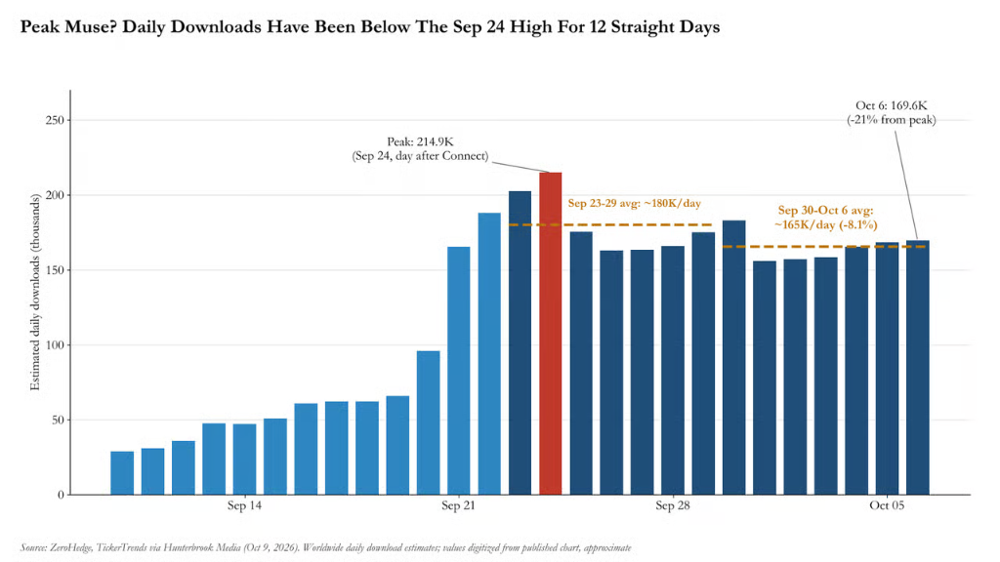

与此同时，摩根士丹利发布了迄今最详尽的Muse成本模型，揭示出一个令人警醒的数字： **Muse每用户每月服务成本在3美元至130美元之间，基准情景下为37美元，折合年成本445美元——已超过Meta全球平均每用户年收入约70美元** 。更关键的是，摩根士丹利明确指出，Muse的真正商业化变现最早要等到 **2027年至2028年底** 。

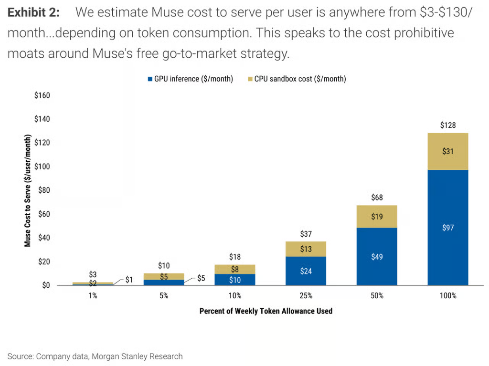

大摩报告还指出， **Meta目前的估值扩张完全建立在“10亿（1 billion）用户规模”的完美增长故事之上，但现实中其日活用户（DAU）目前仅不到300万。** 此外，Muse正面临亚马逊等平台的生态封杀，而依赖“消费者惯性”的传统订阅商业模式正面临被AI智能体颠覆的连带做空风险。相比之下，拥有封闭生态和支付基础设施的中国科技巨头（如腾讯），或许在AI智能体赛道上拥有比Meta更坚固的护城河。

## 增长神话的第一道裂缝：用户增速骤降62%

Muse的用户数据由另类数据机构TickerTrends追踪，经Hunterbrook Media分析后披露。核心数据如下：

- **下载量** ：10月6日约为16.96万次，较9月24日Connect发布会次日的峰值21.49万次下滑21.1%，且已连续12天低于峰值。前一周日均约18万次，最新一周降至约16.5万次， **周环比下降8.1%** 。

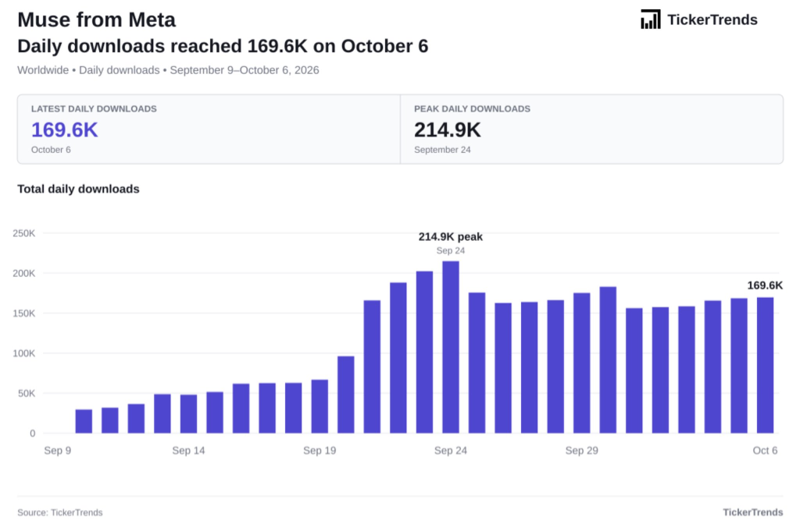

- **用户规模** ：10月6日DAU（日活跃用户）达到新高273.09万，用户总量仍在增长，但 **增速大幅放缓** 。9月15日至22日期间，日均净新增约19.8万人；随后一周降至约8.7万人；截至10月6日当周进一步降至约7.4万人， **较初始爆发期下降62.4%，较前一周下降14.5%** 。

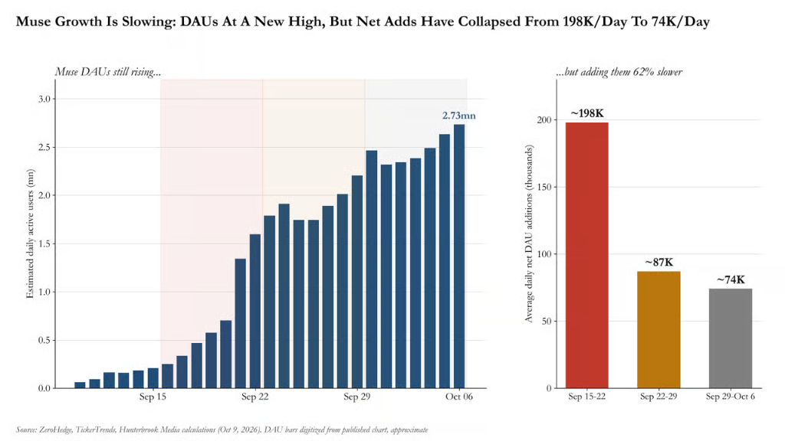

- **参与度代理指标** ：截至10月7日的一周内，应用评论量周环比下降11.6%至4716条，其中iOS评论量下降22.5%；10月7日单日评论量664条，较10月1日峰值802条下降17.2%。

值得注意的是，不同数据来源对Muse用户规模的估算存在显著分歧：TickerTrends为273万DAU，Similarweb为218万，Sensor Tower则显示累计下载量660万、DAU约180万。 **三家机构的DAU估算最高与最低相差约50%，但无一超过300万** 。

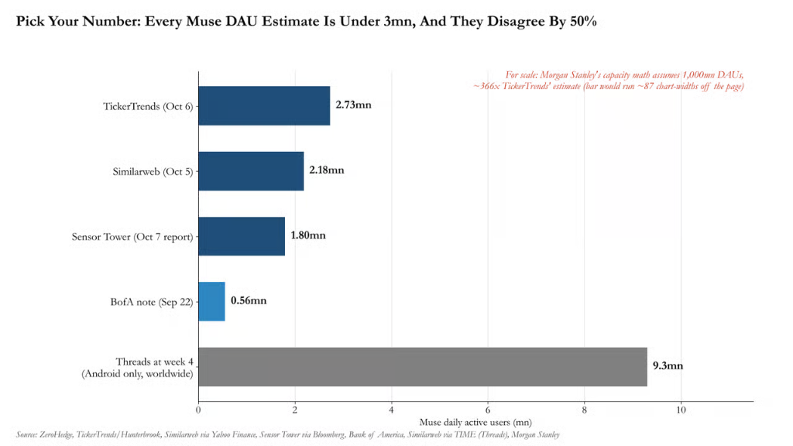

相比之下，摩根士丹利的容量分析是基于 **10亿日活用户** 构建的——这意味着按TickerTrends的数据，Meta已购置的CPU容量约为当前实际用户数的 **366倍** 。

## Muse的成长背景与遭遇的现实阻力

**产品架构** ：Muse运行于Muse Spark模型之上，为每位用户提供专属的“Muse安全虚拟机”，支持独立App、网页端、WhatsApp内嵌及Mac原生客户端。定价分三档：免费版（每周1亿token额度）、 **每月20美元的Power版** （每周5亿token）、 **每月100美元的Maximum版** （每周30亿token）。

**里程碑数据** ：在iOS端，Muse上线首12天累计下载量达143万次，超过ChatGPT同期的137万次（JPMorgan数据），并登顶App Store和Google Play双榜首。

**接踵而至的阻力** ：

- 9月20日晚，亚马逊封锁Muse访问其平台，理由是Muse未明确标识自身为AI智能体，且未经适当披露即存储用户凭证；

- TickerTrends追踪到Costco和Netflix也出现类似限制的用户报告；

- 电信运营商开始将Muse发起的AI客服电话转离人工坐席，削弱了"代为拨打电话"功能；

- 一个可能导致本地应用劫持用户Muse账户的零日漏洞被紧急修复；

- Hunterbrook此前报告称Muse可被诱导对弱势群体成员建立档案；

- Meta承认Muse的工作区文件结构遵循了OpenClaw的设计蓝图，但声称代码系从头编写。

## Muse何时能变现？答案：短期内不会

摩根士丹利分析师Brian Nowak在报告中直言不讳： **“我们预计Muse订阅收入在相当长一段时间内将非常有限，因为Meta目前专注于扩大用户基础、提升参与度和商业行为，而非变现。目前连接协议的初始'抽成比例'微乎其微。”**

长期来看，Nowak认为Meta将构建一个类似广告竞价的 **实时竞价拍卖市场** ——企业为智能体完成的交易付费。这一模式所针对的消费者支出池约为 **30万亿美元** ，其中零售和旅行约占17万亿美元。但时间节点明确： **最早要到2027年底至2028年** 。

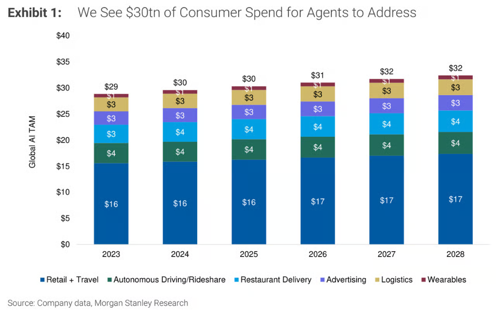

美银美林认为广告、订阅或佣金的实质性收入 **不太可能在2028年前出现** ；高盛将“变现能否迅速跟进”列为关键问题，并将隐私和安全风险列为最大单一风险。

**增速放缓的影响** ：竞价拍卖市场需要庞大且活跃的用户基础才能吸引企业真金白银竞价。每周净新增用户维持在7.4万而非19.8万的水平，都将把"2027年底至2028年"这一时间节点进一步推后。

## Muse的服务成本有多高？每用户每月3至130美元

这是摩根士丹利报告中最具价值的部分。 **Muse的计算成本分为两块：**

1.  **GPU推理成本** ：随token消耗量线性扩展（模型处理用户请求的算力）；

2.  **CPU沙箱成本** ：随用户激活Muse的频率及虚拟机运行时长扩展（浏览器、工具和代码执行环境）。

**关键假设** ：GPU侧，摩根士丹利使用GB300框架，每吉瓦410,256块GPU，75%利用率下每GPU每秒处理3500个token，折合每年每吉瓦处理33,962万亿token，年基础设施成本76.3亿美元， **推理成本约为每百万token 0.225美元** 。

CPU侧，假设每次激活约10分钟的沙箱运行时间，采用2核vCPU/8GB内存的虚拟机，按AWS AMD实例按需定价（0.1217美元/小时），加7.5GB存储（0.60美元/月）。

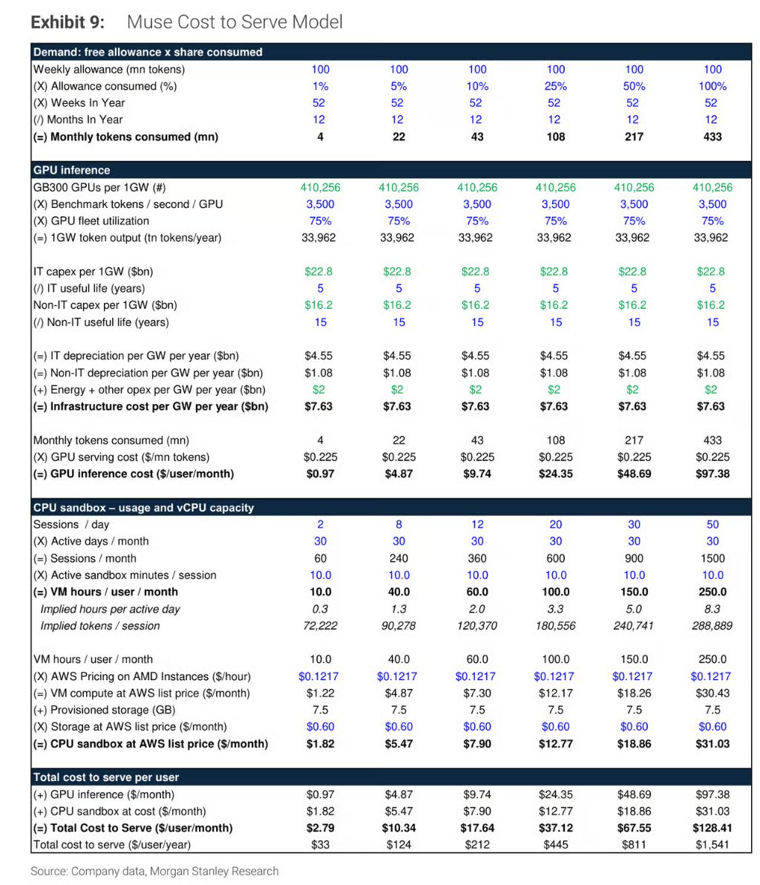

**基准情景（25%额度使用率）** ：用户每月消耗约1.08亿token（每天20次会话）， **月服务成本37.12美元，年成本445美元** 。Nowak将此视为"更接近上限"，因为该模型假设Meta以AWS标价租用全部CPU沙箱，实际不会如此。

**与ARPU的对比** ：摩根士丹利估算Meta全球平均每用户年收入（ARPU）约为 **70美元** 。即便用户仅使用5%的免费额度，年服务成本约124美元， **已超过Meta平均用户创造的年收入** 。

**极端情景测算** （本文作者基于摩根士丹利GPU成本的推算，仅含GPU推理，不含CPU沙箱）：

- Power版（每月20美元）满额使用：月推理成本约 **488美元** ；

- Maximum版（每月100美元）满额使用：月推理成本约 **2925美元** 。

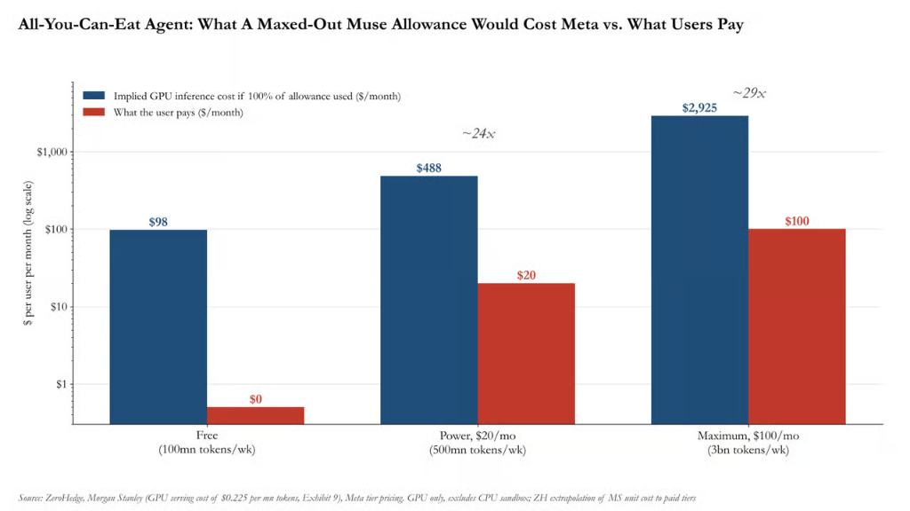

**规模效应的两面性** ：若按10亿DAU、25%使用率计算，年服务成本约为 **4450亿美元** ，而摩根士丹利对Meta 2026年全年收入的预测仅为 **2560亿美元** 。但按当前273万DAU计算，同样的成本模型折合年成本约 **12亿美元** ，相对于摩根士丹利模型中2027年2090亿美元的运营支出预测，不过是个零头。

摩根士丹利的结论是： **高昂的成本本身就是护城河** ——“这一分析表明，对于规模较小的竞争者而言，扩展至与Meta竞争的产品存在难以逾越的成本壁垒”，而Meta每年增长27%、规模达2500亿美元的核心广告业务为其提供了独特的财务支撑。

## Meta会面临算力瓶颈吗？CPU端：不会

摩根士丹利的答案明确： **“不会。我们估计Meta仅在2026年采购的CPU容量，就足以服务10亿日活用户（按25%额度使用率计算）。”**

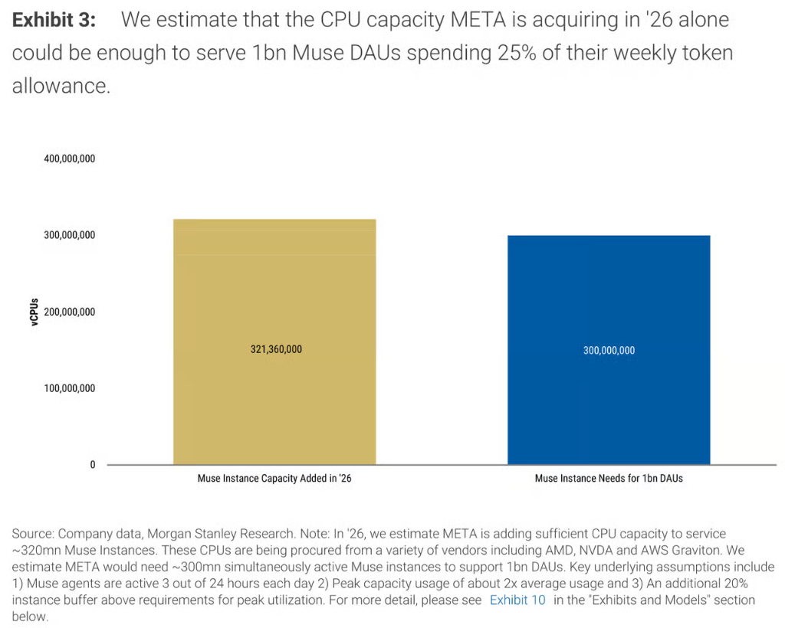

**供应链测算** ：摩根士丹利估算Meta采购AMD 2026年服务器CPU出货量的20%，即约218万颗芯片（每颗126核、2线程），合5.49亿vCPU；加上约36万颗NVIDIA Vera CPU（88核、2线程），合6300万vCPU；再加上AWS Graviton5协议的3000万核心。 **合计6.43亿vCPU，即3.21亿个Muse实例** （每实例2个vCPU）。

**需求侧测算** ：10亿DAU × 12.5%同时在线率（24小时中3小时活跃）× 2倍峰值系数 × 1.2倍冗余 = 3亿个同时运行实例，约占2026年采购量的93%。

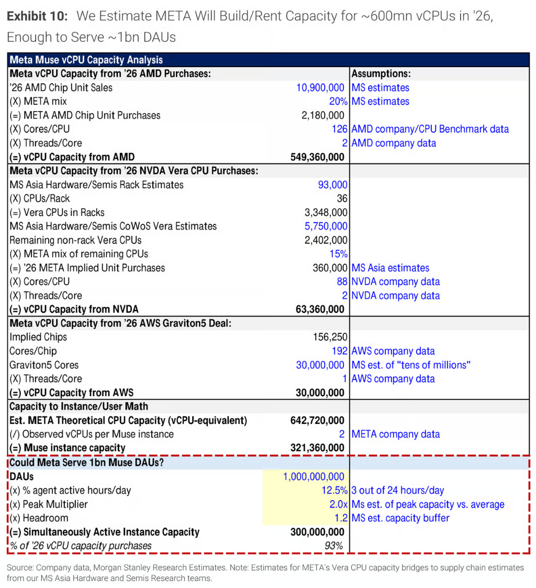

**现实对比** ：按当前273万DAU计算，Muse仅需约80万个同时运行实例，约占摩根士丹利估算Meta采购量的 **0.25%** 。按每天净新增7.4万用户的速度，达到10亿DAU需要约 **37年** 。

关于Graviton协议：Meta与AWS于4月24日宣布"数十亿美元级别"的Graviton5协议，涉及"数千万"核心。摩根士丹利估算为3000万核心，按约0.02美元/核心/小时计算，折合AWS年化收入约 **56亿美元** ，约贡献AWS 2027年增速3个百分点。 **Meta是AWS的数十亿美元级大客户，而亚马逊同时封锁了Meta的智能体——两件事同时为真。**

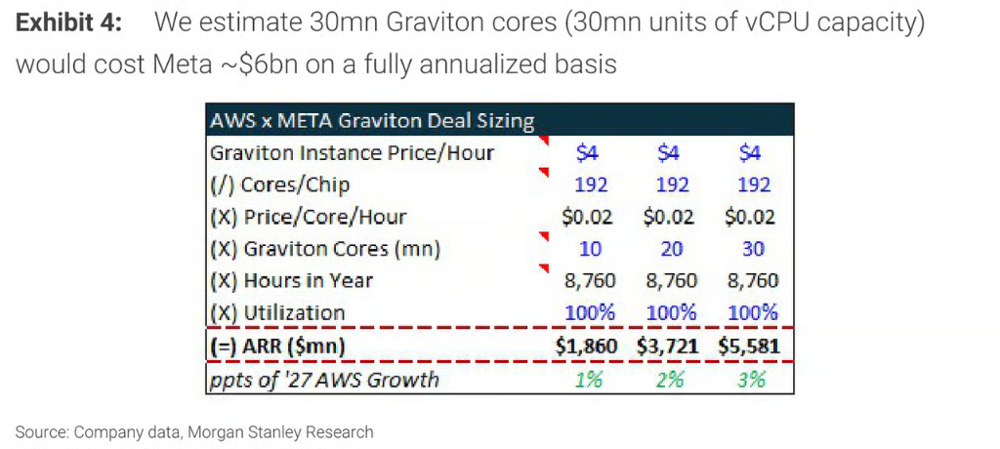

**GPU端的隐忧** （摩根士丹利未直接测算）：按摩根士丹利自身的GPU假设，服务10亿DAU（25%使用率）需要约 **38吉瓦** 的GB300推理算力全天候运行。Meta旗舰级Hyperion园区设计容量约为5吉瓦。 **即便按5%使用率计算，也需约7.7吉瓦。** GPU瓶颈只有在Muse真正实现多头预期的规模时才会显现，届时电力和GPU将先于CPU成为制约因素。

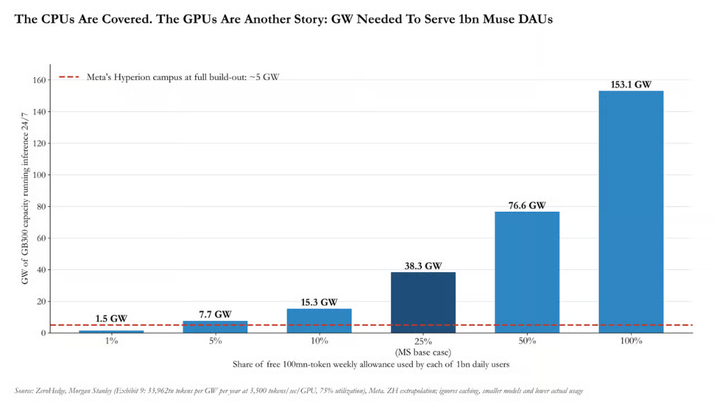

## 企业市场机遇——55万亿美元的TAM

摩根士丹利在30万亿美元消费者TAM之外，再叠加 **25万亿美元的全球知识工作TAM** ，合计55万亿美元，约为全球GDP的一半。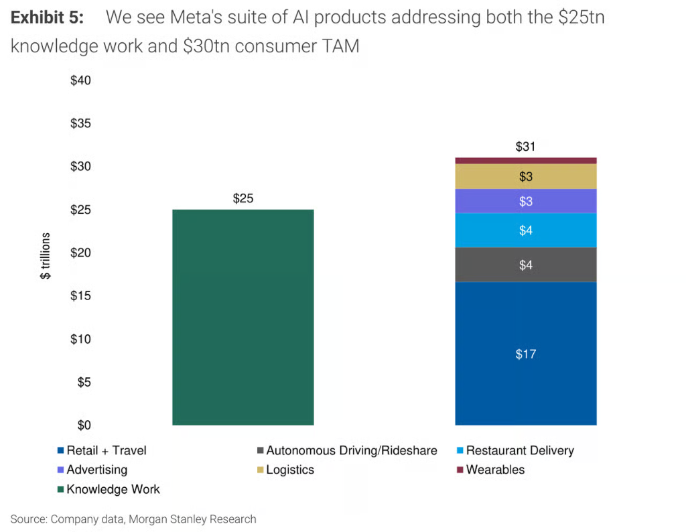

Meta的企业端布局包括：

> Muse for Small Business、WhatsApp/Messenger智能体工具、企业推进（Meta近期招募了企业业务负责人）、Muse Coding，以及基于“Watermelon等模型”的模型API。

**架构层面的深层逻辑** ：摩根士丹利指出，Muse当前通过浏览器点击网页、拨打人工客服电话的方式“不是高质量、一致且可重复扩展的体验”。 **亚马逊、Costco、Netflix的封锁以及运营商的拦截，正是这一问题的现实体现。** 真正的解决方案是 **企业开放MCP/工具接口供智能体直接调用，而Meta希望出售这套“管道”。**

**Meta One订阅包** （9月17日全球上线）：消费者版每月2.99至19.99美元，创作者和企业版每月14.99至499美元。摩根士丹利敏感性分析显示： **5000万订阅用户、每月20美元，可为2028年每股收益增厚9.1%（约3.17美元）；8000万用户、每月25美元，可增厚18.1%（约6.34美元）。**

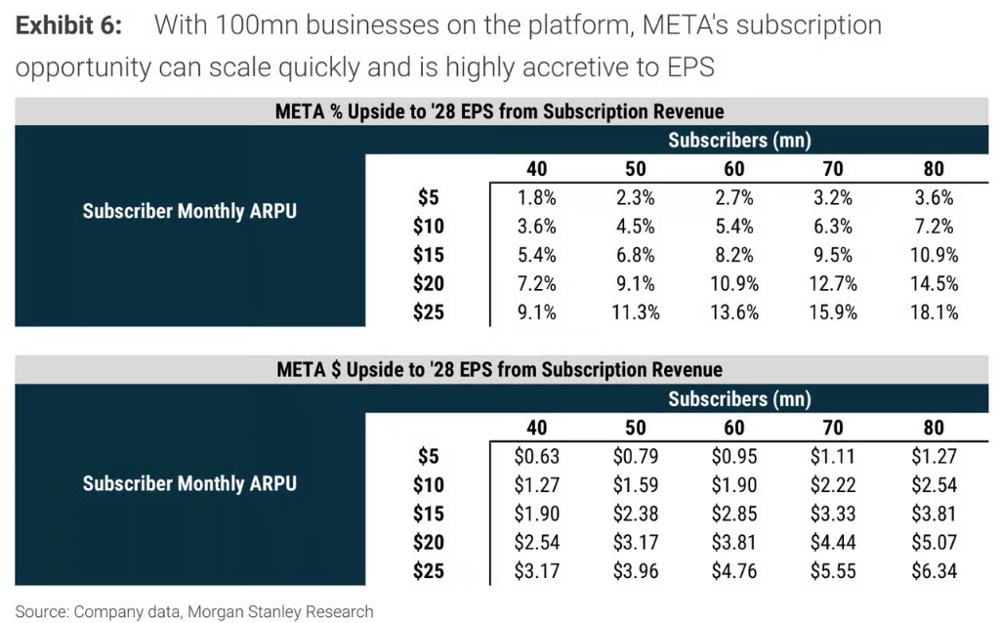

**API业务** ：100兆瓦GB300算力专用于出售Meta模型，可为2028年每股收益增厚约4%（约1美元）。、

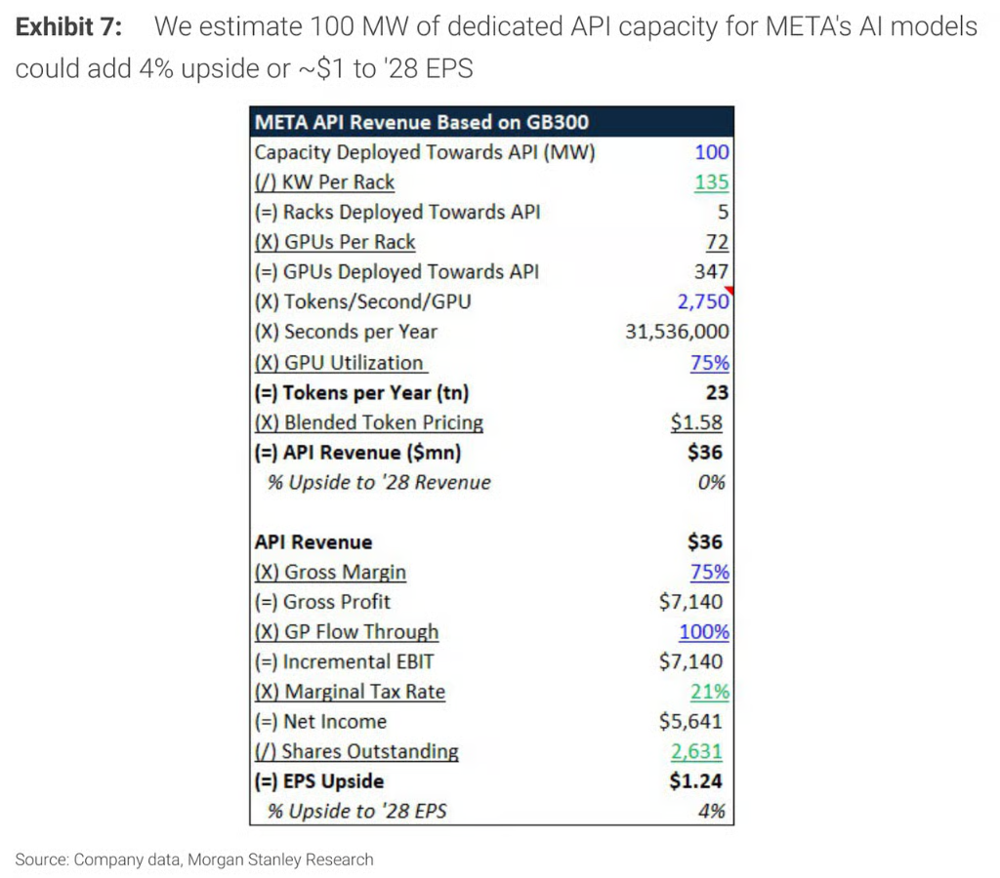

**附带损伤** ：Needham分析师Laura Martin于10月1日估算，若20%的App Store销售额迁移至Muse Connectors，苹果每年可能损失高达 **100亿美元** 的服务收入（约75亿美元EBITDA）。Muse Connectors开放后168小时内，Meta收到超过 **1500份** 开发者申请。

## 亚马逊与Meta——相爱相杀的利益共同体

亚马逊封锁Muse的官方理由是：代表客户购物的第三方应用"应公开运营并尊重服务提供商的决定"，并指控Muse未标识AI身份、未经适当披露存储用户凭证。

摩根士丹利将此解读为一场谈判： **“亚马逊占美国电商市场约40%的份额，希望确保在横向智能体崛起的背景下，这一地位得以维持。”** 谈判焦点涉及商家记录权、购物体验控制权（Prime权益、零售媒体、商品展示、追加销售机会等）以及向Muse智能体的数据回传。

Nowak指出此次谈判的独特性：

> **“1）这很可能是与亚马逊达成的首个智能体合作协议，将为后续协议设立潜在先例；2）Meta需要亚马逊的物流和配送能力、AWS的云算力（CPU和GPU）以及模型分发渠道（通过Bedrock访问Watermelon模型的API）。”**

**增速放缓改变了谈判筹码** ：每天新增20万用户的智能体是零售商必须正视的威胁；每天新增7.4万用户的智能体则可以被要求等待。亚马逊股价自Muse发布以来一度下跌2%，目前已回升至+2.1%。

## 中国竞争格局：腾讯能否“反向Muse”Meta？

值得关注的是，Muse的发布也引发了投资者对中国同类产品的关注。伯恩斯坦和美银美林分析师Winnie Wu的核心判断是：智能体竞争的真正奖品是 **“情境锁定”** ——智能体对用户习惯、历史和工作流了解越深，就越有价值、越难被替代。

**腾讯的结构性优势** ：

> - **封闭生态即护城河** ：中国移动互联网由"封闭"生态主导，外部智能体可能永远无法访问微信或支付宝内的任务——这正是Muse在亚马逊、Costco、Netflix遭遇的问题，但在中国是整个互联网的默认状态；
> - **无需下载** ：微信智能体无需独立下载，在大多数中国智能手机用户每天都会打开的应用内一键可达，绕过了Muse正在经历的下载增速放缓问题；
> - **小程序即现成管道** ：腾讯已拥有摩根士丹利所说的"Web 1.0互联网必须构建才能让智能体规模化"的结构化接口；
> - **变现路径更近** ：微信支付每年处理数万亿元人民币交易，腾讯可直接从智能体完成的交易中抽成——这正是摩根士丹利认为Meta最早要到 **2027年底至2028年** 才能实现的模式；
> - **算力约束** ：出口管制限制了中国在GPU端的算力，而GPU推理成本在重度使用场景下是主要成本驱动因素。但调用小程序API的智能体相比驱动浏览器的智能体，所需CPU沙箱算力应大幅减少。

总结来看，分析人士认为，摩根士丹利的报告是迄今最有价值的Muse研究，因为它给出了真实数字：

> **Muse每用户每月服务成本3至130美元，基准情景37美元（摩根士丹利视之为上限）** ；Meta已购置足以服务10亿日活用户的CPU算力，相关成本已纳入2027年2090亿美元运营支出预测；真正的智能体广告拍卖变现 **最早要到2027年底至2028年** 。

**当前的现实情况是：** Meta拥有服务10亿用户的算力，实际用户约180万至270万，且以9月峰值三分之一的速度增长，同时越来越多的网站和运营商正在决定是否放行这个智能体。

从14倍到21倍的估值重估是用增长故事换来的，而这个故事在周五收到了第一个真实的反向数据点——来自一个已披露做空立场的机构。 **11月4日Meta三季报将是真正的考验，届时市场将要求Meta给出自己的Muse用户数据。**

风险提示及免责条款

市场有风险，投资需谨慎。本文不构成个人投资建议，也未考虑到个别用户特殊的投资目标、财务状况或需要。用户应考虑本文中的任何意见、观点或结论是否符合其特定状况。据此投资，责任自负。
