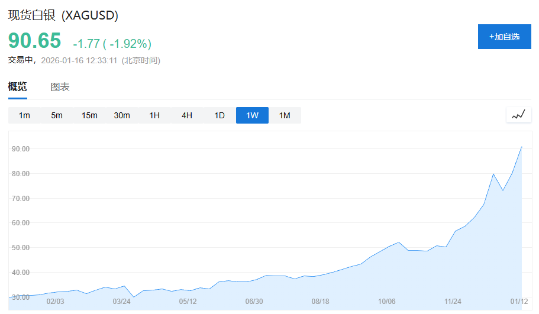

# 白银暴涨，光伏流泪

- 页面显示时间：2026-01-16T12:55:41+08:00
- 页面署名：鲍奕龙
- 标注来源：未单列，见正文
- 原文：[华尔街见闻](https://wallstreetcn.com/articles/3763442)
- 取得时间：2026-11-04T16:03:33+08:00
- [HTML阅读版](article.html) · [来源记录](metadata.json)

## 导语

据彭博新能源财经数据显示，银浆在光伏组件总成本中的占比，已从2023年的3.4%飙升至目前的29%。银浆已经正式取代硅料，成为光伏组件的第一大成本。白银涨价潮下，光伏制造商正提高价格，并加快用铜等更便宜的材料替代白银的计划，预计今年该行业白银的使用量将减少约 17%。

---

现货白银昨日走V收复大部分跌幅，在大宗商品交易员眼里，银价仍处牛市，落在光伏制造企业账面上，却是一道关于生死的催命符。

1月16日[华尔街见闻提及](https://wallstreetcn.com/articles/3763411)，特朗普政府暂缓对关键矿产征收关税，一度令白银从纪录高位回撤，但日内最终V形走势收复大部分跌幅。而从去年初的29.41美元/盎司算起，至今现货白银涨幅已超过200%。

这种涨幅摧毁了光伏行业的成本模型。 **据彭博新能源财经数据显示，银浆在光伏组件总成本中的占比，已从2023年的3.4%飙升至目前的29%。银浆已经正式取代硅料，成为光伏组件的第一大成本要素。**

**白银涨价潮下，光伏企业面临严峻考验，一些企业选择停产、涨价应对挑战，与此同时，制造商正加快减少白银用量的努力。**

## **白银每涨一千块，成本抬一分**

根据测算，银价每上涨1000元/公斤，电池片的单瓦成本就会上升1分钱。对于利润微薄的光伏行业，这1分钱足以决定一家工厂的开工率。

BNEF分析师Yali Jiang指出，这种原材料价格的飙升给制造商带来了“不可抗拒的成本压力”。

目前，TOPCon电池的银耗约为10-13mg/W，如果银浆价格继续维持高位，甚至进一步上涨至1万元/公斤，仅浆料一项的成本就将高达0.1-0.13元/瓦。

这种压力直接体现在了终端价格上。InfoLink Consulting监测到，本周中国组件制造商已将价格上调了1.4%至3.8%，主流500瓦组件的价格回升至400元人民币（约57美元）左右。

隆基绿能、爱旭股份等头部企业均在近期上调了出货价格。爱旭更是明确表示，因原材料价格影响，组件成本正在快速上涨。

## **从“限产保价”到“停产放假”**

相比头部企业的涨价应对，中腰部企业的处境更为凶险。

现金流枯竭、融资渠道断裂、库存积压，这三座大山正在迫使企业做出极端选择：停产。

[此前华尔街见闻提及](https://wallstreetcn.com/articles/3762276)，湖南一家年产2GW的电池生产商已于1月12日全面停产，其负责人直言“暂时没有替代方案”。

更具代表性的是老牌光伏企业亿晶光电，其常州和滁州基地已处于停产状态。财报数据显示，亿晶光电短期负债超过25亿元，而货币资金仅剩7.86亿元，现金短债比不足0.32。

天合光能和晶科能源本周发出的业绩预警也印证了行业的寒意，尽管经历了长达一年的产能出清和自律措施，2025年它们仍将面临净亏损。

这轮银价暴涨并非单纯的金融投机，而是供需基本面失衡的结果。

**光伏、AI服务器和新能源汽车的爆发，使得工业需求占据了白银总需求的65%。据SMM统计，仅光伏行业的用银量就占到了全球银产量的15%以上，2025年的供需缺口预计达到5000吨。**

与此同时，供应端却几乎没有弹性。 **全球约70-80%的白银是铜铅锌金的伴生矿，矿商无法单纯为了银价上涨而扩大产能。**

## 减少白银用量的努力

面对高企的银价，“去银化”成为生存必须。

隆基绿能上周宣布将加速用贱金属替代白银，晶科能源和上海爱旭也在跟进。

**SMM预测，通过铜电镀、银包铜等技术，光伏行业今年有望将白银用量减少17%。** 上海有色网光伏电池片分析师蒋辰怡透露，部分技术路线已能将银含量降至25%，理论上甚至能实现90%的降幅。

但这种激进的替代策略暗藏巨大风险。Silver Bullion Group创始人Gregor Gregersen警告称：

> 如果面板在十年后失效，但保修期是二十年，制造商将面临巨额债务，甚至导致破产。

铜的化学性质不如银稳定，极易氧化，而客户对组件的质保要求通常长达20年。目前，大规模的铜替代方案缺乏足够长时间的实证数据支持。蒋辰怡也承认， **当前方案仍存在浆料印刷不稳定、良率不达标等瓶颈。**

此时此刻，光伏企业正走在钢丝上。左边是因银价暴涨而导致的现金流断裂，右边是因激进技术替代而埋下的远期地雷。无论哪一种，都需要付出惨重的代价。

风险提示及免责条款

市场有风险，投资需谨慎。本文不构成个人投资建议，也未考虑到个别用户特殊的投资目标、财务状况或需要。用户应考虑本文中的任何意见、观点或结论是否符合其特定状况。据此投资，责任自负。
