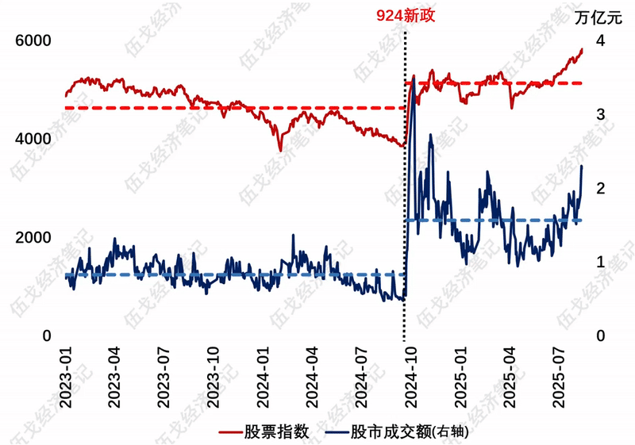
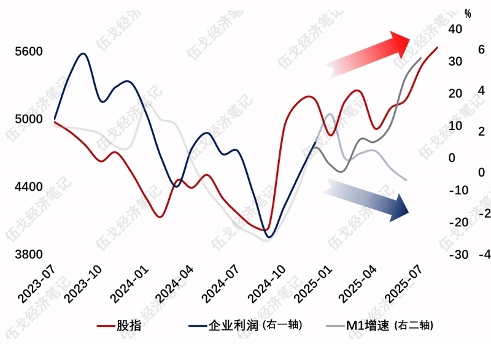
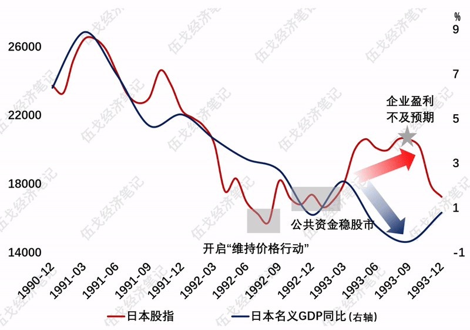
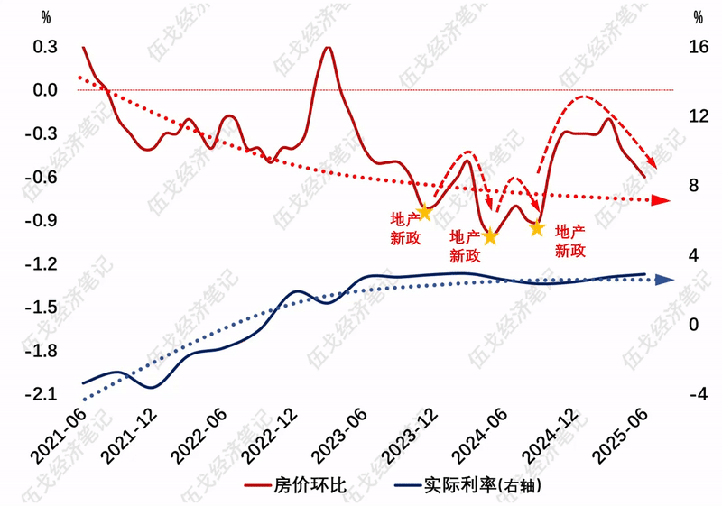

# 稳股市，楼市呢？

- 页面显示时间：2025-08-18T07:56:18+08:00
- 页面署名：董静
- 标注来源：长江证券伍戈
- 原文：[华尔街见闻](https://wallstreetcn.com/articles/3753499)
- 取得时间：2026-11-04T16:03:27+08:00
- [HTML阅读版](article.html) · [来源记录](metadata.json)

## 导语

长江证券认为，股市上涨主要源于去年9月货币工具支持，但与企业盈利等基本面显著背离，持续性有待验证。楼市方面，过去三年多轮新政效果有限，各国经验表明总量性政策和实际利率调整才是关键，当前低通胀环境下需超常规政策。展望未来，地产结构性政策或加码。

---

**核心观点：**

**1.安得两全法。稳住楼市股市是年初以来中央经济工作的明确要求。今年时间过半，股市已突破近年新高，但楼市依然承压。面对相同的经济基本面，股市、楼市为何呈现如此差异？股市行情若要持续，基础是什么？楼市若要稳住，又得靠什么？**

**2.本轮股指中枢的系统性抬升源于去年9月支持资本市场的货币工具出台，成交量更为明显。后续虽受关税等冲击，股市似已“免疫”。不同过往，本轮股指与企业盈利等基本面显著背离。海外也有支持股市举措下的类似场景，但两者终将趋同。**

**3.过去三年我国曾实施多轮地产新政，也产生过脉冲式影响，但持续时长有限。各国经验看，总量性政策而非结构性政策、实际利率而非名义利率的调整才是扭转地产的关键。尤其是当整体物价持续处于低位及负增长时期，超常规政策成为必要。**

**4.展望未来，鉴于近期地产趋弱的斜率加大，后续促进其“止跌回稳”的结构性政策或加码。总量性的实际利率有望边际回落，但短期幅度有限。股市的风险偏好短期仍受反内卷、联储降息等预期支撑，但持续性有待企业盈利等“硬”数据的进一步验证。**

**正文：**

稳住楼市股市是年初以来中央经济工作的明确要求。今年时间过半，股市已突破近年新高，但楼市依然承压。面对相同的经济基本面，股市、楼市为何呈现如此差异？股市行情若要持续，基础是什么？楼市若要稳住，又得靠什么？

## 一、稳股市，靠的是什么？

本轮股指中枢的系统性抬升源于去年9月支持资本市场的货币工具出台，成交量更为明显。后续中长期资金入市的制度安排和科技浪潮等也为股指加码。虽受关税等冲击，股市似已“免疫”。 

图1. 股市中枢抬升的起点

来源：WIND，笔者测算

注：股指为万得全A。

不同过往，本轮股指与企业盈利等基本面显著背离。M1等货币活化指标的抬升，以及居民存款向非银存款的“搬家”，更多体现出的是资金向股市的转移。

图2. 股市与企业盈利的背离

来源：WIND，笔者测算 

注：股指为万得全A，利润为工业企业利润增速。

海外也出台过支持资本市场的举措，并取得阶段性成效。但从可持续性看，最终效果仍取决于微观企业的盈利状况。

图3. 股市与基本面：终将趋同

来源：WIND，笔者测算

注：股指为日经225指数。

## 二、稳楼市，又靠什么呢？

过去三年我国曾实施多轮地产新政，也产生过脉冲式影响，但持续时长有限。各国经验看，总量性政策而非结构性政策、实际利率而非名义利率的调整才是扭转地产的关键。尤其是当整体物价持续处于低位及负增长时期，超常规政策成为必要。

图4. 稳楼市：靠总量还是结构政策？

来源：WIND，笔者测算

注：实际利率为DR007-GDP平减指数同比。

展望未来，鉴于近期地产趋弱的斜率加大，后续促进其“止跌回稳”的结构性政策或加码。总量性的实际利率有望边际回落，但短期幅度有限。股市的风险偏好短期仍受反内卷、联储降息等预期支撑，但持续性有待企业盈利等“硬”数据的进一步验证。

本文作者：伍戈，来源：[伍戈经济笔记](https://mp.weixin.qq.com/s?__biz=MzI4NjMyNTUwMw==&mid=2247488541&idx=1&sn=0efebafa1df5eef5ab2f45bf8ea2e6b8&chksm=eac47d87eaefadd5cb4719cfaf0325a7a8f21ce4da3ea1d78ee888ecb8b8d4153c4a69736025&mpshare=1&scene=23&srcid=0817bPxyhNi61gQPEaNL1esT&sharer_shareinfo=5a0f7fb3b3194ba7ce0e2e0e512f7c56&sharer_shareinfo_first=42cc093f93d7e3a786733b6722a3169d#rd)，原文标题：《稳股市，楼市呢？》

风险提示及免责条款

市场有风险，投资需谨慎。本文不构成个人投资建议，也未考虑到个别用户特殊的投资目标、财务状况或需要。用户应考虑本文中的任何意见、观点或结论是否符合其特定状况。据此投资，责任自负。
