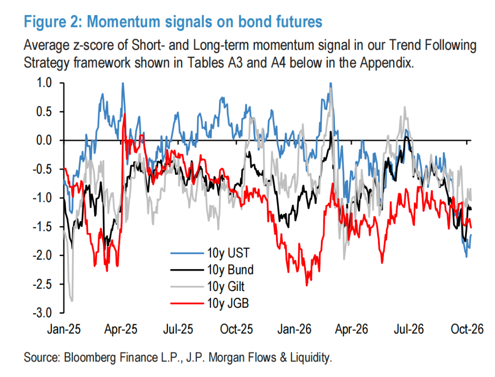

# 美债反转还要等多久？CTA空头已达极端，但主动资金的卖压尚未结束

- 页面显示时间：2026-10-08T18:00:46+08:00
- 页面署名：李佳
- 标注来源：未单列，见正文
- 原文：[华尔街见闻](https://wallstreetcn.com/articles/3783190)
- 取得时间：2026-11-04T16:03:18+08:00
- [HTML阅读版](article.html) · [来源记录](metadata.json)

## 导语

摩根大通认为，主观资金规模更大，其持续减仓仍将给美债价格带来压力，短期收益率更可能继续上行。不过，CTA空头已较为拥挤，若行情反转，空头回补可能放大美债涨势。

---

美债市场正陷入一场罕见的多空博弈：量化基金已大举做空美债，而主动型资金仍在削减此前积累的久期多头。

摩根大通在最新报告中认为， **短期美债收益率仍面临上行压力，主观型投资者持续去化久期的影响，可能超过CTA极端空头带来的反转风险。**

一方面，CTA对美债的看空已经十分拥挤，意味着一旦收益率转而下行，空头回补可能推动美债价格快速反弹。另一方面，主动型债券管理人的资产规模远大于量化基金，其持续削减久期多头，仍可能给美债带来更大的实际卖压。

与此同时，风险平价基金虽然具备增配美债的空间，但高企的债券波动率限制了其加仓速度。因此，在主观资金尚未完成仓位调整之前，摩根大通仍倾向于认为，美债收益率短期更可能继续上行，而非回落。

## CTA做空美债已至极端，反转风险上升

9月，量化策略表现强劲。Managed Futures/CTA基金当月回报约4.29%，今年前9个月累计回报达14.34%，成为表现最好的策略之一；Macro Quant基金9月回报3.41%，年内累计回报也达到11.27%。

这一轮量化策略的强势表现，很大程度上受益于债券期货上的趋势交易。摩根大通趋势跟踪模型显示，截至9月30日，美国国债期货的动量信号已跌至极端负值区间，z值接近-2.5至-3.0。

**动量信号进入这一水平，意味着CTA对美债下跌的押注已经较为拥挤。** 只要美债收益率继续上行，趋势策略仍可能顺势获利；但如果收益率开始回落，趋势信号反转可能迫使CTA止盈、回补空头，甚至转为做多，从而进一步放大美债价格的反弹。

## 主观资金仍在减仓，继续压制美债

与量化基金相反，主动型投资者此前积累的久期多头仍未完全消化。美国规模最大的20只主动债券共同基金，其久期beta近期仍处于历史偏高水平；美国平衡型共同基金的债券久期beta同样高于历史均值，近几个月已经开始主动压缩。

摩根大通的美国国债客户调查也显示，实盘投资者仍存在持续的长久期净多头。 **这意味着，主动型资金当前不仅缺乏进一步加仓美债的动力，还需要继续降低此前积累的久期风险。**

这种调整同样存在于欧洲债券市场，但对美债而言，关键在于主观型债券管理人的资金规模远大于CTA基金。因此，即便CTA的空头仓位已经达到极端水平，其潜在回补买盘短期内也未必足以抵消主动资金持续减仓带来的卖压。

风险平价基金理论上可以成为潜在买家。摩根大通测算显示，这类基金目前的隐含杠杆低于历史均值，具备增加债券配置的空间。但随着美债波动率持续上升，风险平价策略的加仓速度受到限制，暂时难以形成足够强的买盘。

**因此，当前美债市场的核心矛盾并不是“空头是否已经过多”，而是CTA的极端空头与主观资金尚未完成的久期去化同时存在。** 在后者仍占据主导的情况下，摩根大通预计美债收益率短期仍偏向上行；但随着CTA空头进一步积累，收益率上行的同时，市场反转风险也在同步增加。

风险提示及免责条款

市场有风险，投资需谨慎。本文不构成个人投资建议，也未考虑到个别用户特殊的投资目标、财务状况或需要。用户应考虑本文中的任何意见、观点或结论是否符合其特定状况。据此投资，责任自负。
