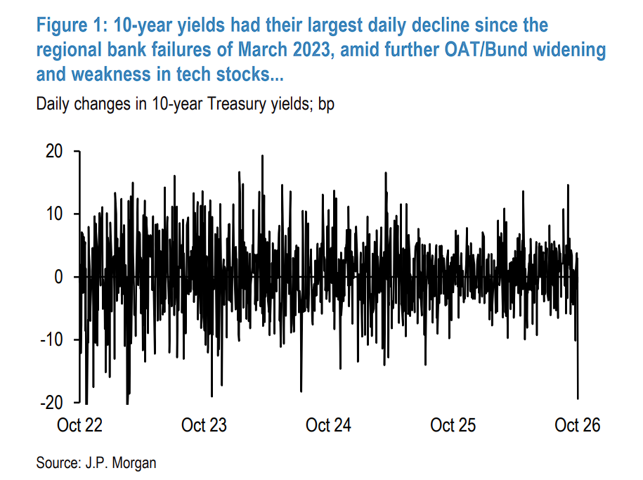
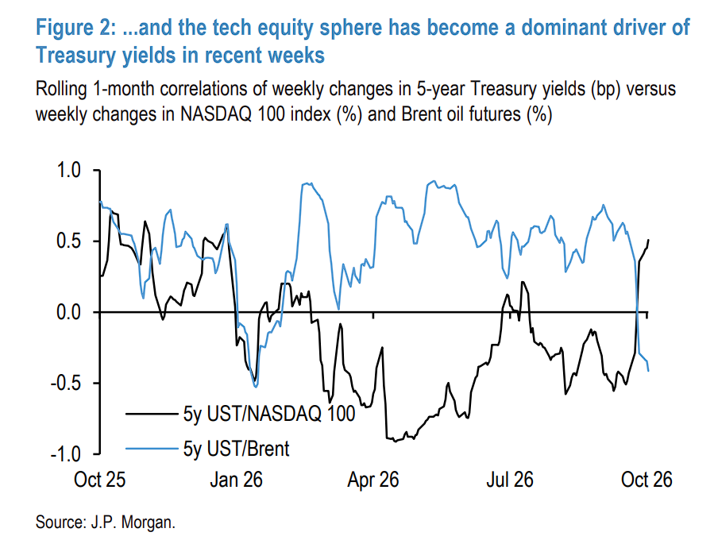
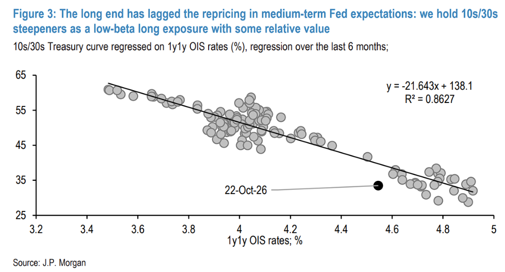
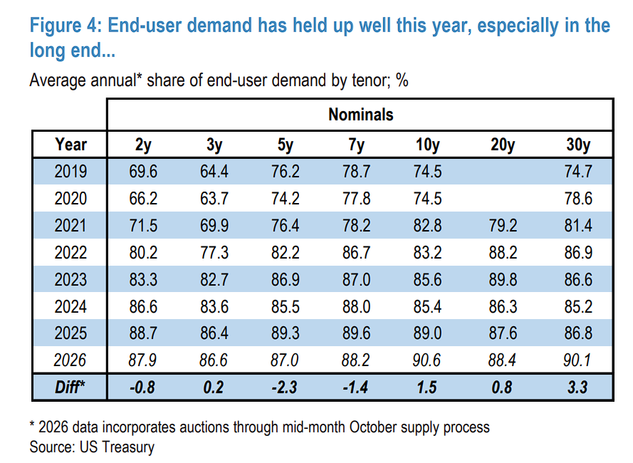
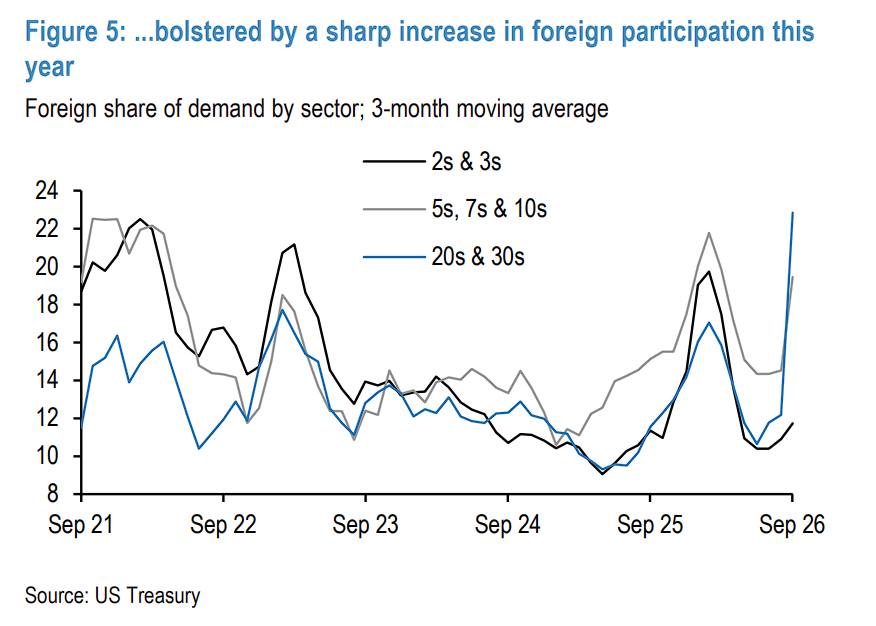
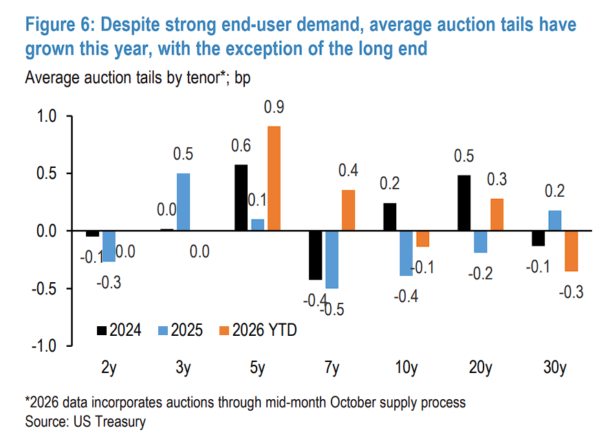
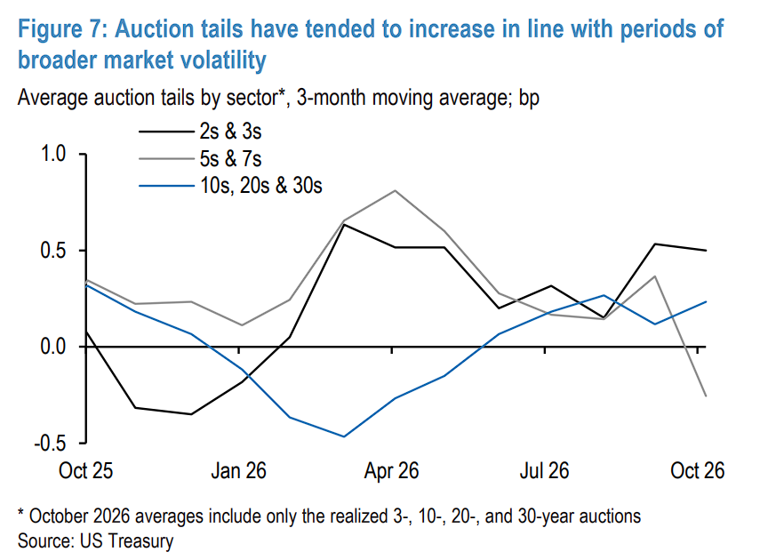
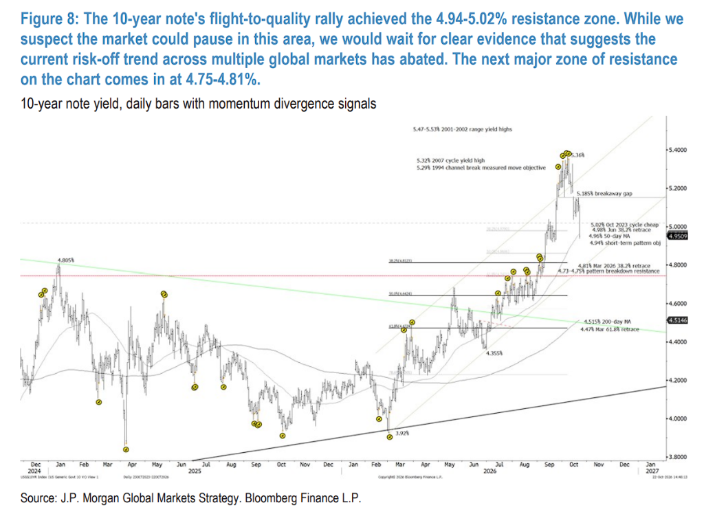

# 美债本轮反弹的持续性如何？

- 页面显示时间：2026-10-23T16:19:40+08:00
- 页面署名：董静
- 标注来源：未单列，见正文
- 原文：[华尔街见闻](https://wallstreetcn.com/articles/3784306)
- 取得时间：2026-11-04T16:03:19+08:00
- [HTML阅读版](article.html) · [来源记录](metadata.json)

## 导语

摩根大通认为，美债此轮反弹由欧债危机蔓延与纳斯达克重挫引爆，并非美国基本面改善。尽管“去美元化”喧嚣不断，外资长端美债需求实已创历史新高。10年期收益率已触4.94%-5.02%关键阻力区，但科技股已成美债收益率的主导变量，风险资产市场出现明确企稳乃至筑底信号之前，不建议逆势做空本轮反弹。

---

美债市场于10月22日迎来自2023年3月地区银行危机以来最大单日收益率下行， **各期限收益率单日下行幅度达15至21个基点** ，10年期美债收益率收于4.95%。

据追风交易台消息，摩根大通在10月22日的研报中称，这场突如其来的“避险狂欢”由欧洲主权债风暴和纳斯达克科技股的持续疲软共同引爆，并非源于美国基本面的实质性改善。

报告称， **尽管宏观层面“去美元化”的喧嚣尘上，但真实数据显示，海外私人资本仍在疯狂涌入美债长端市场，将其作为终极避风港。** 展望后市，10年期美债收益率已触及4.94%-5.02%的关键阻力区，但在风险资产明确企稳前，切勿轻易做空本轮反弹。

**在策略上，摩根大通建议继续持有10年/30年期美债收益率曲线陡峭化交易（10s/30s steepeners）将是当下兼顾前端收益率下行红利与相对价值的最佳选择。**

## 触发因素：欧债危机蔓延叠加科技股重挫

本轮美债收益率大幅下行的导火索来自大西洋彼岸。 **法国OAT与德国Bund利差单日再度扩大15个基点** ，已升至2011年欧洲外围债务危机最严峻时期以来的水平。摩根大通欧洲团队指出，本周利差扩大并无明确催化剂，但上周末法国抗议活动升级可能进一步打压了市场情绪。

摩根大通欧洲团队认为， **打破当前法国利差扩大循环，需要以下条件之一出现** ：法国财政或政治动态出现改善，或欧洲央行发出潜在干预信号。

值得注意的是，即便在欧洲市场收盘后，美债收益率的下行仍在延续，科技股的持续疲软成为另一重要推手。

## 驱动逻辑：科技股已成美债收益率的主导变量

摩根大通数据显示， **过去一个月，美债收益率与纳斯达克100指数的滚动相关性显著上升，同时与布伦特原油价格呈现负相关** 。这一关系的形成有其内在逻辑：在中东冲突爆发初期，当布伦特原油突破每桶110美元时，美债收益率便开始对油价表现出负敏感性。

展望后市，摩根大通认为， **尽管美国经济保持韧性，股票市场已成为利率定价的主导力量** 。摩根大通股票团队此前指出，利率上升将对股票估值倍数形成压制——随着折现率提高和通胀预期上升，估值将受到压缩。根据不同的经济增长情景，这一压制效应在10年期收益率达到5%至6%之间时开始显现。

在上述背景下，摩根大通倾向于 **持有受益于短端收益率下行、同时具备相对价值的交易头寸** 。

> 具体而言， **10s/30s收益率曲线主要由中期美联储政策预期驱动** ，但过去两周该曲线对美联储预期重新定价的反应明显滞后。
>
> 基于此，摩根大通认为10s/30s曲线目前偏平约 **6个基点** ，并继续推荐持有10s/30s陡峭化头寸，将其定位为低贝塔多头敞口，兼具相对价值属性。
>
> 

## 一级市场需求：长端需求创历史新高，外资参与度显著提升

尽管市场波动加剧，美债一级市场需求整体表现出色。

**关键数据如下：**

> **10年期和30年期国债拍卖的终端用户需求均创历史新高** ，平均占比分别达到 **90.6%** 和 **90.1%** ；
>
> 
>
> 中期限需求虽较2025年历史高位有所回落，但从历史维度看仍处于强劲水平。

**外资参与度大幅提升** 是支撑需求的核心力量。外资参与率在中东冲突爆发后的3月份急剧上升，并于9月份收益率重新定价至数十年高位时再度显著跳升。9月中旬的拍卖中，外资参与率创下历史最高水平之列。

摩根大通判断， **此次外资需求增量主要集中在中长端，表明资金来源以外国私人投资者为主** （官方持有通常集中于短端，以便在金融压力时期更易变现）。这与8月份TIC数据相互印证——该数据显示，外国投资者在8月份净买入长期美债的速度为逾一年来最快，主要由外国私人需求拉动。

摩根大通明确指出： **尽管“去美元化”担忧甚嚣尘上，数据表明外资对美债市场的参与度依然强劲。** 在压力时期，全球投资者仍持续增持美债，美债依然是全球流动性最深、规模最大的主权债务市场。

## 拍卖尾差扩大：价格敏感性上升还是波动率效应？

值得关注的是，强劲的终端需求并未转化为更小的拍卖尾差。 **2026年以来，几乎所有期限的平均拍卖尾差均有所扩大** （长端为例外）。

摩根大通提出两种可能的解释：

> **外国私人投资者的价格敏感性更高** ：随着外国私人投资者在一级需求中占比上升，其对价格的敏感程度高于价格敏感性较低的官方部门对手方，这与近年来美债市场整体趋势一致；
>
> 
>
> **利率波动率上升的自然结果** ：尤其是日内波动率的提升，自然导致尾差扩大。拍卖尾差在3月份冲突引发市场波动时扩大，并在9月份收益率重新定价时再度飙升。
>
> 

**长端是显著例外** ——长端拍卖尾差今年以来反而有所收窄。摩根大通认为，在未来数年融资缺口持续扩大的背景下，削减长端发行规模本已是不明智之举；而长端拍卖表现如此强劲，更进一步表明此类调整并无必要。

## 技术面分析：反弹触及关键阻力区，尚不宜逆势做空

从技术面看，10年期美债收益率的反弹已加速推进，并触及摩根大通此前标注的 **第一个主要阻力区间4.94%-5.02%** 。该区间汇聚多重技术信号：2023年10月周期收益率高点；6月份38.2%斐波那契回撤位；50日移动平均线；10月收益率顶部形态的量度升幅目标。

摩根大通判断， **市场短期内可能在此区间附近整固，但在风险资产市场出现明确企稳乃至筑底信号之前，不建议逆势做空本轮反弹** 。目前，多数风险资产市场仍在加速下行，部分已跌破关键支撑位，尚无企稳迹象。

**若反弹延续，下一个主要阻力区间位于4.75%-4.81%** ，该区间包含：2026年3月38.2%斐波那契回撤位（4.81%）；2025年1月收益率高点（4.805%）；夏末跌破水平（4.73%-4.75%）。

向上方向，战术性支撑位于 **5.035%-5.05%** 小时图枢轴水平； **5.15%-5.185%** 的10月15日跳空缺口，鉴于此后收益率大幅下行的冲击力度，现已成为重要支撑区域。

 

\~\~\~\~\~\~\~\~\~\~\~\~\~\~\~\~\~\~\~\~\~\~\~~

以上精彩内容来自[追风交易台](https://mp.weixin.qq.com/s/uua05g5qk-N2J7h91pyqxQ)。

更详细的解读，包括实时解读、一线研究等内容，请加入【 [**追风交易台▪年度会员**](https://wallstreetcn.com/shop/item/1000309) 】

风险提示及免责条款

市场有风险，投资需谨慎。本文不构成个人投资建议，也未考虑到个别用户特殊的投资目标、财务状况或需要。用户应考虑本文中的任何意见、观点或结论是否符合其特定状况。据此投资，责任自负。
