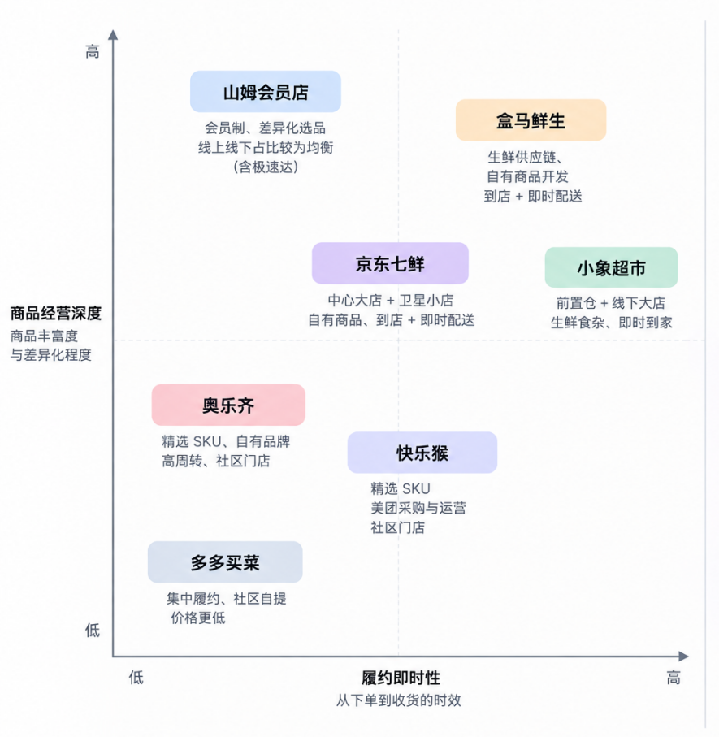
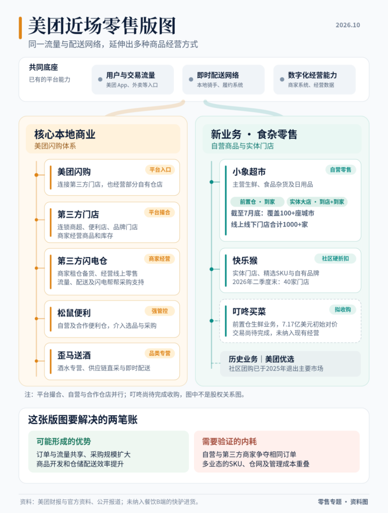
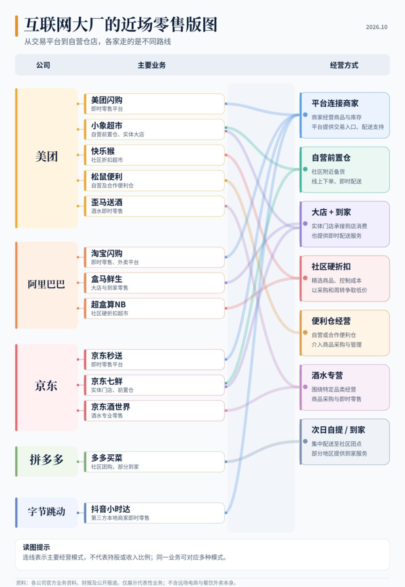

# 美团的零售生意，为什么越来越重？

- 页面显示时间：2026-10-29T21:00:50+08:00
- 页面署名：刘艺晨
- 标注来源：未单列，见正文
- 原文：[华尔街见闻](https://wallstreetcn.com/articles/3784785)
- 取得时间：2026-11-04T16:04:08+08:00
- [HTML阅读版](article.html) · [来源记录](metadata.json)

## 导语

赚零售的辛苦钱

---

美团正在成为零售市场扩张最积极的参与者之一。 

今年以来，快乐猴社区硬折扣店加快多城布局，小象超市前置仓持续下沉、数千平方米的实体大店加速复制，美团还拟斥资7.17亿美元收购叮咚买菜中国业务。 

从社区折扣店到前置仓、实体大店，美团正在加速搭建一套由自己直接经营商品的零售体系。

美团原本可以不这么做。 

作为拥有庞大用户规模、商家网络和即时配送体系的互联网平台，美团本可以继续连接消费者与零售商，让后者承担商品采购、库存和门店经营的成本。

但2025年的外卖大战加剧了配送和流量竞争，也暴露出平台模式的另一重局限：

**掌握交易入口，不等于掌握商品供给；**

**汇集大量订单，也不意味着能够直接获得采购和库存效率。**

美团对自营零售的探索早于外卖大战，如今，这场竞争进一步加快了其向商品经营延伸的步伐。

从连接商家到亲自经营仓店，美团试图将互联网平台积累的规模优势转化为商品开发、采购和供应链效率，以争取更大的食品杂货市场。 

但食品杂货始终是一门利润微薄的生意。美团主动承担更重的经营责任，究竟是在扩大自己的竞争优势，还是让原本擅长提高交易效率的互联网平台，背上更多传统零售的成本？

## 争夺更多购物车

在美团日益庞大的零售版图中，小象超市是其经营方式变重最直观的体现之一。

与主要连接第三方商家的美团闪购不同，小象属自营即时零售业务、通过社区前置仓提供生鲜食品、日用百货等商品及配送服务，直接承担商品采购、库存管理和仓店运营。

今年以来，它同时加快了两条扩张路线：线上前置仓持续向低线城市下沉，线下大型实体超市则从单店试验转向初步复制。

2025年末，小象超市覆盖39座城市，今年一季度末增至55座，二季度末进一步达到68座。

9月，小象超市总经理高雨龙公开表示，截至7月底已覆盖超过100座城市、线上线下门店合计超过1000家。

在长三角，其业务从上海、杭州、南京、苏州等中心城市，扩展至宁波、无锡、常州、嘉兴、绍兴、南通等市场，还进入义乌、昆山等县级市。

广东的布局也从广州、深圳、佛山、东莞向周边延伸，今年6月进一步进入汕头、潮州、揭阳等粤东城市。京津冀地区则已经覆盖石家庄、唐山、廊坊、保定、沧州等城市。

**小象还加快进入此前覆盖较少的区域。成都、重庆、西安等西部中心城市陆续开仓，8月又进入沈阳、南宁等市场，开始向东北和广西扩展。**

小象试图以更快的速度，将已经建立的前置仓经营模式复制到更多市场。

**零售的形式百花齐放。但从消费者的视角看，只有到店和到家。**

过去几年，小象依托美团的即时配送网络，首先做大了到家生意。消费者通过手机下单，由社区附近的前置仓完成商品分拣和配送。

今年，小象开始加快争取到店消费。

自去年12月北京万柳首店开业以来，宁波、杭州、深圳、江门、南昌等城市陆续迎来小象实体超市。截至目前，小象已开出8家线下大店。

从已开业项目看，门店多进入成熟商圈的购物中心，面积普遍达到数千平方米，部分直接承接传统商超退出后的经营场地。

北京万柳首店承接原BHG精品超市，杭州紫荆天街店进驻原永辉超市，深圳领展中心城店则接手此前家乐福留下的铺位。

9月底开业的南昌门店，经营面积超过4000平方米，提供近万款商品，设置现制烘焙、鲜切水果、水产加工和现场餐饮区域。

作为对比，盒马鲜生同样以大面积实体门店结合线上即时配送，典型门店面积约2500—5000平方米，商品数量约为6000款。

美团CEO王兴在今年二季度业绩会上解释，“一定数量的线下旗舰店将在整个生态体系中发挥非常重要的作用。”

但开设大型实体超市，也意味着更高的租金、人力、装修和设备投入。尤其是现制熟食、鲜活水产等经营区域，还需要相应的加工人员、设施和损耗管理。

美团愿意承担这些成本，是因为零售边界正在打破：单一的前置仓已难以完全承接消费者多元的食品杂货支出。为了夺取更大的市场份额，美团选择把生意越做越重。

## 做重零售，要补什么

对“规模与效率”的权衡贯穿了美团的零售发展史。 

从2019年小象生鲜败退，到美团买菜升级为小象超市，再到2025年美团优选收缩、资源向小象和快驴倾斜，前置仓成为主线，是因为它能最大化复用线上流量与骑手网络。

但2025年的外卖大战进一步逼窄了美团的竞争防线。

高盛今年8月的报告测算，2026年二季度，美团、阿里、京东三家的外卖日均订单量份额分别约为49%、41%和10%。

配送网络仍然具有规模优势，但已不再是美团独有的竞争筹码。

**在不同市场，美团面对的是成本结构截然不同的竞争者。**

在下沉市场，多多买菜依靠集中配送和社区自提，以较低的末端履约成本争取价格敏感型消费者。小象能够提供更快的即时到家服务，却需要承担分散备货、仓内分拣和骑手配送费用。

一二线城市的竞争则更多体现在商品经营能力本身。

山姆通过会员体系、差异化选品和较高客单价建立消费黏性；盒马拥有自己的商品开发与生鲜供应链；奥乐齐等社区折扣店则依靠精选SKU和周转效率控制成本。

**仅仅把商品送得更快，已经不足以保证消费者持续选择自己。**

一方面，美团需要建立更强的零售品牌心智。

消费者习惯通过美团点外卖，不意味着购买生鲜、日用品时也会优先选择小象。即便平台连接大量社区商超，消费者对商品品质与价格的认知，往往仍然属于具体的零售商。

美团还需要更直接地掌握货源。

作为交易平台，美团可以汇集大量零售订单，但第三方商家各自采购、备货，交易规模难以自动转化为统一的采购和库存效率。

为此，美团多个零售业态正以不同方式深入上游。

今年9月，小象超市披露已建立数百个生鲜产地直采基地，与君乐宝联合开发的部分乳制品年销量突破1亿瓶，合作进一步延伸至工厂专属排产和物流优化。

快乐猴则将源头直采、精选SKU和自有品牌作为硬折扣经营的核心。目前已开发约300款自有品牌商品，覆盖粮油、烘焙、冻品等品类，通过工厂合作和集中采购减少中间环节。

平台业务同样在向上游延伸。9月，美团闪购推出“商品NEXT”计划，加强对第三方商家的精准选品、商品开发和供应链支持。

自有品牌毛利只是部分收益。更重要的是，美团希望将庞大的消费需求转化为商品开发、采购和成本优势，而不只是依靠流量与配送扩大交易规模。

## 协同与组隔

美团并不打算让这些零售业态各自为战。 

在今年一季度业绩会上，美团高管明确提出，小象超市长期希望实现可持续的“低个位数利润率”，并时刻关注投资回报率。

二季度，王兴又将小象与快乐猴定义为差异化、相互补充的零售模式，强调美团零售的长期竞争力来自组织与供应链能力。

美团内部已经出现了一些实际的协同。

平台侧，美团闪购虽然主要连接第三方商家，却已能将海量商品信息标准化，通过分析区域销售与供给数据，帮助品牌商调整铺货。这为美团识别不同区域的消费需求、优化商品供给提供了技术基础。

自营业务之间，商品与供应链的共享更为直接。

快乐猴不少商品直接复用了小象超市的供应链，尤其集中在即食与生鲜领域，货架上甚至可以直接销售小象超市的自有品牌商品。

**但相较于商品与供应商资源的共享，仓储与履约网络的“硬整合”要艰难得多——这种难题，在美团对叮咚买菜的并购中有所体现。**

今年2月，美团宣布拟以7.17亿美元的初始现金对价收购叮咚买菜中国业务。

两者虽然都采用前置仓模式，商品结构和仓储方式却有明显差异。叮咚围绕生鲜与家庭一日三餐经营，日常SKU约3000个；小象则向食品杂货和日用百货拓展，大仓SKU超过8000个。

在华东等重合市场，双方部分仓点存在重复覆盖，但直接合并仓点，又需要重新调整配送半径、仓内商品配置、分拣流程和运力安排。

**一位接近美团的资深零售行业人士对全天候科技表示，除了防止竞争对手获得叮咚，美团通过并购也是在“花钱买时间”。**

该人士还透露，除叮咚外，美团还接触过一些传统商超的并购机会，涉及其此前尚未覆盖的零售场景。

对美团而言，买入现成的经营能力能够缩短扩张时间，但真正形成规模优势，还需要将不同体系的商品、采购和履约能力有效组织起来。

## 更大的零售战局

**前置仓是一个精密的数字游戏，但零售最终仍是一门回归“多快好省”常识的苦生意。**

**没有一种单一模式能够解决所有零售需求，因为远近场长期并存背后，既有库存集中与分散所决定的成本结构，也取决于不同消费场景下时效与体验的真实匹配：**

如果消费者想买一款冷门的进口调味料，远场电商只需在区域大仓保留少许库存，就能辐射全国；而前置仓若要在每个社区暗仓都备上一瓶，面临较长的库存周转周期。

如果是晚饭前急需一盒鸡蛋，本地前置仓分钟级送达的履约优势便无可替代。

线上与线下也是如此。即时配送固然能满足高效补货，但对于生鲜商品，许多人仍然习惯亲眼观察、亲手挑选来判断品质，实体超市因此保留了独立的经营价值。

**经营模式越来越细分，大型平台的业务边界却随之越来越宽——这一变化，发生在流量红利见顶的存量时代。**

平台越来越难以单纯依靠新增用户和消费总量扩张获得增长，而食品杂货等高频消费的购物渠道仍在变化，争取原本发生在其他渠道的交易，成为新的增长来源。

2025年的外卖大战进一步加剧了这种竞争。阿里、京东加大对即时零售和配送网络的投入，美团原有的履约优势面临挑战。

与此同时，行业也走到了“组合重构”的时机。 经过近十年的探索，前置仓、硬折扣、实体大店与区域供应链的模式均已成熟。

平台不必再从零探索，而是可以通过自建与并购直接重组这些零售能力。

**存量增长的压力、竞争加剧与新的供给整合机会，共同推动了这一轮零售整合与扩张。**

**少有人察觉之处，零售交易入口与商品供给之间的关系也在发生变化。**

10月21日，沃尔玛公布面向第三方AI Agent的购物接入机制，计划允许消费者通过外部AI助手直接下单。

这预示着一种可能：未来的流量入口可能被技术稀释，平台不再能将消费者死死圈在自己的App里。

当配送速度不再是独家护城河，流量入口的价值也在被重塑，商品品质、采购成本与供应链深度，顺理成章地升维为竞争的关键。

**平台的潜在优势，在于让不同的零售业态共享用户、技术系统、采购资源与履约网络，减少重复建设。**

**但前置仓、实体超市与社区折扣店的成本与管理逻辑天差地别，强行整合亦可能带来庞大的管理内耗。**

零售归根结底，是一门弯腰捡钢镚的苦生意。

美团最终需要证明的，不是自己能够经营多少种零售业务，而是把这些业态装进同一套体系后，究竟能否靠后台供应链的协同降本增效，创造出大于各项业务独立经营的价值。

否则，不断扩大的零售版图，不过是将巨额资金投向了本就薄如蝉翼的泥潭。

风险提示及免责条款

市场有风险，投资需谨慎。本文不构成个人投资建议，也未考虑到个别用户特殊的投资目标、财务状况或需要。用户应考虑本文中的任何意见、观点或结论是否符合其特定状况。据此投资，责任自负。
