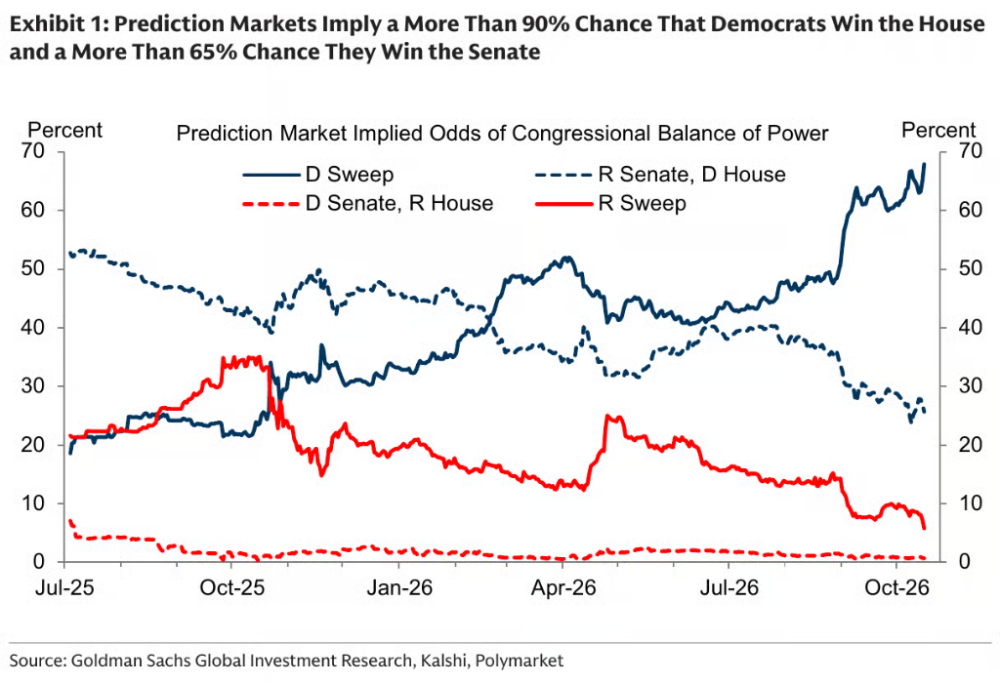
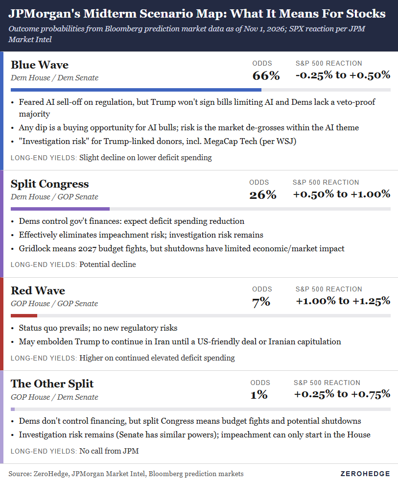
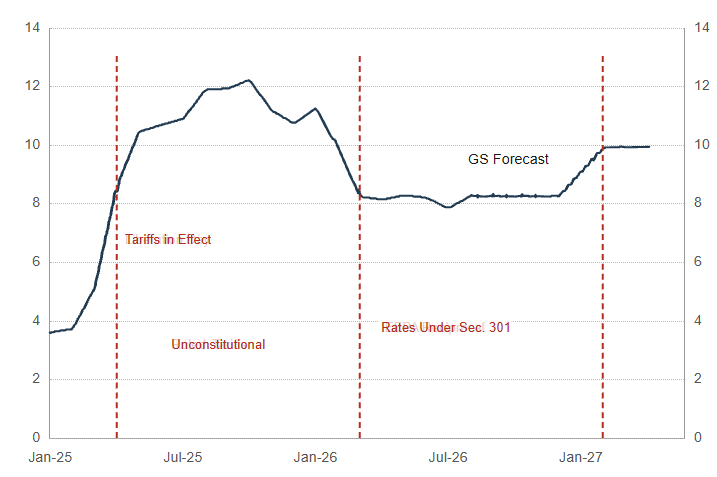
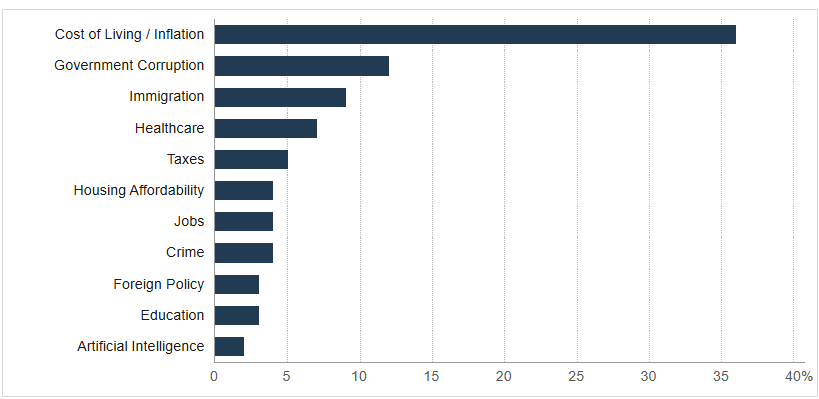

# 美国中选“最可能剧本”，将是美股“最危险剧本”？

- 页面显示时间：2026-11-03T15:32:17+08:00
- 页面署名：许超
- 标注来源：未单列，见正文
- 原文：[华尔街见闻](https://wallstreetcn.com/articles/3785069)
- 取得时间：2026-11-04T16:03:50+08:00
- [HTML阅读版](article.html) · [来源记录](metadata.json)

## 导语

预测市场显示民主党中期选举横扫两院概率高达66%，而这恰恰是华尔街预测模型中对美股唯一存在下行风险的情景。摩根大通、高盛双双警告：蓝色浪潮将加速AI监管立法、推高科技巨头调查风险、压缩税收优惠——但历史数据同样表明，中期选举后一年标普500平均上涨约15%，从未录得负回报。

---

预测市场显示民主党中选横扫两院的概率接近三分之二，而这恰恰是华尔街预测模型中对美股最不友好的选举结果。

摩根大通援引预测市场数据，截至11月1日，民主党同时夺取众议院和参议院的概率为66%。而在摩根大通的区间预测中， **"蓝色浪潮"（民主党大胜）是唯一一个涵盖指数下跌可能性的情景。其余所有结果——无论是民主党仅拿下众议院、共和党守住两院，还是分裂国会——均指向股市上涨。**

对AI板块而言，民主党横扫国会的影响尤为直接。 **高盛预计，民主党掌控的国会将对大型科技公司在AI开发、安全实践和数据收集方面展开调查，并推动将数据中心排除在额外折旧、研发抵税和其他税收优惠之外，甚至可能提出针对数据中心电力消耗的联邦消费税。摩根大通则将此定性为与特朗普捐款相关联的商界领袖所面临的"调查风险"，科技巨头亦在其列。**

## 蓝色浪潮：唯一令股市承压的情景

民主党横扫两院的概率在过去数月持续攀升。据摩根大通，10月初这一概率为62%，分裂国会概率为29%；截至选前，分裂国会降至26%，共和党守住两院仅剩7%，共和党众议院配民主党参议院的概率更低至1%。

摩根大通的情景预测显示： **若民主党仅拿下众议院，标普500指数料上涨0.5%至1%；若共和党守住两院，涨幅预计为1%至1.25%；若出现共和党众议院、民主党参议院的罕见组合，涨幅约为0.25%至0.75%。唯独蓝色浪潮情景，该行给出的区间包含下行可能。**

高盛分析师Alec Phillips和Abhay Duggirala对监管前景得出相似判断。 **他们预计任何两党AI协议将以自愿测试和自我监管为核心，对AI公司负担有限，全国性数据中心建设暂停在任何选举结果下均不太可能发生。但若民主党掌控国会，监管和调查议程将明显提速。**

## AI监管：民主党议程的核心靶点

摩根大通认为，若民主党横扫两院，其将毫无疑问地推进AI监管立法——尽管实际落地难度较大，因特朗普已明确表示不会签署任何限制AI扩张的法案，且民主党无法在两院同时达到推翻否决所需的多数。特朗普此前告知媒体，在僵局之下，"我否决一切"。

摩根大通指出，对于看多AI的投资者而言，选后若出现股价下跌，或是买入机会，但风险在于市场借机在AI主题内大规模减仓。

高盛则预计，民主党国会还可能在财政端施压：将去年财政一揽子计划中的支出削减恢复原状，这将在2027年新增约850亿美元支出，其中医疗补助约550亿美元、营养项目约180亿美元；恢复扩大版平价医疗法案补贴则每年再增约500亿美元。

众议院少数党领袖Hakeem Jeffries据高盛报道表示，预计将快速推进扩大医保补贴、回滚关税并就伊朗战争问题举行投票。

## 关税：无论谁赢，税率都将上升

高盛警告，即便民主党试图拆解部分关税——最有可能针对加拿大进口商品——实际效果也将有限。

选举结束后，高盛预计特朗普将公布针对工业产能过剩的301条款调查结果，该结果与现行10%至12.5%的强迫劳动关税叠加，将把各贸易伙伴关税税率基本恢复至最高法院裁定IEEPA关税违宪之前的水平。高盛预计，美国有效关税税率将因此上升近2个百分点。

**这意味着，无论中期选举结果如何，贸易摩擦带来的成本压力不会因政权交替而消散，企业供应链和利润率所面临的不确定性将持续存在。**

## 伊朗：军事风险的选后变量

在地缘政治维度，选举结果对伊朗局势的走向具有实质性影响。

摩根大通认为， **共和党横扫将可能鼓励特朗普在伊朗问题上持续施压，直至达成其认为有利于美国的协议或伊朗妥协为止。若民主党掌控国会，则可能削减相关军事资金，或援引战争权力法案要求撤军——但须等新国会于1月就座后方可行动。**

摩根大通能源专家Brendan Henrici指出，2027年WTI原油公允价值互换目前交投于88美元附近，而正常价格区间为65至70美元。这意味着股票投资者可用的石油对冲空间已大幅收窄，摩根大通建议适度增加下行保护"或许审慎"。高盛则刚刚上调了布伦特原油预测，以反映供应中断风险。

## 民调与早期投票：参议院仍存悬念

高盛将预测市场解读为民主党在众议院胜率高于90%，在参议院高于65%，并称全国选情较2024年已向民主党摆动10至11个百分点，市场隐含约236个民主党众议院席位。参议院结果则更难判断。

高盛数据显示，自2002年以来，共和党参议院候选人在倾向共和党的州平均跑赢最终民调3个百分点；在竞争激烈的选区，领先幅度不足2.5个百分点的候选人最终仅六成获胜。在共和党现任参议员席位中，民主党领先超过3个百分点缓冲区的仅有北卡罗来纳州一席。

截至上周三，逾4300万美国人已完成提前投票，较2022年同期多出近1000万，其中德克萨斯州提前投票增幅达50%，南卡罗来纳州为83%。在公布党籍登记数据的州，民主党约680万张对共和党约520万张，但摩根大通指出，提前投票历来偏向民主党，选举日投票则偏向共和党。

两行对选民关切的判断也存在分歧。摩根大通援引CNBC和Fox News近期民调，显示腐败议题已超越生活成本成为首要投票动因；高盛的Harris Poll数据则显示生活成本仍遥遥领先，政府腐败位居其次，仅2%的选民将AI列为首要议题。

## 历史季节性：长期来看，选后牛市有据可查

除短期不确定性之外，历史数据为市场提供了一个更长远的参照系。摩根大通的Craig Cohen指出， **自1950年以来，标普500指数在每一次中期选举后一年均录得上涨，平均涨幅约15%。表现最差的一年出现在1986年中期选举之后，但如他所言，"这显然与1987年的市场崩盘关系更大，而非华盛顿的政治动向。"**

更具体的数据显示，标普500指数在中期选举后三个月平均上涨5.4%，六个月上涨11.4%，九个月上涨12.5%，十二个月上涨14.7%。自1990年以来，六个月、九个月和十二个月的回报均每次为正。在仓位层面，摩根大通Delta One团队表示，其"分裂国会"配对交易组合已攀升至两年高位。

高盛补充指出，若民主党拿下参议院，特朗普将面临快速完成人事任命的压力，以便在年底前通过共和党多数批准。民主党控制的参议院可阻止其提名，而特朗普虽可在财政部等内阁机构任命代理官员，却无法在美联储或法院系统如法炮制。

风险提示及免责条款

市场有风险，投资需谨慎。本文不构成个人投资建议，也未考虑到个别用户特殊的投资目标、财务状况或需要。用户应考虑本文中的任何意见、观点或结论是否符合其特定状况。据此投资，责任自负。
