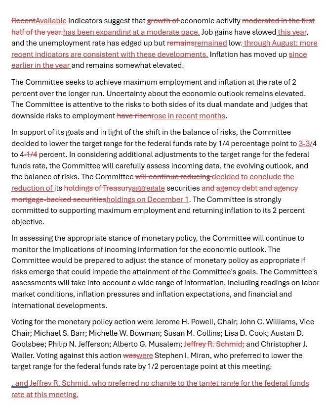

# 美联储祭出组合拳：继续降息25基点+12月结束缩表，两票委反对利率决议

- 页面显示时间：2025-10-30T03:35:37+08:00
- 页面署名：李丹
- 标注来源：未单列，见正文
- 原文：[华尔街见闻](https://wallstreetcn.com/articles/3758224)
- 取得时间：2026-11-04T16:03:16+08:00
- [HTML阅读版](article.html) · [来源记录](metadata.json)

## 导语

美联储缩表持续三年半后告终，12月起以短期国债替代到期MBS持仓。特朗普“钦点”理事米兰和上次一样主张降息50基点，另一票委施密德支持按兵不动。决议声明新增指出，劳动力市场近期指标与政府关门前趋势相符，称就业下行风险“近几个月”增加。“新美联储通讯社”：联储继续努力防止近期就业放缓的趋势恶化，经济数据缺失使未来利率走向变得扑朔迷离。

---

> **要点** ：
>
> 美联储连续两次降息25基点，行动符合市场预期。
>
> 美联储缩表持续三年半后告终，决定12月起以短期国债替代到期MBS持仓。
>
> 两名反对利率决议的FOMC票委中，特朗普“钦点”的新晋理事米兰和上次会议一样主张降息50基点，堪萨斯城联储主席施密德支持按兵不动。
>
> 声明重申“鉴于风险平衡已转变”决定降息，将“最近的”数据指标换为“可获得的”，新增指出，劳动力市场近期指标与政府关门前趋势相符，称就业下行风险“近几个月增加”。
>
> “新美联储通讯社”：联储继续努力防止近期就业放缓的趋势恶化，但经济数据缺失使未来利率走向变得扑朔迷离。

美联储如市场所料继续降息行动，同时决定放弃量化紧缩（QT），一个月后结束缩减资产负债表（缩表）的计划。

美东时间10月29日周三，美联储在货币政策委员会FOMC会后公布，将联邦基金利率的目标区间从4.00%至4.25%下调至3.75%至4.00%，降幅25个基点。在上次会议今年内首次降息后，本次是联储一年来首次连续第二次FOMC会议降息。

本次降息决定完全在投资者意料之中。到本周二收盘，芝商所（CME）工具显示，期货市场预计联储本周降息25个基点的概率达99.9%，12月下次会议继续降息25基点的概率为91%。这显示，市场已几乎完全消化今年内合计降息三次的预期。9月上次FOMC会后公布的利率展望显示，多数联储决策者预计的今年降息次数由6月公布的两次提高到三次。

和前两次会议一样，本次会上，美联储决策层依然没有就利率行动达成统一。包括美国总统特朗普“钦点”的新任理事米兰在内，两名FOMC委员投票反对降息25个基点的决定，体现联储内部的分歧持续，不同于此前的是，这次在降息力度和是否继续行动上都出现了分歧。

美联储此次宣布从12月起结束缩表这一QT行动，但不算意外。两周前美联储主席[鲍威尔已暗示](https://wallstreetcn.com/articles/3757187)将要停止缩表，称银行准备金仍充足，可能未来几个月接近停止缩表所需水平。本周[华尔街见闻文章](https://wallstreetcn.com/articles/3758161)提到，高盛、摩根大通等多数华尔街大行预计，由于近期货币市场出现流动性紧张迹象，联储本周将宣布停止缩表。

本次决议声明公布后，有“新美联储通讯社”之称的资深联储报道记者Nick Timiraos发文称：

> “美联储再次降息25个基点，但（经济）数据缺失使未来的走向变得扑朔迷离。”
>
> “联储连续两次会议降息，继续努力防止近期就业放缓的趋势恶化。在消解联储激进加息的工作中，最容易做的那部分可能已经完成，联储官员正在讨论下一步的降息幅度。由于政府关门导致数据缺失，这项棘手的任务变得更加复杂。”

## 缩表持续三年半后告终 短期国债替代到期MBS持仓

本次会后的决议声明相比上次的主要差异首先是对缩表的调整。

声明不再继续重申，美联储将继续减少其持有的美国国债、机构债和机构抵押贷款支持证券（MBS），而是明确指出：

> “（FOMC）委员会决定，于12月1日结束对其合计证券持仓的减持。”

这意味着，美联储的缩表行动将在持续三年半之后告终。

美联储于2022年6月1日开始缩表，[去年6月首次开始放缓](https://wallstreetcn.com/articles/3714084)缩表步伐，将美国国债的最高月度缩表规模下调350亿美元至250亿美元，今年[4月进一步放缓](https://wallstreetcn.com/articles/3743454)，将国债的每月缩表上限下调至50亿美元，对机构债和机构MBS每月350亿美元的赎回上限保持不变。

本周三美联储公布的货币政策决定执行公告显示：

- 对于10月和11月到期的所持美国国债，美联储要将本金支付额中超过每月50亿美元上限的部分通过标售展期，自12月1日起，将所持全部国债的本金通过标售进行展期。
- 对于10月和11月到期的机构债和机构MBS持仓，美联储要将本金支付额中超过每月350亿美元上限的部分展期，自12月1日起，将所有机构证券本金支付额再投资于国库券。

这相当于，在12月停止缩表计划后，美联储的MBS赎回本金将再投资于短期美国国债，将以短期国债替代到期的MBS持仓。

对于缩表的决定，Timiraos指出，美联储官员长期以来一直表示，一旦在隔夜贷款市场发现银行所持现金不再大量过剩的迹象，就会停止缩表，过去一周，这些信号越发明显。联储将从12月开始用短期国债取代到期债券持仓。

## 反对票委米兰坚持降息50基点 施密德支持按兵不动

本次美联储决议声明的第二大差异是FOMC投票结果。本次投反对票的人数比上次多一人，持平7月末的上上次会议。

投票结果显示，鲍威尔等十名投票委员赞成再次降息25个基点。两名反对者中，9月FOMC会议前走马上任的临时美联储理事米兰坚持了上次会议的激进降息主张，仍希望降息50个基点。堪萨斯城联储主席施密德（Jeffrey Schmid）持异议则是因为，他支持保持利率不变。

这和7月末FOMC会议的投票情况截然不同。当时有两人对暂停降息的决议投了反对票。两名反对者——美联储理事沃勒以及特朗普提名的负责金融监管美联储副主席鲍曼当时都青睐降息25个基点。

摩根大通资产管理的全球固定收益主管Bob Michele评论称，鲍威尔正丧失对美联储的控制。需要一位“有说服力”的人选领导联储。特朗普可能不得不将美国财政部长贝森特安插到联储，从而宣传特朗普本人的利率政策意见。

## 劳动力市场近期指标与政府关门前趋势相符 就业下行风险“近几个月”增加

本次美联储决议相比上次的差异还体现在经济形势的表述上。相关调整主要反映了，美国联邦政府进入10月以来持续关门导致多种经济数据推迟发布的影响。

上次声明开头重申“最近的指标显示上半年经济增长缓和”，本次开头将“最近的”替换为“可获得”的，改称：

> “ **可获得的** 指标显示，经济活动扩张速度缓和。”

上次声明称，“就业增长已放缓，失业率略有攀升但仍保持低位。通胀率有所上升，依旧略为高企。”本次声明添加了对劳动力市场和通胀走势的时限限定，并且新增指出，近期的劳动力市场指标和政府关门前公布数据反映的趋势一致。声明写道：

> “ **今年** 就业增长已放缓，失业率略有攀升，但 **截至8月** 仍保持低位； **更近期指标也与这些趋势相符** 。通胀率 **自年初以来** 有所上升，依旧略为高企。”

以上新增表述和鲍威尔两周前的表态一致。他当时说：“根据我们掌握的数据，可以公平地说，自四周前我们9月的会议以来，就业和通胀前景似乎没有太大变化。”

和上次声明一样，本次声明也表示，降息的决定是“鉴于 **风险平衡已转变** ”。

本次声明再次重申，FOMC委员会专注于，在实现充分就业和价格稳定的双重使命上，所面临的两方面风险，并大致沿用了上次声明新增的就业下行风险增加判断，唯一的区别是增加了这一风险变化的时间限定词。

本次声明不再像上次那样说FOMC“判断就业下行风险已增加”，而是称

> “（FOMC）委员会关注其双重使命所面临的风险，并判断 **近几个月** 就业下行风险已增加。”

以下红字可见本次决议声明相比上次的删减和新增内容。

风险提示及免责条款

市场有风险，投资需谨慎。本文不构成个人投资建议，也未考虑到个别用户特殊的投资目标、财务状况或需要。用户应考虑本文中的任何意见、观点或结论是否符合其特定状况。据此投资，责任自负。
