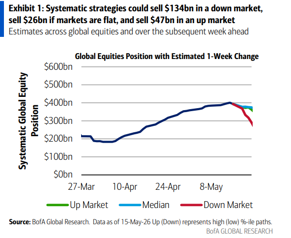
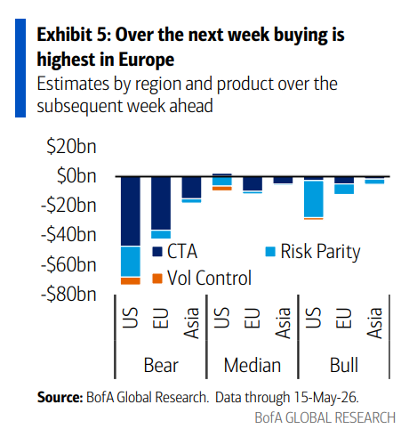

# 美股CTA买入骤降，标普500一旦跌3%或引发千亿美元抛售潮

- 页面显示时间：2026-05-18T10:38:36+08:00
- 页面署名：赵颖
- 标注来源：未单列，见正文
- 原文：[华尔街见闻](https://wallstreetcn.com/articles/3772475)
- 取得时间：2026-11-04T16:03:41+08:00
- [HTML阅读版](article.html) · [来源记录](metadata.json)

## 导语

美银模型显示，CTA增量买入空间十分有限，而下行平仓风险正在加剧。关键触发位如下：标普500约在现货下方3%，罗素2000约在下方5%，欧洲和日本股指约在下方10%，纳指未来一周触发概率较低。一旦上述水平被击穿，CTA全球股票卖盘可能达到约1000亿美元，其中美国约500亿美元、欧洲约350亿美元、亚洲约150亿美元。

---

推动美股上行的系统性买盘正在消退，市场面临一个不对称的结构性风险：上涨时缺乏追涨资金，下跌时却潜藏规模可观的机械抛售。

据追风交易台，在美银美林全球研究近期的报告中，策略师Chintan Kotecha指出，系统性资金流趋于稳定，但股票买入明显放缓。本周CTA策略新增全球股票多头仅约20亿美元，较此前大幅萎缩。与此同时，CTA对美国国债期货的做空仓位接近模型容量上限，市场两端同步逼近临界状态。

在三种市场路径下，CTA、风险平价与波动率控制策略合并测算均显示净卖出：上涨路径对应全球股票卖出约470亿美元，持平路径约260亿美元，下跌路径则高达约1340亿美元。更值得警惕的是， **一旦标普500跌幅达到约3%，CTA全球股票减仓规模可能骤升至约1000亿美元。**

此外，当前市场的矛盾不仅在于系统性股票买盘已经变薄，美债空头也接近饱和，黄金比原油更易触发卖盘，SPX低波动受长Gamma结构支撑但并不稳固。投资者真正需要盯紧的，不是单一方向判断，而是几个关键触发点——标普500现货下方约3%、黄金下方约2.6%、美债波动率走向，以及纳指尾盘杠杆ETF的再平衡压力。

## **系统性买盘萎缩，三种情景下均呈净卖出**

此轮美股反弹的重要推手之一——系统性资金的追涨动能已明显减弱。全球股票系统性仓位目前低于过去五年中位数，这本身不代表多头拥挤，但方向已从净买入转向净卖出。

CTA、风险平价和波动率控制三类策略合并看， **未来一周上涨路径对应卖出约470亿美元，持平路径卖出约260亿美元，下跌路径卖出约1340亿美元。** 三种情景无一例外均为净卖出，意味着市场缺少的不是"高仓位砸盘"的故事，而是继续推高指数的系统性买盘。

区域分布上，欧洲未来一周买盘相对偏高，但并未改变总量层面的整体方向。系统性股票资金的下一步动作，更偏向卖出而非追涨。

## **止损触发线比加仓空间更关键**

CTA在股票方向上尚未转空，短期和中期趋势信号仍处于"最大多头"附近，但波动率约束使实际仓位未能完全打开，长期趋势也仍在修复3月回撤的影响。问题在于，继续加仓的空间已经受限，减仓触发线的重要性开始超过新增买盘。

**关键触发位如下：标普500约在现货下方3%，罗素2000约在下方5%，欧洲和日本股指约在下方10%，纳指未来一周触发概率较低。一旦上述水平被击穿，CTA全球股票卖盘可能达到约1000亿美元，其中美国约500亿美元、欧洲约350亿美元、亚洲约150亿美元。**

这构成了当前股票市场最为尴尬的结构：上涨时系统性资金不再大量追入，下跌时距离触发线尚有距离，但一旦触及，抛售量级将迅速放大。

## **美债空头趋于饱和，后续方向取决于波动率**

在通胀担忧推动收益率上行的背景下，趋势跟随资金从美债空头中持续获益。但这一交易正逼近边界：2年期和5年期美债期货空头已接近模型容量，10年期和30年期尚未完全打满。

报告指出，后续美债空头能否扩大，不仅取决于债券价格走势，还高度依赖波动率变化。若期货价格继续下跌且波动率回落，空头仍可能增加；若波动率上升，空头则面临回撤压力。除美债外，德国债券、韩国国债期货和英国Gilt也可能继续被CTA加空。外汇方面，结束连续两周下跌的美元，模型预计下周将出现对欧元、英镑和加元的买盘。

## **黄金比原油更脆弱，商品内部明显分化**

商品市场并非统一的"趋势资金撤退"，内部分化显著。

黄金自4月以来，CTA不同速度模型仓位已出现分歧：慢速模型仍持有多头，最快模型已转空。经历本周下跌后，不论模型速度快慢，趋势信号预计下周均将走弱，对应趋势资金卖出期货。 **黄金的最近风险管理触发线位于上周五水平下方约2.6%，一旦跌破，卖出节奏可能加快。**

原油方面，即便价格有所回落，CTA仍持有显著多头；铝和豆油也维持明显多头仓位，豆粕下周还可能出现买入。这意味着商品板块内部，黄金是相对脆弱的一环，而原油及部分农产品和工业金属的多头暂未被打掉。

## **长Gamma压低波动，但结构并不牢固**

标普500近期维持低波动，并非源于宏观基本面平稳，而是期权仓位结构在主动压制。过去五个交易日，SPX Delta对冲者日内净多Gamma平均约50亿美元，其中即将到期的存量未平仓期权贡献正Gamma约51亿美元。这一机制使SPX 10日已实现波动率维持在约11.5%的低位，而纳指已实现波动率已升至19%以上。

但报告指出，这一长Gamma结构并不对称。若无新增资金流，SPX上涨反而会比下跌更快将Gamma推向负区间，届时低波动状态难以为继。过去一个月，若Delta对冲集中于收盘前15分钟执行，Gamma效应估计使标普500 e-mini已实现波动率下降约0.8个波动率点，幅度约7%，属于交易结构性压制，而非市场自然平静。

## **杠杆ETF尾盘放大效应不可忽视**

当前美国上市的标普500和纳指100杠杆及反向ETF资产规模合计约750亿美元，对应名义敞口超过1000亿美元。其再平衡机制与日内行情方向一致，容易在尾盘形成放大效应：标的指数每变动1%，标普500相关产品需买卖约11亿美元，纳指100相关产品约27亿美元。

尾盘流动性占比尤为突出。标普500相关部分约占过去一个月收盘前5分钟ES期货平均名义成交的4%，纳指100相关部分则高达28%。单股层面，Tesla和NVIDIA最为集中：TSLA相关杠杆与反向ETF资产约66亿美元，每1%股价变动对应约1.54亿美元再平衡，约占该股尾盘5分钟平均成交的7.4%；NVDA相关资产约63亿美元，每1%变动对应约1.39亿美元再平衡，占比约3.1%。这类机械调仓资金不判断基本面，在市场大幅波动时，极易在尾盘将行情推向极端。

 

\~\~\~\~\~\~\~\~\~\~\~\~\~\~\~\~\~\~\~\~\~\~\~~

以上精彩内容来自[追风交易台](https://mp.weixin.qq.com/s/uua05g5qk-N2J7h91pyqxQ)。

更详细的解读，包括实时解读、一线研究等内容，请加入【 [**追风交易台▪年度会员**](https://wallstreetcn.com/shop/item/1000309) 】

风险提示及免责条款

市场有风险，投资需谨慎。本文不构成个人投资建议，也未考虑到个别用户特殊的投资目标、财务状况或需要。用户应考虑本文中的任何意见、观点或结论是否符合其特定状况。据此投资，责任自负。
