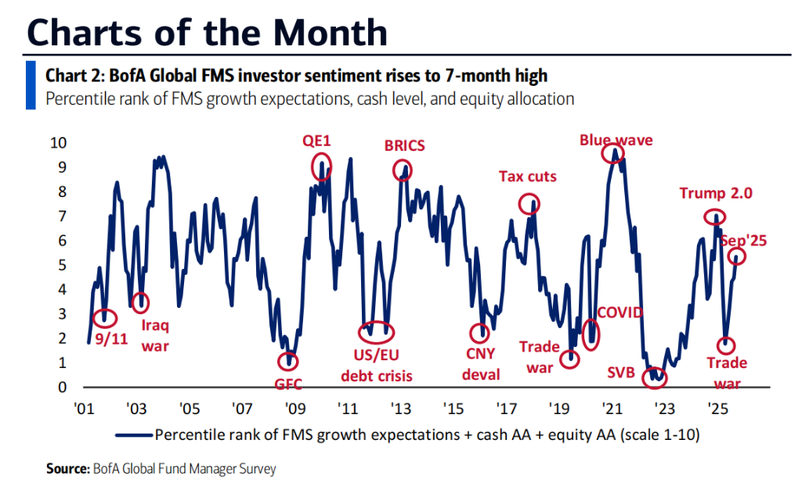
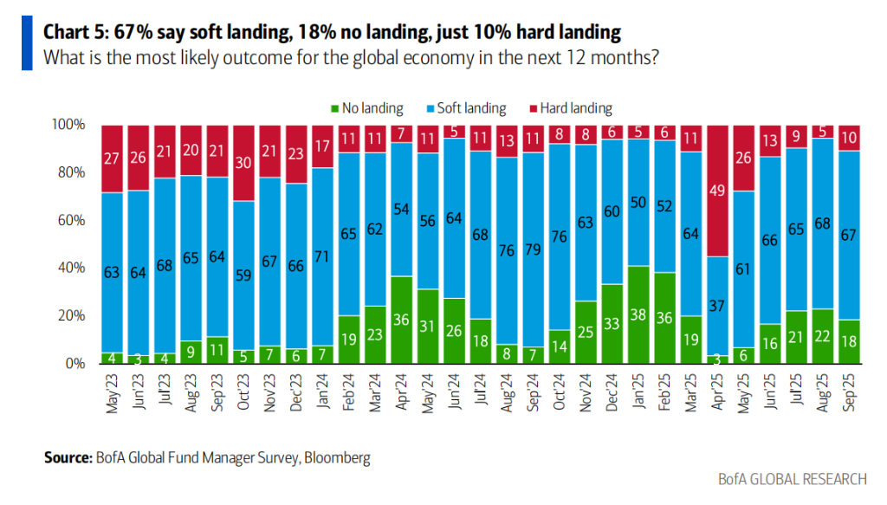
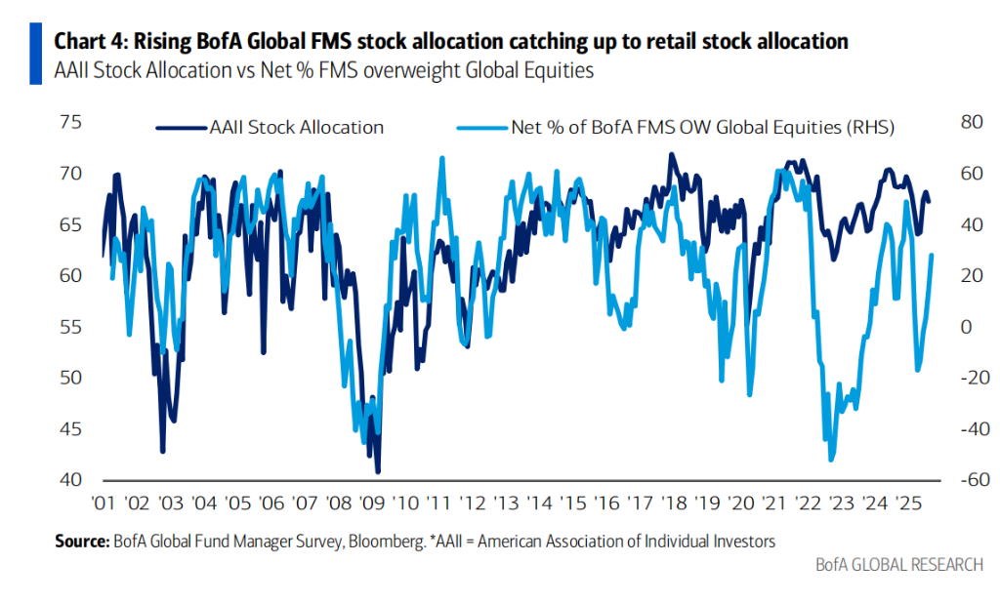
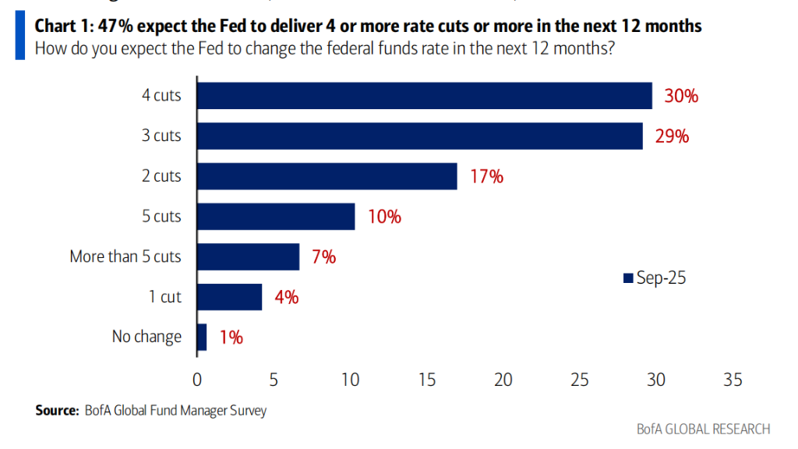
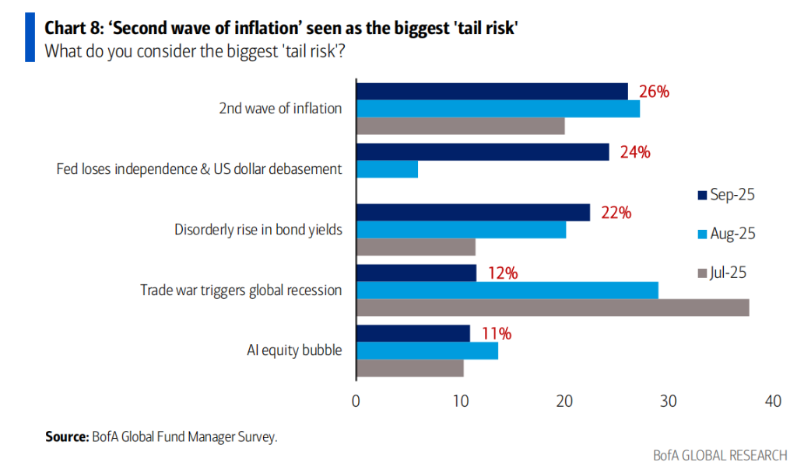
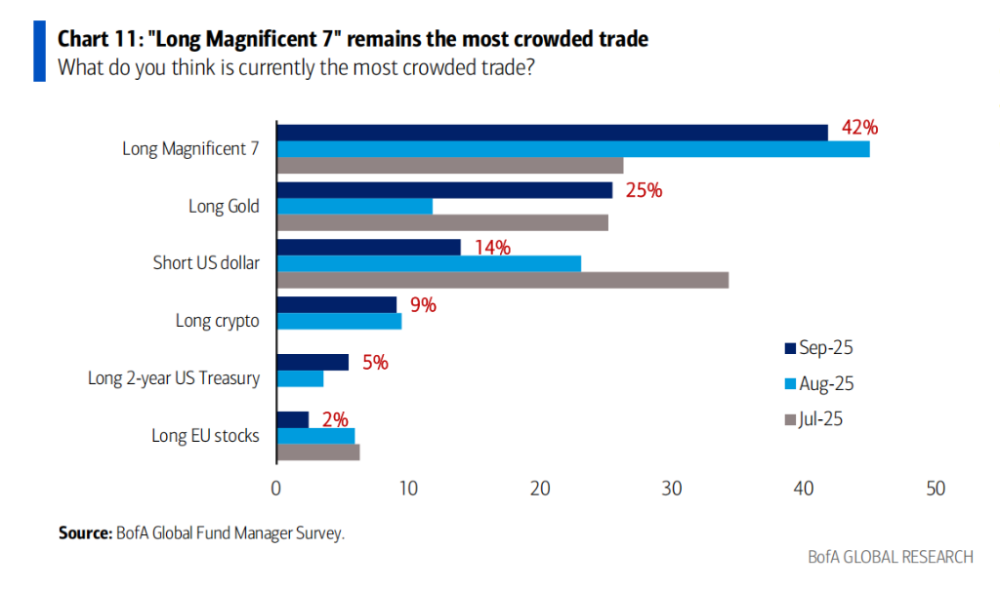

# 美银九月基金经理调查：投资者情绪升至七个月高点，最担心“第二波通胀”

- 页面显示时间：2025-09-16T21:07:26+08:00
- 页面署名：张雅琦
- 标注来源：未单列，见正文
- 原文：[华尔街见闻](https://wallstreetcn.com/articles/3755704)
- 取得时间：2026-11-04T16:03:38+08:00
- [HTML阅读版](article.html) · [来源记录](metadata.json)

## 导语

美银最新调查显示，投资者情绪达到2025年2月以来最乐观水平，基金经理股票配置净增持比例创七个月新高。对关税引发衰退的担忧从8月的29%降至12%，仅有净16%的投资者预计经济将走弱。47%的受访者预计美联储未来一年将降息四次或更多。“第二波通胀”仍是主要担忧。

---

全球股市的涨势短期内或将延续。美国银行的一项最新调查显示，投资者情绪已达到自2025年2月以来的最乐观水平，其背后是全球经济增长预期的显著回升和对大幅降息的押注。

据追风交易台消息，根据美国银行策略师Michael Hartnett发布的最新全球基金经理调查报告， **基金经理的现金头寸连续第三个月维持在3.9%的低位，而股票配置净增持比例达到七个月高点。**

市场风险偏好也发生了明显转变。曾被视为头号风险的“贸易战引发全球衰退”担忧已大幅减弱，其关注度从8月的29%骤降至12%。取而代之的是， **“第二波通胀”成为基金经理们最担忧的尾部风险。** 对经济增长的看法出现了近一年来最强劲的好转，目前仅有净16%的投资者预计未来经济将走弱。

这一转变伴随着对美联储宽松政策的强烈预期。调查显示， **近半数（47%）的受访者预计未来12个月内美联储将降息四次或更多。** Hartnett还补充说， **投资者的股票敞口尚未达到极端水平，这预示着当前的涨势可能还会持续一段时间。**

## 增长预期大幅改善，看涨情绪弥漫

调查结果显示，全球经济增长预期出现自2024年10月以来最大月度跃升，净16%的基金经理预期经济走弱，远低于8月的净41%。

**67%的受访者预期"软着陆"情形，18%预期"无着陆"，仅10%预期"硬着陆"。** 相比之下，8月预期硬着陆的比例仅为5%。77%的基金经理预期"滞胀"环境，即低于趋势的增长和高于趋势的通胀。Hartnett指出，对经济增长的悲观预期正在迅速消退，这为股市的看涨立场提供了坚实基础。

Hartnett认为，由于对“衰退性贸易战”的担忧减弱，市场上的“牛市拥护者比比皆是”。同时，从仓位来看， **尽管股票配置已升至七个月高位，但并未达到“极端”拥挤的程度，暗示着资金仍有进一步流入的空间，** 从而支撑股市继续上行。AI带来的生产力提升预期也为企业盈利前景提供了支撑，调查中约半数参与者表示，人工智能已在提升生产力。

## 美联储降息预期成关键支撑

对美联储货币政策转向的预期，是支撑当前市场乐观情绪的另一个关键支柱。美联储将于本周三（9月17日）召开为期两天的政策会议，市场普遍预期将迎来新一轮宽松周期的开启。

美银的调查显示， **47%的基金经理预期美联储在未来12个月内将降息4次或更多，** 其中30%预期降息4次，17%预期降息2次，29%预期降息3次。这一预期明显高于此前水平。

**30%的受访者预期沃勒将被提名为下任美联储主席，较8月的20%有所上升。** 15%预期哈赛特，13%预期沃什8%预期贝森特。

短期利率预期与通胀预期之间的分歧持续扩大。仅6%的受访者预期短期利率上升，与过去6个月平均水平一致，但预期通胀上升的比例已从2024年9月的9%升至49%。净23%的投资者预期长期利率上升，为2022年8月以来最高。

## 通胀与美联储独立性仍存担忧

尽管市场情绪乐观，但投资者并未完全忽视潜在风险。调查显示， **第二波通胀抬头（26%的受访者选择）被视为最大的尾部风险。**

紧随其后的是对美联储独立性下降及美元贬值的担忧（24%）。此前摩根大通和高盛集团的策略师也警告，随着特朗普总统加大对央行降息的施压，以及他解雇理事Lisa Cook的举动，投资者正日益担忧美联储的独立性。

## 调查揭示其他关键动态

本次调查于9月5日至11日进行，共访问了165名基金经理，他们管理的资产总额达4260亿美元。其他主要发现包括：

> - **风险偏好** ：净15%的投资者采取了低于正常的风险水平，较8月份净19%的数据有所改善。
> - **企业策略偏好** ：39%的受访者希望企业增加资本支出，为去年12月以来最高；而只有27%的人希望企业专注于改善资产负债表，为2022年2月以来最低。
> - **最拥挤的交易** ：做多“七巨头”（42%）、做多黄金（25%）、做空美元（14%）以及做多加密货币（9%）。
>
> 

风险提示及免责条款

市场有风险，投资需谨慎。本文不构成个人投资建议，也未考虑到个别用户特殊的投资目标、财务状况或需要。用户应考虑本文中的任何意见、观点或结论是否符合其特定状况。据此投资，责任自负。
