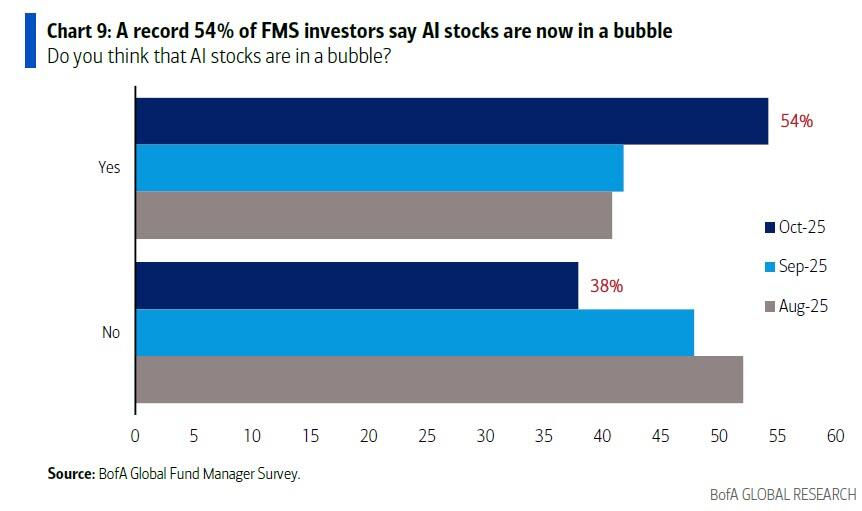
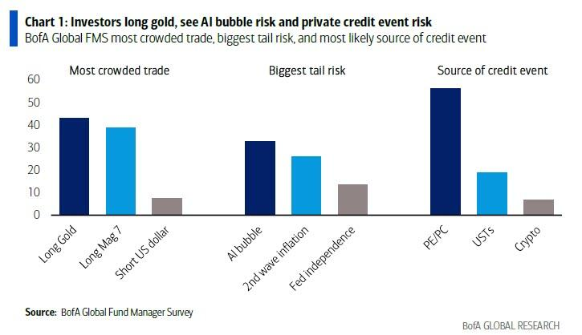
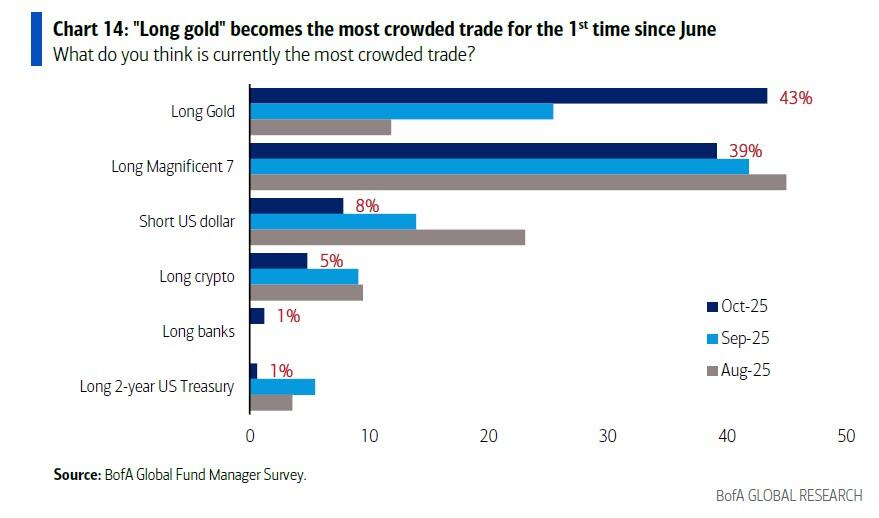
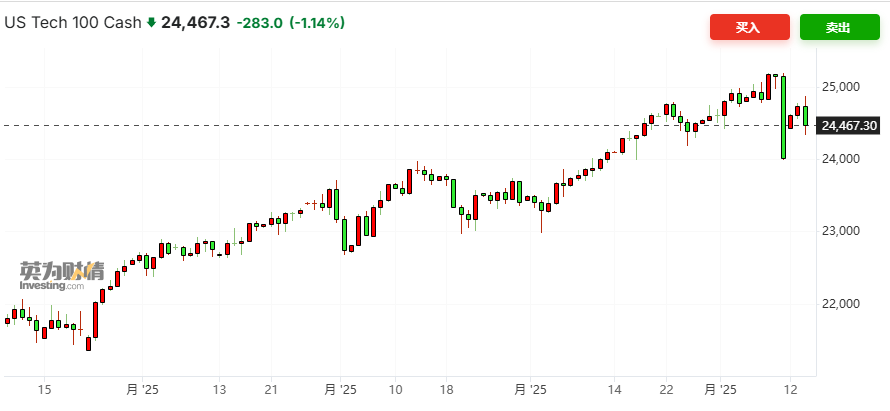

# 美银基金经理调查：美股配置8个月来首次转为超配，超半数认为AI存在泡沫

- 页面显示时间：2025-10-15T13:51:02+08:00
- 页面署名：赵颖
- 标注来源：未单列，见正文
- 原文：[华尔街见闻](https://wallstreetcn.com/articles/3757166)
- 取得时间：2026-11-04T16:03:39+08:00
- [HTML阅读版](article.html) · [来源记录](metadata.json)

## 导语

美银调查显示，约54%的参与者认为科技股估值过于昂贵，这一比例较上月大幅上升。尽管对AI股票存在泡沫担忧，美股配置逆势上升，基金经理对美股敞口升至8个月来最高水平，回到关税担忧情绪抬头之前的水平。有史以来第一次，受访者认为10月最拥挤的交易是“做多黄金”，占比为43%。

---

美银最新基金经理调查显示，全球基金经理对人工智能股票的担忧情绪急剧上升，创纪录的54%受访者认为AI股票存在泡沫。与此同时，基金经理对美股的配置却升至8个月来最高水平，反映出市场情绪的复杂性。

这一调查结果标志着投资者态度的显著转变。相比上月近半数受访者对科技股估值过高的担忧不以为然，10月调查中持此观点的比例大幅上升。全球股市被高估的担忧也在最新调查中达到峰值。

尽管存在泡沫担忧，基金经理仍增加了对美股的配置，显示出对美国市场的相对乐观。美银策略师Michael Hartnett指出， **对AI泡沫和私人信贷市场的担忧正在抑制"完全看涨"的市场情绪。**

此次调查于10月3日至9日期间进行，涵盖166名管理4000亿美元资产的参与者，调查时点恰逢美股多次创下历史新高。

## AI泡沫担忧达到峰值

**美银调查显示，约54%的参与者认为科技股估值过于昂贵，这一比例较上月大幅上升。此前9月调查中，近半数基金经理对科技股估值担忧持不同意见。**

AI泡沫被视为最大的尾部风险，其次是通胀回升以及对美联储独立性丧失和美元贬值的担忧。这反映出投资者对当前AI驱动的市场rally可持续性的质疑。

纳斯达克100指数今年已上涨18%，推动其前瞻市盈率升至近28倍，高于过去十年23倍的平均水平。部分市场参与者质疑当前估值是否已超越该板块的盈利前景。

## 美股配置逆势上升

尽管对AI股票存在泡沫担忧，基金经理的股票配置仍反映出一定程度的乐观情绪。 **调查显示，对美股的敞口升至8个月来最高水平，回到关税担忧情绪抬头之前的水平。**

对经济衰退的担忧降至2022年初以来的最低水平，显示出投资者对美国经济基本面的信心有所恢复。现金持有量出现下降，表明资金正在重新流入风险资产。

这一配置变化与市场表现形成呼应。美股在AI支出热情和相关生产力提升预期推动下屡创新高，科技股成为主要驱动力。

## “做多黄金”首成最拥挤交易？

一方面，有史以来第一次，受访者认为10月最拥挤的交易是“做多黄金”，占比为43%。

然而，在紧接着的下一个问题中，他们承认自己根本就没有持有黄金：具体来说，当被问及黄金配置时，有惊人的39%的FMS投资者表示他们目前的黄金仓位最接近0%，19%的人持有2%的黄金仓位，16%的人持有4%的黄金仓位。

正如Hartnett计算的那样，FMS对黄金的加权平均配置仅为2.4%（在配置了黄金的FMS投资者中为4.2%）。换句话说，黄金远远不是最拥挤的交易。

而且，与之相关的是，对加密货币的平均配置要少得多：FMS对加密货币的加权平均配置仅为0.4%（在配置了加密货币的FMS投资者中为4.9%）。

## 市场情绪复杂多变

美银策略师Michael Hartnett表示，对AI泡沫的担忧以及私人信贷市场的不确定性正在抑制市场的"完全看涨"情绪。这种谨慎乐观的态度反映在基金经理的投资行为中。

近期贸易紧张局势担忧重燃进一步影响了市场情绪。纳斯达克100指数在美股跌势中领跌，相关期货在周二下跌超1%。

尽管高盛策略师认为现在担心科技泡沫还为时过早，但基金经理的担忧情绪表明，投资者正在重新评估当前估值水平的合理性，市场可能面临更大的波动性。

风险提示及免责条款

市场有风险，投资需谨慎。本文不构成个人投资建议，也未考虑到个别用户特殊的投资目标、财务状况或需要。用户应考虑本文中的任何意见、观点或结论是否符合其特定状况。据此投资，责任自负。
