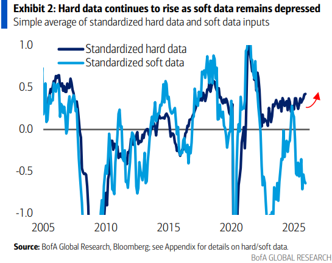
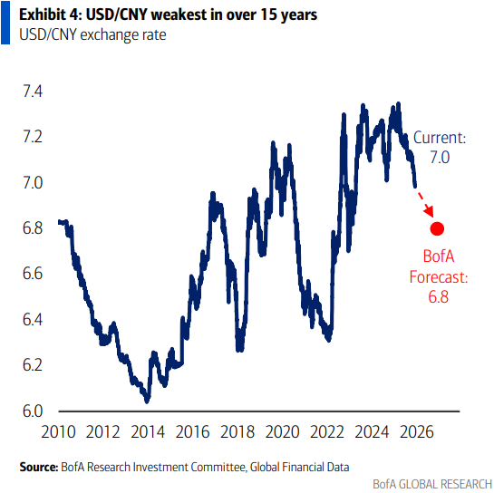
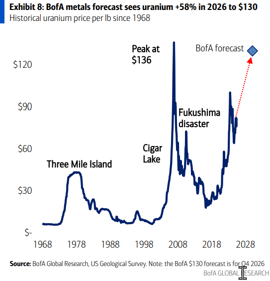
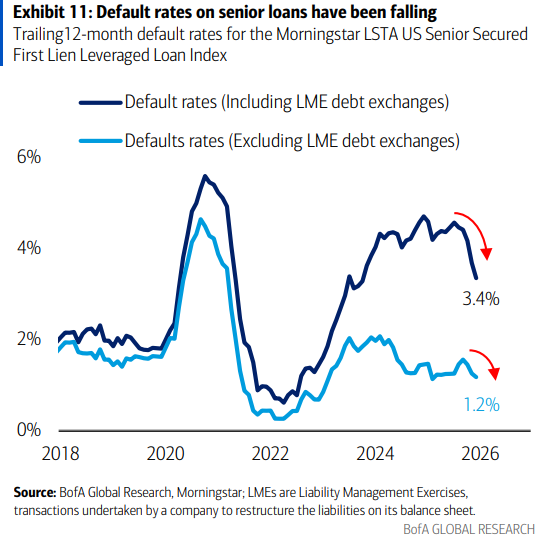
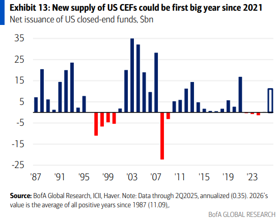
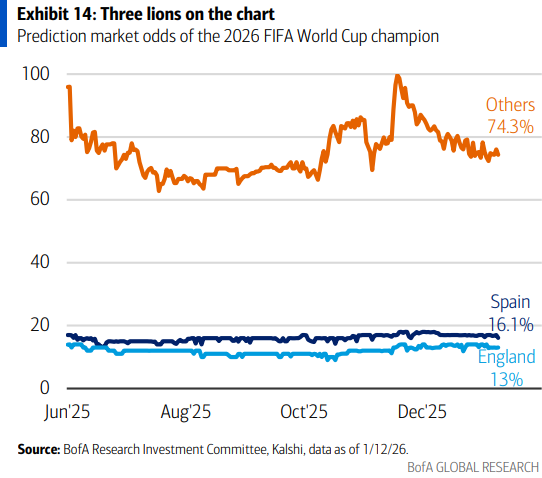
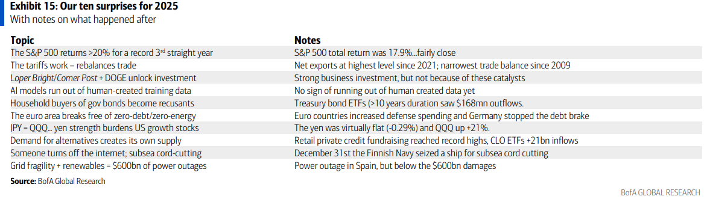

# 美银美林2026年十大灰天鹅：铀价暴涨50%……英格兰喜夺世界杯？

- 页面显示时间：2026-01-16T17:17:17+08:00
- 页面署名：赵颖
- 标注来源：未单列，见正文
- 原文：[华尔街见闻](https://wallstreetcn.com/articles/3763441)
- 取得时间：2026-11-04T16:03:40+08:00
- [HTML阅读版](article.html) · [来源记录](metadata.json)

## 导语

美银美林预测，美国经济增长2.6%，等权重美股指数跑赢市场，美元走弱引发全球汇市“再平衡”，铀价暴涨超50%至历史新高，无人军事系统推动防务板块升级，新兴市场债券成为全球最佳资产，违约率下降，CLO ETF可能跑赢美债，ETF资产超越七国集团（除美国）市值，充裕流动性支持封闭式基金发行大年，英格兰赢得世界杯。

---

当市场一致预期往往沦为平庸的代名词时，真正的超额收益总是潜藏在大多数人的视线之外。

据追风交易台，美银美林策略师Jared Woodard团队在最新发布年度重磅报告《2026年十大意外》中，列举了十个极具冲击力、却被市场严重低估的“反共识”情景。

报告指出，硬数据或打脸经济衰退论，美国经济增长可能达到2.6%，利好周期性资产；美元或迎变局，走弱将利好价值股、周期板块和大宗商品；

美股板块方面，美银预测，铀价或暴涨超50%至130美元/磅，核能板块迎来重大机遇；美股等权重指数可能跑赢大盘股，中小盘股估值修复空间显著；新兴市场债券有望成为风险调整后收益最佳资产

## 硬数据打脸衰退论，美元或迎变局

**预测一：美国经济增长2.6%**

美银美林经济学家对2026年美国经济持乐观态度，预测实际GDP增长2.6%，显著高于市场共识的2.1%。GDP惊喜可能来自监管放松的更快进展、更多美联储降息、关税返还支票，以及生产率提高背景下更高的企业投资。

硬数据支持乐观预期：

> - 美国贸易逆差收窄至290亿美元，为2009年以来最窄水平
> - 第四季度新企业成立数量达到创纪录的51.7万家，创历史新高，这是一个与未来生产率增长高度相关的指标
> - 12月企业盈利上调数量超过下调数量，全球每股收益修正比率达到四年高点
>
> 

总的来看，硬数据指标升至+0.4个标准差（2022年4月以来最高），而软数据情绪指标仍处于-0.8个标准差的低位。

**预测二：美元走弱引发全球汇市“再平衡”**

全球政策制定者正在纠正数十年来资本和商品流动的创纪录失衡。美元从1985年以来最强水平走弱，可能标志着向更平衡的全球经济转变。

美银美林外汇策略师预计人民币升值趋势将持续，年底目标为6.8（当前为7.0）。长期来看，人民币升值空间可能更大：国内高级经济顾问近期表态支持更强的货币以提振国内消费和平衡进出口，前央行官员表示正确的汇率可能是5甚至4人民币兑1美元。

## 美股“权力交接”与核能复兴

**预测三：等权重美股指数跑赢市场**

过去十年中，等权重标普500指数仅在2016年和2021年两年跑赢市值加权指数。自2022年ChatGPT推出以来，市值加权指数回报率（78%）几乎是等权重指数（40%）的两倍。2025年，投资者抛售了等权重ETF。

2026年转机的理由：

> - 广泛市场的每股收益增长正在向"七巨头"收敛
> - 非科技板块资本支出可能扩张
> - 税收/贸易政策明朗释放企业投资
> - 回流加速

从长期来看，等权重标普500指数相对市值加权指数便宜超过1个标准差，估值隐含等权重指数年化回报率为+6%，而标普500为-1%。

**预测四：铀价暴涨超50%至历史新高**

铀和核电股票从2025年4月低点反弹168%，全球公共政策支持力度不断增强。

看涨理由强化：

> - 美银美林金属策略师预测铀价将在2026年第四季度升至130美元/磅，2027年达到135美元/磅，供需失衡是主要驱动因素
> - 亚洲供应中断或数据中心建设者争夺可能导致价格超调
> - 股票分析师上调矿商、公用事业、反应堆等企业的目标价，并指出电力公司需要在2026年下半年补充铀供应
> - 政策层面：核电似乎已成为美国政府的战略优先事项，最近批准了27亿美元支持国内铀浓缩

从当前价格计算，美银美林预测意味着铀价将上涨58%。

**预测五：无人军事系统推动防务板块升级**

2025年全球防务支出大幅增长，但投资者担心盈利能否同步增长，因为2025年第三季度的反弹未能持续。

无人军事系统的重要性日益凸显：

> - 在红海和俄乌冲突中的高调使用凸显了老旧系统的脆弱性，以及用传统防御手段（如210万美元导弹）对抗低成本无人机（2万美元）的成本问题
> - 冲突可能扩展到欧洲、中东和非洲以外地区，可能加速过时设备、软件和基础设施的升级时间表
> - 瑞典、澳大利亚、日本、印度等国最近宣布了无人机和反制措施的新投资

美国新国家安全战略强调，“近期冲突中显示的低成本无人机和导弹与防御所需的昂贵系统之间的巨大差距，暴露了我们改变和适应的需求。”

## 收益率的新猎场：新兴市场与CLO

**预测六：新兴市场债券成为全球最佳资产**

根据美银美林预测，本地新兴市场债券预期回报率为11%，历史回撤幅度适中，在风险调整后可能成为2026年全球表现最佳的主要资产。

基本面前景乐观：

> - 美国和全球利率预期下降，美银美林预测新兴市场短期利率将下降70个基点，所有地区都将降息
> - 政府和企业资产负债表更加稳健，新兴市场企业违约率为2.1%，远低于3.5%的历史平均水平
> - 拉丁美洲盈利修正比率处于2024年以来最高水平

结构性低配：新兴市场债券在许多美国家庭固定收益配置中占比0-3%，但占全球外债的20%以上。

**预测七：违约率下降，CLO ETF可能跑赢美债**

在First Brands和Tricolor等高调破产案例后，一些投资者计划今年避开信贷市场，担心投资级和高收益债券利差收窄以及违约周期风险。

**实际情况更为乐观：**

> - 高级贷款违约率最近从4.7%降至3.4%
> - 今年美联储降息可能缓解借款人的金融条件，支持流动性，保持经济活动强劲

在此背景下，担保贷款凭证（CLO）ETF可能成为比长期国债更具吸引力的收益来源。CLO ETF在2025年需求强劲（流入120亿美元），美银美林策略师预计美国和日本银行的持续需求。持有AAA级份额的ETF收益率超过5%，信用风险极低且久期为零。

**预测八：ETF资产超越七国集团（除美国）市值**

全球交易所交易基金（ETF）管理资产在2025年增长32%，达到创纪录的18.4万亿美元。前一年增长29%。

如果这一趋势持续，到2026年底，ETF资产将超过七国集团国家（不包括美国）目前的市值24万亿美元。

ETF产品已远远超越股票指数基金，扩展到因子指数、期权策略以及系统化和阿尔法寻求模型。主动管理股票ETF显著增长，2025年净流入增长48%。

**预测九：充裕流动性支持封闭式基金发行大年**

过去四年对新封闭式基金（CEF）的需求是本世纪（不包括全球金融危机）最低的。

2026年可能出现转机：

> - 流动性充裕
> - 金融条件宽松
> - 金融放松管制
> - CEF估值已处于适中水平

潜在转机可能建立在对另类资产、信贷和CLO的现有需求，以及对冲基金策略近年来的成功基础上。基于1987年以来净发行为正的年份平均值，成功年份的合理预期可能意味着110亿美元或更多的新发行CEF。

**预测十：英格兰赢得世界杯**

目前，Kalshi预测市场将西班牙评为最有可能获胜的球队（16.1%），其次是英格兰（13%）、法国（10%）、巴西（10%）和阿根廷（卫冕冠军，9.9%）。

英格兰曾在1966年赢得过一次世界杯。这次可能结束"六十年的伤痛"。英格兰队在预选赛中表现完美，八场比赛全胜且零失球，是唯一做到这一点的欧足联球队。

本届锦标赛将由美国11个城市以及墨西哥3个城市和加拿大2个城市联合举办，这是首次由三个国家共同举办的世界杯。

## 2025年预测回顾

美银美林对其2025年十大预测进行了回顾：

- **标普500连续第三年回报率超20%** ：实际总回报率为17.9%，相当接近

- **关税发挥作用，贸易再平衡** ：净出口达到2021年以来最高水平；贸易逆差为2009年以来最窄

- **投资解锁** ：企业投资强劲，但并非因为这些催化剂

- **AI模型耗尽人类创建的训练数据** ：尚无耗尽人类创建数据的迹象

- **国债ETF** ：10年期以上久期的国债ETF出现1.68亿美元资金流出

- **欧元区摆脱零债务/零能源** ：欧洲国家增加国防开支，德国停止债务刹车

- **日元与QQQ** ：日元几乎持平（-0.29%），QQQ上涨+21%

- **另类投资需求** ：零售私人信贷募资达到创纪录高位，CLO ETF流入210亿美元

- **海底电缆切断** ：12月31日芬兰海军扣押一艘涉嫌海底电缆切割的船只

- **电网脆弱性** ：西班牙发生停电，但低于6000亿美元的损失预测

 

 

 

 

 

 

\~\~\~\~\~\~\~\~\~\~\~\~\~\~\~\~\~\~\~\~\~\~\~~

以上精彩内容来自[追风交易台](https://mp.weixin.qq.com/s/uua05g5qk-N2J7h91pyqxQ)。

更详细的解读，包括实时解读、一线研究等内容，请加入【 [**追风交易台▪年度会员**](https://wallstreetcn.com/shop/item/1000309) 】

风险提示及免责条款

市场有风险，投资需谨慎。本文不构成个人投资建议，也未考虑到个别用户特殊的投资目标、财务状况或需要。用户应考虑本文中的任何意见、观点或结论是否符合其特定状况。据此投资，责任自负。
