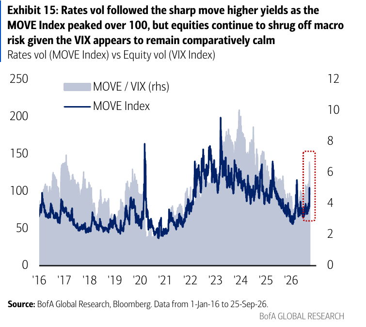
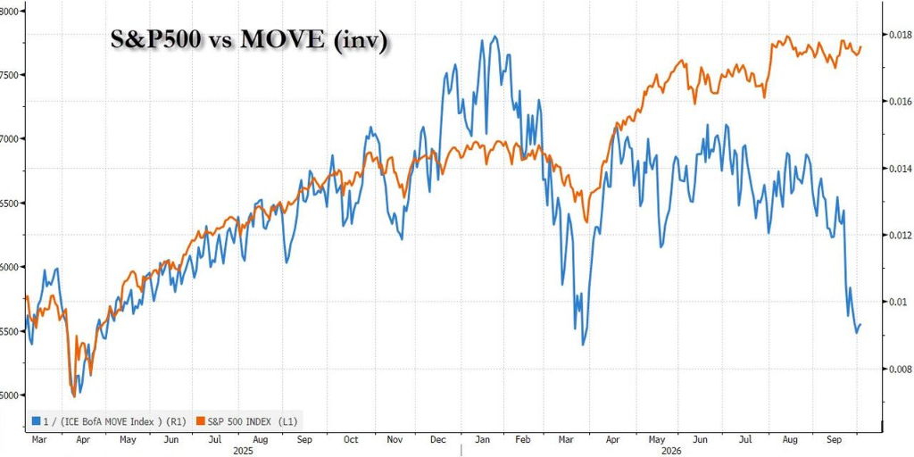
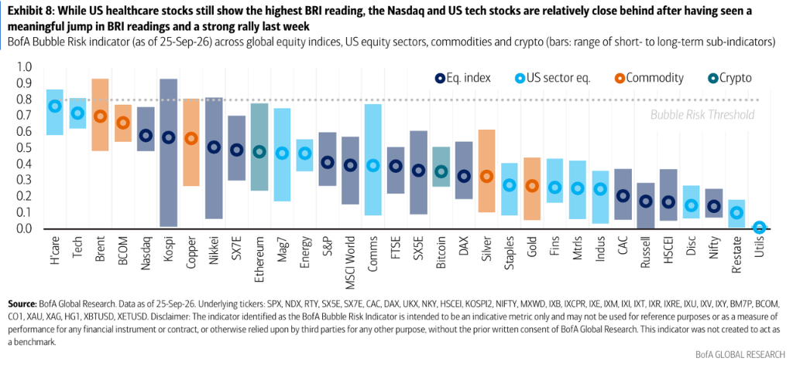
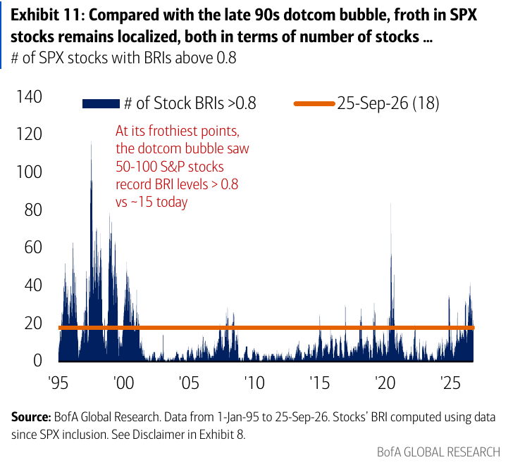

# 美银：“AI交易”是当前美债市场“最后一道防线”

- 页面显示时间：2026-10-04T12:41:20+08:00
- 页面署名：鲍奕龙
- 标注来源：未单列，见正文
- 原文：[华尔街见闻](https://wallstreetcn.com/articles/3782975)
- 取得时间：2026-11-04T16:03:42+08:00
- [HTML阅读版](article.html) · [来源记录](metadata.json)

## 导语

美国银行警告，AI叙事正充当宏观风险"缓冲垫"，压制市场波动。AI带来的FOMO情绪形成"AI看跌期权"效应，使股市对债市剧烈震荡几乎无动于衷。美银担忧一旦AI叙事受挫，增长预期下修将使债市危机演变为全市场危机，所有被压制的宏观风险将同步放大。

---

美国银行警告， **AI叙事正在充当宏观风险的"缓冲垫"，一旦这一叙事出现裂痕，所有被压制的宏观风险将同步放大，股市将面临真正的冲击。**

美银股票衍生品团队在最新报告中指出，在注意力资源相对有限的市场环境下，宏观风险"难以与AI增长叙事争夺市场关注"。

AI带来的错失恐惧（FOMO）情绪推动投资者在每次下跌时积极抄底，形成所谓的"AI看跌期权"效应，有效压制了股市波动。

与此同时，Meta旗下AI智能助手Muse上周的强势亮相推动纳斯达克大涨逾3%，VIX指数仍处于相对温和水平，与债市的剧烈震荡形成鲜明反差。

（利率市场的波动明显大于美股）

美银认为，真正的尾部风险是若AI叙事出现"故障"，对增长前景的重新定价将使债市问题演变为全市场危机。在AI看跌期权失效后，所有其他风险都可能被"实质性放大"。

## 债市压力持续升级，收益率创数十年新高

美国债市正承受自去年2月份以来最为集中的抛售压力。

上周二的5年期美债标售以5.033%的收益率定价，这是2007年以来首次出现"5字头"，认购倍数创2018年以来最低，当日债市录得去年所谓“对等关税”以来最差单日表现。

次日，美债收益率沿整条曲线升至数十年高位，此后持续攀升。衡量美债波动率的MOVE指数突破100，通常而言，这一水平与股市动荡相关联。

（美债利率波动与美股走势背离）

美银全球金融压力指标（GFSI）同样印证了债市的紧张态势，上周从-0.10升至-0.05。欧元区和美元利率隐含波动率的压力涨幅位居所有子指标之首，变动幅度分别处于历史第97和第95百分位。

利率波动率目前是3月以来压力最高的跨资产波动率指标，取代了此前自去年11月起几乎持续占据首位的大宗商品波动率。信用市场也开始出现共振迹象，欧元区3年/5年信用曲线、美元投资级CDS及欧元区高收益CDS的压力涨幅均位于各自历史前十分位。

## 股债背离之谜：AI叙事提供"宏观对冲"

股市对上述信号几乎无动于衷。美银给出的解释是： **在"注意力供给相对固定"的市场中，宏观风险正在与AI增长叙事争夺话语权，而后者目前占据绝对优势。**

上周的具体催化剂是Meta推出的AI智能体助手Muse，其在各大应用商店迅速走红，推动纳斯达克单周涨幅超过3%。

**美银还援引历史先例驳斥了"5%收益率必然终结牛市"的论断。** 上世纪90年代互联网泡沫期间，长端利率累计上行200个基点，美联储加息100个基点，但股市泡沫仍在持续膨胀。

美银股票策略师在另一份题为《困于5%世界》的报告中同样表示：

> 不认为5%的收益率是股市的必然丧钟。

该行认为 **，若要从根本上改变当前格局，需要收益率大幅进一步上升，或利率波动率大幅飙升，而这"可能需要政策制定者放弃干预"。**

## AI"看跌期权"失效的真实风险

美银真正担忧的方向并非"债市压垮股市"，而是反向传导： **AI叙事一旦受挫，对增长前景的重新定价将使债市危机演变为全市场性危机。**

报告原文指出：

> AI繁荣所带来的长期增长与生产率潜力，在某种程度上如同一个'AI看跌期权'，充当了当前各类宏观风险的缓冲器。因此，AI叙事一旦出现滑落，与之相关的增长预期下修，可能进一步加剧宏观压力，并对美股形成实质性冲击。

这一逻辑也契合了市场对美国财政可持续性的押注。特朗普和马斯克均曾公开表示，美国可以"通过经济增长走出40万亿美元债务困境"。AI生产率叙事正是这一希望的核心支撑。

**一旦这一支撑动摇，对财政可持续性的担忧将失去对冲，届时所有其他风险均可能被"实质性放大"。**

不过，美银同时指出，基本面目前仍具韧性，估值处于"去泡沫化"的状态，因此这一极端风险情景"在时间轴上仍较为靠后"。

## 泡沫风险指标：热度集中但未蔓延

美银已开始每周发布泡沫风险指标（BRI）。

Muse引发的行情过后，美国科技板块和纳斯达克的BRI再度跳升——科技板块读数约为0.72，仅次于医疗健康（约0.76），接近0.8的危险阈值。

半导体板块录得所有热门主题中单周BRI最大涨幅；美银美国网络安全组合（0.91）和美国医疗健康动量组合（0.85）是仅有的两个已进入"明确泡沫区间"的主题。

（美股热门板块的单周BRI对比）

**尽管如此，美银提示这与1999年的情形存在本质差异。** 当前标普500指数中BRI高于0.8的个股仅有18只，而互联网泡沫顶峰时期为50至100只；这18只股票仅占指数权重的3.2%，而当时这一比例高达20%至40%。

（美银研究显示，相比1990年代末互联网泡沫时期50-100只标普500成分股泡沫化（BRI\>0.8），当前泡沫仅集中在极少数龙头股）

BRI最高的股票分别是莫德纳（MRNA）、CrowdStrike（CRWD）、慧与科技（HPE）、瑞维蒂（RVTY），与2000年前后的标志性科技龙头相差甚远。泡沫风险目前仍属局部现象，但美银提示，这一状态"很少会长期维持"。

## 策略建议顺势而为

在策略层面，美银建议投资者顺应这一悖论逻辑。 **该行衍生品团队继续看好挂钩"收益率较高但区间震荡"情景的纳斯达克100看涨期权，视其为捕捉今年"股债双升"趋势的低成本工具。**

**为对冲收益率进一步上行的风险，美银推荐做空长期美债ETF（TLT）的认沽价差组合** ，利用该期权历史上较陡峭的认沽偏斜来部分抵消利率波动率跳升带来的额外成本。

**在股票对冲方面，美银综合考量了各板块的利率敏感性与保护成本，认为材料（XLB）、小盘股（IWM）及非必需消费品（XLY）的认沽价差组合性价比最高。**

该行指出，小盘股"可能面临CTA进一步卖出的额外压力"。这一趋势随着收益率持续走高已延续数月，小盘股持续受到重创。

风险提示及免责条款

市场有风险，投资需谨慎。本文不构成个人投资建议，也未考虑到个别用户特殊的投资目标、财务状况或需要。用户应考虑本文中的任何意见、观点或结论是否符合其特定状况。据此投资，责任自负。
