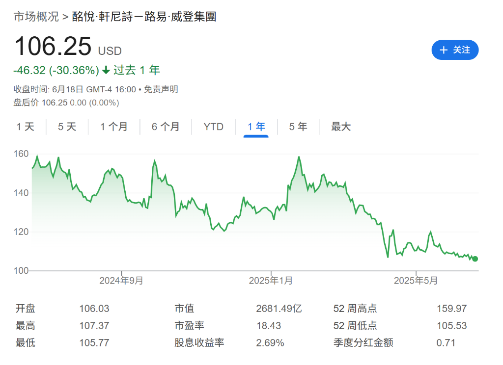

# 股价腰斩、核心增长引擎失速、继承人问题.......奢侈品巨头LVMH遭遇史上最严重危机

- 页面显示时间：2025-06-19T18:08:54+08:00
- 页面署名：张雅琦
- 标注来源：未单列，见正文
- 原文：[华尔街见闻](https://wallstreetcn.com/articles/3749452)
- 取得时间：2026-11-04T16:04:05+08:00
- [HTML阅读版](article.html) · [来源记录](metadata.json)

## 导语

LVMH正经历一场史无前例的危机。掌舵人Bernard Arnault从全球首富跌至第十位，集团市值蒸发约2210亿欧元，公司还面临全球需求萎缩和美国关税威胁。核心品牌Dior增长乏力，酒类部门裁员，其多元化“杂货铺”模式的弊端显现，而继承人问题也给集团带来了“治理折价”。

---

当全球最大奢侈品集团的掌舵人在股东大会上为背景音乐发牢骚时，你就知道事情变得有多糟糕了。

LVMH总裁兼CEO Bernard Arnault正面临一场史无前例的完美风暴：全球需求急剧萎缩、美国关税威胁步步紧逼、股价从峰值腰斩、个人财富蒸发超过800亿美元。

更致命的是，这位76岁的“穿开司米羊绒衫的狼”发现自己精心打造的850亿欧元奢侈品帝国正暴露出结构性裂痕——从核心品牌Dior的增长失速到继承人计划的模糊不清，一切都在提醒市场：LVMH的黄金时代可能真的结束了。

## 市值蒸发2210亿欧元：从欧洲之王到第十富豪的坠落

数字不会撒谎。LVMH股价自2023年4月峰值以来几乎腰斩，市值蒸发约2210亿欧元。 **今年以来，公司股价下跌超30%。**

这家曾经的欧洲三大市值公司已不再位列前三，法国最有价值公司的桂冠也被宿敌爱马仕夺走——讽刺的是，这正是Arnault曾试图秘密收购但失败的公司。

**Arnault的个人财富从2024年3月的2310亿美元峰值暴跌至约1490亿美元，从全球首富跌至第十位。** 这位古典钢琴家、曾经睥睨北美以外所有富豪的消费品巨头，如今看起来远非奥林匹亚般的神祇。

AIR Capital研究主管Pierre-Olivier Essig毫不留情地指出：

> "在我们覆盖LVMH的20年里，从未见过如此多的红旗。全球金融危机、疫情都是重大挑战，但LVMH今天的规模要大得多，最近的价值毁灭史无前例。 **这显然是LVMH历史上最大的危机。** "

而美国这一关键市场又面临特朗普反复无常的关税威胁。尽管Arnault炫耀与特朗普数十年的交情——两人自1980年代Arnault短暂涉足美国房地产市场时就相识——但这段"友谊"并未带来实质帮助。今年5月，Arnault父子受邀访问白宫，特朗普称他们为"我的好朋友"，但几周后这位总统就威胁对欧盟商品征收50%关税。

## 收购成瘾留下的"杂货铺"诅咒

Arnault在商界最著名的绰号 “穿开司米羊绒衫的狼” (Wolf in Cashmere) 绝非浪得虚名，其残酷的收购策略让LVMH囤积了超过75个品牌的庞杂资产组合。从现金牛Louis Vuitton到酒类部门Moët Hennesry，从化妆品零售商Sephora到豪华酒店连锁Cheval Blanc，甚至包括提供100美元烤鸡的巴黎小酒馆L'Ami Louis。

**这种多元化在繁荣期被忽视，但在困难时期成为累赘。** 单一品牌爱马仕的远期市盈率约50倍，而LVMH仅约20倍。Edmond de Rothschild Asset Management基金经理Ariane Hayate直言：

> "只要LVMH大幅增长，投资者就不会太在意集团结构，但当时局艰难时，投资者很快就会以集团折价惩罚它们。"

LVMH已出售Off-White和Stella McCartney等表现不佳的品牌，并考虑剥离更多资产。据知情人士透露，该集团曾探索Sephora的潜在分拆，甚至考虑2021年在阿姆斯特丹上市。

## 核心品牌危机：Dior失速，Moët Hennessy大裁员

最令人担忧的是两大核心业务的困境，这也让Arnault的两个孩子陷入尴尬境地。

50岁的长女Delphine于2023年接管Dior，但这个占集团利润14%的品牌在她手中失去动力。 **经过多年双位数增长后，Dior近几个季度表现落后于Louis Vuitton。** 分析师将此归咎于不合理的产品涨价，品牌还因意大利分包商剥削无证工人丑闻而备受抨击。

Dior对LVMH至关重要。据汇丰银行估计，迪奥占集团利润的14%，仅次于Louis Vuitton，后者占集团利润的55%。为了重振增长，LVMH刚刚任命Jonathan Anderson为该品牌的新任创意总监，负责女装、高级定制系列和男装。

**酒类部门Moët Hennessy同样麻烦缠身** ，在美国陷入通胀螺旋，干邑败给竞品和更便宜的龙舌兰酒、波旁威士忌。今年2月，CEO被集团前CFO Jean-Jacques Guiony替换，33岁的三子Alexandre也加入管理层。但这对新搭档开局艰难，在法国劳动节前夕宣布裁员1200人，占员工总数13%。

## 继承人悬疑：五个孩子的王位争夺战

**76岁的Arnault丝毫没有放权迹象，** 今年股东大会还将CEO年龄上限从80岁延长至85岁。与其他家族企业不同，Arnault成功让五个孩子——Delphine、Antoine、Alexandre、Frédéric和Jean——都参与业务，并掩盖了兄弟姐妹间的分歧。

但投资者越来越关注继承问题，甚至出现"治理折价"。GAM UK Ltd奢侈品投资组合经理Flavio Cereda观察道：

> "治理处于变化中，有很多后代。他在让一个对抗另一个。"

**去年，Arnault选择Stéphane Bianchi作为副手。** 这位60岁的前安达信顾问职业生涯几乎都在经营小型家族控制的化妆品和时装公司，专注于指导继承人。尽管Bianchi在股东大会上表示LVMH有中期继承计划和"突发事件"预案，但没有明显继承人让投资者难以安心。

正如Arnault 2016年在牛津大学辩论社所说的指导原则：

> "一家公司，即使成功，也应该像可能在12个月内倒闭一样经营。"

如今，这句话听起来更像是对当前危机的预言，而非管理智慧。

风险提示及免责条款

市场有风险，投资需谨慎。本文不构成个人投资建议，也未考虑到个别用户特殊的投资目标、财务状况或需要。用户应考虑本文中的任何意见、观点或结论是否符合其特定状况。据此投资，责任自负。
