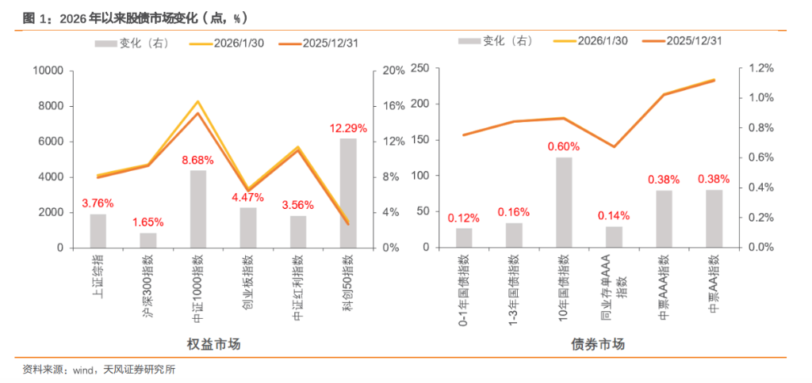
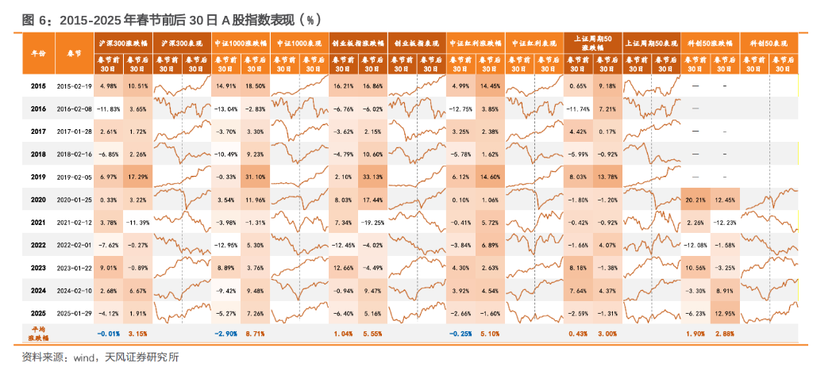
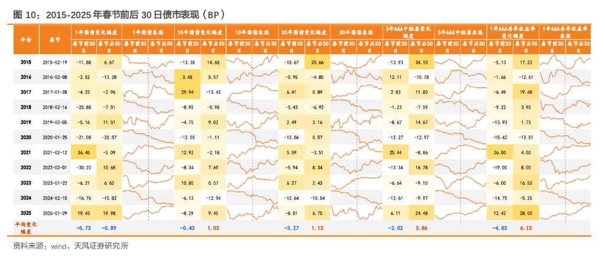

# 节前债稳，节后股暖？

- 页面显示时间：2026-02-03T21:23:46+08:00
- 页面署名：李佳
- 标注来源：未单列，见正文
- 原文：[华尔街见闻](https://wallstreetcn.com/articles/3764855)
- 取得时间：2026-11-04T16:03:40+08:00
- [HTML阅读版](article.html) · [来源记录](metadata.json)

## 导语

天风证券研究显示，2026年市场正打破传统“春节效应”。历史规律显示节前债强股弱、节后风格切换至小盘成长。但今年在“晚春节”、政策预期及全球流动性支持下，“春季躁动”提前且基础更实，市场呈现股债同强博弈。债市在结构性降息后或延续震荡，股市风格将从简单切换转为“成长与红利共舞”的复杂格局，投资者需关注高拥挤度下的波动风险。

---

天风证券最新研究指出，2026年开年的市场表现正在打破传统历史规律。2026年至今， **中国资本市场呈现出显著的股债分化特征。** 沪指走出十六连阳并时隔十年再度站上4100点关口，而债市则经历了先抑后扬的“倒V型”走势。站在春节这一重要时点前，历史数据表明： **A股市场通常在春节后完成由震荡到上涨的转换，市场风格亦从节前的大盘防御型切换至节后的小盘成长型。**

报告指出，对投资者而言，今年的市场环境呈现出区别于历史规律的三大特征：首先，在“十五五”开局政策预期、全球流动性宽松前景以及居民资产持续向权益市场倾斜的共同作用下， **今年的“春季躁动”行情基础较以往更为扎实，节后市场上涨的规律有望得到强化。**

其次，债市在经历1月央行结构性降息0.25个百分点后，短期内总量宽松必要性下降， **叠加节后地方债供给加速，预计将呈现区间震荡格局。**

最后，市场风格层面，天风证券认为，节后市场将难以呈现简单的风格切换， **更可能进入成长与红利风格交织、多重逻辑并存的复杂博弈阶段。**

## **市场现状：4100点上的狂欢与债市的“倒V”反转**

**开年首月市场呈现典型的结构分化与流动性再平衡格局。** 权益市场在宽裕流动性支撑下展开快速修复，沪指实现连续上涨并突破4100点关口，单日成交额一度突破3万亿元。尽管指数随后进入震荡阶段，但中小盘及科技成长风格仍为主要结构性方向。

**债券市场在此期间出现阶段性压力** ，受权益市场活跃资金分流及政府债供给预期影响，10年期国债收益率一度升至1.9%，30年期利率突破2.3%。随后央行宣布实施0.25个百分点的结构性降息，叠加配置需求逐步释放，市场情绪趋于稳定，月末10年期国债收益率回落至1.8%附近。该走势反映1.9%已成为利率上行关键阻力位，而政策及时响应进一步明确了流动性环境维持稳健偏松的基调。

## 历史规律：春节前后的股债轮动

**股市：从防御到进攻的风格切换**

回顾近十年（2015-2025）历史数据，A股市场在春节前后呈现出较为鲜明的季节性规律。春节前30日，市场普遍呈现震荡态势，沪深300指数上涨概率为63.64%，平均涨幅接近持平，而中证1000指数上涨概率仅为27.27%，表现明显偏弱，显示大盘风格相对占优。与此相呼应，银行、食品饮料等防御型板块在节前具备较高的胜率。

**春节后30日，市场则通常迎来“春季躁动”行情。** 沪深300指数上涨概率提升至72.73%，平均涨幅达到3.15%；中证1000指数表现更为突出，上涨概率高达81.82%，平均涨幅达8.71%， **显示小盘成长风格明显占优。其中，TMT与高端制造等行业在节后表现尤其活跃。**

历史数据显示，春节前后30日发生风格切换的年份占比达81.82%，市场存在从节前防御到节后进攻的清晰轮动规律。

**债市：交易逻辑的阶段性转变**

债市在春节前后同样呈现出明显的周期性特征。 **节前30日，市场通常表现偏强，主要得益于央行加大公开市场操作以维护流动性稳定，以及银行、保险等配置型机构较强的投资需求。** 历史数据显示，此期间1年期国债收益率平均下行5.73个基点，10年期国债收益率亦呈现0.43个基点的平均降幅。

**进入节后30日，债市则可能面临一定调整压力。** 在政策预期变化、债券供给增加以及股债市场“跷跷板”效应的共同影响下，10年期国债收益率平均上行1.03个基点，30年期品种平均上行1.13个基点。这反映出债市交易逻辑在春节前后发生明显转变：节前主要围绕“流动性与确定性”展开，节后则逐步转向“经济增长与风险偏好”的博弈。

## 晚春节的“特殊日历效应”

从历史数据来看，日历效应对股债市场的短期表现具有显著的统计意义。根据2015年至2025年的市场复盘，春节前后的资产走势存在明显规律， **而2026年春节时间偏晚（位于2月中下旬），这一特征可能放大历史规律中部分信号的出现概率：**

股市方面， **一般年份春节前市场往往趋于震荡（反映“持币过节”心态），节后才逐步开启“春季躁动”行情。然而在春节时间较晚的年份（如2015、2018、2021、2024年），节前沪深300指数上涨概率高达75%** ，明显高于所有年份平均63.64%的水平， **反映资金在节前提前布局的意愿较强。** 

债市方面， **春节前因流动性环境通常较为宽松，债券价格倾向于走强；节后则伴随经济预期回暖，收益率易出现上行压力** 。 **在春节较晚的年份中，节前10年期国债收益率下行的概率同样达到75%。** 

综合来看， **在“晚春节”年份中，股、债市场在节前同步走强的概率均处于较高水平（约75%）** ， **这一统计特征在研判2026年开年市场节奏时值得重点关注。**

## **2026展望：** “躁动”延续与风格重构

**可能被强化的三大规律**

**第一，"春季躁动"行情基础更扎实。**  不论是"十五五"开局之年的政策预期、全球流动性宽松前景，还是居民资金向权益资产配置的趋势，都可能强化节后市场上涨规律。非银存款大幅增长，叠加清晰的AI产业主线，今年"春节躁动"行情或更持续。

**第二，消费与出行行情前置与增强。**  今年受"史上超长九天春节假期"影响，消费需求释放明显早于往年。2026年消费者购买春节旅游产品的决策时间较2025年同期平均提前7-10天。出行与消费规模有望再突破，市场对"经济开门红"的预期更为稳定。

**第三，债市区间震荡行情可能强化。**  1月央行结构性降息0.25个百分点后，短期内总量降息必要性降低。若节前博弈流动性宽松带动债市修复，节后伴随地方债发行提速和政策预期升温，利率回调概率或在增加。

**可能被打破的两大规律**

**第一，节前"债强股弱"模式或被打破。**  今年股市"春季躁动"预期强烈且提前，节前市场可能并非单一避险模式，而更可能是股债各有支撑、博弈加剧的局面。

**第二，股市风格切换可能弱化。**  历史上节后小盘成长通常占优，但今年这一规律可能受到两大因素制约： **一是AI等产业主线景气度确凿背景下，大盘成长可能同步走强；二是"高股息"资产作为长期底仓的配置逻辑依然坚固，节后风格可能是"成长与红利共舞"，而非简单的完全切换。**

风险提示及免责条款

市场有风险，投资需谨慎。本文不构成个人投资建议，也未考虑到个别用户特殊的投资目标、财务状况或需要。用户应考虑本文中的任何意见、观点或结论是否符合其特定状况。据此投资，责任自负。
