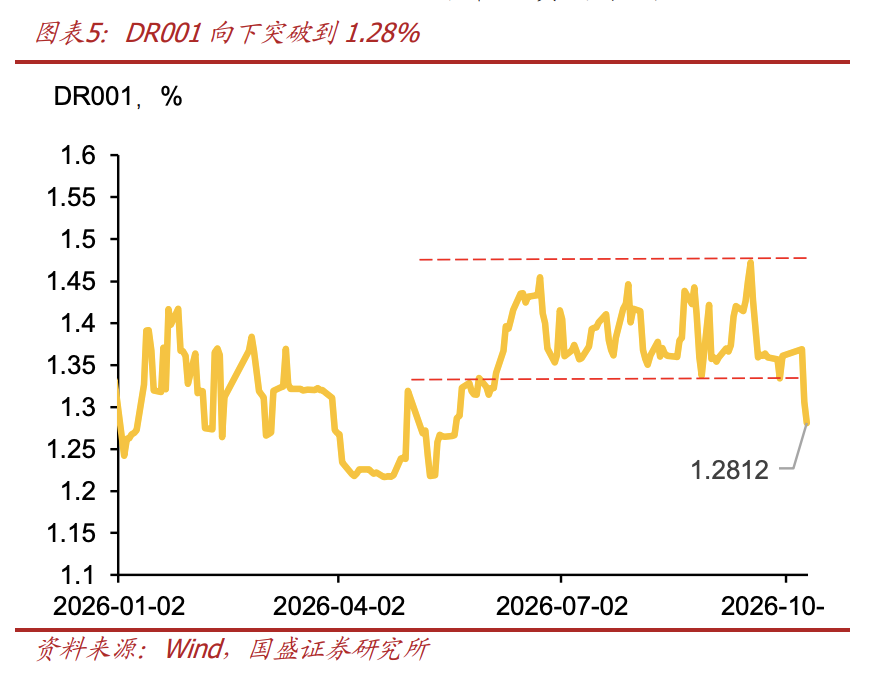
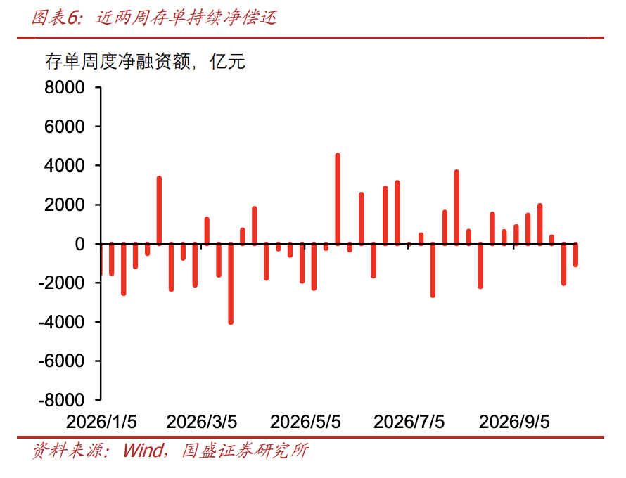
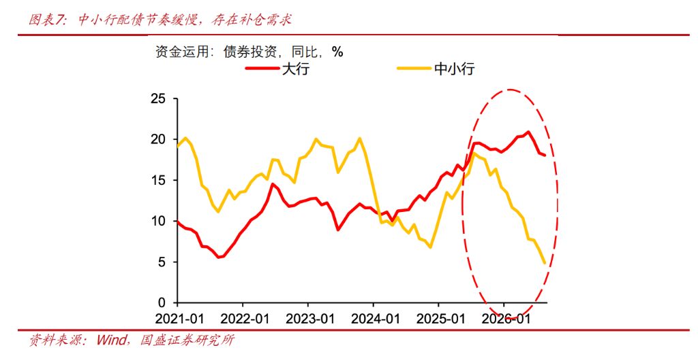

# 节后债市的三个边际变化

- 页面显示时间：2026-10-12T21:28:32+08:00
- 页面署名：李佳
- 标注来源：未单列，见正文
- 原文：[华尔街见闻](https://wallstreetcn.com/articles/3783435)
- 取得时间：2026-11-04T16:03:29+08:00
- [HTML阅读版](article.html) · [来源记录](metadata.json)

## 导语

国盛证券认为，节后债市走强的三大支撑正在显现：资金价格突破此前区间下限，短端利率中枢或进一步下移；同业存单连续净偿还，银行负债融资需求减弱；中小银行债券持仓增速放缓，后续存在补仓空间。据此，10年期国债收益率有望下探至1.6%附近，30年期或接近2.0%，四季度同业存单利率则有望降至1.4%附近。

---

国庆节后三个交易日，债市延续走强，各期限债券收益率普遍下行。国盛证券10月11日发布的报告表示，节后债市出现的三个边际变化，正在为行情延续提供支撑。

具体来看， **资金价格下破此前区间下限，意味着短端利率中枢可能进一步下移；同业存单连续净偿还，反映银行负债融资需求减弱；中小银行债券持仓增速明显放缓，则意味着后续存在补仓空间。** 三者分别作用于资金面、银行负债端和债券配置需求，共同构成债市走强的潜在动力。

基于上述变化，国盛证券判断，债市走强趋势有望延续，10年期国债收益率有望下探至1.6%附近，30年期国债收益率或接近2.0%，四季度同业存单利率则有望回落至1.4%附近。

## 边际变化一：资金价格突破下限，短端利率中枢或下移

节后DR001降至1.28%，创今年5月下旬以来新低，突破了6月以来的震荡区间。

这一变化既与节后资金需求季节性回落有关，也受到央行流动性操作的推动。买断式逆回购超量续作2000亿元，为资金面提供了支撑。 **更值得关注的是，资金价格下破此前的隐性下限，表明央行对短端利率的容忍区间可能有所放宽。**

若DR001持续维持在1.3%附近或以下，短端利率中枢有望进一步下移，并为整体收益率曲线下行打开空间。资金价格能否持续处于低位，是判断这一变化能否延续的关键。

## 边际变化二：同业存单连续净偿还，银行负债压力缓解

同业存单市场已连续两周净偿还：节前一周净偿还2032亿元，节后一周净偿还1083亿元，结束了6月以来大部分时间的净融资状态。

跨季后，银行面临的阶段性指标压力减轻，通过发行存单补充负债、调整负债期限结构的需求随之下降。 **存单净融资持续回落，意味着市场供给压力有望减轻，为存单利率进一步下行提供支撑。**

存单利率回落还可能通过降低银行负债成本，为债券市场提供支撑。若银行融资需求继续下降，存单供给压力减轻将成为推动债市走强的又一因素。

## 边际变化三：中小银行债券持仓偏低，后续存在补仓空间

二季度以来，中小银行持续减持债券。截至今年8月，中小银行债券持有量同比增速降至4.9%，明显低于大型银行的18.0%，9月数据预计将进一步走低。

不过，中小银行持续压缩债券资产的空间有限。在信贷投放承压、同时需要维持利润稳定增长的情况下，银行仍有动力统筹安排资产配置。进入四季度，随着银行着手规划下一年度资产配置，债券可能重新成为增配方向。

中小银行当前偏低的持仓意味着后续配置需求存在回升空间。 **一方面，持仓偏低有望减轻中小银行进一步减持对债市的压力；另一方面，若资金面持续宽松、存单利率继续回落，中小银行增配债券可能成为推动收益率进一步下行的新增动力。** 不过，这一判断仍有待实际配置数据验证。

总体来看，节后债市的三个边际变化各有侧重：资金价格下破区间下限，指向短端利率中枢可能下移；同业存单连续净偿还，反映银行负债融资需求回落；中小银行债券持仓偏低，则意味着后续存在增配空间。三者能否形成持续合力，将影响债市后续的走强幅度。

风险提示及免责条款

市场有风险，投资需谨慎。本文不构成个人投资建议，也未考虑到个别用户特殊的投资目标、财务状况或需要。用户应考虑本文中的任何意见、观点或结论是否符合其特定状况。据此投资，责任自负。
