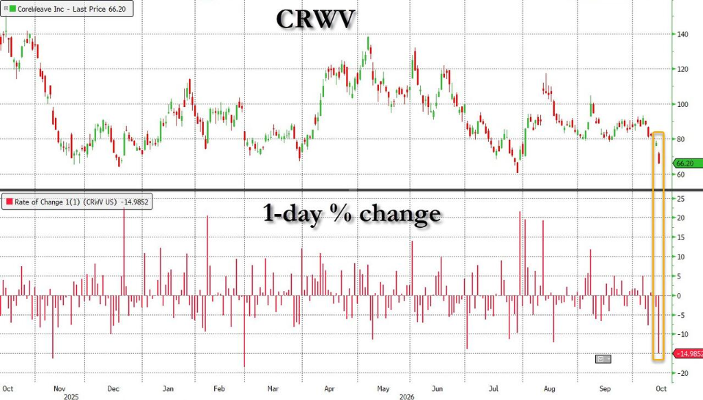

# 英伟达的CoreWeave困局：被迫救援还是坐视不管？

- 页面显示时间：2026-10-15T07:58:58+08:00
- 页面署名：鲍奕龙
- 标注来源：未单列，见正文
- 原文：[华尔街见闻](https://wallstreetcn.com/articles/3783657)
- 取得时间：2026-11-04T16:03:19+08:00
- [HTML阅读版](article.html) · [来源记录](metadata.json)

## 导语

作为CoreWeave的股东兼唯一GPU供应商，CoreWeave股价重挫让英伟达陷入两难困局。救，则每次出手都强化"兜底预期"，抬高下次救援门槛，且难以自拔于这场高杠杆游戏；不救，则CoreWeave流动性危机将直接砍断GPU采购需求，英伟达股权投资同步减值，市场信誉亦受重创。

---

英伟达与CoreWeave之间的财务纠葛，正在演变为一场复杂的博弈论困局。

[华尔街见闻提及](https://wallstreetcn.com/articles/3783644)，周三在通胀数据意外走热、美债收益率上行的双重压力下，数据中心运营商CoreWeave股价重挫逾15%，创下历史第三大单日跌幅，距历史低点仅一步之遥。

知名财经分析师Quoth the Raven（QTR）在ZeroHedge专栏文章中分析称， **随着CoreWeave股价承压、融资渠道收窄，英伟达面临一个棘手抉择：再度出手救援，还是眼睁睁看着这家高度依赖自家芯片的云计算客户陷入流动性危机？**

CoreWeave的麻烦或许不会等到实质性债务违约才浮出水面。股价的持续下跌本身就可能触发恶性循环，股价崩塌动摇市场信心，进而切断外部融资渠道，最终加速流动性危机的到来。

对于CoreWeave这类极度依赖外部资本维系运营的公司而言，股市的剧烈波动足以在违约发生之前就将其逼入绝境。

**这一局面对英伟达的潜在冲击，远不止于一笔投资的账面损失。英伟达此前已通过2.5亿美元的认购订单参与救助CoreWeave缩水后的IPO，此后又追加了数十亿美元的投资，将自身深度绑定于这家公司的命运。**

## 双重角色使英伟达陷入两难

文章指出英伟达与CoreWeave的关系，远比普通投资人与被投公司复杂得多。

英伟达不仅是CoreWeave的股东，更是其核心业务的唯一硬件供应商，CoreWeave借入的数十亿美元债务，本质上是用来采购英伟达芯片的。这种供应商与股东身份高度重叠的结构，使双方的财务利益异常深度捆绑。

**一旦CoreWeave陷入困境，其对GPU硬件的采购需求必然萎缩，这将直接波及英伟达的营收端。与此同时，英伟达在CoreWeave的巨额股权投资也将面临减值压力。**

正是这种双重暴露，制造了一个典型的博弈论困局：救援代价高昂，但不救援的代价可能同样难以承受。

## "不得不救"的逻辑陷阱

市场真正担忧的，并非英伟达是否愿意再度出手，而是它是否会发现自己根本别无选择。

这一逻辑并非没有先例。英伟达在CoreWeave IPO遇冷时出资2.5亿美元认购，外界普遍将其解读为一次信用背书。

这笔投资在当时稳住了市场情绪，但也在客观上为英伟达设定了一个隐性预期，一旦CoreWeave再度告急，英伟达的出手将被市场视为理所当然。

**问题在于，每一次救援都在抬高下一次救援的门槛。若CoreWeave股价进一步下行并触发流动性危机，英伟达届时面临的将不只是一个财务决策，更是一次关乎市场信誉的公关考验。**

## 更大的市场隐忧

CoreWeave个案的警示意义或许远超其自身体量。

这家公司的商业模式，大规模举债购置GPU、以算力租赁形式变现，代表着当前AI基础设施投资浪潮中一类典型的高杠杆路径。

**若这一模式在资本市场收紧、需求增速放缓的背景下遭遇压力测试，其传导效应将波及整条产业链：GPU需求预期、云算力定价、以及投资者对AI基础设施赛道的整体风险偏好，均可能受到冲击。**

对英伟达而言，CoreWeave困局真正的深远影响在于：它将迫使市场重新审视芯片巨头与其下游高杠杆客户之间的风险传导机制，而这一机制，此前在AI泡沫预期最为高涨的阶段，几乎从未被认真定价过。

风险提示及免责条款

市场有风险，投资需谨慎。本文不构成个人投资建议，也未考虑到个别用户特殊的投资目标、财务状况或需要。用户应考虑本文中的任何意见、观点或结论是否符合其特定状况。据此投资，责任自负。
