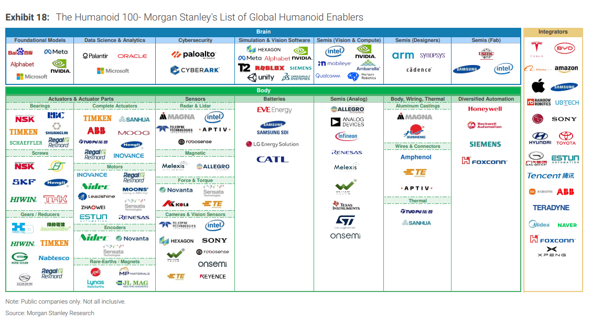
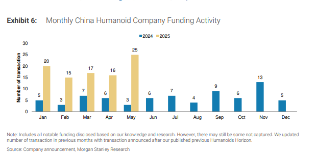

# 苹果、Meta、谷歌...谁将打造人形机器人时代的“安卓”系统？

- 页面显示时间：2025-06-30T18:57:45+08:00
- 页面署名：赵颖
- 标注来源：未单列，见正文
- 原文：[华尔街见闻](https://wallstreetcn.com/articles/3750086)
- 取得时间：2026-11-04T16:03:51+08:00
- [HTML阅读版](article.html) · [来源记录](metadata.json)

## 导语

大摩表示，科技巨头希望通过开源将AI工具扩展到物理世界，同时将开发者更深入地绑定到各自的生态系统中。但目前未来"安卓系统"赢家尚未确定，中国凭借制造业基础和政策支持方面的优势，可能在这场"机器人竞赛"中占据领先地位。预计到2050年全球人形机器人市场年收入可达5万亿美元，累计采用量将达到10亿台，这一规模大约是2024年全球20大汽车制造商总收入的两倍。

---

全球人形机器人市场正值爆发前夜，谁将打造人形机器人时代的“安卓”系统？

据追风交易台消息，摩根士丹利在最新的研报中表示，大型科技公司正在争夺人形机器人领域的生态主导权，过去一个月内Apple、Meta、Google、华为等巨头相继发布开源机器人模型和工具，意图将开发者吸引到各自的机器人生态系统中。

与此同时，中国政府对人形机器人产业的支持力度持续加强，投资基金规模已达1870亿元人民币。大摩分析认为，制造能力和物理智能密不可分，数据获取将决定AI驱动机器人技术的最终赢家。中国在制造业基础和政策支持方面的优势，可能使其在这场"机器人竞赛"中占据领先地位。

根据大摩报告，到2050年全球人形机器人市场年收入可达5万亿美元，累计采用量将达到10亿台。这一规模大约是2024年全球20大汽车制造商总收入的两倍。

截止6月24日收盘，“人形机器人100”指数今年以来上涨14.4%，跑赢标普500指数约11个百分点。其中双林股份涨幅高达148%居首，金力永磁上涨132%。中国公司受到重要关注，体现了中国在人形机器人产业链中的强势地位。

## 科技巨头开源竞争白热化，未来"安卓系统"赢家尚未确定

过去一个月，科技巨头们在机器人领域的开源布局明显加速。这些公司希望通过开源策略，将AI工具扩展到物理世界，同时将开发者更深入地绑定到各自的生态系统中。

> - Meta发布了V-JEPA 2世界模型，拥有12亿参数的AI世界模型，能够“理解、预测和规划物理世界”。
> - Google Deepmind推出Gemini Robotics On-Device，允许公司的Gemini机器人模型在机器人上本地运行，以减少延迟并实现完整性
> - Apple发布了EgoDex灵巧操作数据集，称迄今为止发布的最大和最灵活的灵巧操作数据集。
> - 华为发布了CloudRobo具身智能平台，华为还提出了机器人到云端（R2C）协议，希望让更多机器人能够开发和安全的标准化。

摩根士丹利指出：

> 随着公司将AI投资分散到物理世界，包括硬件领域，其发展速度只会进一步加快。值得注意的是，许多科技公司最近才开始大规模招聘机器人人才。

## 中国政策支持力度空前，汽车公司向人形机器人转型具备天然优势

大摩表示，类似随电动汽车、电池、无人机等领域的支持，中国对人形机器人产业的支持已达到前所未有的高度。

> - 继北京人形机器人半程马拉松赛后，世界首场人形机器人拳击比赛在杭州举办，并在央视全国播出。
> - 政府层面的投资更是大手笔。各级政府已设立总规模约1870亿元人民币的产业基金，用于支持人形机器人价值链发展。其中包括北京100亿元机器人产业发展投资基金、深圳100亿元AI和机器人产业基金等。
> - 武汉市最新宣布设立10亿元人形机器人产业基金，并为人形机器人部署提供双边补贴：应用方最高可获得100万元补贴（占项目投入30%），产品提供方最高可获得100万元补贴（占研发投入20%）。
> - 5月份中国人形机器人公司融资活动达到创纪录的25笔交易，其中宇树科技完成C轮融资，估值达17亿美元，投资方包括吉利、蚂蚁集团、腾讯、阿里巴巴等企业。
>
> 

报告指出，中国在制造业和智能方面的优势不容小觑。制造业和物理智能密不可分，而AI赋能机器人技术的最终障碍是数据获取，这与制造能力直接相关。胜负将由构建和部署数据物理节点（机器人）来收集数据并驱动AI改进飞轮的能力决定。

摩根士丹利中国汽车团队认为，中国汽车公司正准备向人形机器人转型，将人形机器人确定为传统汽车业务的三大挑战之一，另外两个是强化汽车增长和智能汽车发展。

## 商业化部署提速，2050年或达到5万亿美元规模

大摩例举了一系列商业部署案例：

> 富士康和英伟达正在讨论在休斯顿新建的AI服务器制造工厂中部署人形机器人，预计协议将在未来几个月内敲定，机器人将在2026年一季度工厂开始生产NVIDIA GB3000服务器时投入使用。
>
> 亚马逊正在开发必要系统，使人形机器人能够作为配送工人运营，并将在不久的将来开始实际测试。测试将包括Unitree G1等多种机器人，这些机器人将通过Rivian电动货车运送到配送地点。
>
> 现代汽车预计在其美国工厂部署Atlas人形机器人，而特斯拉继续预期年底前生产"数千台"Optimus人形机器人，用于部署在自己的工厂。

大摩表示，这些部署计划显示，人形机器人正从概念验证阶段快速迈向实际商业应用。特别是在制造业和物流领域，人形机器人实现了显着的效率并降低成本。

根据摩根士丹利的全球人形机器人TAM模型，预计到2050年全球人形机器人市场年收入将达到近5万亿美元，累计部署约10亿台人形机器人。这一规模约为2024年全球20大汽车制造商总收入2.5万亿美元的两倍。

按收入分类：预测到2036年，约2370万台人形机器人将被采用；到2040年，这一数字将达到1.344亿台；到2044年，将有4.28亿台人形机器人开始投入使用。高收入国家的平均售价将从预计2024年的20万美元下降到2040年的5万美元。

总的来看，人形机器人市场正处于历史性拐点，科技产业的生态竞争、政府政策支持、商业化应用落地以及资本市场认可，共同推动这一万亿美元级别的新兴产业快速发展。

 

 

 

\~\~\~\~\~\~\~\~\~\~\~\~\~\~\~\~\~\~\~\~\~\~\~~

以上精彩内容来自[追风交易台](https://mp.weixin.qq.com/s/uua05g5qk-N2J7h91pyqxQ)。

更详细的解读，包括实时解读、一线研究等内容，请加入【 [**追风交易台▪年度会员**](https://wallstreetcn.com/shop/item/1000309) 】

追风交易台由华尔街见闻和智堡联合打造；

风险提示及免责条款

市场有风险，投资需谨慎。本文不构成个人投资建议，也未考虑到个别用户特殊的投资目标、财务状况或需要。用户应考虑本文中的任何意见、观点或结论是否符合其特定状况。据此投资，责任自负。
