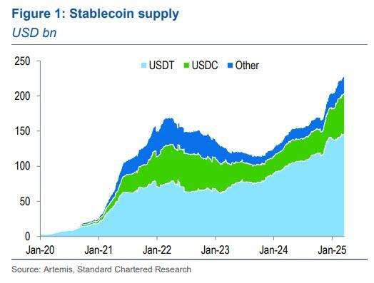

# 讽刺！“美元霸权”的希望竟然会是“颠覆美元”的币圈？

- 页面显示时间：2025-04-16T08:53:10+08:00
- 页面署名：鲍奕龙
- 标注来源：未单列，见正文
- 原文：[华尔街见闻](https://wallstreetcn.com/articles/3745289)
- 取得时间：2026-11-04T16:03:50+08:00
- [HTML阅读版](article.html) · [来源记录](metadata.json)

## 导语

随着GENIUS法案有望今夏获批，稳定币的供应量将从当前2300亿美元暴增至2028年底的2万亿美元，这不仅将每年吸纳4000亿美元国债，更将通过币圈这一"反建制"阵营，反向强化美元在全球金融体系中的主导地位。

---

在特朗普打击外界对美国主权信心、全球去美元化言论甚嚣尘上之际，一个意想不到的力量正在暗中支撑美元霸权：稳定币。

近期渣打银行发表研报称，美国国会即将通过的GENIUS法案，将使稳定币供应在未来四年内增长近10倍，每年将吸纳4000亿美元国债，并可能成为美元全球主导地位的新支柱。按照这一预测， **稳定币发行商将成为仅次于货币市场基金的第二大美国短期国债持有者** 。

《GENIUS法案》明确了美国对稳定币的监管规定，该法案已于3月获得参议院银行委员会的批准。这一法案将为稳定币——这种通常与美元等法定货币挂钩、旨在降低价格波动性并便于交易的数字资产——提供明确的监管框架。

渣打银行指出，目前全球稳定币供应量约为2300亿美元，其中60%在以太坊网络上，30%在波场(Tron)网络上。市场由USDT(Tether发行)和USDC(Circle发行)主导，分别占据63%和25%的市场份额。

## 数字美元：美元霸权的意外救星

渣打银行分析师称，稳定币的使用场景正在从最初的加密货币交易平台扩展到更广泛的传统金融领域。一旦GENIUS法案通过：

> - 非交易所相关的稳定币使用将从目前的年增长率50%跃升至100%。
> - 整体稳定币交易量从当前每月约7000亿美元增长7倍至2028年底的约6万亿美元。
> - **届时稳定币交易将占外汇现货市场交易量的10%，远高于目前的约1%。**

此外渣打银行强调， **这一爆发式增长将使稳定币供应量从目前的2300亿美元膨胀至2028年底的约2万亿美元** 。随着稳定币供应量的增加，对美元计价的稳定币储备需求将创造更多美元需求。美联储沃勒在去年2月15日曾指出：

> 分散金融(DeFi)中的大多数交易涉及使用稳定币，这些稳定币将其价值与美元一比一挂钩。约99%的稳定币市值与美元挂钩，这意味着加密资产实际上是以美元进行交易的。因此，DeFi世界交易的任何扩展可能只会加强美元的主导地位。

渣打银行认为，稳定币行业将逐渐采用类似Circle(USDC稳定币的发行和管理公司)的储备模型——其88%的储备投资于平均期限为12天的美国短期国债。而且GENIUS法案要求持有期限不超过93天的资产，考虑到稳定币发行商可能希望避开美联储议息会议前后的风险，Circle较短的持仓期限可能成为行业未来的标准。

风险提示及免责条款

市场有风险，投资需谨慎。本文不构成个人投资建议，也未考虑到个别用户特殊的投资目标、财务状况或需要。用户应考虑本文中的任何意见、观点或结论是否符合其特定状况。据此投资，责任自负。
