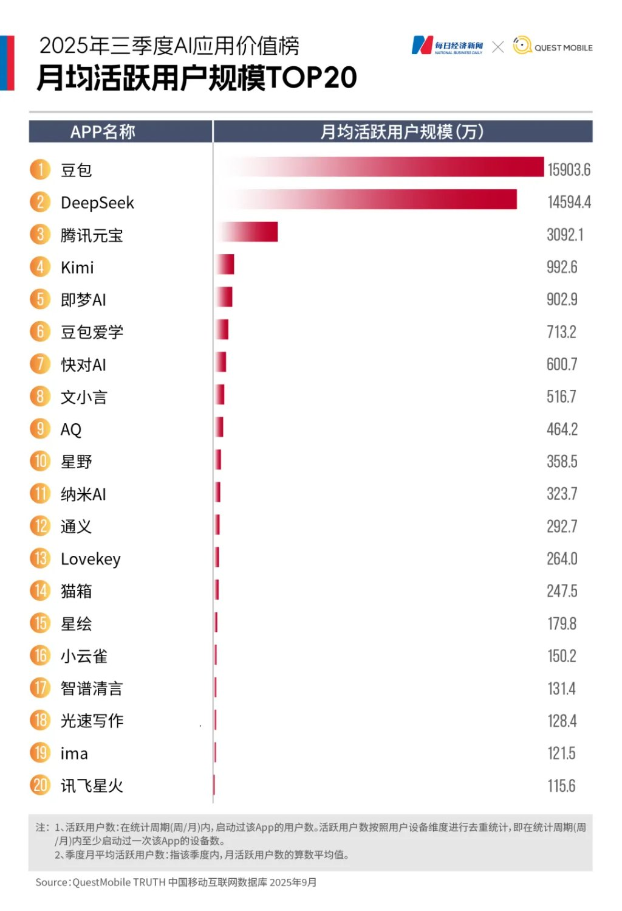
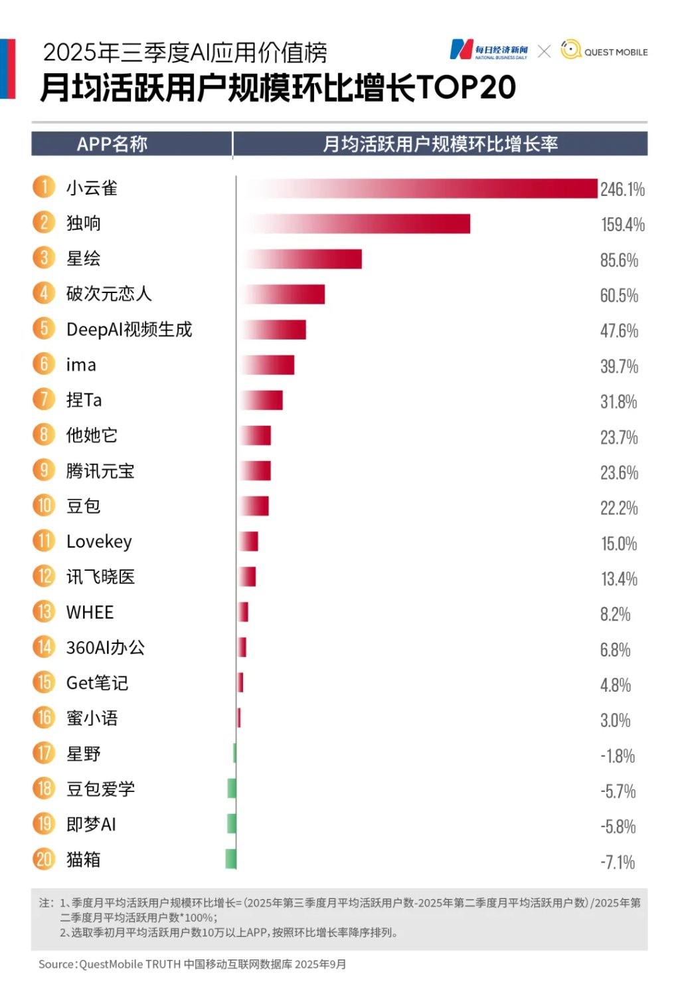
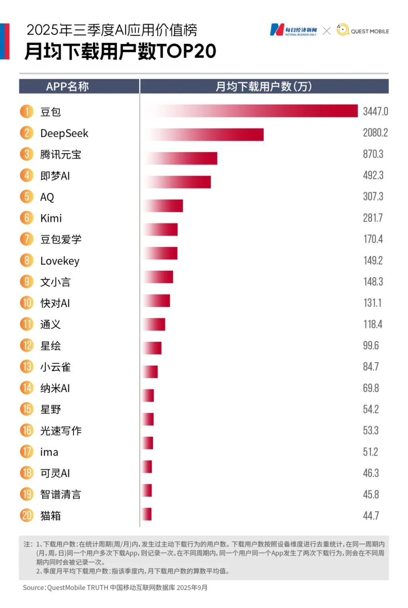
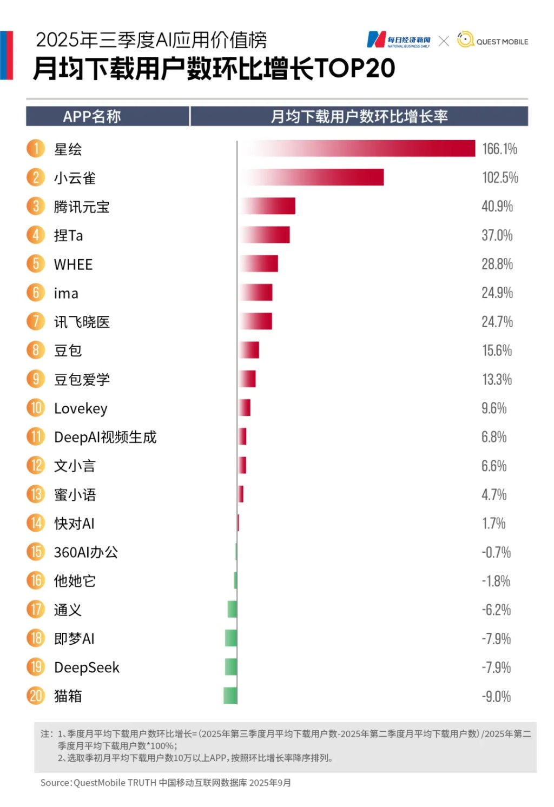
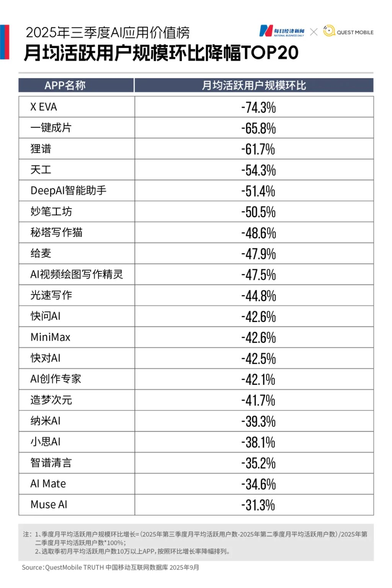
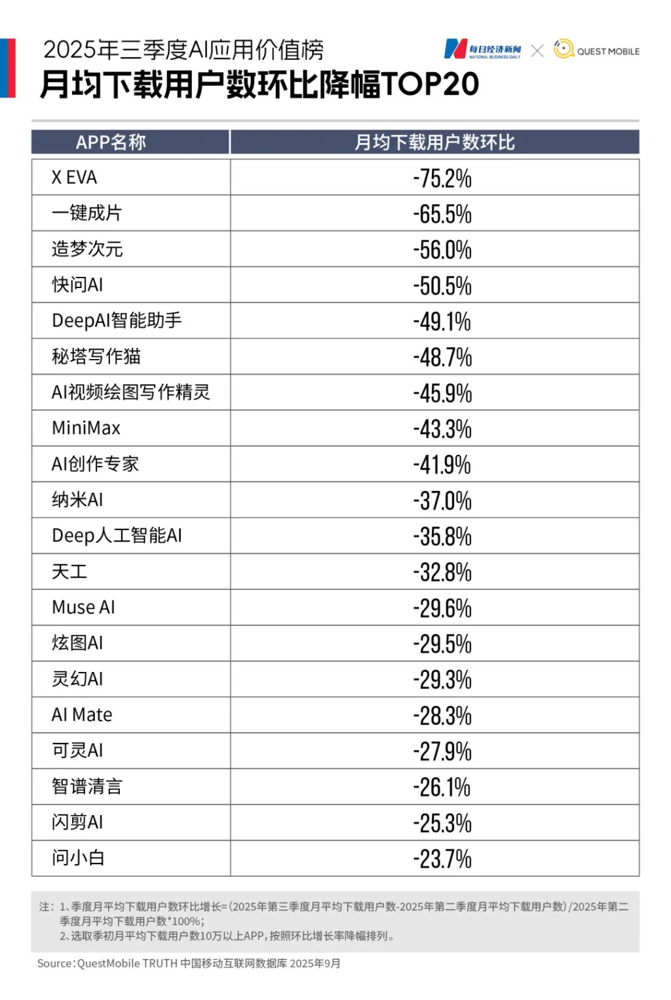

# 豆包月活首超DeepSeek登顶，即梦、可灵、智谱、Kimi集体下滑，“AI+医疗”异军突起

- 页面显示时间：2025-10-29T14:54:10+08:00
- 页面署名：董静
- 标注来源：每日经济新闻
- 原文：[华尔街见闻](https://wallstreetcn.com/articles/3758159)
- 取得时间：2026-11-04T16:03:52+08:00
- [HTML阅读版](article.html) · [来源记录](metadata.json)

## 导语

2025年三季度AI应用市场两极分化加剧。豆包月活增长22.2%至1.59亿，首次超越DeepSeek成为双料冠军；DeepSeek月活下滑14%，陷入"孤岛困境"。Kimi、智谱清言、MiniMax等"AI四小强"集体下滑，面临成本压力被迫收费或转型。蚂蚁集团AQ等"AI+医疗"应用异军突起，月活达464万。

---

2025年第三季度，AI应用市场呈现出明显的两极分化。《每日经济新闻》联合QuestMobile推出《2025年三季度AI应用价值榜》，基于月均下载量与月活跃用户数（以下简称“月活”）两大核心指标，揭示AI应用“下半场”的新变局。

数据显示，AI应用“王座”易主。字节跳动旗下豆包月活环比增长22.2%至1.59亿，月均下载量达3447万，首次超越DeepSeek，成为月活与下载量的双料冠军。

“AI四小强”中的Kimi、MiniMax、智谱清言均面临下滑。三季度榜单上的“新黑马”，如小云雀、AQ等，无一例外出自大厂。

对此，QuestMobile研究总监陈燕对《每日经济新闻》记者（以下简称“每经记者”）表示，大厂们正充分利用其庞大的流量、数据和场景，初创AI企业如何在巨头“缝隙”中找到不可替代的价值，这是摆在它们面前的关键挑战。

## “王座”易主：豆包全面登顶 DeepSeek“失血”加剧

三季度，DeepSeek和豆包依旧占据通用AI助手市场的绝大部分份额，但两者位次发生逆转，且差距有拉大趋势。字节跳动的生态优势在本季度展现了强大的“飞轮效应”。

**◆ 数据洞察**

**豆包：** 三季度月活达1.59亿，相较于二季度的1.3亿环比增长22.2%， **首次超越DeepSeek成为月活冠军。** 其月均下载量也从二季度的2981.3万增长15.6%至3447万，稳固了下载榜第一的位置。

**DeepSeek：三季度“失血”加剧。** 其月活从二季度的近1.7亿环比下滑14%至1.46亿。月均下载量也从2258.9万环比下降7.9%至2080.2万。

**腾讯元宝：** 三季度表现稳健。月活从2502.5万环比增长23.6%至3092.1万， **守住行业第三** 。下载量也从617.5万环比增长40.9%至870.3万。

**◆ 数据解读**

（1）豆包的“生态飞轮”： **豆包的登顶得益于字节跳动“通用平台+垂直爆款”策略。** 豆包将抖音、剪映等生态流量沉淀为自身用户，并通过主App的通用能力反哺各垂直场景，形成了生态循环。

（2）DeepSeek陷入“孤岛困境”：作为通用型智能问答产品， **DeepSeek缺乏强大生态场景依托的“孤岛困境”在本季度被急剧放大。**

> ● 技术迭代迟缓：在年初出圈后，市场一直对DeepSeek的大版本更新（如V4或R2模型）抱有极高期待。 **然而，整个三季度，DeepSeek仅进行了V3.1、V3.2等小版本迭代。**
>
> ● 竞争者发起正面挑战：7月新上线的Kimi K2模型，不仅开源，更号称在DeepSeek擅长的代码、数学推理任务上实现了反超。在价格上，Kimi K2也完全对齐了DeepSeek的API价格体系。此外，MiniMax-M1模型也展示了极低的训练成本，仅需53万美元，对比 DeepSeek V3 的557万美元优势明显。
>
> ● 多模态功能“踏空”： **对比其他主流AI助手，DeepSeek是唯一暂不支持多模态功能的应用。** 当豆包、元宝等对手依托生态大玩AI生图、AI视频时，DeepSeek的纯文本形态，使其在办公、学习之外的泛娱乐场景中难以留住用户。

## “AI四小强”：智谱、MiniMax、Kimi集体下滑 阶跃星辰策略转向

独立AI助手的生存空间正持续收窄。在主流AI智能助手应用中，豆包（月活1.59亿）和DeepSeek（月活1.46亿）合计占据该赛道近88.4%的月活用户规模。 而“AI四小强”则面临艰难求生的局面。

**◆ 数据洞察**

**Kimi：** 继二季度加速下滑后，三季度跌势不止。 **其月活从二季度的1407.2万环比下降约30%至992.6万，已跌破千万大关** 。月均下载量环比下跌20.2%。

**智谱清言：** 月活环比下降35.2%，下载量环比下降26.1%。

**MiniMax：** 月活环比下降42.6%，月均下载量环比骤降43.3%。

◆ 数据解读

**（1）Kimi：迫于成本压力，开启C端收费**

Kimi的月活下滑，与其说用户流失，不如说是其在巨额成本压力下的主动战略收缩与客群筛选。

> ● 高成本难以为继：Kimi的核心竞争力是“长文本处理”，但也是其最沉重的成本负担。 **海量的Token消耗导致算力成本增长。**
>
> ● 从工具转向“智能体”：Kimi在三季度密集“亮剑”：先是发布Kimi K2-0905版本，强化编程能力以吸引高价值的开发者用户；随后，又在9月底推出全新Multi-Agent产品“OK Computer”，使其能独立完成网站开发、数据分析、PPT制作等复杂任务。
>
> ● 启动付费：伴随“OK Computer”上线的，是Kimi大胆启动的会员付费制度。

**（2）智谱AI：IPO前曝裁员风波**

● 按照之前的计划，智谱AI预计将于10月完成全部辅导工作。如果顺利，智谱AI将成为第一家正式启动IPO流程的大模型创业公司。

然而，在进入IPO冲刺期的同时，智谱AI陷入了裁员争议，有消息称，这波调整将陆续裁员近百人，其中很多都是9月下旬被突然通知，不少员工的期权问题也悬而未决。对此，智谱AI回应称 **，目前公司涉及产品和研发相关部门运转正常，组织调整涉及人员十余人** ，且有近50个岗位需求待招。

在这之前，包括前首席运营官张帆等高管离职。有分析称， **人员震荡的背后，是智谱AI将G端（政府）与B端（企业）资源进行全面整合的深层战略考量** ，意在高效吸纳与B端客户关联的潜在G端资源，实现能力协同。

**（3）MiniMax：主攻智能体**

● MiniMax创始人闫俊杰表示， **公司最重要的目标不是增长或收入，而是加速技术迭代，其中AI智能体是发力重点之一。** 7月16日，MiniMax发布了全球首个复杂全栈网站应用高交付率智能体。知情人士透露，MiniMax即将完成近3亿美元新融资，估值超40亿美元，并正寻求A股上市。

**（4）阶跃AI：三季度未上榜**

**●** 今年6月，阶跃星辰对C端业务进行了调整，公司对产品进行收敛， **重心转向终端Agent（智能体）上** 。

## “AI+场景”大洗牌：作业帮旗下快对AI月活大降42%，“AI+陪伴”现关停潮，蚂蚁AQ横空出世

三季度的“AI+场景”赛道上演大洗牌。二季度的热点赛道迅速降温，而内容智能体和AI医疗异军突起。

**（1）“AI+教育”集体降温，或受暑期冲击**

一度被视为刚需的 **“AI+教育”赛道，在三季度集体“熄火”** 。

**数据表现：作业帮旗下的快对AI在三季度月活环比下降42.5%至600.7万。字节旗下的豆包爱学月活也从756.2万环比下降5.7%至713.2万。**

**现象解读：** 教育辅导作为“刚需”的逻辑并未改变，三季度的集体下滑大概率源于“暑期效应”。三季度恰逢学生暑假，导致搜题、批改作业等高频学习任务需求锐减，也说明了此类应用与学习场景的强绑定关系。

**（2）内容智能体异军突起**

**数据洞察：** 字节旗下内容创作智能体 **小云雀三季度月活环比增长246.1%，登顶月活增长榜** 。其下载量也环比增长102.5%，位列增长榜第二。

**数据解读：小云雀的成功关键在于它不是单纯的“聊天机器人”，而是“干活的工具人”。** 小云雀将自己定位为一款“内容创作智能体”，依托于字节强大的模型能力， **力争实现“一句话打造一个爆款”** 。用户仅需输入一个主题或一句话，小云雀便能自动完成文案生成、AI配音、素材匹配和视频剪辑的全流程，一键生成短视频，精准解决了短视频创作者在构思、制作、剪辑上的核心痛点。

**（3）“AI+医疗”成新刚需，蚂蚁集团AQ横空出世**

**数据表现：蚂蚁集团旗下AI健康应用AQ在三季度“空降”榜单，月均下载量达307.3万，高居下载量总榜第五** ； **月活达464.2万，位列总榜第九。讯飞晓医月均下载量同比增长24.7%，月活同比增长13.4%。**

**数据解读：** 医疗健康是比教育更具普适性的“刚需”场景。AQ能冲上高位，因其在AI问诊、健康管理、报告解读等方面提供服务，迅速抓住用户痛点。这是“AI+生产力”向生活服务领域的关键延伸。

● 生态流量的“闪电战”：AQ的迅速崛起，首先得益于蚂蚁集团不遗余力的推广。 **三季度，AQ的广告登上了支付宝首页，获得了海量曝光。**

● 精准切入“泛健康”刚需： **AQ能留下464万月活，在于其精准的产品定位——“AI健康助理”。** 它避开了高风险、强监管的AI诊断领域，转而解决用户最高频的“信息看懂”痛点，如一键解读体检报告、分析药品说明书、翻译化验单等。

**（4）AI视频/图像与AI陪伴：即梦、可灵下滑，AI陪伴产品现“关停潮”**

**AI视频/图像：** 二季度“一家独大”的 **即梦AI在三季度月活环比微降5.8%** 。 **可灵AI三季度下载量继续环比下滑27.9%。** 但新玩家如字节旗下的 **星绘月活环比增长85.6%，下载量增长166.1%** ；美图旗下的WHEE月活环比增长8.2%，下载量增长28.8%。

**数据解读：** 这表明市场已越过“通用AI生图/视频”的尝鲜期，转向更垂直、更具工具属性的细分场景。

● **星绘：其爆发在于精准定位“专注于AI人像的创作工具”。** 它提供AI分身、让照片动起来、AI换装等功能，通过极低门槛（一句话P图）将生态流量转化为应用留存。

●  **WHEE：** 其定位是“高品质AI素材生成器”， **目标用户是设计师和专业创作者。其核心壁垒在于背靠美图旗下的设计创意平台站酷，** 为设计师提供了从“AI创作”到“曝光收益”的完整生态闭环。

**AI陪伴：** 三季度，MiniMax旗下星野月活微降1.8%，但北京暴裂果实科技有限公司旗下的 **独响月活环比增长159.4%** ，网易推出的 **破次元恋人月活环比增长60.5%** 。尽管该赛道不乏亮眼数据，但值得注意的是， **一批AI社交公司近期悄然关停或发布了停业通知。**

**现象解读：** 数据表明，用户需求依然强劲，但正被新模式快速分流。市场厌倦了同质化的“AI聊天”，转而投向差异化路径：

● 情感创新：北京暴裂果实科技有限公司旗下的 **独响精准抓住了“i人”（内向者）的社交痛点** 。创始人王登科表示，产品采用类似朋友圈的“异步交互”，用户发布的心情会在未来某个时刻收到AI的回复，这种机制被用户盛赞为创造了“活人感”，目标是建立“长期的、积极的关系”。

● 游戏化：网易带来了 **“游戏化”打法** ，旗下产品破次元恋人更像一个“AI聊天应用合集”，用户可以扮演角色，与AI进行“双人剧本杀”，并通过“羁绊值”解锁剧情。

● 关停潮：近期， **一批“AI+陪伴”产品正在悄然退出市场，包括阶跃星辰ToC产品冒泡鸭和Soul旗下AI应用异世界回响等。小冰旗下的X Eva也从9月17日起关闭了充值和新用户注册渠道。**

产品关停的背后有公司的主动求变。例如，阶跃星辰选择关停冒泡鸭，即是希望在新的竞争形势下重新寻找自身定位、寻觅差异化突围路径。

## 趋势解读：独立App的窗口期正在收窄 生态壁垒提高

《2025年三季度AI应用价值榜》表明，AI应用市场已彻底告别“广撒网”的流量竞争，进入了“生态绞杀”与“场景深耕”的全新阶段。

●  **趋势一：AI应用从“能聊”走向“能干”。** QuestMobile研究总监陈燕向每经记者表示，AI应用的竞争核心正从模型能力转向任务闭环能力。用户不再满足于聊天，而是需要能干活的AI。AI应用的价值不再是“纯工具”，而是必须有明确的落脚点并形成服务闭环。

●  **趋势二：“刚需”场景垂直深耕，新蓝海不断涌现。** “AI+教育”的季节性波动和“AI+医疗”的强势崛起，证明了“AI+生产力”仍是核心增长极。陈燕指出，目前所有垂直领域都还没有彻底爆发，因此都存在机会。竞争的关键已不在于“占领”哪个赛道，而在于如何“深耕”。AI应用必须回到用户的视角，将技术与用户生活的真实场景深度结合。最终，能否让用户感知并真正体验到应用的核心价值，将是决定垂直应用成败的关键。

●  **趋势三：生态壁垒空前提高，“AI四小强”夹缝求生。** 三季度榜单上的“新黑马”——小云雀（字节）、AQ（蚂蚁）、ima（腾讯）——无一例外均出自大厂生态，大厂们正在充分利用其庞大的流量、数据和场景。对于“AI四小强”（智谱AI、MiniMax、Kimi和阶跃星辰）等初创AI企业，如何在巨头“缝隙”中找到不可替代的价值，是摆在面前的关键挑战。

陈燕表示， **独立App的窗口期正在收窄。** 头部的互联网企业在C端拥有天然的“基因”优势，包括成熟的运营经验、生态积累和流量打法。而独立AI厂商在这方面则相对欠缺。这些独立AI厂商未来的机会可能更多在于B端的企业服务。

本文作者：宋欣悦，来源：[每日经济新闻](https://mp.weixin.qq.com/s?__biz=Mzg3NTA5MjkyNQ==&mid=2248484015&idx=4&sn=1600da696fe0fd5296a35f54cd429c5f&chksm=ccd55f4dc4362a9be2bec2a71790dc5ff1151ab9c3bf3c7bcd313def7b6b6966bc5163c2513e&scene=0&xtrack=1?clueId=4064777716)，原文标题：《豆包月活首超DeepSeek登顶，即梦、可灵、智谱、Kimi集体下滑，“AI+医疗”异军突起｜2025年三季度AI应用价值榜》

风险提示及免责条款

市场有风险，投资需谨慎。本文不构成个人投资建议，也未考虑到个别用户特殊的投资目标、财务状况或需要。用户应考虑本文中的任何意见、观点或结论是否符合其特定状况。据此投资，责任自负。
