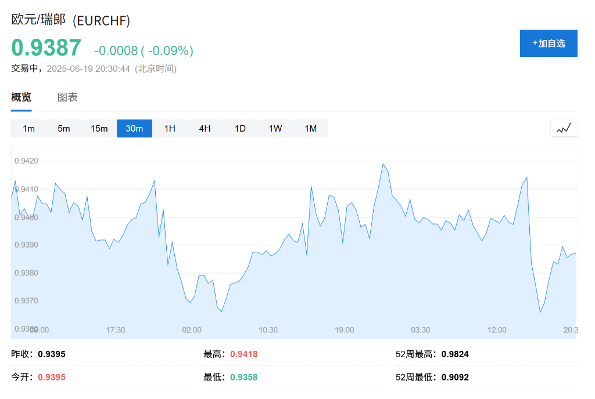

# 负利率“幽灵”重现？瑞士央行降息至零利率，暗示或进一步放松以阻止资金流入

- 页面显示时间：2025-06-19T20:39:49+08:00
- 页面署名：张雅琦
- 标注来源：未单列，见正文
- 原文：[华尔街见闻](https://wallstreetcn.com/articles/3749464)
- 取得时间：2026-11-04T16:03:24+08:00
- [HTML阅读版](article.html) · [来源记录](metadata.json)

## 导语

瑞士央行周四宣布降息25个基点至零利率，不仅结束了瑞士长达两年半多的正利率时代，也创下了主要央行的最低基准利率水平。特朗普政策担忧下，瑞士法郎在过去一个季度升至十年来对美元的最高水平。央行暗示，如有必要，将准备进一步采取行动，以阻止瑞郎持续走强。

---

瑞士央行将利率降至零，并暗示可能重返负利率时代。这一激进举措背后，是瑞士法郎避险需求激增对该国通胀和经济的致命冲击。

**瑞士央行周四宣布降息25个基点至零利率，这是该行连续第六次降息行动。** 央行行长Martin Schlegel表示，此举旨在对抗"通胀压力下降"，并强调央行"将继续密切监控形势，必要时调整货币政策"。

此次降息至零， **不仅结束了瑞士长达两年半多的正利率时代，也创下了主要央行的最低基准利率水平。** 调查显示，大多数经济学家预期了这一降息决定，但仍有少数分析师此前预计央行可能采取更激进的50个基点降息。

特朗普政策担忧下，瑞士法郎在过去一个季度升至十年来对美元的最高水平。瑞士央行暗示， **如有必要，将准备进一步采取行动，以阻止瑞郎持续走强。** Schlegel还承认，此次降息使借贷成本"接近负利率区间边缘"：

> "我们也意识到负利率确实具有不良副作用，对许多经济主体构成挑战"。

## 特朗普效应的连锁反应：负利率“幽灵”重现

这一降息决定凸显了美国总统特朗普对全球贸易的冲击如何波及瑞士。Schlegel及其同事早在3月份还暗示可能结束宽松政策， **但瑞士法郎作为避险货币的角色迫使他们改变立场。**

**投资者对美国政策剧变的担忧推动瑞士法郎在过去一个季度升至十年来对美元的最高水平，并将通胀推至2021年初以来首次跌破零。** 自4月以来，受美元广泛抛售带来的需求推动，瑞士法郎一直在0.92附近区间交易。今年迄今，法郎对一篮子货币已升值近2%。

消息公布后，瑞郎兑欧元汇率一度上涨至日内高点0.9387。

此次降息至零，不仅结束了瑞士长达两年半多的正利率时代，也创下了主要央行的最低基准利率水平。

彭博经济学家Jean Dalbard表示：

> "考虑到贸易、增长和货币的高度不确定性，瑞士央行的下一步行动难以预测， **但总体而言，我们预计9月份将再降息25个基点，将政策利率推入负区间。** "

ODDO BHF的经济学家也认为，9月份再次降息25个基点的可能性很高。他们表示，这种“负利率的回归旨在遏制瑞郎升值并提振国内信贷。瑞士央行可能会重新引入部分豁免机制以保护国内银行，同时对外国资本流动产生更直接的影响。”

**周四，瑞士股市下跌多达1.1%。** 尽管较低的利率有助于出口商，但强势瑞郎、零利率和平坦的收益率曲线往往对银行和金融股构成不利影响，而这些股票约占市场基准的五分之一。

## 瑞士央行：如有需要，准备干预外汇市场

削弱瑞郎的另一种方式是重启货币干预，但这本身也带有风险。特朗普第一任期内，美国曾将瑞士列为汇率操纵国，本月早些时候，美国财政部再次将瑞士列入汇率政策监测名单。

尽管Schlegel表示： **瑞士央行仍"愿意在必要时积极参与外汇市场"** ，但最新数据显示，2024年瑞士央行几乎没有进行干预。他还坚称瑞士央行没有汇率目标，但强调“外汇干预仍是重要的工具”。

## 通胀前景持续疲软

目前，以色列与伊朗爆发敌对行动后原油价格的上涨可能有助于支撑物价，从而减轻瑞士央行的压力。

尽管如此，瑞士央行的通胀前景预测仍指向疲软的消费者价格压力，这可能会让官员们感到担忧。 **周四，他们下调了今年的通胀预测，预计2025年平均为0.2%，** 2026年为0.5%，2027年为0.7%，此前分别为0.4%、0.8%和0.8%。

瑞郎走强再次发挥了作用：由于石油以美元计价，当瑞士货币升值时，瑞士的石油价格就会下跌。许多其他进口商品价格也趋于下降。

出乎一些人的意料，尽管美国征收关税，瑞士央行仍维持了对瑞士经济的展望不变。在上一季度因出口前置而实现两年来的最强劲扩张后， **瑞士央行仍预计今年经济增长将在1%-1.5%之间** 。本周早些时候，政府公布的预测为1.3%。

7月9日将近，Schlegel在接受彭博电视采访时表示，此类关税"可能对瑞士经济产生影响，但很难看出确切程度，因为瑞士几乎每家企业受到的影响都不同"。他拒绝透露这是否可能触发瑞士央行的紧急降息行动。

风险提示及免责条款

市场有风险，投资需谨慎。本文不构成个人投资建议，也未考虑到个别用户特殊的投资目标、财务状况或需要。用户应考虑本文中的任何意见、观点或结论是否符合其特定状况。据此投资，责任自负。
